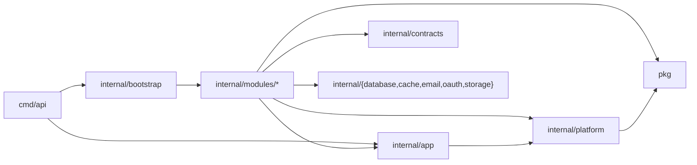

# CLAUDE.md

Guidance for agents working in this repository. Detail lives in `docs/`; this
file keeps the invariants you must not break. There is no deployed database
and no released API yet: nothing here keeps a compatibility shim, and a change
replaces the old design outright.

## Build & Run

```bash
make build                 # bin/server + bin/migrate + bin/seed (.exe on Windows)
make build-dev             # same with -tags dev (loads .env); used by `make watch`
make migrate-run           # apply pending migrations via cmd/migrate
make migrate-down CONFIRM=yes  # drops the whole schema; disposable DBs only
make run                   # migrate, then run the API locally (-tags dev)
make seed                  # migrate (dependency) then seed the admin user
make test                  # unit tests
make test-race             # unit tests with -race (needs cgo; use Docker on Windows)
make test-integration      # integration tests (Testcontainers or TEST_DATABASE_URL)
make check                 # vet + lint + arch tests + unit tests
make lint                  # golangci-lint v2
make docker-run / docker-down
make sqlc-generate         # every internal/modules/*/sqlc.yaml (no root sqlc.yaml)
make openapi               # regenerate docs/openapi.yaml (OpenAPI 3.1) from the huma operations
make gen module=<name>     # cmd/gen: module | resource=<r> | command=<Name> | query=<Name> (+ module=<m>)
```

Production build: `CGO_ENABLED=0 go build -ldflags="-s -w" -trimpath -o server ./cmd/api`.
Release binaries never read `.env` (only `-tags dev` builds do; `test/arch`
checks it). `scripts/rename-module.sh <path>` rewrites the module path.

CI: gofmt, golangci-lint, `docs/openapi.yaml` and sqlc output up to date,
build of the three binaries, unit/integration/race tests, the `Migrations` job
(init up/down on a fresh PostgreSQL, `cmd/migrate` twice, forced-RLS table
count derived from the schema), and `Manifests` (actionlint, kustomize,
kubeconform, api/worker split checks). On pull requests `API compatibility`
runs `oasdiff breaking` on the base and PR `docs/openapi.yaml` and fails on
ERR findings; an intentional break is acknowledged by editing
`docs/api-breaking-changes.md` in the same PR. Every downloaded CI tool is
checksum-verified. `release.yml` publishes only from `v*` tags: it pushes the
multi-arch distroless image, Trivy-scans each platform digest (CRITICAL/HIGH
with fixes fail), then cosign-signs it and attaches SLSA build provenance.
`deploy.yml` authenticates with OIDC, verifies the signature (identity:
`release.yml` on `refs/tags/v*`) and rolls out by digest; pre-release tags
never auto-deploy to production. Kubernetes: follow `deploy/k8s/README.md`
(migration Job, seed Job, then the api and worker Deployments; secrets come
from ExternalSecrets).

## Architecture

**Modular monolith.** One deployable (run as `api`, `worker`, or `all`);
modules own their operations and tables; platform packages own cross-cutting
mechanics.



Arrows are the only allowed import directions; a module never imports another
module, and `platform`/`pkg` never import modules. `pkg/` holds only packages
with no dependency on the app (`config` included); anything that reads app
configuration lives under `internal/`.

| Path | Role |
|------|------|
| `cmd/api` | Owns the pools and infra, calls `bootstrap.Build`, lifecycle, graceful shutdown |
| `internal/bootstrap` | The single ordered module list + contract wiring (shared with `test/arch`) |
| `cmd/migrate` + `internal/migrate` | The only schema migrator; `internal/migrate` verifies the schema and writes the snapshot |
| `cmd/seed` | The only seeder (tenant `owner` + `platform_admin`); Kubernetes runs it as the one-shot `deploy/k8s/seed` Job |
| `cmd/openapi` | Writes `docs/openapi.yaml` from the same huma API the server builds (no database) |
| `cmd/gen` | Module/resource/command/query generator |
| `config` | One file per concern; `Config.Validate` reports every violation (`errors.Join`) |
| `internal/app` | Fiber app, global middleware, huma API, module registry, provider hooks, `app.Infra`, `app.Deps` |
| `internal/modules/<m>` | `module.go` (operations + providers), `build.go`, `catalog/` (permissions, error codes, flags, locales), `dto`/`handler`/`service`/`repository`, `queries/` + generated `sqlc/`. Modules: identity (service split into `core`, `authn`, `mfa`, `membership`, `tenancy`, `privacy`), files, features, notifications, admin (stats, contracts only), webhooks, apikeys |
| `internal/contracts/<provider>` | Contracts per providing module (stdlib + `google/uuid` only): identity, files, notifications, privacy (GDPR exporter/eraser registry), tenancy (tenant `Purger` registry) |
| `internal/platform` | apikey, audit, authz, banhash, events, features, httpapi, i18n, jobs, logging, middleware, requestctx, scheduler, session, tenant, tracing |
| `internal/{database,cache,email,oauth,storage}` | Config-aware drivers (pgx pools/Scoped/TxManager, memory/Redis cache, console/SMTP, Google OAuth, storage drivers incl. `s3store`) |
| `pkg` | apperror, health, keyring, logger, metrics, pagination, patch, storage (interface + local), token, totp, validator, webhook |
| `migrations` | one init pair `20260101000000_platform_init_schema` with `-- owner:` sections, plus `schema.snapshot.sql` |

**Request flow:** client → global middleware (request ID, client metadata,
i18n, tracing, metrics, logger, security headers, CORS, body limit, timeout) →
tenant middleware → huma operation chain built from its `httpapi.Policy`
(rate limit → authenticate → authz → MFA/passkey gate → feature gate →
idempotency → no-store → audit Guard) → handler → service → repository → sqlc
→ PostgreSQL. Diagram: `docs/architecture.md`.

**Design docs** (keep current when operations/contracts change):

| Doc | Scope |
|-----|-------|
| `docs/api-routes.md` | The canonical route map: every operation, operationId, permission, policy |
| `docs/api-design.md` | Conventions, errors, pagination, merge patch, ETags, idempotency, cookies |
| `docs/openapi.yaml` | Generated OpenAPI 3.1 (never hand-edited) |
| `docs/architecture.md` | Module map, ownership, request lifecycle, cross-module communication |
| `docs/data-model.md` | Schema ER diagram, private SQLSTATEs |
| `docs/security-model.md` | Credentials, keys, tokens, sessions, MFA/passkeys, RLS, browser transport |
| `docs/module-template.md` | Canonical module layout and generator |
| `docs/operations.md` | Roles, health, metrics, logs, jobs, scheduler, shutdown, retention, migrations, incidents |
| `docs/tracing.md` | OpenTelemetry config, span privacy rules, collector, job trace links |
| `docs/feature-flags.md` | Catalog, precedence, cache, admin API, metrics |
| `docs/webhooks.md` | Outbound dispatch/signing/SSRF/retries, inbound receiver, secrets |

`.github/CODEOWNERS` maps platform areas and each module (code, contracts,
migrations) to its owners; keep it current when adding a module.

**Dependency rules** (enforced by `test/arch`; do not weaken it)
- A module must not import another module's internals; use
  `internal/contracts` or a narrow interface injected through `Build`.
- `platform`/`pkg` must not import business modules; `pkg` must not import
  `config` or `internal/`.
- One module owns each table; cross-module reads use a contract/read model.
- `test/arch` builds every module from `internal/bootstrap` and inspects the
  real huma operations. It fails when: an operation is neither in the public
  allowlist nor protected by a permission; a mutating operation is neither
  Tier 1 (owning service records in its transaction) nor Guarded; an
  operation with any `platform:*` permission lacks the passkey MFA gate; the
  chain order is wrong (feature gate and Guard after idempotency is forbidden
  the other way round); two modules register the same path/operationId; or a
  module directory is not registered in bootstrap.
- Framework-free cores: `pkg/apperror`, `pkg/storage`, `platform/authz`,
  `tenant`, `audit`, `apikey`, `features`, and every module `service`/
  `repository` must not import Fiber/fasthttp/huma, even transitively. HTTP
  adapters live in `<pkg>http` subpackages and in `platform/httpapi`.
  `pkg/storage` and `files/service` must not import the AWS SDK.
- Layering ratchet (`test/arch/layering_test.go`): `service/` may not import
  sqlc, pgx, Fiber, huma, or the module's own `dto/`/`handler/`; `handler/`
  may not import `repository/`, sqlc, or pgx. `test/arch/layering_allowlist.txt`
  only shrinks (it has a decreasing hard maximum); never add a line.
- `TestCodeSQLOnlyTouchesOwnedTables` scans module `queries/*.sql` and SQL
  constants in non-test Go (folded with `go/types`, case-insensitive) under
  `internal/` and `cmd/`; platform tables belong to `platform/<pkg>`, the one
  reviewed exception is `platform/features` reading the flag tables, and a CTE
  must not be named like another owner's table. Every
  `Exec`/`Query`/`QueryRow`/batch SQL argument outside generated code is a
  compile-time constant; the reviewed dynamic-SQL allowlist only shrinks.
- Every module owning a `tenant_id` table registers a tenancy `Purger`
  (`app.TenantPurgeProvider`); platform tables register under their table name.
- The Tier 1 audit check is per function (`go/ast`): the action literal and
  `RecordTx`/`RecordInTx` sit in one function or in functions linked by
  same-package calls.
- Migrations: 14-digit UTC versions, owners are real modules or `platform`,
  an owner's file or `-- owner:` section only creates that owner's tables.

## Identifiers

Every primary key and public id is a UUIDv7 (`uuid DEFAULT uuidv7()` in
PostgreSQL 18, `github.com/google/uuid` in Go, sqlc overrides map `uuid` to
`uuid.UUID`). Path parameters are named after the resource (`{memberId}`,
`{fileId}`); a malformed id is 422 `request.validation_failed`. Hashes and
digests are `bytea`. There are no sequential ids anywhere (tenants
included); the compatibility tenant is the seeded tenant with slug `default`.

## Schema ownership

- Only `cmd/migrate` applies DDL (owner role via `DB_MIGRATE_*`, which may
  bypass a transaction-mode pooler for golang-migrate's advisory lock); API,
  worker, and seed assume the schema exists.
- The init migration is edited in place until the first release; after that,
  only add `<UTC ts>_<owner>_<purpose>.{up,down}.sql` files
  (`make migrate-create module=<owner> name=<purpose>`). golang-migrate never
  applies a version below the recorded one, so regenerate a branch migration
  older than the newest on main before merging.
- Tenant-owned tables have `tenant_id uuid NOT NULL REFERENCES tenants(id)`
  with no default: the tenant is always explicit (`tenant.Require(ctx)` in Go
  returns an error when it is missing). Tenant-scoped query indexes lead with
  `tenant_id`. `feature_flags` is process-wide; `api_key_scopes` is a pure
  child of `api_keys` (CASCADE).
- Users are global: `users`, `user_passwords`, `user_identities`,
  `mfa_factors`, `mfa_recovery_codes`, `webauthn_credentials`,
  `password_reset_tokens`, `email_verification_tokens` have no `tenant_id`.
  A user joins a tenant through `memberships` (`UNIQUE (tenant_id, user_id)`,
  `status active|suspended|removed`); roles live in `membership_roles`
  (system `owner`/`admin`/`member` or a tenant role) and platform access in
  `platform_role_assignments`. Per-member rows in other modules reference
  `(tenant_id, user_id) → memberships ON DELETE RESTRICT`, never `users`.
- `audit_events` is range-partitioned by month (`cmd/migrate` ensures the
  upcoming partitions); it rejects `DELETE`/`TRUNCATE`, and its completion
  trigger freezes the actor columns and lets `status_code`/`error_code` go
  only from NULL to a value.
- The last-owner trigger (on `memberships` and `membership_roles`, per tenant)
  raises the private SQLSTATE `LO001`; repositories map errors by SQLSTATE,
  never by message text. Trigger functions pin `search_path`; the runtime
  roles have no `TEMP` and no rights on `schema_migrations`.
- `cmd/migrate` verifies required tables, columns, unique indexes (every
  `ON CONFLICT` target), tenant-leading indexes, RLS on every table with a
  `tenant_id` column (found dynamically), and enabled triggers, and compares
  the catalog with `migrations/schema.snapshot.sql`; its test fails when the
  lists drift from the baseline.
- `jobs.idempotency_key` is nullable with a partial unique
  `(tenant_id, idempotency_key)` index; `scheduler_leases`/`scheduler_runs`
  are global coordination tables with no tenant column.
- Tenant status is `trialing|active|suspended|pending_deletion|deleted`; only
  `trialing`/`active` serve requests; transitions go through the audited
  identity tenant service on the `/platform/tenants` operations
  (`pending_deletion → deleted` before `deletion_scheduled_at` is 409
  `tenant.deletion_not_due`). Hourly schedules: `identity.tenants.expire_trials`,
  `identity.tenants.finalize_deletions`, and `identity.tenants.purge_deleted`
  (privacy erasers per member, then every tenancy `Purger`, the platform
  `jobs` purger last; batched, idempotent, `tenants.purge_cursor`, 2-minute
  budget per tenant per run; audit rows and the `tenants` row stay,
  `tenants.purged_at` records completion). The seeded `default` tenant can
  never be `pending_deletion`/`deleted`.

## Tenancy and row-level security

- Identity, files, webhooks, apikeys, notifications, and feature targets are
  tenant-isolated; every query keeps a `tenant_id` predicate. Cross-tenant ids
  behave as not found (404), never forbidden. Deliberate cross-tenant
  retention queries (token/session purge, file trash purge, read-notification
  purge) lead their indexes with the age column.
- `tenanthttp.Middleware` resolves `X-Tenant-Slug` (empty →
  `TENANT_DEFAULT_SLUG`; production requires the header). A validated
  `?tenant=` fallback is accepted only on the Google start, password-reset
  completion, and email-verification completion operations; the OAuth
  callback uses the tenant in its signed state.
- An access token without a tenant or session claim is rejected. The RLS
  scope comes from `tenant.IDFromContext` only (no fallback tenant): a context
  without a tenant sees no tenant-owned rows; background work sets the tenant
  explicitly and the job worker restores each job's `tenant_id`.
- Every table with a `tenant_id` has `ENABLE`+`FORCE ROW LEVEL SECURITY` and
  one `tenant_isolation` policy calling `app_tenant_visible(tenant_id)`
  (`roles` also exposes the shared system roles, `tenant_id IS NULL`).
  `app_tenant_visible` reads only `app.tenant_id`. `database.TxManager` sets it
  with a transaction-local `set_config` right after `BEGIN`;
  `database.Scoped` does the same for one statement in a single pgx batch.
  Repositories are wired with `app.Infra.DB` (the Scoped handle); modules never
  see a raw pool.
- Bypass is a role property: `database.Pools` (owned by `cmd/api`) holds the
  normal pool and a pool for a dedicated `BYPASSRLS` role
  (`DB_BYPASS_USERNAME`/`DB_BYPASS_PASSWORD`, required in production).
  `database.WithRLSBypass(ctx)` picks it at `BEGIN`/per statement and marks a
  deliberate cross-tenant path only: global job claim/lease/purge, retention
  purges, feature snapshot, webhook inbound source lookup, tenant lifecycle,
  global-user operations, and possession lookups by token hash (API key, refresh
  token logout, invitation token, passkey credential id), each for that one
  statement. Credential and MFA changes run tenant-scoped; bumping the global
  `users.token_version` ends every session everywhere, and per-tenant session
  bookkeeping is one bypass statement after commit. Only deleting a global
  account keeps one bypass transaction.
- Production startup refuses a runtime role that is superuser, has
  `BYPASSRLS`, owns a table in `DB_SCHEMA`, or is a member of such a role
  (`pg_has_role`), a bypass role that is superuser or owns tables, and
  anything but `DB_SSLMODE=verify-full`. Create roles with
  `deploy/postgres/database-roles.sql`. Per-tenant resource limits are future
  work; do not claim whole-application isolation.

## HTTP API (huma, OpenAPI 3.1)

- Operations are declared only through
  `httpapi.Register(api, httpapi.Op{Method, Path, OperationID, Tags, Summary},
  httpapi.Policy{...}, handler)` inside a module's `RegisterRoutes(*httpapi.API,
  app.Deps)` (`app.RouteProvider`). Handlers are typed huma functions
  (`func(ctx, *Input) (*Output, error)`); request state comes from `ctx`
  (typed accessors in `requestctx`, `tenant`, `authz`, `i18n`), never from
  Fiber locals. `docs/api-routes.md` is the approved map; `/api/v1` is the
  only version (no `/api/v2`, no `Accept-Version`).
- `Policy` fields: `Public`, `Permission`/`AnyOf`, `RequireMFA`,
  `RequirePasskey` (set automatically for every `platform:*` permission),
  `JWTOnly`, `RateLimit` (`strict|normal|relaxed`), `Feature` (flag gate,
  evaluated before idempotency and the Guard), `Idempotent`, `NoStore`
  (secret-returning operations), `Audit` (`Tier1Action` or `Guard`).
- Resource layout: `/auth/*` (public credential ceremonies), `/me/*` (the
  caller's profile, sessions, MFA, passkeys, API keys, notifications, data
  exports, erasure requests), `/members`, `/invitations`, `/roles`, `/stats`,
  module resources (`/files`, `/notifications`, `/webhooks/*`,
  `/feature-flags`), and `/platform/*` (cross-tenant, passkey-only). Actions
  that are not CRUD are sub-resources (`POST .../erasure-requests`,
  `POST /me/mfa/{factorId}/disable`), never verbs in query strings or
  DELETE bodies.
- Responses: 201 + `Location` for creates, 202 + `Location` (status resource)
  for async work, 204 for no content, no `{"message": ...}` bodies. Lists are
  `pagination.List[T]` (`{data, hasMore, nextCursor}`, `limit` ≤ 100 +
  `startingAfter`, `(created_at, id)` indexes).
- Updates are `PATCH` with `application/merge-patch+json` (RFC 7396,
  `pkg/patch.Field[T]`: absent = unchanged, `null` = clear/default) or `PUT`
  on an item URI for full replacement/upsert. Configuration resources carry an
  `ETag`; a write with `If-Match` is a SQL compare-and-swap (0 rows → 412
  `resource.precondition_failed`, missing → 404).
- `cmd/openapi` and the server build the same document; CI fails when
  `docs/openapi.yaml` is stale.

## Error Handling

- Services/handlers return `*apperror.AppError` built from a typed catalog:
  `apperror.NewCode(identitycatalog.CodeUserEmailTaken, "public detail")`.
  Module codes live in the module's `catalog/` (`Errors() []apperror.Spec`).
  `app.Catalogs` (errors, permissions, feature flags) is built once at the
  composition root (`app.NewCatalogs()` + `Catalogs.Register(modules...)`;
  duplicates and conflicts fail) and injected through `app.Infra`/`app.Deps`;
  there are no package-level mutable registries. `NewCode` is a pure
  constructor: the catalog resolves status, title, and type when rendering.
  Only platform-wide codes (`request.*`,
  `resource.*`, `permission.denied`, `feature.disabled`,
  `rate_limit.exceeded`, `auth.mfa_required`, `system.*`) stay in
  `pkg/apperror`. Every code is namespaced `<domain>.<reason>`. An
  unregistered code renders as 500 `system.internal` and logs; tests build
  their own catalogs (`testutil.Catalogs()` for the full set).
- Output is RFC 9457 `application/problem+json` (`type`, `title`, `status`,
  `code`, `detail`, `instance`, `requestId`, `timestamp`, optional `errors[]`).
  `detail` is public text only; causes are wrapped (`apperror.Internal(err,
  ...)`) and logged, never rendered. `(*AppError).Is(apperror.ErrNotFound)`
  matches errors built with an explicit 404 (`NewNotFound`,
  `database.MapError`); compare module codes by code. `pgx.ErrNoRows` and SQLSTATEs are mapped once in
  `database.MapError`.
- `i18n` localizes titles, validation messages, and `WithDetailKey`
  details; `code`/`type`/`status`/`instance` never change.

## Key Patterns

- **i18n:** `golang.org/x/text/language` matcher over the bundle's locales;
  sets `Content-Language` and `Vary: Accept-Language`. Platform strings in
  `internal/platform/i18n/locales`, module strings in
  `catalog/locales/{en,vi}.json` (`<m>.*` or `errors.<code>.*`). Startup fails
  on key or `{placeholder}` parity mismatch, a missing file, a non-namespaced
  or duplicate key.
- **Passwords and credentials:** Argon2id (`$argon2id$v=19$m=19456,t=2,p=1$…`
  PHC strings, OWASP parameters as named constants); a successful login
  re-hashes when parameters changed (conditional on the hash that verified).
  NIST 800-63B: 12–64 characters after NFKC, no composition rules, not on the
  embedded blocklist (full value and normalized core), no repeated patterns,
  not containing the email local part; optional `PASSWORD_BREACH_CHECK=hibp`
  (k-anonymity, 2s, fails open with a warning). The dummy hash for unknown
  accounts uses the same parameters. Login lockout counts failures per
  (email, client IP) (5) and locks the account globally after 100 consecutive
  failures (NIST cap); cache keys hash the normalized email. Login is the
  global password plus an active membership in the request tenant (otherwise
  the same 401).
- **Tokens and sessions:** access tokens are HS256 JWTs per RFC 9068/8725:
  header `typ: at+jwt` and `kid` (required), `iss`/`aud`/`exp` required,
  claims user, `tenant_id`, `sid`, `token_version`, `amr`; no email and no
  role. `JWT_ACCESS_TTL` (default `15m`); `token.Keyring` = active
  `JWT_SECRET` + verify-only `JWT_PREVIOUS_SECRETS`. A session is the RFC 9700
  refresh-token family: single-use, tenant-scoped, version-bound rotation;
  `JWT_REFRESH_TTL` (default `720h`) capped by the absolute
  `SESSION_MAX_LIFETIME`; a used token replayed within 10s of rotation is 401
  `auth.refresh_concurrent` (session kept), later replay revokes the session.
  `session.Store` (required; there is no session-less mode) checks the
  session, membership, user, tenant, and token version and returns the
  effective permissions (5s cache, generation-keyed invalidation).
- **Browser transport:** JSON mode (refresh token in the body) for
  non-browser clients; `AUTH_REFRESH_COOKIE=true` is the BFF mode: token
  responses set `__Host-refresh` (HttpOnly, Secure, SameSite=Strict, Path=/,
  no Domain) and omit the refresh token from JSON; refresh/logout read the
  cookie and require `Sec-Fetch-Site: same-origin|same-site` or a trusted
  `Origin` plus `X-CSRF-Token` (403 `auth.csrf_failed`). CORS credentials are
  allowed only in cookie mode. The OAuth state cookie is `__Host-oauth_state`.
  Security headers follow OWASP: CSP `default-src 'none'; frame-ancestors
  'none'`, `X-XSS-Protection: 0`, `Referrer-Policy: no-referrer`,
  `Cross-Origin-Resource-Policy: same-origin`, HSTS in production.
- **MFA (AAL2):** TOTP (RFC 6238, per global user, sealed secret, enrollment
  re-authenticates, 15-minute pending enrollment), ten single-use recovery
  codes of 120 bits (SHA-256 at rest), and passkeys. With a confirmed factor,
  password and Google sign-in return a five-minute, single-use, tenant-bound,
  version-pinned challenge; `POST /auth/mfa/verifications` issues the pair.
  Second-factor guesses share a per-user budget of 5 per 15 minutes; failures
  are audited as `auth.mfa_verify_failed`. `amr` records `pwd`, `google`,
  `otp`, `rc`, `hwk`, or `swk`. `RequireMFA` accepts `otp|rc|hwk|swk` with
  `sessions.mfa_verified_at` within `MFA_MAX_AGE` (default 12h);
  `POST /me/mfa/step-up` refreshes it with a TOTP/recovery code or a passkey
  assertion. `CreateSession` refuses, in SQL, a session without a second
  factor for a user with one. Lost factors: `DELETE /platform/users/{userId}/mfa`.
- **Passkeys (WebAuthn, `go-webauthn`):** `webauthn_credentials` per global
  user; `WEBAUTHN_RP_ID`/`WEBAUTHN_RP_NAME`/`WEBAUTHN_RP_ORIGINS` (required in
  production, https origins in the RP domain; unset locally disables passkeys
  and the operations answer 503). Registration
  (`POST /me/mfa/passkeys/options`, `POST /me/mfa/passkeys`,
  `DELETE /me/mfa/passkeys/{passkeyId}`) and discoverable login
  (`POST /auth/passkeys/options`, `POST /auth/passkeys/verifications`) keep
  ceremony state sealed in the cache for 5 minutes, consumed with
  compare-and-delete before verification; user verification is required;
  the sign counter advances with a conditional UPDATE and a regression is 401
  `auth.passkey_sign_count_invalid`. A device-bound credential records `hwk`,
  a synced one `swk`. Every operation with a `platform:*` permission requires
  a passkey-verified session (TOTP is not enough). Register/delete/login are
  Tier 1 and send security emails.
- **Google sign-in:** PKCE (S256), no offline access, signed tenant-bound
  state keyed by `OAUTH_STATE_KEY` (independent of the JWT key); the callback
  redirects with a 256-bit, 60s, single-use `#code=` redeemed at
  `POST /auth/google/exchanges`. Linking needs verified emails on both sides;
  an existing user never joins a tenant implicitly.
- **Keys and secrets (one key per purpose, NIST SP 800-57):** `JWT_SECRET`,
  `DATA_ENCRYPTION_KEY` (job payloads, MFA secrets, ceremonies, ban markers),
  `WEBHOOK_SECRET_ENCRYPTION_KEY`, and `OAUTH_STATE_KEY` are each base64 of 32
  random bytes (`openssl rand -base64 32`), all required, all distinct; there
  is no fallback between them in any environment. Each rotatable key has a
  decrypt/verify-only `*_PREVIOUS_*` list; rotation is two-phase (add as
  previous everywhere, then promote). Secret settings accept `<NAME>_FILE`
  (`config/secretfile.go`); setting both forms is an error.
- **Authz:** module permissions in `catalog/permissions.go`
  (`app.PermissionProvider`, `authz.Grant{Permission, Roles, Platform}`) into
  the injected `authz.Catalog` (services check through an injected
  `authz.Authorizer`), synchronized into `permissions`/system
  grants at startup; tenant roles are rows and may only use known tenant
  permissions. A subject carries only its explicit permission set (no role
  fallback). Owner and admin get every tenant permission; member gets the
  listed grants. Rank (owner 3 > admin 2 > member/tenant roles 1; a tenant
  role with any `admin:users:*` permission ranks as admin) gates member
  management in the mutation transaction with the target membership locked
  (403 `role.insufficient_rank`). Platform permissions go to
  `platform_admin` only and are the only cross-tenant access. Service-level
  checks use `authz.Authorize` (subject ⇒ permission + policies; no subject
  but `authz.SystemContext` ⇒ allowed; neither ⇒ 403). Job, event, and seed
  handlers run under `SystemContext`; never derive it from a request.
- **Members and invitations:** admin changes are membership changes in the
  request tenant (`PATCH /members/{memberId}` merge patch of roles/status,
  `DELETE` removes). Ban/removal set `memberships.credentials_revoked_at`
  (never cleared; older API keys stay dead) and keep a keyed HMAC ban marker
  of the email (`banhash`, `DATA_ENCRYPTION_KEY`-derived, key id stored), so
  re-registering is refused. The last active owner cannot be demoted, banned,
  removed, or deleted (trigger + advisory lock). An existing user joins
  another tenant only through an invitation; accepting re-checks that the
  inviter can still grant the role.
- **API keys:** `fgb_<base62 random><base62 CRC32>` (bad checksum rejected
  before lookup), SHA-256 at rest, scopes intersected with the owner's
  current permissions, every key expires (default `APIKEYS_MAX_LIFETIME`).
  Self-service under `/me/api-keys` (`api_keys:*`); only the owner creates,
  rotates, or widens; admins list/revoke tenant keys when they outrank the
  owner (`MemberRankChecker` contract). Creation locks the membership through
  `PrincipalLocker.LockPrincipalTx`.
- **Files:** blobs under `<tenantID>/<userID>/<uuid>.<ext>`; services compare
  the row's tenant/user before exposing it; optional quotas checked under a
  per-tenant advisory lock (`file.quota_exceeded`); `FILES_SCAN_DRIVER=clamav`
  scans before commit and fails closed; hourly `files.trash.purge` and
  `files.orphans.sweep`. The upload feature flag is an operation `Feature`
  gate. Only multipart on the upload operation may exceed
  `APP_JSON_BODY_LIMIT` (up to `APP_BODY_LIMIT`).
- **Email:** every email goes through the transactional outbox
  (`email.send.encrypted` job committed in the business transaction); there
  is no post-commit or goroutine fallback and no global async tracker.
  `POST /auth/password-resets` enqueues an encrypted request job and answers
  204 whether or not the account exists. Security notifications (password,
  email, MFA, passkey changes, platform MFA reset) are sent the same way.
- **Jobs** (`internal/platform/jobs`, `docs/operations.md`): at-least-once,
  idempotent handlers that honor cancellation; retries with backoff,
  dead-letter after `max_attempts`, `jobs.Permanent(err)` for invalid
  payloads only (decryption failures stay retryable). Leases
  (`lease_expires_at`, default 5m, heartbeat 30s) are fenced by owner and
  attempts; a worker that loses its lease cancels the handler and records
  nothing. Handler timeout 10m. Terminal rows purge after 30 days.
  `JOBS_WORKER_KINDS`/`JOBS_WORKER_EXCLUDE_KINDS` build dedicated workers.
  Payloads that carry personal data are AES-256-GCM sealed (`kid` in the
  envelope).
- **Roles and shutdown:** `APP_ROLE=api|worker|all`; `api` serves HTTP only,
  `worker` runs jobs, scheduler, and module background loops with only
  `/healthz`, `/readyz`, `/metrics`. Kubernetes runs separate api and worker
  Deployments. Shutdown has one 20s budget (15s drain window in parallel,
  then tracing/metrics flush and pool close); a request keeps up to 3s after
  its handler (`app.PostHandlerBudget`), so `APP_REQUEST_TIMEOUT` ≤ 12s.
- **Scheduler:** optional (`SCHEDULER_ENABLED`), one leader via
  `scheduler_leases`; the `scheduler_runs` row and job enqueue share a
  transaction; cron is 5-field UTC; `SCHEDULER_CATCHUP` is
  `none|latest|all`. Module retention jobs are schedules, so they run only
  with the scheduler enabled.
- **Events:** one versioned envelope (`id` UUIDv7, `type`, `dataVersion`,
  `occurredAt`, `tenantId`, `actor`, `data`; 1:1 with CloudEvents); payloads
  in `internal/contracts/<producer>`, evolved additively. `PublishTx` enqueues
  durable deliveries (`events.<type>.<handler>` jobs) in the business
  transaction; `Subscribe` handlers are local and never called inside it.
- **Webhooks** (`docs/webhooks.md`): producers publish events; the webhooks
  module stores the envelope once plus a delivery row and job per matching
  endpoint. Standard Webhooks signing (`webhook-id`/`-timestamp`/`-signature`,
  co-signed with the previous secret for 24h after rotation), SSRF-safe
  client (private ranges blocked, DNS pinned, no redirects/proxy, allowed
  ports, `WEBHOOK_REQUIRE_HTTPS` in production), retries for
  408/425/429/5xx. Secrets `whsec_…` are sealed with
  `WEBHOOK_SECRET_ENCRYPTION_KEY` (AAD binds purpose, tenant, id) and returned
  only on create/rotate. The inbound receiver answers every failure with the
  same 401 and deduplicates `(source, webhook-id)`.
- **Audit:** privileged mutations are fail-closed. Tier 1 services call
  `audit.TxRecorder.RecordTx` in the mutation transaction (failure → 503
  `system.audit_unavailable`); Guarded operations write a started intent row
  before the handler and complete it (succeeded/failed/denied/unknown). The
  actor belongs to the intent: completion sets only outcome, status, error
  code, and time (the database trigger refuses any other change). Client text is
  sanitized; never put secrets or PII in metadata.
- **Privacy (GDPR):** modules register `privacy.Exporter`/`Eraser` through
  `app.PrivacyProvider`. Identity owns `data_exports` and the operations
  (`/me/data-exports`, `/me/erasure-requests`,
  `/members/{memberId}/erasure-requests`). Exports are one JSON document per
  tenant/user kept 7 days (passkeys listed without key material). Self
  erasure suspends the memberships under the owner lock, fans out one erase
  job per membership plus a finalizer that anonymizes the global user and
  deletes factors, recovery codes, and passkeys. Admin erasure is
  tenant-scoped and respects the rank rules.
- **Notifications:** in-app feed and per-type `in_app`/`email` preferences
  (`PUT /me/notification-preferences/{type}/{channel}`); identity's recipient
  lookup admits only active members of the context tenant; the row and its
  email job commit together.
- **Feature flags** (`docs/feature-flags.md`): flags declared in the module
  catalog (`app.FlagProvider`); precedence force-off > kill switch > user >
  tenant > database default > environment > compiled default; kill switches
  fail closed on a stale snapshot. Tenant targets under `/feature-flags`
  (`admin:features:*`), global flags under `/platform/feature-flags`.
- **Rate limits:** cache-backed sliding window per tier; authenticated
  callers keyed per user, anonymous per client IP; `RateLimit-Policy`/
  `RateLimit` headers plus `Retry-After`.
- **Idempotency:** `Policy.Idempotent` operations accept `Idempotency-Key`
  (scoped by method, path, tenant, caller); 2xx replays for 24h with
  `Idempotent-Replayed: true`; body-bound (different body → 422
  `idempotency.key_mismatch`); a 2m owner-token lock (`SET NX PX`) answers
  concurrent duplicates with 409. Never on token-minting or secret-returning
  operations or safe methods.
- **Cache:** `memory|redis`; memory is bounded (`CACHE_MEMORY_MAX_ENTRIES`,
  locks/counters never evicted, `cache.ErrFull` when full); Redis scripts
  keep TTLs with `KEEPTTL`; per-operation timeouts are real
  (`ContextTimeoutEnabled`).
- **Observability:** metrics through the OTel SDK with a Prometheus exporter
  on `/metrics` (optional bearer auth) and OTLP when configured:
  `http_server_request_duration_seconds{http_request_method,http_route,
  http_response_status_code,error_type}` (semconv buckets; its `_count`
  replaces a request counter), plus the job, scheduler, audit, events,
  feature-flag, and file-quota metrics listed in `docs/operations.md`.
  Tracing is off by default (`TRACING_ENABLED`); the SDK reads the standard
  `OTEL_*` variables; HTTP spans follow HTTP semconv, job spans follow
  messaging semconv (`<kind> process`, linked to the enqueue span); record
  only route templates and bounded `error.type`. Logs are JSON `slog` with a
  context handler adding `app.request_id`, `trace_id`/`span_id`, tenant, and
  user; use `slog.*Context`.
- **Configuration:** durations are Go durations (`APP_REQUEST_TIMEOUT=12s`,
  `JWT_ACCESS_TTL=15m`, ...), lists are comma-separated and parsed by the env
  library, and validation reports every violation at once.
- **Database connections:** `DB_QUERY_EXEC_MODE` is `cache_statement`
  (default; PgBouncer 1.21+ with prepared statements), `cache_describe`, or
  `describe_exec`; `DB_MAX_CONNS`/`DB_MIN_CONNS` apply per pool;
  `search_path` stays a startup parameter.

## Adding a Module

Use `cmd/gen` and follow `docs/module-template.md`; its output passes
`test/arch` with no allowlist entries.

- `make gen module=<name>`: `module.go` (`RegisterRoutes` with huma
  operations, catalog providers), `build.go`
  (`Build(infra app.Infra, settings Settings, deps Deps) (*Module, error)`),
  `sqlc.yaml`, `catalog/` (permissions, errors, en/vi), service, repository,
  handler, dto, queries, tests, README, a `<UTC ts>_<name>_init` migration
  pair, and the `internal/bootstrap/modules.go` entry (at the `gen:` markers).
- `make gen resource=<r> module=<m>`: tenant-scoped CRUD with a UUIDv7 table
  (`ENABLE`+`FORCE` RLS, `tenant_isolation` policy, tenancy `Purger`),
  merge-patch PATCH with ETag compare-and-swap, cursor lists, Policy with
  permission/idempotency/Guard, unit tests, and a PostgreSQL integration test
  through the RLS app role.
- `make gen command=<Name>` / `query=<Name>`: a service use case (501 until
  written) plus an operation stub (`no_http=1` skips it).
- Every run writes, runs sqlc, build, vet (both tags), the module tests, and
  `test/arch`; any failure restores every written file. `dry_run=1` prints a
  diff.

Module rules: module-owned configuration goes in its `Settings` (filled by
`bootstrap.Build`); contracts from earlier modules arrive in `Deps`; the
bootstrap entry and `.github/CODEOWNERS` are the only central edits. Name
tables `<name>`/`<name>_*`. Expose data to other modules only through
`internal/contracts/<name>/`. Run `make openapi` and `make check`.

## Testing

- Standard `testing` + `testify`. Unit tests need no Docker; integration tests
  use `-tags=integration` with `internal/testutil/pgtest` (`pgtest.New(t)`:
  one PostgreSQL container per package or `TEST_DATABASE_URL`, a schema per
  test, explicit app/bypass pools). Tests that must observe RLS use the app
  role pool; a superuser or bypass pool proves nothing.
- Run `go test -race ./...` before merging (Docker on hosts without cgo).
- Architecture tests live in `test/arch`.
- Identity tests lower the Argon2id parameters in `TestMain`; production uses
  the OWASP constants.
- Never commit password-like literals or key material (GitGuardian fails the
  PR): build fixture passphrases and keys at runtime.
