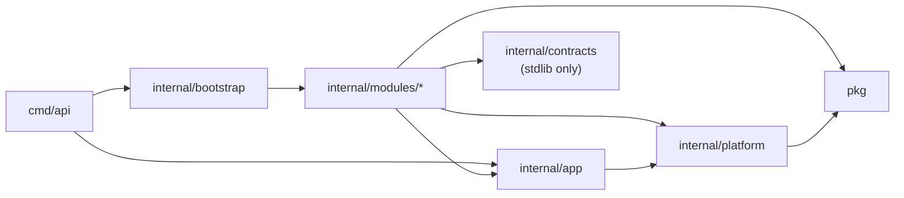

# CLAUDE.md

Guidance for agents working in this repository. Detail lives in `docs/`; this
file keeps the invariants you must not break.

## Build & Run

```bash
make build                 # bin/server + bin/migrate (.exe on Windows)
make migrate-run           # apply pending migrations via cmd/migrate (no migrate-up)
make migrate-down CONFIRM=yes  # drops the whole schema; disposable DBs only
make run                   # migrate, then run the API locally
make seed                  # migrate (dependency) then seed the admin user
make test                  # unit tests
make test-race             # unit tests with -race (needs cgo)
make test-integration      # integration tests (Docker/testcontainers or TEST_DATABASE_URL)
make check                 # vet + lint + arch tests + unit tests
make lint                  # golangci-lint v2
make docker-run            # Compose: migrate job -> API
make docker-down
make sqlc-generate         # every internal/modules/*/sqlc.yaml (no root sqlc.yaml)
make swagger
make gen module=<name>     # cmd/gen: module | resource=<r> | command=<Name> | query=<Name> (+ module=<m>)
```

Production build: `CGO_ENABLED=0 go build -ldflags="-s -w" -trimpath -o server ./cmd/api`.
`swag`/`air` run via `go run` at versions pinned in the Makefile
(`SWAG_VERSION`/`SQLC_VERSION` match CI). `scripts/rename-module.sh <path>`
reads the current path from `go list -m` and rewrites tracked text files with
perl (needs go + perl).

CI builds both binaries; its `Migrations` job applies the baseline up/down on a
fresh PostgreSQL service and runs `cmd/migrate` twice, and its `Manifests` job
runs actionlint, kustomize, and kubeconform. On pull requests the
`API compatibility` job converts the base and PR `docs/swagger.json` to
OpenAPI 3 (`go run ./cmd/openapi3`) and fails on `oasdiff breaking` ERR
findings (oasdiff v1.33.0); an intentional break is acknowledged by editing
`docs/api-breaking-changes.md` in the same PR. Reproduce the fresh-DB check
against a disposable database before merging. Kubernetes: follow
`deploy/k8s/README.md` (migration Job first, then the app kustomization);
`.github/workflows/release.yml` publishes only from `v*` semver tags: it pushes
the multi-arch image unsigned, Trivy-scans that pushed digest per platform
(CRITICAL/HIGH with fixes fail), and only then cosign-signs and attests the
digest. `deploy.yml` always verifies the signature (identity: `release.yml` on
`refs/tags/v*`) and rolls out by digest; a `workflow_run` deploy checks out the
release's `head_sha`, and pre-release tags never auto-deploy to production.
The CI `Migrations` job derives the expected forced-RLS table count from the
schema, and every downloaded CI tool is checksum-verified.

## Architecture

**Modular monolith.** One deployable; modules own route tables; platform
packages own cross-cutting mechanics.



Arrows are the only allowed import directions; a module never imports another
module, and `platform`/`pkg` never import modules.

| Path | Role |
|------|------|
| `cmd/api` | Infra setup, catalog registration, lifecycle, graceful shutdown |
| `internal/bootstrap` | The single ordered module list + contract cross-wiring (shared with `test/arch`) |
| `cmd/migrate` | The only schema initializer/migrator |
| `cmd/seed` | Admin seeder: tenant `owner` + `platform_admin` (schema must exist); the only seeder: `cmd/api` never seeds, and Kubernetes runs it as the one-shot `deploy/k8s/seed` Job with its own `ADMIN_*` Secret |
| `config` | One file per concern; `Config.Validate` runs section validators in a fixed order and reports the first error |
| `internal/app` | Fiber app, global middleware, module registry, provider hooks, `app.Infra` (shared config only in `Infra.Platform`: App, JWT, Tenant) |
| `internal/modules/<m>` | `module.go` (Build + providers), `catalog/` (permissions, error codes, flags, locales), dto/handler/service/repository, `queries/` + generated `sqlc/`. Modules: identity, files, features, notifications, admin (contracts-only, no SQL), webhooks, apikeys |
| `internal/contracts/<provider>` | Stdlib-only contracts per providing module: identity (admin, principal reader, notification recipient, `user.registered` payload), files (admin, `file.*` event payloads), notifications (notifier), privacy (exporter/eraser registry for GDPR requests), tenancy (tenant-wide `Purger` registry for deleted tenants) |
| `internal/platform` | authz, audit, events, features, i18n, jobs, requestctx, scheduler, session, tenant, tracing, versioning, middleware |
| `pkg` | apperror, response, database, cache, storage, email, webhook, ... |
| `migrations` | one init pair `20260101000000_platform_init_schema` with `-- owner:` sections; later changes are `<UTC ts>_<owner>_<purpose>.{up,down}.sql` |

**Request flow:** client → global middleware (request ID, i18n, tracing,
metrics, logger, audit fallback, timeout) → `/api/vN` guard → tenant
middleware → module route (auth limiter, authenticate, route limiter, authz,
idempotency, audit guard) → handler → service → repository → sqlc →
PostgreSQL. Diagram: `docs/architecture.md`.

**Design docs** (keep current when routes/contracts change):

| Doc | Scope |
|-----|-------|
| `docs/architecture.md` | Module map, ownership, request lifecycle, cross-module communication |
| `docs/data-model.md` | Core schema ER diagram |
| `docs/api-design.md` | Conventions, errors, pagination, idempotency, notifications, compatibility, update semantics |
| `docs/module-template.md` | Canonical module layout, scaffold, routes/permissions/tables/contracts |
| `docs/operations.md` | Health, metrics, logs, jobs, scheduler, shutdown, idempotency, migrations, incidents |
| `docs/tracing.md` | OpenTelemetry config, span privacy rules, collector, job trace links |
| `docs/feature-flags.md` | Catalog, precedence, cache, admin API, metrics |
| `docs/webhooks.md` | Outbound dispatch/signing/SSRF/retries, inbound receiver, secrets |

`.github/CODEOWNERS` maps platform areas and each module (code, contracts,
migrations) to its owners; keep it current when adding a module.

**Dependency rules** (enforced by `test/arch`; do not weaken it)
- A module must not import another module's internals; use
  `internal/contracts` or a narrow exported interface.
- `platform`/`pkg` must not import business modules.
- One module owns each table; cross-module reads use a contract/read model.
- `test/arch` builds every module from `internal/bootstrap` (v1 and v2 routes)
  and fails when: a `/api/v1`/`/api/v2` route lacks `authzhttp.Require`
  (explicit public allowlist); a mutating route is neither Tier 1 (owning
  module records with `RecordInTx`) nor `audithttp.Guard`ed;
  `authzhttp.Require`/`audithttp.Guard` sit after the final handler, or
  `Guard` before `Idempotency`; one module's group middleware covers another
  module's routes (the `/admin` overlap class); or a module directory is not
  registered in bootstrap.
- Framework-free cores: `pkg/apperror`, `pkg/storage`, `platform/authz`,
  `tenant`, `audit`, `apikey`, `features`, and every module `service`/
  `repository` must not import Fiber/fasthttp, even transitively
  (`test/arch/framework_free_test.go`). Fiber adapters live in a `<pkg>http`
  subpackage (`apperrorhttp`, `tenanthttp`, `authzhttp`, `audithttp`,
  `featureshttp`, `apikeyhttp`). `pkg/storage` (interface + local driver) and
  `files/service` must not import the AWS SDK; S3/SeaweedFS is
  `pkg/storage/s3store`, selected by `pkg/storage/drivers.New`.
- Layering ratchet (`test/arch/layering_test.go`): `service/` may not import sqlc, pgx, Fiber,
  or the module's own `dto/`/`handler/`; `handler/` may not import
  `repository/`, sqlc, or pgx. Existing violations are listed in
  `test/arch/layering_allowlist.txt`, which only shrinks: never add a line,
  delete one when its violation is fixed.
- `TestCodeSQLOnlyTouchesOwnedTables` scans module `queries/*.sql` and inline
  SQL string literals in non-test Go under `internal/modules/**` and
  `internal/platform/**` (detected only with UPPERCASE keywords). Platform
  tables belong to `platform/<pkg>`; the one reviewed exception is
  `platform/features` reading `feature_flags`/`feature_flag_targets`. A CTE
  must not be named like another owner's table. The scan also covers `pkg/`
  and `cmd/`, and `test/arch/sql_literals_test.go` requires every
  `Exec`/`Query`/`QueryRow`/batch SQL argument outside generated code to be a
  compile-time constant; the reviewed dynamic-SQL allowlist there (with
  `maxDynamicSQLSites`) only shrinks.
- The Tier 1 audit check is per function (`go/ast`): the action literal and
  `RecordTx`/`RecordInTx` must sit in one function or in functions linked by
  same-package calls.
- Migrations: every version is a 14-digit UTC timestamp, owners are real
  modules or `platform`, two spellings of one version are duplicates, and an
  owner's file or `-- owner:` section may only create that owner's tables
  (`TestMigrationsCreateOnlyOwnedTables`).

**Schema ownership**
- Only `cmd/migrate` applies DDL; API/seed assume the schema exists.
  `cmd/migrate` uses `config.LoadDatabase` (DB_* only; no JWT/admin/SMTP
  secrets).
- Fresh installs apply the single init migration, whose
  `-- owner: <module|platform>` sections run shared functions, identity,
  platform jobs/scheduler/audit, then modules. There is still no deployed
  database, so the init is edited in place until the first release; after
  that, only add migrations.
- New migrations: `make migrate-create module=<owner> name=<purpose>` (or
  `make gen`) → `<YYYYMMDDHHMMSS>_<owner>_<purpose>.{up,down}.sql`.
  `test/arch` rejects duplicate versions, missing up/down pairs, non-timestamp
  versions, unknown owners, and files creating another owner's tables.
  golang-migrate never applies a version below the recorded one, so
  regenerate a branch migration older than the newest on main before merging.
- `cmd/migrate` refuses a database recorded at a legacy sequential version
  (1–999999) with upgrade guidance; never rewrite `schema_migrations` to skip
  DDL or edit a shipped migration.
- Tenant-owned tables (`memberships`, `invitations`, `sessions`,
  `refresh_tokens`, `data_exports`, `files`, `notifications`,
  `notification_preferences`, `api_keys`, `jobs`, `audit_events`,
  `feature_flag_targets`, `webhook_*`)
  have `tenant_id BIGINT NOT NULL DEFAULT 1 REFERENCES tenants(id)`. New ones
  must too, and lead tenant-scoped
  query indexes with `tenant_id`. `feature_flags` is process-wide (deliberate
  exception); `api_key_scopes` is a pure child of `api_keys` (CASCADE) and
  inherits its tenant through the parent key. `data_exports` is identity-owned:
  its partial unique index allows one queued/running export per membership,
  and `storage_path` is the authoritative export blob key.
- Users are global: `users`, `user_passwords`, `user_identities`,
  `password_reset_tokens`, and `email_verification_tokens` have no
  `tenant_id`; `tenants`/`tenant_settings` are the tenant rows themselves. A
  user joins a tenant through `memberships` (`UNIQUE (tenant_id, user_id)`,
  `status active|suspended|removed`); roles live in `membership_roles`
  (system `owner`/`admin`/`member` or a tenant role) and platform access in
  `platform_role_assignments`. Every per-member row in another module references
  `(tenant_id, user_id) → memberships ON DELETE RESTRICT`, never `users`. Job
  claim/lease recovery/purge are
  global, so `jobs` has only the tenant-leading idempotency index.
- `cmd/migrate` verifies required tables, columns, unique indexes (every
  `ON CONFLICT` target), tenant-leading indexes, row-level security on every
  table with a `tenant_id` column (found dynamically: `ENABLE`+`FORCE`, one
  `tenant_isolation` policy calling `app_tenant_visible`, no other policy),
  and enabled triggers
  (`trigger_memberships_last_owner`, `trigger_protect_last_owner`,
  `trigger_membership_roles_scope`, `trigger_platform_role_scope`, audit
  completion/no-delete/no-truncate); its
  test fails when that list drifts from the baseline. `audit_events` rejects
  `DELETE`/`TRUNCATE` at the database, and its completion trigger freezes the
  actor columns (`actor_id`/`actor_type`/`actor_role`) and lets
  `status_code`/`error_code` go only from NULL to a value. Trigger functions pin
  `search_path` (TEMP tables cannot shadow them; the runtime roles have no
  `TEMP` and no rights on `schema_migrations`), and `validate_role_permission`
  raises when the role row is not visible instead of treating it as a system
  role.
- `jobs.idempotency_key` is nullable with a partial unique
  `(tenant_id, idempotency_key)` index used by `EnqueueOnce`/`EnqueueOnceTx`.
- `scheduler_leases` (one leader row) and `scheduler_runs` (unique
  `(schedule, scheduled_for)` ledger) are platform coordination tables with no
  tenant column and no cross-module/jobs foreign keys; do not add them.
- The baseline seeds tenant id 1 (`default`); keep it as the compatibility
  tenant (it can never be `pending_deletion`/`deleted`). The last-owner
  trigger lives on `memberships` and `membership_roles` and is per tenant:
  removing the last active system `owner` of an operational tenant is refused.
  The platform tenant create endpoint makes the caller its first owner.
  Tenant status is `trialing|active|suspended|pending_deletion|deleted`; only
  `trialing`/`active` serve requests; transitions go through the audited
  identity `TenantService`, exposed on the platform tenant routes;
  `pending_deletion → deleted` is refused (409 `tenant.deletion_not_due`)
  before `deletion_scheduled_at`. The hourly `identity.tenants.purge_deleted`
  schedule erases a deleted tenant's per-member data through the privacy
  erasers, then every module's tenant-wide data through the
  `internal/contracts/tenancy` `Purger` registry (batched, idempotent; audit
  rows and the `tenants` row stay, `tenants.purged_at` records completion);
  the platform `jobs` purger, registered after every module, deletes the
  tenant's non-running job rows.
  `identity.tenants.expire_trials` suspends `trialing` tenants past
  `trial_ends_at`, which also stop serving requests at once.

**Tenancy invariants**
- Identity, files, webhooks, apikeys, and notifications are tenant-isolated;
  every new query keeps a `tenant_id` predicate. Cross-tenant ids behave as
  not found (`404`), never forbidden. Identity scopes memberships, sessions,
  refresh tokens, and invitations by tenant; global user/credential rows are
  reached through the caller's membership. Deliberate exceptions are the
  cross-tenant retention queries: identity `PurgeExpired*`/`PurgeStaleSessions`
  (`identity.tokens.purge_expired`), files `ClaimTrashedFiles`/
  `HardDeleteTrashedFiles` (`files.trash.purge`), and notifications
  `PurgeReadNotifications` (`notifications.retention.purge`); their indexes
  lead with the age column (`idx_files_deleted_at`,
  `idx_notifications_read_at`), not `tenant_id`.
- Startup checks tenant *existence* (`StartupTenants`, ignoring status)
  separately from request resolution: a suspended configured/default tenant
  must not crash `cmd/api`/`cmd/seed`; its requests return 404.
- `tenanthttp.Middleware` resolves `X-Tenant-Slug` (empty → `TENANT_DEFAULT_SLUG`;
  production requires the header). A validated `?tenant=` fallback is accepted
  only on `/auth/google`, `/auth/reset-password`, `/auth/verify-email` (the
  header wins; reset/verify/invitation links carry it so the frontend knows
  where to sign in; reset and verification tokens are per user and ignore it
  for the lookup). The OAuth callback is exempt and uses the tenant in signed
  `state`.
- Tokens without a positive `tenant_id` or `sid` claim are rejected
  fail-closed; rotate legacy tokens after upgrading. `tenant.EffectiveID(ctx)`'s tenant-1 fallback
  is for jobs/internal/tests only, never HTTP handling, and never the RLS
  scope: `app.RLSResolver` uses `tenant.IDFromContext` only, so a context
  without a tenant sees no tenant-owned rows (background work sets the tenant
  explicitly; the job worker restores each job's `tenant_id`).
- **Row-level security:** every table with a `tenant_id` has
  `ENABLE`+`FORCE ROW LEVEL SECURITY` and one `tenant_isolation` policy calling
  `app_tenant_visible(tenant_id)` (`roles` also exposes the shared system roles,
  `tenant_id IS NULL`, to every tenant; writing one needs the bypass, as the
  startup catalog sync does). `app_tenant_visible` reads only
  `app.tenant_id`; there is no application-writable bypass setting.
  `database.TxManager` sets `app.tenant_id` with a transaction-local
  `set_config` right after `BEGIN`; `database.Scoped` does the same for one
  statement in a single pgx Batch (`BEGIN; set_config; statement; COMMIT`).
  Bypass is a role property: `database.Pools` holds the normal pool and a
  pool for a dedicated `BYPASSRLS` role (`DB_BYPASS_USERNAME`/
  `DB_BYPASS_PASSWORD`, required in production, distinct from `DB_USERNAME`;
  outside production an unset pair reuses the normal pool with a warning).
  The pool is chosen at `BEGIN` (or per `Scoped` statement) from
  `database.WithRLSBypass(ctx)`; a bypass marker inside a transaction that
  began on the normal pool stays tenant-scoped, so mark the context before
  `WithTx`. `DB_MAX_CONNS`/`DB_MIN_CONNS` apply per pool. Repositories are wired
  with `app.Infra.DB` (the Scoped handle), never the raw pool. A query without
  a tenant setting sees no rows. `database.WithRLSBypass(ctx)` marks a
  deliberate cross-tenant path (global job claim/lease/purge, retention
  purges, feature snapshot, webhook inbound source lookup, global-user
  identity operations, tenant lifecycle, and the possession statements by
  token hash: API key `GetByHash` and `RevokeByRefreshToken` (logout), each
  for that one statement; refresh rotation stays tenant-scoped) and must
  never appear on an HTTP path serving one tenant otherwise. Invitation
  accept/sign-up bypass only the possession lookup of the invitation's
  tenant; credential/MFA changes that revoke every tenant's sessions keep one
  bypass transaction for atomicity (each site comments why). The
  API/worker/seed connect as a non-superuser role without `BYPASSRLS`, and
  `cmd/api` refuses production startup unless the bypass role has
  `BYPASSRLS`, is not superuser, owns no tables, and the normal role is not a
  member of it;
  `cmd/migrate` uses the owner role via `DB_MIGRATE_*`. Per-tenant limits
  remain future work; do not claim whole-application isolation.

**Scope:** a boilerplate, not a finished multi-tenant SaaS platform.
Per-tenant quotas and promotion/rollout automation are
future work. Tracing (HTTP, sanitized pgx, jobs) is disabled by default
(`OTEL_ENABLED=false`). Kubernetes manifests and the GHCR release workflow are
a production foundation, not a complete CD platform. There is no shared
generated sqlc package, no cross-module sqlc import, and no legacy
handler/service/DTO/repository package.

## Error Handling

- Return `*apperror.AppError` from services/handlers via the typed catalog:
  `apperror.NewCode(identitycatalog.CodeUserEmailTaken, "public detail")`.
  Module codes live in the module's `catalog/` and register through
  `app.ErrorProvider`; only platform-wide codes (`permission.denied`,
  `feature.disabled`, `rate_limit.exceeded`, `api.version_unsupported`,
  `system.*`, and `user.last_admin` until the identity repository moves it)
  stay in `pkg/apperror`. An unregistered code renders as 500
  `system.internal` and logs, so handler/service unit tests call
  `<m>catalog.Register()`.
- Output is RFC 9457 `application/problem+json` (`type`, `title`, `status`,
  `code`, `detail`, `instance`, `requestId`, `timestamp`, optional
  `errors[]`). `detail` is public text only: never internal causes, SQL, or
  stack traces. Sentinel: `apperror.ErrNotFound`.
- `Deps.I18n` localizes titles and validation messages; localize a detail with
  `WithDetailKey("errors.<code>.detail", params)`. A nil bundle keeps English;
  `code`/`type`/`status`/`instance` never change.
- Permission failures go through `authzhttp.Require` or `authz.Authorize`
  (`permission.denied`). Fiber rendering lives in
  `pkg/apperror/apperrorhttp` (`FiberErrorHandler`, `Localizer`).

## Response & Pagination

- Use `pkg/response` (`Success`, `Created`, `NoContent`,
  `List(c, data, hasMore, nextCursor...)` → `{object,url,data,hasMore,nextCursor}`);
  never write raw JSON in handlers.
- Cursor pagination: `limit` (max 100) + `startingAfter`; repositories use
  `(created_at, id)` indexes; handlers return `nextCursor`
  (`pagination.NextCursor`) when `hasMore`. Offset helpers only for small
  admin/export tables.
- Existing `PUT`s are partial (identity, apikeys) or full replace (webhooks);
  new modules use `PATCH` for partial updates (`docs/api-design.md`).

## Key Patterns

- **i18n:** runs right after request ID; negotiates `Accept-Language`
  (q-values, truncation, wildcards), sets `Content-Language` and
  `Vary: Accept-Language`. Platform strings in `internal/platform/i18n/locales`;
  module strings in `catalog/locales/{en,vi}.json` (keys `<m>.*` or
  `errors.<code>.*`), merged via `app.LocaleSources`. Startup fails on key or
  `{placeholder}` parity mismatch, a missing locale file, a non-namespaced key,
  or a duplicate key.
- **API versions:** `/api/v1` always mounted; `app.V2Module`
  (`RegisterV2Routes`) opts into `/api/v2`. `Accept-Version: 1|v1|2|v2` must
  match the path, else 406 `api.version_unsupported`; unknown `/api/vN` → 406.
  Responses carry `API-Version`, `Vary: Accept-Version`, optional
  `Deprecation`/`Sunset`/`Link`. Keep Swagger's base path at `/api/v1`.
- **Auth/session:** login is the global password plus an *active membership*
  in the request tenant (otherwise the same 401 as a wrong password). JWT
  carries user id, `tenant_id`, `sid` (session id), `token_version`, and
  optional `amr` (pwd/google/otp/rc); it
  carries no role (a legacy `role` claim verifies but is ignored).
  `session.Store` loads the session and requires it unrevoked, the membership
  and user active, the tenant operational, and the token version to match; the
  same snapshot carries the effective permission set (union of the membership
  roles and platform assignments) for 5s, with generation-keyed per-user and
  global permission invalidation. `JWTAuth` rejects a non-positive tenant and an
  explicit header that conflicts with the claim, and clears `tenant_slug` when
  the claim overrides an unresolved default. `pkg/token` pins HS256 and
  requires `exp`; tokens carry a `kid` header derived from the signing secret,
  and a `token.Keyring` (active `JWT_SECRET` + verify-only
  `JWT_PREVIOUS_SECRETS`) picks the key by `kid` (unknown `kid` rejected;
  tokens without one verify against the active secret only). A session is the
  RFC 9700 refresh-token family: refresh tokens are atomic single-use,
  tenant-scoped, and version-bound; a session has an absolute
  `sessions.expires_at` (`SESSION_MAX_LIFETIME`, default 720h) that rotation
  never extends (refresh tokens expire at the earlier of the refresh TTL and
  it), and access tokens default to 1h (`JWT_EXPIRE_HOUR`); a used token
  presented again within 10s of rotating a still-live session is a client
  race (401 `auth.refresh_concurrent`, session kept), decided in one SQL
  statement; presenting a used token revokes the whole
  session (`refresh_reuse`) and returns 401; logout revokes the session by
  possession; logout-all revokes every session in every tenant and bumps
  `token_version`; refresh with an inactive member returns 401. Login lockout
  counts failures per (email, IP) and locks the account globally only after
  5x that threshold; neither key is tenant-scoped (the password is global).
  Lockout/rate-limit cache keys hash the normalized email (SHA-256, 128-bit
  hex: `<prefix><hash>[:ip=…]`), never store it raw. Admin ban/unban/role
  change/removal are membership changes in the request tenant; ban, removal,
  and an actual role change revoke the member's sessions there. The last active
  owner cannot be demoted, banned, removed, or deleted (DB trigger + advisory
  lock). A ban or
  removal sets
  `memberships.credentials_revoked_at` (`clock_timestamp()`, never cleared);
  API keys created at or before it are rejected, so unban never revives them.
  A ban also survives the banned user deleting and re-creating the account
  (`EmailBannedInTenant`). The API-key principal is an active membership;
  API-key creation locks the membership row through
  `PrincipalLocker.LockPrincipalTx` (the only transactional apikeys→identity
  channel); rotate returns 409 when the owner is inactive or the key predates
  `credentials_revoked_at`. `(*AppError).Is(apperror.ErrNotFound)` matches any
  404 `AppError`. The global profile is editable only by its owner
  (`PUT /users/:id` for another id → 403). `DELETE /users/:id` on yourself
  deletes the global account (JWT only; refused while you are the last active
  admin of any tenant); on another id it removes that membership from the
  request tenant. Registration creates user + password + membership in the
  request tenant; an email that already has an account gets 409
  `user.email_taken`, and an existing user joins another tenant only through
  an invitation (`/invitations`, `/auth/invitations/accept|signup`). Google
  sign-in links/creates through `user_identities` (linking needs a verified
  local email and Google `verified_email`); a new Google account gets a
  membership in the state tenant, an existing user never joins a tenant
  implicitly. `SignInWithGoogle` with a `Complete` hook runs these checks and
  session creation in the sign-in transaction before the Tier 1
  `auth.google_login` row, so refused logins are never audited as success.
  The Google authorization request uses PKCE (S256, verifier bound to the
  signed state) and no offline access; the callback never puts tokens in the
  URL: it redirects with `#code=` (256-bit, single use, 60s, tenant-bound)
  that the frontend redeems at `POST /auth/google/exchange` (401
  `auth.oauth_code_invalid`). New passwords follow NIST 800-63B: 12–64
  characters and ≤72 bytes, no composition rules, not on the embedded
  common-password list, not containing the email local part. Password
  change/reset, email change (old address too), MFA enable/disable,
  recovery-code regeneration, and platform MFA reset email the user through
  the transactional outbox in the change's transaction.
  Password reset and email verification are per user. The password-reset
  token insert re-checks the current email (an email change in between skips
  the send). The admin seed (only `cmd/seed`) only creates a missing admin; an existing
  demoted/banned/deleted or non-member account is skipped, never re-promoted
  or added. A newly seeded admin becomes tenant `owner` and gets the
  `platform_admin` assignment.
- **MFA:** TOTP only (RFC 6238, SHA-1/6 digits/30s, ±1 step),
  per global user, not per tenant. `mfa_factors` keeps at most one confirmed
  factor and one pending enrollment; the secret is sealed with
  `infra.PayloadCodec` (`DATA_ENCRYPTION_KEY`, previous keys decrypt) and is
  returned only inside the enrollment `otpauth://` URI. Enroll and confirm
  re-authenticate (`currentPassword`, counted against the second-factor
  budget; a passwordless account needs a session created within 15 minutes);
  every enroll stores a fresh secret, a pending enrollment expires after 15
  minutes (`auth.mfa_enrollment_expired`), and a password change/reset deletes
  it. Confirmation and disable require a current TOTP/recovery code; confirmation issues ten
  single-use recovery codes (SHA-256 hashes, shown once). `mfa_recovery_codes.used_at`
  and `mfa_factors.last_used_step` are claimed with conditional UPDATEs, so
  concurrent uses cannot both pass. Routes: `GET /auth/mfa/status`,
  `POST /auth/mfa/totp/{enroll,confirm}`, `POST /auth/mfa/disable`,
  `POST /auth/mfa/recovery-codes/regenerate` (JWT-only, `mfa:read|write`,
  Tier 1; no Idempotency-Key on secret-returning endpoints). The recovery path
  for a lost factor is `POST /platform/users/:id/mfa/reset`
  (`platform:users:mfa_reset`, JWT-only, Tier 1): it deletes the factors and
  recovery codes, revokes every session, and bumps `token_version`. With a confirmed
  factor, password login and Google sign-in return `mfaRequired` plus a
  five-minute, single-use, tenant-bound challenge sealed with the same codec
  (no tokens) that also pins the token version, so a password change or
  logout-all voids it; `POST /auth/mfa/verify` (challenge + TOTP/recovery
  code) issues the normal pair. Second-factor guesses (verify, disable,
  regenerate) use a per-user budget of 5 per 15 minutes that only a successful
  verification clears (a correct password does not); each failure is audited
  as `auth.mfa_verify_failed` (reason class only, own transaction, a write
  failure is logged and never changes the 401), and confirming/disabling
  revokes the user's other sessions
  (`mfa_changed`). `amr` on access tokens records `pwd`, `google`, `otp`, or
  `rc`; refresh repeats the session's `amr`, tokens without it still verify,
  and `authz.Subject.AMR`/`authzhttp.RequireMFA()` gate routes that need
  `otp`/`rc` (403 `auth.mfa_required`, a platform code in `pkg/apperror`). Every `/platform` route (platform-scope roles) requires it (enforced
  by `test/arch` `TestPlatformRoutesRequireMFA`).
- **Authz:** module permissions live in `catalog/permissions.go`, registered
  via `app.PermissionProvider` (`authz.Grant{Permission, Roles, Platform}`).
  The system tenant roles are `owner`, `admin`, and `member`; owner and admin
  receive every tenant permission, member receives the listed grants. A rank
  (`service/role_hierarchy.go`: owner 3 > admin 2 > member/tenant roles 1)
  gates member management: granting or inviting a role needs a rank ≥ that
  role plus all its permissions; changing, demoting, banning, unbanning,
  removing, or erasing a member needs a strictly higher rank (owners may
  manage co-owners), checked in the mutation transaction with the target
  membership locked (403 `role.insufficient_rank`). Accepting an invitation
  re-checks that the inviter can still grant its role
  (`invitation.inviter_ineligible`); banning or removing a member revokes
  their pending invitations. Platform
  permissions (`platform:tenants:*`, `platform:features:write`,
  `platform:users:mfa_reset`) go to `platform_admin` only and are the only
  cross-tenant access. Only permissions
  shared by several modules (`admin:users:*`, `admin:files:*`,
  `admin:stats:read`, the platform ones) stay in `platform/authz`. The catalog
  is synchronized into `permissions`/system-role grants at API startup;
  tenant roles are database rows and may only use known tenant permissions.
  Duplicate or conflicting registrations fail startup. Protect routes with
  `authzhttp.Require(<m>catalog.PermissionX)` behind `deps.Authenticate()`
  (API key or JWT; API-key scopes are intersected with the owner's current
  effective permissions). JWT-only:
  `POST /auth/logout-all` and `DELETE /auth/sessions/:id` (`sessions:revoke`),
  `GET /auth/sessions` (`profile:read`), `POST /auth/invitations/accept`
  (`profile:write`). `invitations:read|write` are admin-only.
  Service-level checks use `authz.Authorize`, the single fail-closed path: a
  subject in ctx ⇒ permission + policies; no subject but
  `authz.SystemContext(ctx)` ⇒ allowed; neither ⇒ `403`. A subject always wins
  over the marker. Job handlers registered through `JobProvider` and durable
  event handlers run under `SystemContext` (`internal/app/system_jobs.go`), as
  does the admin seed; never derive a system context from an HTTP request.
  apikeys `ensureCallerCanGrant` and identity `authorizeGrant` follow the
  same rule. API keys are created and rotated only by their owner (no
  `userId` field; another member's key rotates as 404); admins may still
  list and revoke them. Keys are `fgb_<base62 random><base62 CRC32>`; a bad
  checksum is rejected before any lookup (legacy base64url keys still
  verify). Every key expires: an omitted `expiresAt` defaults to now +
  `APIKEYS_MAX_LIFETIME` (default 8760h) and a later one is 400.
- **Files:** repositories always pass `tenant.EffectiveID(ctx)`; services also
  compare the row's `TenantID`/`UserID` before exposing it. Uploads reject an
  invalid tenant; blobs go under `<tenantID>/<userID>/<uuid>.<ext>`. Optional
  quotas (`FILES_TENANT_QUOTA_BYTES`, `FILES_USER_QUOTA_BYTES`, 0 =
  unlimited; trashed files count) are checked in the metadata transaction
  under a per-tenant advisory lock (`file.quota_exceeded`). `FILES_SCAN_DRIVER`
  `none|clamav` (`FILES_CLAMAV_ADDR`) scans the stored blob before commit and
  fails closed (`file.infected` 422, `file.scan_unavailable` 503).
- **Jobs** (`internal/platform/jobs`, details in `docs/operations.md`):
  - At-least-once; handlers must be idempotent and honor context
    cancellation. Never use `async.Go` for durable work.
  - Reset/verification tokens commit with their `email.send` job in one
    transaction (`QueuedSender.SendTx`). `POST /auth/forgot-password` only
    enqueues an encrypted `password_reset.request` job (same response and work
    whether or not the account exists); the handler does the lookup and the
    token + email transaction. With transactional email wired (as in
    `identity.Build`), registration commits user, membership, token, and `email.send` job
    together (fail-closed); otherwise the handler falls back to a post-commit
    email. Resend and email-change use a separate post-commit transaction.
  - Retries with backoff, dead-letter after `max_attempts`; unknown kinds retry
    until then. A handler error wrapped with `jobs.Permanent(err)` dead-letters
    immediately (`last_error` prefix `permanent failure (not retried): `); use
    it for undecodable/invalid payloads only. Decryption failures stay
    retryable (a replica may lack a key another already seals with). Claim errors back off up to 30s. Handler timeout 10m
    (`WithJobTimeout`, non-positive disables); a timeout is a normal failure.
  - Each row stores `lease_expires_at` = now() + the owning worker's lease
    (`WithLeaseDuration`, default 5m), set on claim and every heartbeat
    (default 30s); a `CHECK` requires it on `running` rows. Reclaim happens
    only when `lease_expires_at < now()`, so workers with different lease
    durations (dedicated slow-kind workers) are safe together.
    Bookkeeping writes are fenced by owner and attempts, so a reclaimed worker
    cannot finish the job; a worker whose heartbeat finds the lease gone (or
    whose heartbeats keep failing until a safety margin before the lease
    expires — lease − heartbeat interval − bookkeeping timeout, measured from
    before the last successful heartbeat was sent) cancels its handler and
    records neither success nor failure.
  - Shutdown: one 20s budget; HTTP, scheduler/worker, module background loops
    (joined before the pools close), and async work drain in
    parallel within a 15s window, the rest is reserved for tracing flush and
    closing cache/DB. A request keeps working up to 3s after its handler
    (audit write 2s + idempotency store/release 1s =
    `config.PostHandlerReserve`/`app.PostHandlerBudget`), so
    `APP_REQUEST_TIMEOUT` is at most 12s (default 12). A handler that ignores
    cancellation keeps heartbeating and can overrun the drain window.
  - Terminal rows (`succeeded`/`dead`) older than 30 days are purged hourly
    from worker start (`WithRetention`, non-positive disables;
    `WithPurgeInterval`, non-positive ignored), 5s per pass, ≤1,000-row
    batches.
  - Module retention jobs are hourly `ScheduleProvider` schedules, so they run
    only with `SCHEDULER_ENABLED=true`: `identity.tokens.purge_expired`;
    `files.trash.purge` (files soft-deleted more than
    `FILES_TRASH_RETENTION_DAYS`, default 30, ago, in 100-row batches: commit a
    `purge_started_at` claim that blocks restore, then blob, then row; a
    missing blob counts as deleted; a failed blob delete releases the claim
    and backs the row off via `purge_attempts`/`purge_retry_after`, up to
    24h; no event/webhook);
    `notifications.retention.purge` (notifications read more than
    `NOTIFICATIONS_RETENTION_DAYS`, default 180, ago; unread are kept); and
    `privacy.exports.purge` (expired data-export blobs, then rows). See
    `docs/operations.md` "Data retention overview". The k8s configmap enables
    the scheduler, and `cmd/api` warns in production when a job-running role
    has it off.
  - Metrics: `jobs_claimed_total{kind}`, `jobs_succeeded_total{kind}`,
    `jobs_retried_total{kind}`, `jobs_dead_total{kind}` (handler failures,
    permanent ones included), `jobs_lease_dead_total{kind}` (dead-lettered by
    lease expiry, also logged), `jobs_lease_lost_total{kind}`, `jobs_claim_errors_total`,
    `jobs_purged_total`, `audit_write_failures_total`, and the
    `jobs_queue_lag_seconds{kind}` histogram (from the claim query, no extra
    query; a stalled queue shows as missing observations).
  - `jobs.WithKinds(...)`/`WithExcludeKinds(...)` filter claims for dedicated
    workers (`JOBS_WORKER_KINDS`/`JOBS_WORKER_EXCLUDE_KINDS`; a kind in both
    fails startup); lease reclaim stays global. A worker must register a
    handler for every kind it claims, and every kind needs some worker.
  - `APP_ROLE=api|worker|all` (default `all`): `api` serves HTTP only (jobs
    are enqueued, not processed); `worker` runs the job worker, scheduler, and
    module background loops with only `/healthz`, `/readyz`, `/metrics`;
    `all` does both. Optional Kubernetes component `deploy/k8s/base/worker/`
    (not enabled by any overlay).
  - Email and password-reset payloads are AES-256-GCM sealed
    (`jobs.PayloadCodec`, HKDF-SHA256) with `DATA_ENCRYPTION_KEY` (required in
    production and must differ from `JWT_SECRET`; outside production an empty
    key falls back to `JWT_SECRET`) plus decrypt-only
    `DATA_ENCRYPTION_PREVIOUS_KEYS`. Envelope v2 carries the sealing key's
    `kid`; v1 (no kid) still opens by trying every key. Email uses kind
    `email.send.encrypted`; workers register both kinds and still read legacy
    plaintext. Workers from before v2 cannot open v2 envelopes: roll every
    worker out before relying on new pods' sealed jobs.
- **Keys and secrets:** `JWT_SECRET`, `DATA_ENCRYPTION_KEY`, and
  `WEBHOOK_SECRET_ENCRYPTION_KEY` each have a `*_PREVIOUS_*` list
  (`JWT_PREVIOUS_SECRETS`, `DATA_ENCRYPTION_PREVIOUS_KEYS`,
  `WEBHOOK_SECRET_ENCRYPTION_PREVIOUS_KEYS`) that only verifies/decrypts.
  Rotation is two-phase: add the new key as a previous key on every replica,
  then promote it to active and keep the old one as previous until its tokens
  expire / its jobs drain / its rows are re-sealed. Listing the active key as
  previous fails startup. OAuth `state` is still derived from the active
  `JWT_SECRET` only, so in-flight Google sign-ins fail across a JWT swap.
  Secret settings also accept `<NAME>_FILE` (`config/secretfile.go`:
  `JWT_SECRET`, `JWT_PREVIOUS_SECRETS`, `DB_PASSWORD`, `DB_MIGRATE_PASSWORD`, `DATA_ENCRYPTION_KEY`,
  `DATA_ENCRYPTION_PREVIOUS_KEYS`, `WEBHOOK_SECRET_ENCRYPTION_KEY`,
  `WEBHOOK_SECRET_ENCRYPTION_PREVIOUS_KEYS`, `SMTP_PASSWORD`,
  `GOOGLE_CLIENT_SECRET`, `ADMIN_PASSWORD`, `METRICS_AUTH_TOKEN`,
  `DB_BYPASS_PASSWORD`,
  `STORAGE_S3_SECRET_KEY`, `REDIS_URL`); setting both forms is an error.
- **Database connections:** `DB_QUERY_EXEC_MODE` is `cache_statement`
  (default; behind a transaction-mode PgBouncer needs 1.21+ with
  `max_prepared_statements > 0`), `cache_describe`, or `describe_exec`; pgx's
  `exec`/`simple_protocol` are rejected because json/jsonb `[]byte` binding
  (audit metadata) breaks. `cmd/migrate` uses `DB_MIGRATE_HOST`/
  `DB_MIGRATE_PORT` (and `DB_MIGRATE_USERNAME`/`DB_MIGRATE_PASSWORD` for the
  schema owner) when set: golang-migrate holds a session advisory lock,
  so it must bypass a transaction-mode pooler. The API/worker/seed role is a
  non-superuser without `BYPASSRLS`; create it with
  `deploy/postgres/database-roles.sql` (no `TRUNCATE`: it ignores RLS).
  Production refuses a role that is a superuser, has `BYPASSRLS`, owns a
  table in `DB_SCHEMA` (it could turn `FORCE` off), or is a member of a
  superuser, `BYPASSRLS`, or table-owner role (`pg_has_role`, so `SET ROLE`
  cannot reach the owner; `cmd/api/rls.go`), and requires `DB_SSLMODE=verify-full` (optional
  `DB_SSLROOTCERT`). In Kubernetes the migrate credentials live only in
  `fiber-boilerplate-migrate-secrets`, mounted by the migration Job alone.
  `search_path` stays a startup
  parameter: with PgBouncer either `track_extra_parameters = search_path` or
  `ignore_startup_parameters = search_path` plus
  `ALTER ROLE ... SET search_path`.
- **Webhooks** (`docs/webhooks.md`): producers never call
  webhooks. Identity registration and file upload/delete/restore publish
  domain events with `events.PublishTx` in their transaction; the webhooks
  module subscribes durably (`app.EventProvider`, types in
  `webhooks/catalog.SubscribedEvents`) and its dispatcher stores the envelope
  once in `webhook_events` plus a delivery row (URL/secret/timeout snapshot)
  and `webhook.delivery` job per matching endpoint in one transaction. The
  worker sends Standard Webhooks requests: `webhook-id` (event id; receivers
  deduplicate on it), `webhook-timestamp`, `webhook-signature: v1,<base64
  HMAC-SHA256 of id.timestamp.body>` (for 24h after a rotation every delivery
  is co-signed with the previous secret, space-separated; a second rotation
  keeps only the immediately previous one); the envelope body carries
  `type`/`dataVersion`. A replay is a new delivery row (`is_replay`) that
  keeps the original `webhook-id`; pending deliveries follow an endpoint URL
  change in the same transaction; audit metadata and `last_error` never hold
  the endpoint URL path/query. It
  sends via `pkg/webhook.Client` (private/loopback/link-local blocked unless
  allowlisted, no redirects, no proxy, DNS pinned, ports 443/80 plus
  `WEBHOOK_ALLOWED_PORTS` at validation and dial time), records every attempt, and
  retries 408/425/429/5xx with backoff or `Retry-After`; other 3xx/4xx are
  dead. Secrets are `whsec_<base64 32 bytes>` (HMAC key = decoded bytes;
  pre-Standard secrets must be rotated), sealed with
  `WEBHOOK_SECRET_ENCRYPTION_KEY` (JWT fallback locally; dedicated key in
  production; the AAD binds purpose, tenant, and endpoint/source id, legacy
  seals still open) and returned only on create/rotate.
  `POST /webhooks/inbound/:id` verifies the same scheme with the source
  secret (or, for 24h after a rotation, the previous one), answers unknown,
  disabled, or deleted sources with the same 401 as a bad signature, takes
  the type from the body, and deduplicates `(source, webhook-id)`.
- **Events**: typed bus over one versioned envelope `events.Event`
  {`id` UUIDv7, `type`, `dataVersion`, `occurredAt`, `tenantId`, `actor`
  {type user|service|system, id}, `data`} (1:1 with CloudEvents attributes;
  internal `requestId` is never sent out). Payload structs and versions live
  in `internal/contracts/<producer>`, never REST DTOs; evolve additively, a
  breaking change gets a new `dataVersion` or type. Missing metadata is
  resolved from context. `Subscribe` is synchronous local delivery;
  `SubscribeDurable` enqueues one job per event and handler (kind
  `events.<type>.<handler>`, key `event:<type>:<id>:<handler>:<tenantId>`);
  `PublishTx` keeps it atomic with the business transaction (files via its
  tx-bound `EventPublisher` port; `app.Infra.Events`) and enqueues durable
  deliveries only: local `Subscribe` handlers are not called inside the
  transaction (use `Publish` after commit). Invalid durable
  payloads dead-letter (`jobs.Permanent`). Panics are recovered per handler,
  errors joined; durable handlers must be idempotent.
- **Scheduler:** optional (`SCHEDULER_ENABLED`, default false), global. One
  process holds `scheduler_leases`; the `scheduler_runs` row and job enqueue
  share a transaction. Intervals align to epoch boundaries; cron is 5-field UTC
  plus `@hourly`/`@daily`/etc. `SCHEDULER_CATCHUP` is `none|latest|all`
  (bounded by `SCHEDULER_CATCHUP_LIMIT`); a lost heartbeat cancels the pass.
  Payload has `schedule`/`scheduledFor`/`data`; key `scheduler:<name>:<slot>`.
- **Module hooks:** `app.EventProvider`/`JobProvider`/`ScheduleProvider` run
  only when the dependency is non-nil, then durable event handlers register
  (webhooks registers `webhook.delivery` and its `events.*.webhooks`
  subscriptions this way); both
  go through a registrar that wraps every handler in `authz.SystemContext`. Catalog
  hooks (`PermissionProvider`, `ErrorProvider`, `FlagProvider`,
  `LocaleProvider`) are registered by `app.RegisterCatalogs`, which `cmd/api`
  calls right after `bootstrap.Build` and before FEATURE_FLAGS validation,
  `i18n.New`, and `app.New`; `app.Register` repeats it idempotently. The
  `email.send` handler stays in `cmd/api` (platform outbox kind used by
  several modules).
- **Audit:** privileged mutations are fail-closed. Tier 1 services call
  `audit.TxRecorder.RecordTx` in the mutation transaction (failure rolls back,
  `503 system.audit_unavailable`); Tier 2 routes use `audithttp.Guard` after
  idempotency (started intent row, completed as succeeded/failed/denied;
  webhook admin mutations and `POST /notifications/send` are Guarded).
  `audithttp.Middleware` is a fallback (only the webhook receiver and a user's
  own notification state rely on it) and skips routes that set
  `audit_guarded`; `status`/`path` are its reserved metadata keys. A zero
  `audithttp.Policy` mode is `audithttp.ModeRequired` (best-effort must be
  explicit). Client-supplied text and
  metadata are sanitized before storage (invalid UTF-8 → U+FFFD in text
  columns, dropped in `jsonb`; NUL stripped). Use `audit.NewServiceEvent`;
  never put secrets or PII in metadata.
- **Tracing** (`docs/tracing.md`): `app.Deps.Tracing` is nil-safe; disabled is
  a no-op provider. Middleware goes after `RequestID`, before
  `Metrics`/`Logger`. Record only route templates and bounded `error.type`,
  never raw paths, payloads, SQL, headers, or error text. pgx is instrumented
  only under a recording parent. Jobs persist `trace_parent`; each attempt is a
  new-root `job.process` span linked to the enqueue span.
- **Privacy (GDPR):** `internal/contracts/privacy` is the stdlib
  `Exporter`/`Eraser`/`Registry` contract. Every module with per-user data
  registers through `app.PrivacyProvider` (identity, files, notifications,
  apikeys, features, and webhooks' stored event history; endpoint config is
  tenant-wide), and `bootstrap` returns the registry
  in `Modules.Privacy`, installed in `app.Deps.Privacy`. Identity owns
  `data_exports` and the routes: `POST/GET /me/data-exports`,
  `GET /me/data-exports/:id[/download]`, `POST /me/erasure`, and
  `POST /admin/users/:id/erasure` (`admin:users:delete`). Export jobs write one
  JSON document per tenant/user for 7 days (blobs embedded up to 64 MiB, later
  files marked `contentOmitted`; identity's section also carries linked
  identities, MFA status, invitations, and the user's own audit events, never
  secrets or hashes); self erasure fans out one
  `privacy.erase` job per membership plus a retryable finalizer that
  anonymizes the global user only after every membership is `removed`. Admin
  erasure is tenant-scoped: one erase job for the request tenant, no
  finalizer, other memberships and the account untouched, and the role
  hierarchy applies. An erase job runs identity's eraser last, so a removed
  membership proves every other module's eraser succeeded. A banned
  membership keeps `banned_at` and a SHA-256 `banned_email_hash` through
  removal/erasure, so re-registering with the old email is still refused. Self
  erasure re-authenticates with the current password (an MFA user's session
  already passed the second factor); the finalizer also deletes the MFA factor
  and recovery codes; both
  erasure routes are JWT-only. The last active admin is refused before enqueue
  and re-checked at job time. Audit rows keep only IDs. The hourly purge also
  removes failed/stale export rows after one day.
- **Notifications:** owns the in-app feed, per-type `in_app`/`email`
  preferences, and the email channel. Queries filter `tenant_id` and
  `user_id`; missing preferences mean both channels on. `notifications.Notifier`
  is the cross-module create API; identity implements
  `NotificationRecipientLookup` (only an active member of the context tenant
  is a recipient; the lookup runs for every send, in-app only included, and
  an unknown recipient is 404), so notifications never reads `users`. With
  email on, the row and `email.send` job commit together (queue failure rolls
  back); both channels off is a successful no-op. Writes use
  `Idempotency-Key`; admin sends need `notifications:send`.
- **Feature flags** (`docs/feature-flags.md`): flags declared in
  `catalog/flags.go` via `app.FlagProvider`; `config.Load` checks
  `FEATURE_FLAGS` syntax only and `cmd/api` rejects unknown keys after
  `app.RegisterCatalogs`. `deps.Flags` is never nil after `app.New`.
  Precedence: force-off > kill switch > user > tenant > database default >
  environment > compiled default. Kill switches fail closed: when the snapshot
  is older than the max staleness, the last loaded snapshot's kill switches
  still apply while everything else falls back. The `features` module scopes targets to
  `tenant.EffectiveID(ctx)` and invalidates the local snapshot after writes.
- **Transactions:** `database.TxManager.WithTx` scopes one module/aggregate
  and installs the context's RLS scope right after `BEGIN`; never span modules
  (use jobs/events).
- **Drivers:** storage `local|s3|seaweedfs` (`pkg/storage/drivers.New`; S3 via
  aws-sdk-go-v2 in `pkg/storage/s3store`), cache `memory|redis` (memory is
  bounded by `CACHE_MEMORY_MAX_ENTRIES`, default 100000: expired entries go
  first, then least-recently-used `Set` values; live locks and counters from
  `SetNX`/`Increment*` are never evicted, and a cache full of them fails the
  write with `cache.ErrFull`; the Redis scripts keep TTLs with `KEEPTTL`), email
  `console|smtp`, chosen by config factories.
- **Request bodies:** Fiber streams request bodies (`StreamRequestBody`,
  lazy multipart). `middleware.BodyLimit` caps every body at
  `APP_JSON_BODY_LIMIT` before auth (declared `Content-Length` rejected
  unread; chunked bodies read through a limited reader). Only multipart on
  `POST /api/v1/files/upload` (`filesUploadPath` in `internal/app`, keep it in
  sync with the files route) may use `APP_BODY_LIMIT`.
- **Rate limits:** tiered, cache-backed sliding window (current + weighted
  previous window); authenticated requests keyed per user, unauthenticated
  per IP. Responses carry `RateLimit-Policy`/`RateLimit`
  (draft-ietf-httpapi-ratelimit-headers) plus legacy `X-RateLimit-*` and
  `Retry-After`.
- **Idempotency** (`docs/operations.md` flowchart): opt-in `Idempotency-Key`
  via `deps.Idempotency`, scoped by method/path/tenant ID+slug/caller (user, or
  IP for public routes). 2xx replays for 24h; non-multipart bodies ≤1 MiB are
  body-bound (different body → 422 `idempotency.key_mismatch`). The
  2m lock is an atomic owner-token
  claim (`cache.Cache.SetNX` → `SET NX PX`, UUID token): concurrent duplicates
  get 409. On a lost reply the key is re-read (own token ⇒ held; other ⇒ 409;
  missing/read error ⇒ fail open), and compare-and-delete releases it even
  after failing open. The Redis client sets `ContextTimeoutEnabled`, so the
  250ms/500ms per-operation bounds (rate limit, idempotency) are real.
  Replays set `Idempotent-Replayed: true` and `idempotency_replayed=true` so
  audit skips them. Keep `Idempotency-Key` in `CORS_ALLOW_HEADERS`; the
  default `CORS_EXPOSE_HEADERS` lists the rate-limit headers and
  `X-Request-Id` so browsers can read them. Never add
  it to token-minting or secret-returning endpoints (API-key create/rotate,
  webhook create and `rotate-secret`) or GET/HEAD/OPTIONS.

## Adding a Module

Use the Go generator `cmd/gen` (stdlib `text/template` + `embed`) and follow
`docs/module-template.md`; its output follows the layering rules, so `test/arch`
(layering ratchet included) passes with no allowlist entries.

- `make gen module=<name>`: `module.go` (`Handlers`, catalog providers,
  routes), `build.go` (`Build(infra app.Infra, settings Settings) (*Module,
  Provides, error)`), `generate.go` + `sqlc.yaml`, `catalog/` (permissions,
  errors, en/vi), `service/ports.go` + a health use case, `repository/`,
  `handler/`, `dto/`, `queries/`, tests, README, a
  `<UTC ts>_<name>_init.{up,down}.sql` pair, and the
  `internal/bootstrap/modules.go` entry (inserted once at the `gen:` markers).
- `make gen resource=<r> module=<m>`: tenant-scoped CRUD (`<m>_<plural>`
  table, sqlc queries, repository mapping rows to service types, service over
  ports, handler/dto, routes `rate limit → authzhttp.Require → idempotency →
  audithttp.Guard → handler`, permissions, error code, en/vi keys, fake-based
  unit tests, a PostgreSQL integration test).
- `make gen command=<Name> module=<m>` / `query=<Name>`:
  `service/{command,query}_<name>.go` with Input/Result (501 until written)
  plus an HTTP stub (`no_http=1` skips it).
- Every run writes, then runs sqlc, `go build ./...`, `go vet` (with and
  without `-tags=integration`), the module tests, and `test/arch`; any failure
  restores every written file. `dry_run=1` prints a diff. Only modules created
  by cmd/gen (with `gen:` markers) can be extended. `scripts/new-module.sh` is
  a wrapper for `go run ./cmd/gen module`.

1. Module-owned configuration goes in the module's `Settings`, filled by
   `bootstrap.Build(cfg, infra)` from its own `config` section (as identity,
   files, and webhooks do); `app.Infra.Platform` carries only App, JWT, and
   Tenant. Contracts from earlier modules follow `settings` in `Build`. The
   bootstrap entry is the only central edit: catalogs self-register through
   the catalog providers, and jobs/events/schedules through
   `JobProvider`/`EventProvider`/`ScheduleProvider`. Add `RegisterV2Routes`
   only for a breaking v2 surface.
2. Keep handler/service/repository/DTO/catalog inside the module; protect
   every route with `authzhttp.Require`; keep `service/` free of sqlc, pgx,
   Fiber, and `dto/` (layering ratchet).
3. Name tables `<name>`/`<name>_*` (or add them to the `test/arch` table
   ownership list); queries must not touch other modules' tables. Each module
   owns `internal/modules/<name>/sqlc.yaml`; run `make sqlc-generate`.
4. Other schema changes: `make migrate-create module=<name> name=<purpose>`.
5. Expose data to other modules only through `internal/contracts/<name>/`
   (stdlib-only).
6. Add unit + integration tests; `test/arch` must stay green.
7. Run `make swagger` and `make check`.

## Testing

- Standard library `testing` + `testify` where it improves assertions.
- Unit tests must not need Docker. Integration tests use `-tags=integration`
  with Testcontainers or `TEST_DATABASE_URL` (apply the schema with
  `cmd/migrate` first; platform integration tests use that database as-is).
- Run `go test -race ./...` before merging.
- Architecture tests live in `test/arch`.
- Identity service tests set `bcryptCost = bcrypt.MinCost` in
  `internal/modules/identity/service/main_test.go`; production hashes use cost
  12. Use `bcrypt.MinCost` for fixture hashes in tests.
