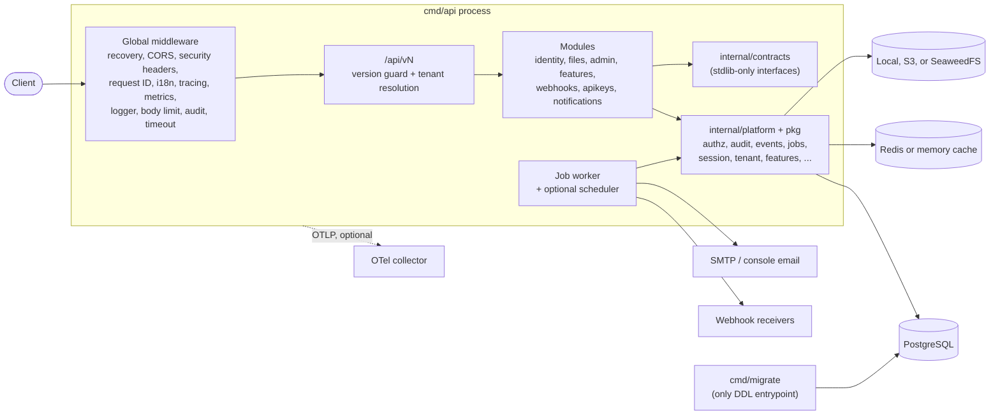
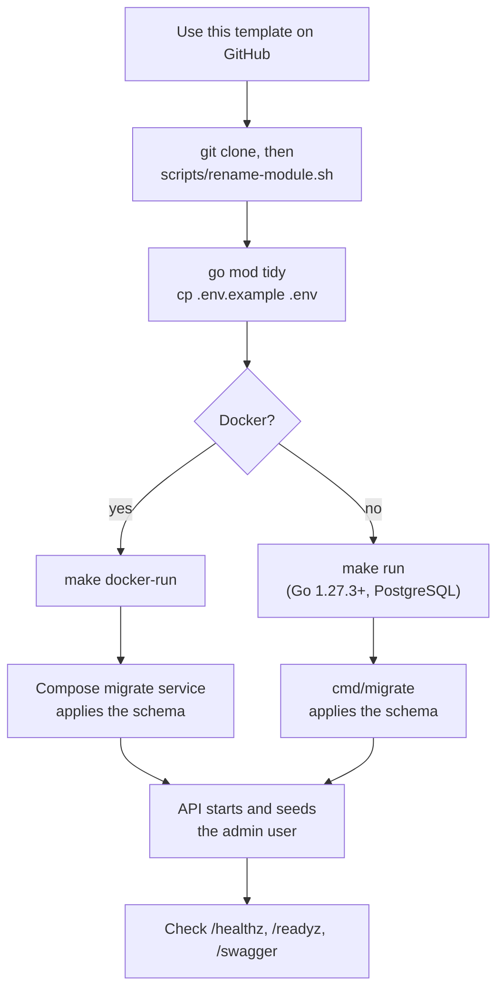

<div align="center">


[](https://github.com/chuanghiduoc/fiber-golang-boilerplate/actions/workflows/ci.yml)
[](https://go.dev/)
[](LICENSE)
[](https://goreportcard.com/report/github.com/chuanghiduoc/fiber-golang-boilerplate)

[](https://gofiber.io/)
[](https://www.postgresql.org/)
[](https://redis.io/)
[](https://www.docker.com/)
[](https://swagger.io/)
[](https://prometheus.io/)

</div>

Production-minded REST API boilerplate built with Go Fiber v3, PostgreSQL, and sqlc.

## Features

- **Modular monolith** with layered modules (handler → service → repository →
  sqlc), stdlib-only cross-module contracts, and architecture tests that
  enforce the boundaries.
- **Multi-tenant identity:** global users joining tenants through
  memberships, sessions with refresh-token reuse detection, Google OAuth,
  API keys, invitations, and TOTP MFA with recovery codes.
- **Authorization:** tenant-scoped RBAC stored in the database, platform
  administration behind MFA, and PostgreSQL row-level security on every
  tenant-owned table as a second line of isolation.
- **Durable work:** a PostgreSQL job queue, an optional leader-elected
  scheduler, versioned domain events, and Standard Webhooks delivery and
  receiving.
- **Operations:** RFC 9457 errors, cursor pagination, idempotency keys, rate
  limits, audit trail, feature flags, i18n (en/vi), Prometheus metrics,
  optional OpenTelemetry tracing, GDPR data export and erasure, and retention
  jobs.

## Tech Stack

| Concern | Choice |
|---------|--------|
| Framework | [Fiber v3](https://docs.gofiber.io/) (Go 1.27.3+) |
| Database | PostgreSQL 18 with [pgxpool](https://github.com/jackc/pgx) |
| Queries | [sqlc](https://sqlc.dev/) (type-safe SQL code generation) |
| Migrations | [golang-migrate](https://github.com/golang-migrate/migrate) through one `cmd/migrate` entrypoint (single init schema) |
| Auth | JWT ([golang-jwt](https://github.com/golang-jwt/jwt)), Google OAuth 2.0, `Authorization: ApiKey` keys |
| Validation | [go-playground/validator](https://github.com/go-playground/validator) |
| Logging | `slog` (stdlib structured logging) |
| API docs | Swagger/OpenAPI via [swaggo](https://github.com/swaggo/swag) |
| Lint | [golangci-lint v2](https://golangci-lint.run/) |
| Cache | In-memory or Redis |
| Storage | Local filesystem, AWS S3, or SeaweedFS (S3 gateway) |
| Email | SMTP or console (dev) |
| Metrics / tracing | Prometheus; OpenTelemetry OTLP/gRPC, disabled by default ([docs/tracing.md](docs/tracing.md)) |
| Container | Docker + Docker Compose; Kubernetes manifests in [`deploy/k8s`](deploy/k8s/README.md) |

## Architecture

One deployable with module-owned routes and platform packages for
cross-cutting mechanics. `APP_ROLE=all` (default) runs the API, job worker,
and optional scheduler together; `api` and `worker` split them. Schema
changes run as a separate one-shot `cmd/migrate` step.



## Quick Start



### 1. Create your project

Click **"Use this template"** on GitHub, then:

```bash
git clone https://github.com/yourname/yourproject.git
cd yourproject
./scripts/rename-module.sh github.com/yourname/yourproject
go mod tidy
```

The script reads the current module path from `go.mod` (`go list -m`) and
rewrites every tracked text file that mentions it with `perl` (Linux/macOS;
needs `go` and `perl`), so it is safe to re-run after a rename.

### 2. Run

**With Docker (recommended):**

```bash
cp .env.example .env
make docker-run
```

| Service | Port | Notes |
|---------|------|-------|
| API | `:8080` | Starts after the one-shot `migrate` service succeeds |
| PostgreSQL | `:5432` | `postgres:18-alpine` |
| Redis | `:6379` | `redis:8-alpine` |
| SeaweedFS S3 gateway | `:8333` | Optional: `STORAGE_DRIVER=seaweedfs docker compose --profile s3 up` |
| OTel collector | `:4317` | Optional `otel` profile; see [docs/tracing.md](docs/tracing.md) |

**Without Docker** (requires Go 1.27.3+ and PostgreSQL):

```bash
cp .env.example .env
# Edit .env with your database credentials
make run
```

`make run` applies the schema through `cmd/migrate` before starting the API.
In both paths the API seeds the admin user (`ADMIN_EMAIL`/`ADMIN_PASSWORD`)
on startup.


## Commands

```bash
make run                 # apply the schema, then run the API locally
make docker-run          # Compose: migrate job, then the API
make check               # vet + lint + architecture tests + unit tests
make test-integration    # integration tests (testcontainers or TEST_DATABASE_URL)
make gen module=billing  # scaffold a module (also resource= / command= / query=)
make migrate-create module=files name=add_x  # new UTC-timestamp migration
make sqlc-generate       # regenerate every module's sqlc code
make swagger             # regenerate OpenAPI docs (served at /swagger outside production)
```

See the `Makefile` for the full list.

## Documentation

| Doc | Covers |
|-----|--------|
| [docs/architecture.md](docs/architecture.md) | Module map, dependency rules, request lifecycle, tenancy, authorization |
| [docs/data-model.md](docs/data-model.md) | Schema, table ownership, keys, row-level security |
| [docs/api-design.md](docs/api-design.md) | URLs, errors, pagination, auth, MFA, RBAC, idempotency, compatibility |
| [docs/module-template.md](docs/module-template.md) | Module layout, generator, routes, permissions, migrations |
| [docs/operations.md](docs/operations.md) | Health, metrics, jobs, migrations and upgrades, Kubernetes, incidents, configuration, security |
| [docs/webhooks.md](docs/webhooks.md) | Outbound signing/retries/SSRF, inbound receiver |
| [docs/feature-flags.md](docs/feature-flags.md) | Flag catalog, precedence, admin API |
| [docs/tracing.md](docs/tracing.md) | OpenTelemetry configuration and privacy rules |
| [deploy/k8s/README.md](deploy/k8s/README.md) | Kubernetes deployment flow |
| [CONTRIBUTING.md](CONTRIBUTING.md) | Workflow, commit convention, checks |

Every option and default is in [.env.example](.env.example); the
[configuration reference](docs/operations.md#11-configuration-reference) explains
the important ones.

## Scope

A production-minded boilerplate, not a finished SaaS platform. Per-tenant
quotas and full promotion/rollout automation are future work; tracing is
disabled by default.

## License

[MIT](LICENSE)
