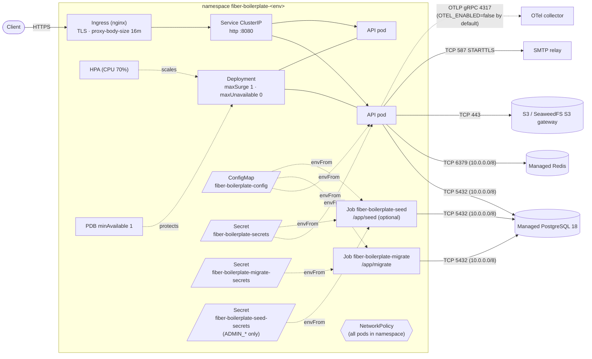
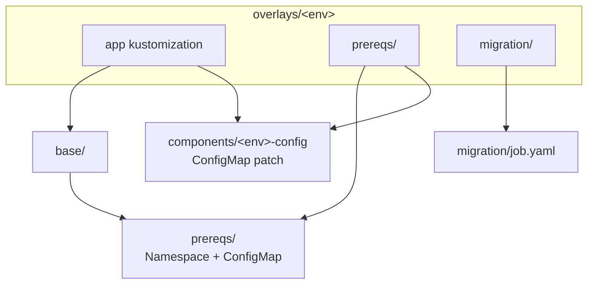
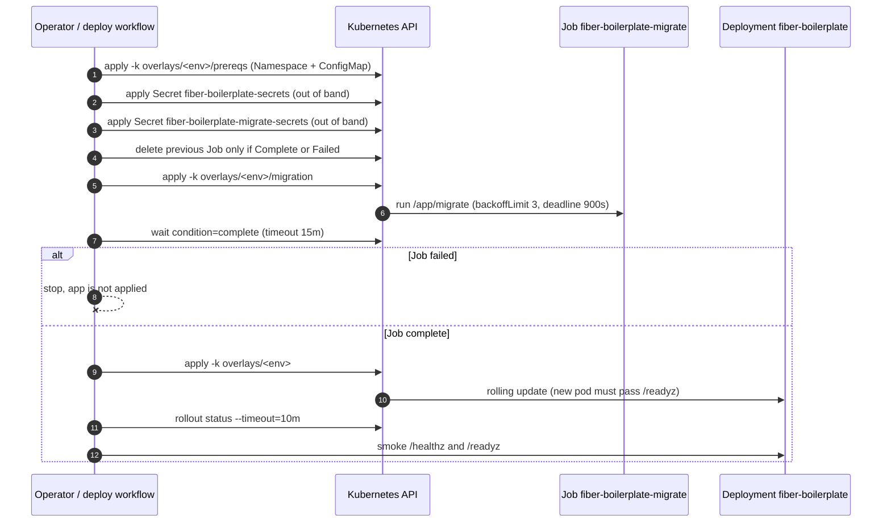
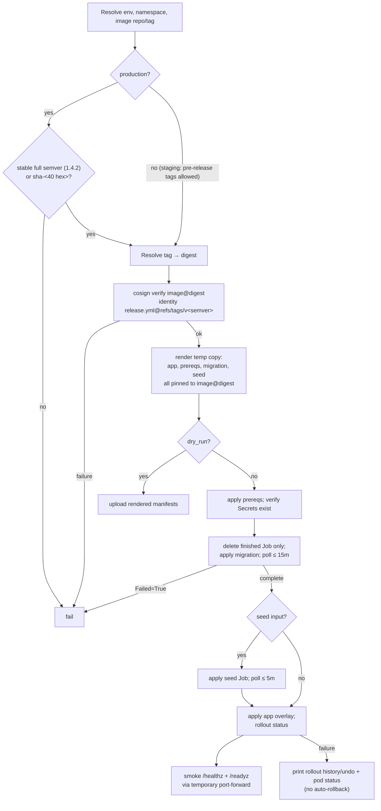

# Kubernetes deployment

Production-oriented Kubernetes manifests for the Fiber SaaS boilerplate. They
assume managed PostgreSQL and Redis, an S3-compatible bucket (AWS S3 or a
SeaweedFS S3 gateway), and an ingress-nginx controller. No stateful service is
bundled.

These files are templates. Replace every `OWNER/REPO`, `example.com`,
`REPLACE_*`, bucket, and CIDR placeholder before applying them. Do not commit a
rendered Secret.

## Topology



The NetworkPolicy selects every pod in the namespace (API, the optional
worker, and the migration Job).
Ingress is allowed only from the `ingress-nginx` namespace on 8080; egress is
limited to DNS, the ports above, and HTTPS (S3, Google OAuth). A SeaweedFS
gateway on a non-443 port (for example `seaweedfs-s3.storage.svc:8333`) needs
an extra egress rule.

## Contents

| Path | Purpose |
| --- | --- |
| `base/` | Deployment, Service, HPA, PDB, NetworkPolicy, Ingress |
| `base/worker/` | Optional kustomize Component: separate job-worker Deployment (`APP_ROLE=worker`) and `APP_ROLE=api` on the API; enabled by no overlay (see [Job workers](#job-workers)) |
| `base/kustomization.yaml` | Reusable app base (includes `../prereqs`) + image transformer; omits the Job and Secret |
| `prereqs/` | Namespace + ConfigMap kustomization, applied before the migration Job |
| `migration/job.yaml` | One-shot `/app/migrate` Job; applied separately, before the app |
| `seed/job.yaml` | One-shot `/app/seed` Job (bootstrap admin); applied separately after the migration, never at API startup |
| `overlays/staging/`, `overlays/production/` | Namespace, HPA, Deployment, and Ingress patches + image tag; each has `prereqs/`, `migration/`, and `seed/` sub-overlays |
| `overlays/components/<env>-config` | Environment ConfigMap patch shared by the app and prereqs builds |
| `kustomization.yaml` | Convenience wrapper for `kubectl apply -k deploy/k8s` (legacy, `:latest`) |
| `secret.example.yaml` | Template for the runtime Secret; excluded from every kustomization |
| `migrate-secret.example.yaml` | Template for the migration-only Secret (schema owner); excluded from every kustomization and mounted only by the Job |
| `seed-secret.example.yaml` | Template for the seed-only Secret (`ADMIN_*`); excluded from every kustomization and mounted only by the seed Job |



## Prerequisites

| Requirement | Notes |
| --- | --- |
| Kubernetes 1.29+, `kubectl` | built-in kustomize renders |
| `kustomize` v5.8.1+ | for `kustomize edit set image` in the manual flow (`kubectl kustomize` has no `edit`) |
| Managed PostgreSQL 18 over TLS | `DB_SSLMODE=verify-full` is mandatory because `APP_ENV=production`; set `DB_SSLROOTCERT` to a mounted provider CA when it is not in the system trust store |
| Managed Redis | required for correct session invalidation with more than one replica |
| S3-compatible bucket + credentials | recommended storage; local disk needs a shared ReadWriteMany volume (see below) |
| SMTP relay with STARTTLS | normally port 587; implicit TLS on 465 is not supported |
| ingress-nginx in `ingress-nginx` | or edit the Ingress class and NetworkPolicy selectors |
| metrics-server | for the HPA |
| cert-manager or a pre-created TLS Secret | for the Ingress host |
| GHCR access | create an image pull Secret if the package is private |
| Optional CD | GitHub Environments `staging` and `production`, each with protection rules and a `KUBE_CONFIG` secret; see [Continuous deployment](#continuous-deployment-github-actions) |

## Environments and overlays

| Overlay | Namespace | HPA | Notes |
| --- | --- | --- | --- |
| `overlays/staging` | `fiber-boilerplate-staging` | 2–4 replicas | Smaller CPU/memory requests, staging hosts and bucket, `imagePullPolicy: Always` |
| `overlays/production` | `fiber-boilerplate-production` | 3–10 replicas | Immutable image tag required, production hosts and bucket, `imagePullPolicy: IfNotPresent` |

Both reference `../../base`, keep the same resource names, and isolate
environments by namespace. The app overlay and its `prereqs` sub-overlay both
include `overlays/components/<env>-config`, so the migration Job and API read
the same non-secret configuration. `overlays/<env>/migration` is a separate
kustomization for the one-shot Job; the app overlay must never include it.

Every overlay's image tag is the literal placeholder `REPLACE_WITH_IMAGE_TAG`.
The deploy workflow replaces it in a temporary copy; for a manual deployment,
set it in the app overlay **and** the migration overlay (step 3). `base/` still
uses `ghcr.io/OWNER/REPO:latest` for the legacy `kubectl apply -k deploy/k8s`
path; do not use that path for production.

Render an overlay without a cluster:

```bash
kubectl kustomize deploy/k8s/overlays/staging > /tmp/staging.yaml
kubectl kustomize deploy/k8s/overlays/production > /tmp/production.yaml
kubectl kustomize deploy/k8s/overlays/staging/prereqs > /tmp/staging-prereqs.yaml
kubectl kustomize deploy/k8s/overlays/staging/migration > /tmp/staging-migration.yaml
```

## Deployment order



`kubectl apply -k` has no cross-resource ordering guarantee, which is why the
Job lives outside every app kustomization.

## 1. Configure the placeholders

| File | Replace |
| --- | --- |
| `base/kustomization.yaml`, both app overlays, both migration overlays, both seed overlays | `images[].newName` (real repository); `newTag` (or a digest) for manual deploys. Keep `images[].name` exactly `ghcr.io/OWNER/REPO`: it is the stable source key used by the deploy workflow. The base Deployment and raw Job image literals are placeholders rewritten by these transformers. |
| `overlays/<env>/ingress-patch.yaml` | API host and TLS Secret |
| `overlays/components/<env>-config/configmap-patch.yaml` | `APP_FRONTEND_URL`, `CORS_ALLOW_ORIGINS`, `DB_HOST`, `SMTP_HOST`, `EMAIL_FROM_ADDRESS`, `STORAGE_S3_BUCKET` |
| `prereqs/configmap.yaml` | shared defaults such as `APP_TRUSTED_PROXIES`, `TENANT_REQUIRE_HEADER=true`, and the S3 endpoint; keep environment-specific values in the overlay components |
| `base/networkpolicy.yaml` | DB/Redis/OTel CIDRs and SMTP ports/ranges if your services are not in `10.0.0.0/8` or use different ports |
| overlay `namespace:` values + Namespace rename patches (and the matching `prereqs`/`migration` overlays) | only if you rename an environment |
| `secret.example.yaml` (copied outside the repo) | every `REPLACE_*` value |

Find the remaining placeholders with:

```bash
grep -RInE 'OWNER/REPO|example\.com|REPLACE_|10\.0\.0\.0/8' deploy/k8s
```

Configuration rules:

| Setting | Rule |
| --- | --- |
| `CORS_ALLOW_HEADERS` | keep `Idempotency-Key`, `X-Tenant-Slug`, `Accept-Language`, `Accept-Version` |
| `CORS_EXPOSE_HEADERS` | keep `Idempotent-Replayed`, `Content-Language`, the version/deprecation headers, the rate-limit headers (`RateLimit`, `RateLimit-Policy`, `Retry-After`, `X-RateLimit-*`), and `X-Request-Id` so browsers can read replay, locale, version, throttling, and correlation metadata |
| `TENANT_REQUIRE_HEADER=true` | required in production so header-less writes never fall back to tenant 1. Every API client sends `X-Tenant-Slug`; the frontend forwards `?tenant=<slug>` from reset/verification links |
| `APP_TRUSTED_PROXIES` | only the cluster pod/service CIDR containing ingress-nginx. `0.0.0.0/0` lets clients spoof `X-Forwarded-For` and bypass per-IP rate limits |
| `APP_PORT` (8080) | part of the probe, Service, container port, and NetworkPolicy contract. If you change it, update `containerPort`, the `http` named port used by the probes, the Service port, the Ingress backend, and the NetworkPolicy ingress port |
| Image tag | immutable release tag (for example `1.4.2`) in production, never `:latest`. The workflow resolves the tag to its digest, verifies that digest's signature, and deploys `image@sha256:...`; the app, migration, and seed overlays all get the same reference |
| `images[].name` | do not rename. Kustomize uses it only as the source key; the image is `newName:newTag`. If you must, change `SOURCE_IMAGE` in `.github/workflows/deploy.yml` and every base/overlay kustomization together, or the workflow fails its stable-key or rendered-image check |

## 2. Create the namespace and Secrets

```bash
export ENV=staging
export NS=fiber-boilerplate-staging

# Applies the environment Namespace and ConfigMap (with staging values).
kubectl apply -k deploy/k8s/overlays/$ENV/prereqs

cp deploy/k8s/secret.example.yaml /tmp/fiber-secret.yaml
# Edit metadata.namespace to $NS and replace every value, then:
kubectl apply -f /tmp/fiber-secret.yaml

cp deploy/k8s/migrate-secret.example.yaml /tmp/fiber-migrate-secret.yaml
# Edit metadata.namespace to $NS and set the schema-owner credentials, then:
kubectl apply -f /tmp/fiber-migrate-secret.yaml

# Only if you want the seed Job to create a bootstrap admin:
cp deploy/k8s/seed-secret.example.yaml /tmp/fiber-seed-secret.yaml
# Edit metadata.namespace to $NS and set ADMIN_EMAIL/ADMIN_PASSWORD, then:
kubectl apply -f /tmp/fiber-seed-secret.yaml
```

For production use `ENV=production` and `NS=fiber-boilerplate-production`. The
`prereqs` kustomization contains only the Namespace and ConfigMap; no Secret is
in a kustomization. Never commit a rendered Secret; for GitOps use External
Secrets, Sealed Secrets, SOPS, or your cloud secret manager.

The schema-owner credentials are deliberately **not** in
`fiber-boilerplate-secrets`: only the migration Job mounts
`fiber-boilerplate-migrate-secrets`, so API and worker pods cannot read the
role that may run DDL or `ALTER TABLE ... NO FORCE ROW LEVEL SECURITY`.

The bootstrap admin credentials are deliberately **not** in
`fiber-boilerplate-secrets` either: only the seed Job mounts
`fiber-boilerplate-seed-secrets`, so `ADMIN_PASSWORD` never reaches an API or
worker pod. `cmd/api` does not seed at startup.

| Secret value | Behavior |
| --- | --- |
| `JWT_SECRET`, `DATA_ENCRYPTION_KEY`, `WEBHOOK_SECRET_ENCRYPTION_KEY`, `METRICS_AUTH_TOKEN` | short `REPLACE_ME` placeholders on purpose: production validation rejects them, so an unedited template fails closed. `DATA_ENCRYPTION_KEY` must also differ from `JWT_SECRET` |
| `*_PREVIOUS_*` keys | commented out; set only during a [rotation](#secret-rotation) |
| `<NAME>_FILE` | any secret setting may instead point at a mounted file (for example `JWT_SECRET_FILE=/run/secrets/jwt`); setting both forms fails startup |
| `DB_PASSWORD` | Password of the runtime `app` role (`DB_USERNAME`). It must not be a superuser, own tables in the schema, or be a member of a `BYPASSRLS` role; production startup refuses one |
| `DB_BYPASS_PASSWORD` | Password of `DB_BYPASS_USERNAME=app_bypass`. That role has `BYPASSRLS` for cross-tenant job/retention/catalog work but must not be a superuser, own tables, or be reachable with `SET ROLE` from the app role; production startup refuses it otherwise |

`fiber-boilerplate-seed-secrets` holds only what the seed Job needs from
`ADMIN_*`:

| Seed Secret value | Behavior |
| --- | --- |
| `ADMIN_EMAIL` / `ADMIN_PASSWORD` | required pair; the password must be at least 12 characters and not the sample value, and the `REPLACE_ME` placeholder fails validation until replaced. The seed only creates a missing admin; an existing demoted, banned, removed, or non-member account is never re-promoted or added |
| `ADMIN_NAME` | optional display name |

The seed Job also mounts `fiber-boilerplate-secrets` for `DB_PASSWORD` and
`DB_BYPASS_PASSWORD` (cmd/seed opens the same normal and bypass pools as the
API). It reads only the database, app-environment, and admin sections;
JWT/SMTP/storage settings are not validated by the seed.

`fiber-boilerplate-migrate-secrets` holds only the schema-owner settings the
migration Job reads:

| Migrate Secret value | Behavior |
| --- | --- |
| `DB_MIGRATE_USERNAME` | Schema owner for `cmd/migrate` (`postgres` by default) |
| `DB_MIGRATE_PASSWORD` | Password of that owner; never mounted by API or worker pods |
| `DB_MIGRATE_HOST` / `DB_MIGRATE_PORT` | commented out; point the Job directly at PostgreSQL when the API uses a transaction-mode pooler |

Create both runtime roles once as the owner before the first migration; the same script is in the repository:

```bash
psql -v app_user=app -v app_password='<DB_PASSWORD>' \
  -v bypass_user=app_bypass -v bypass_password='<DB_BYPASS_PASSWORD>' \
  -v owner=postgres -v schema=public \
  -f deploy/postgres/database-roles.sql
```

If the GHCR package is private, create a pull Secret and uncomment
`imagePullSecrets` in `base/deployment.yaml` (and add it to
`migration/job.yaml` if that image is also private):

```bash
kubectl -n "$NS" create secret docker-registry ghcr-pull \
  --docker-server=ghcr.io \
  --docker-username=<github-user> \
  --docker-password=<PAT-with-read:packages>
```

## 3. Run the migration Job before the rollout

Only `cmd/migrate` applies DDL; the API and seed commands never migrate, so
replicas do not race on schema changes. Apply the namespace/ConfigMap and both
Secrets, apply and await the Job, and only then apply the app overlay:

```bash
export ENV=staging
export NS=fiber-boilerplate-staging
export IMAGE_REPO=ghcr.io/OWNER/REPO
export IMAGE_TAG=1.4.2

# Pin the same immutable tag in the app, migration, and seed overlays. The CD
# workflow does this in a temporary copy; these commands edit tracked files, so
# commit the pin intentionally or revert it after the deploy.
(cd deploy/k8s/overlays/$ENV && kustomize edit set image "$IMAGE_REPO=$IMAGE_REPO:$IMAGE_TAG")
(cd deploy/k8s/overlays/$ENV/migration && kustomize edit set image "$IMAGE_REPO=$IMAGE_REPO:$IMAGE_TAG")
(cd deploy/k8s/overlays/$ENV/seed && kustomize edit set image "$IMAGE_REPO=$IMAGE_REPO:$IMAGE_TAG")

if kubectl -n "$NS" get job fiber-boilerplate-migrate > /dev/null 2>&1; then
  existing="$(kubectl -n "$NS" get job fiber-boilerplate-migrate \
    -o jsonpath='{range .status.conditions[*]}{.type}={.status}{"\n"}{end}' 2>/dev/null || true)"
  if ! printf '%s' "$existing" | grep -qxE 'Complete=True|Failed=True'; then
    echo "Refusing to delete a migration Job that is not complete or failed." >&2
    exit 1
  fi
  kubectl -n "$NS" delete job fiber-boilerplate-migrate --wait=true
fi
kubectl apply -k deploy/k8s/overlays/$ENV/migration
kubectl -n "$NS" wait \
  --for=condition=complete \
  --timeout=15m \
  job/fiber-boilerplate-migrate
kubectl -n "$NS" logs job/fiber-boilerplate-migrate
```

On failure:

```bash
kubectl -n "$NS" describe job fiber-boilerplate-migrate
```

| Job setting | Value |
| --- | --- |
| `restartPolicy` | `Never` |
| `backoffLimit` | `3` |
| `activeDeadlineSeconds` | `900` |
| `ttlSecondsAfterFinished` | `86400` (completed Job removed after 24h) |

Jobs are immutable: delete the old Job before applying a changed template, and
only after confirming it is complete or failed; deleting a running Job can
interrupt DDL (the deploy workflow refuses). Do not add the Job back to
`base/kustomization.yaml` or an app overlay. The migration, seed, and app
overlays must use the same image reference; the CD workflow sets all three from
one digest and refuses mismatched renders.

## 3b. Run the seed Job (optional)

Account creation is never part of API startup, so `ADMIN_PASSWORD` does not
reach API or worker pods. To create the bootstrap admin, apply the seed Job once
the schema exists (it creates a missing admin only; an existing account is never
re-promoted or re-added, so rerunning is safe):

```bash
kubectl apply -f /tmp/fiber-seed-secret.yaml   # ADMIN_* only, from step 2
kubectl apply -k deploy/k8s/overlays/$ENV/seed
kubectl -n "$NS" wait \
  --for=condition=complete \
  --timeout=5m \
  job/fiber-boilerplate-seed
kubectl -n "$NS" logs job/fiber-boilerplate-seed
```

| Seed Job setting | Value |
| --- | --- |
| `restartPolicy` | `Never` |
| `backoffLimit` | `2` |
| `activeDeadlineSeconds` | `300` |
| `ttlSecondsAfterFinished` | `86400` (completed Job removed after 24h) |

Skip this step to run without a bootstrap admin (for example when accounts are
created through invitations or Google sign-in). The deploy workflow's `seed`
input (default `false`) runs the same Job after the migration.

## 4. Deploy the application

Once the migration Job has completed:

```bash
kubectl apply -k deploy/k8s/overlays/$ENV
kubectl -n "$NS" rollout status deployment/fiber-boilerplate --timeout=10m
```

This applies the Namespace, ConfigMap, Deployment, Service, HPA, PDB,
NetworkPolicy, and Ingress, not the migration or seed Jobs or any Secret. If the
migration Job was garbage-collected by its TTL, rerun step 3 first.

| Deployment property | Value and reason |
| --- | --- |
| `spec.replicas` | intentionally absent: the HPA owns the count (`minReplicas` 2 staging, 3 production). Adding it makes the controllers fight |
| Rolling update | `maxUnavailable: 0`, `maxSurge: 1`; a new pod must pass `/readyz` before an old pod is removed |
| Job workers | in-process (`APP_ROLE=all` from the ConfigMap), PostgreSQL queue with `SKIP LOCKED`, so multiple replicas are safe; the optional [worker component](#job-workers) moves them to their own Deployment |
| Probes | startup `/healthz` (5s × 24), readiness `/readyz` (5s × 3), liveness `/healthz` (10s × 3) on the `http` port |
| Shutdown | `preStop` sleeps 5s, then the API's 20s shared shutdown budget; `terminationGracePeriodSeconds: 30` adds 5s margin. Raise it together with the shutdown budget; `APP_REQUEST_TIMEOUT` plus 3s of post-handler audit/idempotency work must stay within the budget minus its 5s reserve (max 12s) |
| Security | `runAsNonRoot`, UID 100 / GID 101, `fsGroup: 101`, `seccompProfile: RuntimeDefault`, `readOnlyRootFilesystem: true`, no service-account token |
| Spread | `topologySpreadConstraints` across zones and hosts, `ScheduleAnyway` |

## 5. Verify

```bash
kubectl -n "$NS" get deploy,rs,pods,svc,hpa,pdb
kubectl -n "$NS" rollout status deployment/fiber-boilerplate --timeout=5m

kubectl -n "$NS" port-forward svc/fiber-boilerplate 8080:8080
curl -fsS http://127.0.0.1:8080/healthz
curl -fsS http://127.0.0.1:8080/readyz
```

Through the Ingress (replace the host with the overlay's host):

```bash
curl -fsS https://api.staging.example.com/healthz
curl -fsS https://api.staging.example.com/readyz
```

| Endpoint | Meaning |
| --- | --- |
| `/healthz` | process liveness; also the startup probe |
| `/readyz` | dependency check: only PostgreSQL down returns `503`; a Redis outage or a saturated DB pool reports `status:"degraded"` with `200` (see [Operations](../../docs/operations.md)) |

The startup probe only covers slow-but-reachable startup: the API exits during
startup if PostgreSQL, storage (including the S3 bucket check), or cache
initialization fails, and the container restarts. Once startup succeeds,
`/readyz` gates traffic. If `kubectl get hpa` shows `<unknown>` targets,
install or fix metrics-server.

## 6. Rollback

```bash
kubectl -n "$NS" rollout history deployment/fiber-boilerplate
kubectl -n "$NS" rollout undo deployment/fiber-boilerplate
kubectl -n "$NS" rollout status deployment/fiber-boilerplate --timeout=10m
```

Migrations are forward-only here and the Job has no automatic down step. A
previous image may not be compatible with a newer schema, so prefer
backward-compatible migrations and test rollback before production. If a failed
release applied an incompatible migration, restore from a verified backup/PITR
snapshot or ship a forward fix instead of rolling the image back blindly. See
[Operations](../../docs/operations.md#7-migrations-and-legacy-upgrade).

## Continuous deployment (GitHub Actions)

`.github/workflows/deploy.yml` is a manual, environment-gated deploy path. It
contacts no cluster unless you configure the GitHub Environments and secrets
below; nothing deploys automatically out of the box.

### Triggers

| Trigger | Behavior |
| --- | --- |
| `workflow_dispatch` | inputs `environment` (`staging`/`production`), `image_tag`, boolean `seed` (run the seed Job, default `false`), boolean `dry_run` |
| `workflow_run` (Release completed) | runs only for a **successful** Release run triggered by a **stable** `v<semver>` tag; production tag from `github.event.workflow_run.head_branch` (`v1.4.2` → `1.4.2`). Pre-release tags (`v1.4.2-rc.1`) never auto-deploy. The checkout uses `head_sha`, so manifests match the image's commit. GitHub only runs `workflow_run` workflows whose file is on the default branch, so merge this workflow first |
| Image resolution | every non-dry-run deploy resolves the tag to its digest, runs `cosign verify` on `image@digest` against `release.yml@refs/tags/v<semver>`, and renders/rolls out that digest. There is no optional preflight; a failed verification aborts before the cluster is touched |
| `dry_run: true` | renders app, prereqs, migration, and seed manifests from the tag (no registry call, no signature check) and uploads them as an artifact; never reads `KUBE_CONFIG` or calls a cluster (the GitHub Environment still gates the job) |
| Concurrency | serialized per environment, `cancel-in-progress: false`, so a migration or rollout is never cancelled by a second deploy |

### Required GitHub configuration

Create GitHub Environments `staging` and `production` with protection rules
(required reviewers, wait timer, deployment branches/tags) as appropriate. In
each:

| Name | Required | Purpose |
| --- | --- | --- |
| `KUBE_CONFIG` (secret) | yes for real deploys | Kubeconfig for that environment's cluster. Raw YAML or base64; base64 is recommended. |
| `GHCR_IMAGE` (variable, or secret) | no | Bare lowercase image repository, for example `ghcr.io/acme/fiber`. It must equal the Release workflow image `ghcr.io/<owner>/<repo>`; otherwise the workflow fails. No scheme, tag, digest, port, or colon. Defaults to `ghcr.io/${{ github.repository }}`. |

The workflow does not create the application Secrets: create
`fiber-boilerplate-secrets`, `fiber-boilerplate-migrate-secrets`, and (only when
using the seed Job) `fiber-boilerplate-seed-secrets` in the target namespace out
of band (or via External Secrets / Sealed Secrets / SOPS); the workflow fails
early if a required one is missing.
The cluster pulls the image, so give it pull credentials separately if the
package is private; `packages: read` is used to resolve the digest and verify
its signature.

### Deploy sequence and image promotion



The workflow job timeout is 60 minutes. It never auto-rolls back because
migrations are forward-only, and needs no ingress DNS or public URL for the
smoke check.

Promote a release by deploying the same full semver tag to staging, then to
production. The workflow never rebuilds; it only promotes an image already
published by `.github/workflows/release.yml`. To deploy from a workstation, use
the manual flow in steps 1–4 with `kustomize edit set image`. Rollback uses the
commands in [step 6](#6-rollback); the migration Job is not rolled back.

## Operational notes

### External PostgreSQL and Redis

The manifests deploy neither. Use managed services with TLS, automated
backups/point-in-time recovery, and private networking.

| Setting | Where / rule |
| --- | --- |
| `DB_HOST`, `DB_PORT`, `DB_DATABASE`, `DB_USERNAME`, `DB_BYPASS_USERNAME`, `DB_SCHEMA`, `DB_SSLMODE`, `DB_SSLROOTCERT` | ConfigMap |
| `DB_PASSWORD`, `DB_BYPASS_PASSWORD` | Secret |
| `DB_MIGRATE_USERNAME`, `DB_MIGRATE_PASSWORD`, `DB_MIGRATE_HOST`, `DB_MIGRATE_PORT` | migration-only Secret (mounted only by the Job) |
| `DB_SSLMODE=verify-full` | mandatory in production. `require`/`verify-ca` encrypt but do not verify the server, so they are rejected; set `DB_SSLROOTCERT` to a mounted provider CA when the system trust store does not contain it |
| `DB_MAX_CONNS` | per pool, and each pod opens two pools (normal + bypass). Production 10 × 2 × HPA max 10 = 200, so keep the database connection limit above that; staging 5 × 2 × max 4 = 40 |
| `CACHE_DRIVER=redis`, `REDIS_URL` | required for multi-replica session invalidation; use `rediss://` when the provider supports TLS |
| NetworkPolicy CIDRs | update DB/Redis CIDRs and ports in `base/networkpolicy.yaml` if not private `10.0.0.0/8`; a blocked migration Job fails to connect |
| PgBouncer (transaction mode) | the API works with `DB_QUERY_EXEC_MODE=cache_statement` on PgBouncer 1.21+ (`max_prepared_statements > 0`) or `cache_describe`/`describe_exec`. Point the migration Job at PostgreSQL directly with `DB_MIGRATE_HOST`/`DB_MIGRATE_PORT` (golang-migrate holds a session advisory lock), and handle `search_path` in PgBouncer: [docs/operations.md](../../docs/operations.md#connection-poolers-pgbouncer) |

### Object storage versus local uploads

The template uses `STORAGE_DRIVER=s3` and `readOnlyRootFilesystem: true`, the
recommended multi-replica setup. `STORAGE_DRIVER=seaweedfs` targets a SeaweedFS
S3 gateway through `STORAGE_S3_ENDPOINT` (host[:port], no scheme);
`STORAGE_S3_ACCESS_KEY`/`STORAGE_S3_SECRET_KEY` live in the Secret, and
`STORAGE_S3_USE_SSL=true` is required in production unless
`STORAGE_S3_ALLOW_INSECURE=true` acknowledges plaintext storage on a trusted
private network.

Create the bucket before rollout: each replica checks bucket existence at
startup (and tries to create a missing bucket, which can race across replicas).
An unreachable endpoint or bad credentials prevents startup; after startup,
object reads/writes/deletes fail on use and are not covered by `/readyz`.
Grant the credentials `s3:ListBucket` on the bucket: without it AWS answers
`403` for a missing key, which surfaces as `500` instead of `404`. A missing
bucket (`NoSuchBucket`) is always a configuration error (`500`).

The Deployment mounts a bounded `emptyDir` (512Mi) at `/tmp` as scratch space so
the root can stay read-only. It is not upload storage and is safe to lose.

If you must use `STORAGE_DRIVER=local`:

- Mount a writable PVC at `/app/uploads` (the commented example in
  `base/deployment.yaml`).
- Use ReadWriteMany (NFS/EFS/CephFS) so every replica sees the same files;
  `emptyDir` is node-local, lost on restart, and single-replica only.
- Make the volume writable by UID 100 / GID 101 (`fsGroup: 101` is set; the
  image's `appuser` owns `/app/uploads`), or adjust `runAsUser`/`runAsGroup`.
- A local volume is not a substitute for object storage durability or backups.

### Upgrading an existing deployment

`kubectl apply` does not remove Secret keys or revoke privileges, so two fixes
need an explicit step on a cluster created before this release:

1. Move the schema-owner credentials out of the runtime Secret. Rotate that
   password at the same time: every API and worker pod could read the old one.
   Create `fiber-boilerplate-migrate-secrets` (step 2) with the new value, then
   drop the old key and roll the app:
   ```bash
   kubectl -n "$NS" patch secret fiber-boilerplate-secrets \
     --type=json -p '[{"op":"remove","path":"/data/DB_MIGRATE_PASSWORD"}]'
   kubectl -n "$NS" rollout restart deployment/fiber-boilerplate
   # Also restart fiber-boilerplate-worker when the worker component is enabled.
   ```
   A "missing path" error means the key was already absent.
2. Revoke `TRUNCATE` from the runtime role as the schema owner. Re-running
   `database-roles.sql` only adds privileges; it does not remove a grant, and
   the old default-privilege entry still applies to new tables:
   ```bash
   psql -h <host> -U postgres -d <database> -c \
     'REVOKE TRUNCATE ON ALL TABLES IN SCHEMA public FROM app'
   psql -h <host> -U postgres -d <database> -c \
     'ALTER DEFAULT PRIVILEGES FOR ROLE postgres IN SCHEMA public
        REVOKE TRUNCATE ON TABLES FROM app'
   ```

### Secret rotation

| Secret | Effect of rotation | Procedure |
| --- | --- | --- |
| `JWT_SECRET` (+ `JWT_PREVIOUS_SECRETS`) | Signs access tokens; each token's `kid` selects the key, and previous secrets only verify. Refresh tokens are opaque DB rows and survive rotation. Google OAuth `state` uses the active secret only, so sign-ins in flight during the swap must restart. Tokens without a `kid` verify against the active secret only. | 1. Add the new value to `JWT_PREVIOUS_SECRETS`, roll out. 2. Make it `JWT_SECRET`, move the old one to `JWT_PREVIOUS_SECRETS`, roll out. 3. Remove the old one after `JWT_EXPIRE_HOUR`. |
| `DATA_ENCRYPTION_KEY` (+ `DATA_ENCRYPTION_PREVIOUS_KEYS`) | Seals queued email and password-reset payloads; required in production, ≥ 32 characters, different from `JWT_SECRET`. Envelopes name their key, and a replica missing a key retries the job instead of dead-lettering it. | Same two phases; remove the old key once no queued/running job is sealed with it. Upgrading a deployment whose queue holds jobs sealed with the old `JWT_SECRET`-derived key: set the old `JWT_SECRET` value as `DATA_ENCRYPTION_PREVIOUS_KEYS` until those jobs drain. |
| `WEBHOOK_SECRET_ENCRYPTION_KEY` (+ `WEBHOOK_SECRET_ENCRYPTION_PREVIOUS_KEYS`) | Seals outbound endpoint and inbound source signing secrets; required in production, ≥ 32 characters. Rows keep the key that sealed them, so previous keys keep them readable. | Same two phases; remove the old key only after every endpoint and source secret has been rotated through the API and no pending delivery snapshot uses it. |

Details and the rationale for the two phases:
[docs/operations.md](../../docs/operations.md#key-rotation). Workers built
before envelope v2 cannot open payloads or webhook secrets sealed by newer
pods: when upgrading, let the rollout replace every pod (including a separate
worker Deployment) before relying on new jobs.

### Job workers

By default every API pod also runs the job worker, the scheduler
(`SCHEDULER_ENABLED=true` in the ConfigMap), and module background loops
(`APP_ROLE=all` in the ConfigMap). To scale and fail them independently, enable
the optional component in an overlay:

```yaml
components:
  - ../../base/worker
```

| Effect | Detail |
| --- | --- |
| API Deployment | gets `APP_ROLE=api`: serves HTTP and enqueues jobs, never claims them |
| `fiber-boilerplate-worker` Deployment | `APP_ROLE=worker`, 1 replica, same image transformer, ConfigMap, and Secret; serves only `/healthz`, `/readyz` (database and cache), and `/metrics` on 8080 and mounts no `/api` route |
| Selection | worker pods use their own `app.kubernetes.io/instance` label, so the API Service, HPA, and PDB never select them |
| Scaling | replicas are safe: claims use `FOR UPDATE SKIP LOCKED` and the scheduler elects one leader through `scheduler_leases`. Count worker pods in the `2 × DB_MAX_CONNS × replicas` budget (normal + bypass pools) |
| Bulkheads | copy the Deployment under another name with `JOBS_WORKER_KINDS=<kinds>` and set `JOBS_WORKER_EXCLUDE_KINDS=<kinds>` on the general worker, so every kind is claimed by exactly one group |
| Retention | `SCHEDULER_ENABLED=true` in the ConfigMap enables the hourly purge schedules (`identity.tokens.purge_expired`, `files.trash.purge`, `notifications.retention.purge`, `privacy.exports.purge`) on the worker-capable process. `cmd/api` logs a production warning when the scheduler is off |

Apply it after the migration Job like the rest of the app overlay. No overlay
enables it today, so the CI-rendered manifests keep the single-Deployment
topology.

### Configuration changes

Environment variables are injected with `envFrom`, so editing the ConfigMap or
Secret does not update running pods. Restart explicitly (a pod-template change,
including the image tag, already triggers a rollout):

```bash
kubectl -n "$NS" rollout restart deployment/fiber-boilerplate
kubectl -n "$NS" rollout status deployment/fiber-boilerplate
```

### Ingress, TLS, and network policy

| Topic | Detail |
| --- | --- |
| Ingress | `base/ingress.yaml` assumes ingress-nginx (`ingressClassName: nginx`, forced SSL redirect, 60s proxy read/send timeouts). Replace host and TLS Secret in each `overlays/<env>/ingress-patch.yaml`, or enable the commented cert-manager annotation |
| Body size | `proxy-body-size` 16 MiB, above `APP_BODY_LIMIT` (12 MiB) and `STORAGE_MAX_FILE_SIZE` (10 MiB) |
| Ingress policy | only from the `ingress-nginx` namespace to 8080; change the namespace label if your controller runs elsewhere. A Prometheus rule for the `monitoring` namespace is included as a comment |
| Kubelet probes | CNI-dependent: many CNIs allow node-originated probes regardless of policy; some drop them. Uncomment the node/node-pod CIDR rule in `base/networkpolicy.yaml` if probes fail; never widen it to `0.0.0.0/0` |
| Egress | DNS to `kube-dns`; PostgreSQL 5432, Redis 6379 (add 6380 for TLS Redis), and OTLP 4317 to `10.0.0.0/8`; SMTP 587 and HTTPS 443 to `0.0.0.0/0` (tighten with VPC endpoints/provider ranges) |
| OpenTelemetry | `OTEL_ENABLED=false` by default; endpoint `otel-collector.observability.svc.cluster.local:4317` (gRPC). The app never waits for the collector and readiness ignores it; spans are dropped if it is unreachable. Set `OTEL_SERVICE_VERSION` from the release tag. See [Tracing](../../docs/tracing.md) |

### HPA and PDB

The HPA requires metrics-server and scales on CPU at 70% utilization: staging
2–4, production 3–10 replicas. The PDB (`minAvailable: 1`) keeps at least one
API pod during voluntary disruptions such as node drains; since every
environment runs at least two replicas, drains proceed one pod at a time without
deadlocking.

### Release workflow and CI

`.github/workflows/release.yml` runs on `v*` tags and manual dispatch, but a
manual dispatch publishes only when the ref is a `v<semver>` tag:

| Step | Detail |
| --- | --- |
| Ref check | refuses anything but `refs/tags/v<major>.<minor>.<patch>[-pre][+build]`; a branch dispatch fails instead of publishing an unsigned/unverifiable image |
| Gate | `go vet ./...`, `go build ./...`, `go test -race ./...` before publishing |
| Build and push | `linux/amd64` and `linux/arm64` with Buildx/QEMU are pushed **first**, unsigned, with provenance and SBOM attestations |
| Scan | Trivy scans the pushed digest per platform (`linux/amd64` and `linux/arm64` by their own digests) for CRITICAL/HIGH with fixes; a failure stops the job and leaves the image unsigned |
| Tags | `1.4.2`, `1.4`, `1`, and `latest` for **stable** semver; pre-releases keep only the full version. Every run gets a full-SHA tag; no branch tags |
| Supply chain | provenance and SBOM; actions pinned to full commit SHAs (version comments alongside) verified on 2026-10-26; base images pinned by digest in the Dockerfile |
| Signing | only after both scans pass, the index digest is signed keyless with cosign (the workflow's OIDC identity). `deploy.yml` verifies `release.yml@refs/tags/v<semver>` on every non-dry-run deployment, by digest, before rollout |

The CI `Manifests` job runs `actionlint`, renders the base and both
environment overlays (including `prereqs`, `migration`, and `seed`) with
kustomize, checks that no app overlay contains a Secret, the migration Job, or
the seed Job, and runs kubeconform strict against Kubernetes 1.29, including
`migration/job.yaml`, `seed/job.yaml`, and the three Secret examples. Downloaded
tool archives (actionlint, kustomize, kubeconform) are verified against the
sha256 file published with the same release.

Example release:

```bash
git tag v1.4.2
git push origin v1.4.2
```

To build and push the same image manually:

```bash
echo "<PAT-with-write:packages>" | docker login ghcr.io -u <github-user> --password-stdin
docker buildx build \
  --platform linux/amd64,linux/arm64 \
  --target prod \
  --tag ghcr.io/OWNER/REPO:1.4.2 \
  --push .
```

Then pin `images[].newTag: 1.4.2` in
`deploy/k8s/overlays/<env>/kustomization.yaml` and
`deploy/k8s/overlays/<env>/migration/kustomization.yaml`. Use the exact version
tag in production; the major/minor and `latest` tags are mutable.

## Validation

```bash
# Parse every YAML file (Python 3 with PyYAML is only an example).
python3 - <<'PY'
import glob, yaml
for path in sorted(glob.glob("deploy/k8s/**/*.yaml", recursive=True)) + [
    ".github/workflows/ci.yml",
    ".github/workflows/deploy.yml",
    ".github/workflows/release.yml",
]:
    with open(path, encoding="utf-8") as f:
        list(yaml.safe_load_all(f))
    print("ok", path)
PY

# Render the base and both overlays (no cluster required).
kubectl kustomize deploy/k8s
kubectl kustomize deploy/k8s/overlays/staging
kubectl kustomize deploy/k8s/overlays/production
kubectl kustomize deploy/k8s/overlays/staging/prereqs
kubectl kustomize deploy/k8s/overlays/staging/migration

# Lint both workflows (actionlint v1.7.12 is what CI uses).
actionlint

# With a reachable cluster, perform a client-side dry run. Without a cluster
# this still needs API discovery and will fail to resolve built-in kinds.
kubectl apply --dry-run=client -k deploy/k8s/overlays/staging
```
