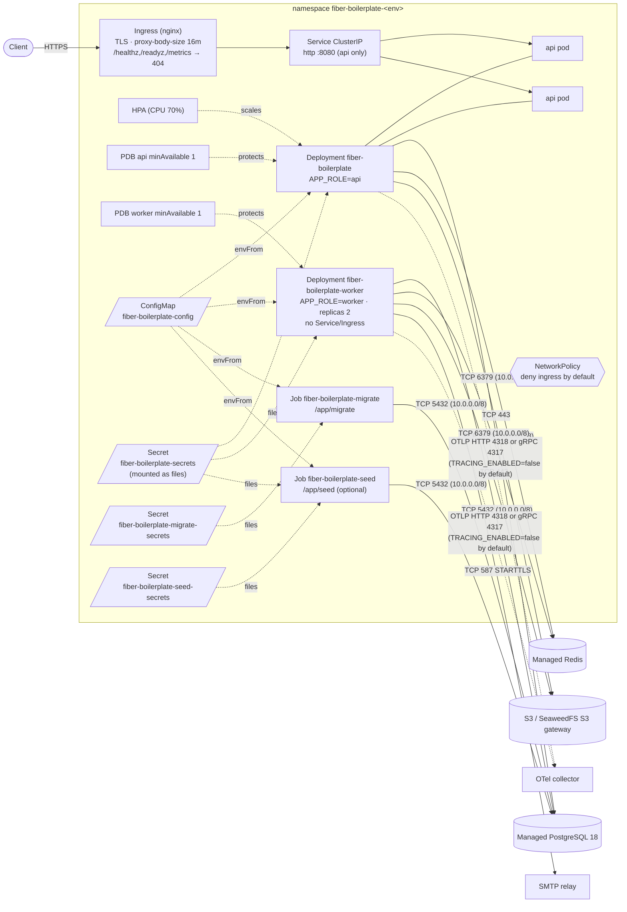
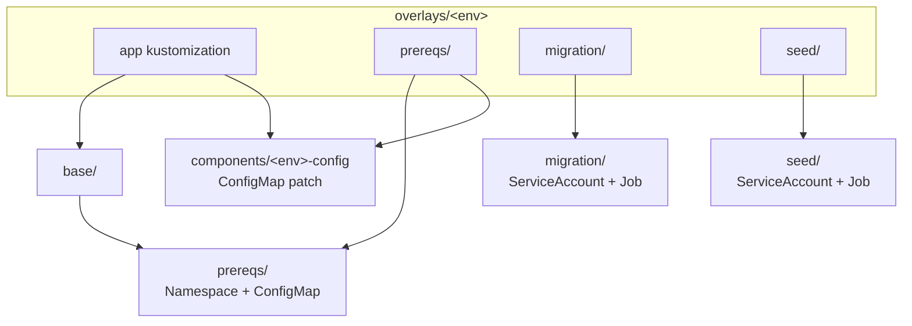
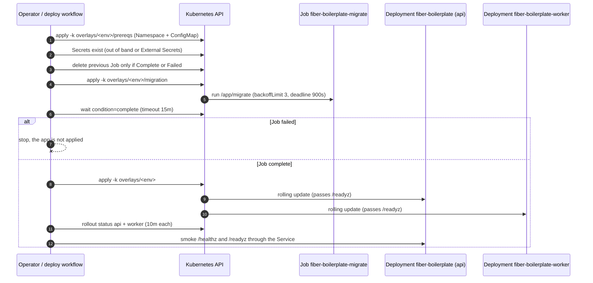
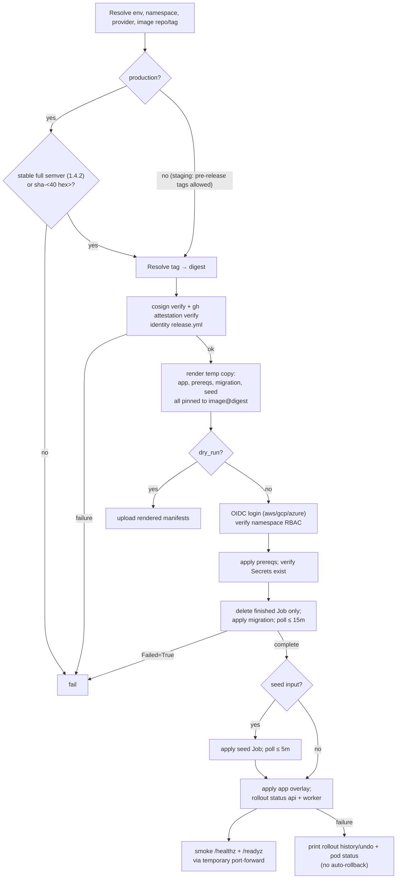

# Kubernetes deployment

Production-oriented Kubernetes manifests for the Fiber SaaS boilerplate. They
assume managed PostgreSQL and Redis, an S3-compatible bucket (AWS S3 or a
SeaweedFS S3 gateway), and an ingress-nginx controller. No stateful service is
bundled.

These files are templates. Replace every `OWNER/REPO`, `example.com`,
`REPLACE_*`, bucket, and CIDR placeholder before applying them. Do not commit a
rendered Secret.

## Topology



The default topology is split: the API serves HTTP only and the worker runs the
job worker, scheduler, and module background loops. See
[Process model](#process-model).

Only the API has a Service; the public Ingress reaches that Service and
explicitly returns 404 for `/healthz`, `/readyz`, `/health`, and `/metrics`.
NetworkPolicy denies all ingress in the namespace and re-allows only
ingress-nginx to api pods; worker pods accept no pod-to-pod ingress. Egress is
limited to DNS, the ports above, and HTTPS (S3, Google OAuth). A SeaweedFS
gateway on a non-443 port (for example `seaweedfs-s3.storage.svc:8333`) needs
the included extra egress rule.

## Contents

| Path | Purpose |
| --- | --- |
| `base/` | api Deployment, worker Deployment, Service, HPA, PDBs, NetworkPolicies, Ingress, ServiceAccounts |
| `base/worker/` | The worker Deployment (`APP_ROLE=worker`); part of the default base, no Service or Ingress |
| `base/kustomization.yaml` | Reusable app base (includes `../prereqs`) + image transformer; omits the Jobs and Secrets |
| `prereqs/` | Namespace + ConfigMap kustomization, applied before the migration Job |
| `migration/job.yaml` | One-shot `/app/migrate` Job + its ServiceAccount; applied separately, before the app |
| `seed/job.yaml` | One-shot `/app/seed` Job + its ServiceAccount (bootstrap admin); applied separately after the migration |
| `overlays/staging/`, `overlays/production/` | Namespace, HPA, api/worker resource, and Ingress patches + image tag; each has `prereqs/`, `migration/`, and `seed/` sub-overlays |
| `overlays/components/<env>-config` | Environment ConfigMap patch shared by the app and prereqs builds |
| `components/image-policy/` | Optional ClusterImagePolicy: require the release.yml keyless signature at admission |
| `components/external-secrets/` | Optional External Secrets integration for the three Secrets |
| `components/keda-worker-scaler/` | Optional KEDA ScaledObject on `jobs_queue_lag_seconds` |
| `examples/` | Buildable base + component examples so CI can render every component |
| `rbac/deployer-role.yaml` | Namespace-scoped Role for the OIDC deploy identity |
| `kustomization.yaml` | Convenience wrapper for `kubectl apply -k deploy/k8s` (legacy, `:latest`) |
| `secret.example.yaml` | Template for the runtime Secret; excluded from every kustomization |
| `migrate-secret.example.yaml` | Template for the migration-only Secret (schema owner) |
| `seed-secret.example.yaml` | Template for the seed-only Secret (`ADMIN_PASSWORD`) |



## Prerequisites

| Requirement | Notes |
| --- | --- |
| Kubernetes 1.32+, `kubectl` | `lifecycle.preStop.sleep` needs 1.30+; CI validates with kubeconform's 1.32 schemas. Built-in kustomize renders |
| `kustomize` v5.8.1+ | for `kustomize edit set image` in the manual flow (`kubectl kustomize` has no `edit`) |
| Managed PostgreSQL 18 over TLS | `DB_SSLMODE=verify-full` is mandatory because `APP_ENV=production`; set `DB_SSLROOTCERT` to a mounted provider CA when it is not in the system trust store |
| Managed Redis | required for correct session invalidation with more than one replica |
| S3-compatible bucket + credentials, or workload identity | recommended storage; local disk needs a shared ReadWriteMany volume (see below) |
| SMTP relay with STARTTLS | normally port 587; implicit TLS on 465 is not supported |
| ingress-nginx in `ingress-nginx` | or edit the Ingress class and NetworkPolicy selectors |
| metrics-server | for the api HPA |
| cert-manager or a pre-created TLS Secret | for the Ingress host |
| GHCR access | create an image pull Secret if the package is private |
| Optional: External Secrets Operator | for `components/external-secrets` |
| Optional: sigstore policy-controller | for `components/image-policy` (admission enforcement) |
| Optional: KEDA + Prometheus | for `components/keda-worker-scaler` |
| Optional CD | GitHub Environments `staging` and `production` with protection rules and OIDC federation (no kubeconfig Secret); see [Continuous deployment](#continuous-deployment-github-actions) |

## Environments and overlays

| Overlay | Namespace | HPA (api) | Notes |
| --- | --- | --- | --- |
| `overlays/staging` | `fiber-boilerplate-staging` | 2–4 replicas | Smaller api/worker CPU/memory requests, staging hosts and bucket, `imagePullPolicy: Always` |
| `overlays/production` | `fiber-boilerplate-production` | 3–10 replicas | Immutable image tag required, production hosts and bucket, `imagePullPolicy: IfNotPresent` |

Both reference `../../base`, keep the same resource names, and isolate
environments by namespace. The app overlay and its `prereqs` sub-overlay both
include `overlays/components/<env>-config`, so the migration Job and the
workloads read the same non-secret configuration. `overlays/<env>/migration` and
`overlays/<env>/seed` are separate kustomizations; the app overlay must never
include them.

Every overlay's image tag is the literal placeholder `REPLACE_WITH_IMAGE_TAG`.
The deploy workflow replaces it in a temporary copy; for a manual deployment,
set it in the app overlay **and** the migration and seed overlays (step 3).
`base/` still uses `ghcr.io/OWNER/REPO:latest` for the legacy
`kubectl apply -k deploy/k8s` path; do not use that path for production.

Render an overlay without a cluster:

```bash
kustomize build deploy/k8s/overlays/staging > /tmp/staging.yaml
kustomize build deploy/k8s/overlays/production > /tmp/production.yaml
kustomize build deploy/k8s/overlays/staging/prereqs > /tmp/staging-prereqs.yaml
kustomize build deploy/k8s/overlays/staging/migration > /tmp/staging-migration.yaml
```

## Deployment order



`kubectl apply -k` has no cross-resource ordering guarantee, which is why the
Jobs live outside every app kustomization.

## 1. Configure the placeholders

| File | Replace |
| --- | --- |
| `base/kustomization.yaml`, both app overlays, both migration overlays, both seed overlays | `images[].newName` (real repository); `newTag` (or a digest) for manual deploys. Keep `images[].name` exactly `ghcr.io/OWNER/REPO`: it is the stable source key used by the deploy workflow. The base Deployments and raw Job image literals are placeholders rewritten by these transformers. |
| `components/image-policy/clusterimagepolicy.yaml` | `OWNER/REPO` in both the image glob and the certificate identity regexp (lowercase) |
| `components/external-secrets/externalsecrets.yaml` | `REPLACE_WITH_*_SECRET_PATH` remote paths and the SecretStore name |
| `components/keda-worker-scaler/scaledobject.yaml` | Prometheus `serverAddress` and the lag threshold |
| `overlays/<env>/ingress-patch.yaml` | API host and TLS Secret |
| `overlays/components/<env>-config/configmap-patch.yaml` | `APP_FRONTEND_URL`, `CORS_ALLOW_ORIGINS`, `DB_HOST`, `SMTP_HOST`, `EMAIL_FROM_ADDRESS`, `STORAGE_S3_BUCKET`, `ADMIN_EMAIL` |
| `prereqs/configmap.yaml` | shared defaults such as `APP_TRUSTED_PROXIES`, `TENANT_REQUIRE_HEADER=true`, `DB_MIGRATE_USERNAME`, the S3 endpoint and access key ID; keep environment-specific values in the overlay components |
| `base/networkpolicy.yaml` | DB/Redis/OTel CIDRs and SMTP ports/ranges if your services are not in `10.0.0.0/8` or use different ports |
| overlay `namespace:` values + Namespace rename patches (and the matching `prereqs`/`migration`/`seed` overlays) | only if you rename an environment |
| `secret.example.yaml` (copied outside the repo) | every `REPLACE_*` value |

Find the remaining placeholders with:

```bash
grep -RInE 'OWNER/REPO|example\.com|REPLACE_|10\.0\.0\.0/8' deploy/k8s
```

Configuration rules:

| Setting | Rule |
| --- | --- |
| `CORS_ALLOW_HEADERS` | keep `Idempotency-Key`, `X-Tenant-Slug`, `Accept-Language`, `X-CSRF-Token` (cookie mode) |
| `CORS_EXPOSE_HEADERS` | keep `Idempotent-Replayed`, `Content-Language`, the version/deprecation headers, the rate-limit headers, and `X-Request-Id` |
| `TENANT_REQUIRE_HEADER=true` | required in production so header-less writes never fall back to tenant 1 |
| `APP_TRUSTED_PROXIES` | only the cluster pod/service CIDR containing ingress-nginx. `0.0.0.0/0` lets clients spoof `X-Forwarded-For` |
| `APP_PORT` (8080) | part of the probe, Service, container port, and NetworkPolicy contract. If you change it, update `containerPort`, the `http` named port, the Service port, the Ingress backend, and the NetworkPolicy ingress port |
| `APP_ROLE` | not in the ConfigMap. The api Deployment sets `api` and the worker sets `worker`; no Kubernetes workload runs `all` |
| `GOMEMLIMIT` | set from `limits.memory` with a `resourceFieldRef` (`divisor: "1"` yields bytes), so an overlay resource patch adjusts the Go soft limit automatically. Size the limit so the runtime has headroom for non-Go memory; the Go limit is not a hard reservation |
| Image tag | immutable release tag (for example `1.4.2`) in production, never `:latest`. The workflow resolves the tag to its digest, verifies that digest's signature and provenance, and deploys `image@sha256:...`; the app, migration, and seed overlays all get the same reference |
| `images[].name` | do not rename. Kustomize uses it only as the source key; the image is `newName:newTag`. If you must, change `SOURCE_IMAGE` in `.github/workflows/deploy.yml` and every base/overlay kustomization together |

## 2. Create the namespace and Secrets

```bash
export ENV=staging
export NS=fiber-boilerplate-staging

# Applies the environment Namespace and ConfigMap (with staging values).
kubectl apply -k deploy/k8s/overlays/$ENV/prereqs

cp deploy/k8s/secret.example.yaml /tmp/fiber-secret.yaml
# Edit metadata.namespace to $NS and replace every value, then:
kubectl apply -f /tmp/fiber-secret.yaml

cp deploy/k8s/migrate-secret.example.yaml /tmp/fiber-migrate-secret.yaml
# Edit metadata.namespace to $NS and set the schema-owner password, then:
kubectl apply -f /tmp/fiber-migrate-secret.yaml

# Only if you want the seed Job to create a bootstrap admin:
cp deploy/k8s/seed-secret.example.yaml /tmp/fiber-seed-secret.yaml
# Edit metadata.namespace to $NS and set ADMIN_PASSWORD, then:
kubectl apply -f /tmp/fiber-seed-secret.yaml
```

For production use `ENV=production` and `NS=fiber-boilerplate-production`. The
`prereqs` kustomization contains only the Namespace and ConfigMap; no Secret is
in a kustomization. Never commit a rendered Secret.

### Secrets are mounted as files

The workloads never use `envFrom` on a Secret. Each Secret is projected as a
read-only volume (`defaultMode 0440`, `fsGroup 65532`) and the process reads
each value through its `<NAME>_FILE` variable (`config/secretfile.go`). This
keeps values out of the container environment and `kubectl describe`, and lets
External Secrets refresh the volume in place.

The runtime Secret keys are part of the Deployment contract: dropping one makes
the pod fail startup instead of silently running with an empty secret.

| Secret | Keys | Consumer |
| --- | --- | --- |
| `fiber-boilerplate-secrets` | `JWT_SECRET`, `OAUTH_STATE_KEY`, `DB_PASSWORD`, `DB_BYPASS_PASSWORD`, `DATA_ENCRYPTION_KEY`, `WEBHOOK_SECRET_ENCRYPTION_KEY`, `METRICS_AUTH_TOKEN`, `REDIS_URL`, `STORAGE_S3_SECRET_KEY`, `SMTP_PASSWORD` | api + worker (files at `/var/run/secrets/fiber-boilerplate`); seed mounts the DB/data-encryption subset |
| `fiber-boilerplate-migrate-secrets` | `DB_MIGRATE_PASSWORD` | migration Job only (files at `/var/run/secrets/fiber-boilerplate-migrate`) |
| `fiber-boilerplate-seed-secrets` | `ADMIN_PASSWORD` | seed Job only (files at `/var/run/secrets/fiber-boilerplate-seed`) |

Non-secret halves of a credential pair stay in the ConfigMap:
`STORAGE_S3_ACCESS_KEY`, `SMTP_USERNAME`, `DB_MIGRATE_USERNAME`, and the
`ADMIN_EMAIL`/`ADMIN_NAME` of the bootstrap admin. For an unauthenticated SMTP
relay set `SMTP_USERNAME=""` and leave `SMTP_PASSWORD` empty.

The schema-owner password is deliberately **not** in
`fiber-boilerplate-secrets`: API and worker pods cannot read the role that may
run DDL or `ALTER TABLE ... NO FORCE ROW LEVEL SECURITY`. `ADMIN_PASSWORD` is
likewise seed-only, and `cmd/api` never seeds at startup.

| Value | Behavior |
| --- | --- |
| `JWT_SECRET`, `DATA_ENCRYPTION_KEY`, `WEBHOOK_SECRET_ENCRYPTION_KEY`, `OAUTH_STATE_KEY`, `METRICS_AUTH_TOKEN` | public sample keys (and short `REPLACE_ME` placeholders for the token) on purpose: production validation rejects them. `DATA_ENCRYPTION_KEY` must differ from `JWT_SECRET` |
| `DB_PASSWORD` | password of the runtime `app` role; it must not be a superuser, own tables, or be a member of a `BYPASSRLS` role |
| `DB_BYPASS_PASSWORD` | password of `app_bypass`; that role has `BYPASSRLS` for cross-tenant job/retention/catalog work and must not be a superuser, own tables, or be reachable with `SET ROLE` |
| `*_PREVIOUS_*` keys | set only during a [rotation](#secret-rotation); add the matching `_FILE` env then |
| optional keys | `GOOGLE_CLIENT_SECRET_FILE`, `JWT_PREVIOUS_SECRETS_FILE`, `DATA_ENCRYPTION_PREVIOUS_KEYS_FILE`, and `WEBHOOK_SECRET_ENCRYPTION_PREVIOUS_KEYS_FILE` are not set by default; add the key to the Secret and the env when needed |

Create both runtime roles once as the owner before the first migration:

```bash
psql -v app_user=app -v app_password='<DB_PASSWORD>' \
  -v bypass_user=app_bypass -v bypass_password='<DB_BYPASS_PASSWORD>' \
  -v owner=postgres -v schema=public \
  -f deploy/postgres/database-roles.sql
```

If the GHCR package is private, create a pull Secret and uncomment
`imagePullSecrets` in `base/deployment.yaml`, `base/worker/deployment.yaml`, and
`migration/job.yaml` / `seed/job.yaml`:

```bash
kubectl -n "$NS" create secret docker-registry ghcr-pull \
  --docker-server=ghcr.io \
  --docker-username=<github-user> \
  --docker-password=<PAT-with-read:packages>
```

### External Secrets (optional)

Instead of creating the three Secrets by hand, enable the component in the
`prereqs` overlay **and** the app overlay:

```yaml
# overlays/<env>/prereqs/kustomization.yaml AND overlays/<env>/kustomization.yaml
components:
  - ../../components/external-secrets
```

The prereqs build runs before the migration Job, so the Secrets (including the
schema-owner password) exist before the Job starts; the app build keeps the
ExternalSecret resources managed with the rest of the rollout. It creates
`fiber-boilerplate-secrets`, `fiber-boilerplate-migrate-secrets`, and
`fiber-boilerplate-seed-secrets` from a `ClusterSecretStore` named
`fiber-boilerplate`. Replace the remote paths in
`components/external-secrets/externalsecrets.yaml`; the component does not
create the store (provider setup stays with the platform team). The deploy
workflow waits up to two minutes for the Secrets to sync. See
[`examples/external-secrets`](examples/external-secrets) for the validated
render.

### Workload identity for S3

The api and worker have dedicated ServiceAccounts
(`fiber-boilerplate-api`, `fiber-boilerplate-worker`) with
`automountServiceAccountToken: false`. Prefer cloud workload identity over
static S3 keys:

- **EKS (IRSA or Pod Identity):** annotate only `fiber-boilerplate-api` and
  `fiber-boilerplate-worker` with the role annotation
  (`eks.amazonaws.com/role-arn`) or associate them with an EKS Pod Identity
  association. `automountServiceAccountToken: false` disables the default token;
  for IRSA, add an explicit projected token volume:
  ```yaml
  volumes:
    - name: aws-iam-token
      projected:
        sources:
          - serviceAccountToken:
              audience: sts.amazonaws.com
              expirationSeconds: 86400
              path: token
  # env: AWS_ROLE_ARN, AWS_WEB_IDENTITY_TOKEN_FILE=/var/run/secrets/aws/token
  ```
  Then remove `STORAGE_S3_ACCESS_KEY`/`STORAGE_S3_SECRET_KEY_FILE`.
- **GKE Workload Identity:** bind the Kubernetes ServiceAccounts to a Google
  service account (`iam.gke.io/gcp-service-account` annotation) and grant it
  object access on the bucket.
- **AKS Workload Identity:** label the ServiceAccounts
  (`azure.workload.identity/use: "true"`) and federate the managed identity.

The same identity is what External Secrets should use for its SecretStore.

## 3. Run the migration Job before the rollout

Only `cmd/migrate` applies DDL; the API and seed commands never migrate, so
replicas do not race on schema changes. Apply the namespace/ConfigMap and the
Secrets, apply and await the Job, and only then apply the app overlay:

```bash
export ENV=staging
export NS=fiber-boilerplate-staging
export IMAGE_REPO=ghcr.io/OWNER/REPO
export IMAGE_TAG=1.4.2

# Pin the same immutable tag in the app, migration, and seed overlays. The CD
# workflow does this in a temporary copy; these commands edit tracked files, so
# commit the pin intentionally or revert it after the deploy.
(cd deploy/k8s/overlays/$ENV && kustomize edit set image "$IMAGE_REPO=$IMAGE_REPO:$IMAGE_TAG")
(cd deploy/k8s/overlays/$ENV/migration && kustomize edit set image "$IMAGE_REPO=$IMAGE_REPO:$IMAGE_TAG")
(cd deploy/k8s/overlays/$ENV/seed && kustomize edit set image "$IMAGE_REPO=$IMAGE_REPO:$IMAGE_TAG")

if kubectl -n "$NS" get job fiber-boilerplate-migrate > /dev/null 2>&1; then
  existing="$(kubectl -n "$NS" get job fiber-boilerplate-migrate \
    -o jsonpath='{range .status.conditions[*]}{.type}={.status}{"\n"}{end}' 2>/dev/null || true)"
  if ! printf '%s' "$existing" | grep -qxE 'Complete=True|Failed=True'; then
    echo "Refusing to delete a migration Job that is not complete or failed." >&2
    exit 1
  fi
  kubectl -n "$NS" delete job fiber-boilerplate-migrate --wait=true
fi
kubectl apply -k deploy/k8s/overlays/$ENV/migration
kubectl -n "$NS" wait --for=condition=complete --timeout=15m job/fiber-boilerplate-migrate
kubectl -n "$NS" logs job/fiber-boilerplate-migrate
```

| Job setting | Value |
| --- | --- |
| `restartPolicy` | `Never` |
| `backoffLimit` | `3` |
| `activeDeadlineSeconds` | `900` |
| `ttlSecondsAfterFinished` | `86400` (completed Job removed after 24h) |
| Identity | `fiber-boilerplate-migrate` ServiceAccount, `runAsUser/Group: 65532`, read-only root filesystem |

Jobs are immutable: delete the old Job only after confirming it is complete or
failed. The migration, seed, and app overlays must use the same image
reference; the CD workflow sets all three from one digest and refuses mismatched
renders.

## 3b. Run the seed Job (optional)

```bash
kubectl apply -f /tmp/fiber-seed-secret.yaml   # ADMIN_PASSWORD only, from step 2
kubectl apply -k deploy/k8s/overlays/$ENV/seed
kubectl -n "$NS" wait --for=condition=complete --timeout=5m job/fiber-boilerplate-seed
kubectl -n "$NS" logs job/fiber-boilerplate-seed
```

The seed creates a missing admin only; an existing account is never re-promoted
or re-added. Skip it when accounts are created through invitations or Google
sign-in. The deploy workflow's `seed` input (default `false`) runs the same Job.

## 4. Deploy the application

```bash
kubectl apply -k deploy/k8s/overlays/$ENV
kubectl -n "$NS" rollout status deployment/fiber-boilerplate --timeout=10m
kubectl -n "$NS" rollout status deployment/fiber-boilerplate-worker --timeout=10m
```

This applies the Namespace, ConfigMap, ServiceAccounts, both Deployments,
Service, HPA, PDBs, NetworkPolicies, and Ingress, not the Jobs or any Secret.

| Property | Value and reason |
| --- | --- |
| api `spec.replicas` | intentionally absent: the HPA owns the count (2 staging min, 3 production min) |
| worker `spec.replicas` | `2`, no HPA: the scheduler lease and claims fail over. The KEDA component removes this field when enabled |
| Rolling update | `maxUnavailable: 0`, `maxSurge: 1`; a new pod must pass `/readyz` before an old pod is removed |
| api probes | startup `/healthz` (5s × 24), readiness `/readyz` (5s × 3), liveness `/healthz` (10s × 3) on the `http` port |
| worker probes | same paths; the worker listener serves only health and metrics |
| api shutdown | native `preStop.sleep` 5s, then the 20s shared shutdown budget; `terminationGracePeriodSeconds: 30` adds 5s margin |
| worker shutdown | no preStop; `terminationGracePeriodSeconds: 300` lets a handler that ignores cancellation be killed around the 5m job lease, at which point another worker reclaims the job |
| Security | `runAsNonRoot`, UID/GID 65532 (distroless nonroot), `fsGroup: 65532`, `seccompProfile: RuntimeDefault`, `readOnlyRootFilesystem: true`, no service-account token |
| Image | distroless/static, no shell; the container health check is `server healthcheck` |
| Spread (api) | `topologySpreadConstraints` across zones and hosts, `ScheduleAnyway` |

## 5. Verify

```bash
kubectl -n "$NS" get deploy,rs,pods,svc,hpa,pdb,sa
kubectl -n "$NS" rollout status deployment/fiber-boilerplate --timeout=5m

kubectl -n "$NS" port-forward svc/fiber-boilerplate 8080:8080
curl -fsS http://127.0.0.1:8080/healthz
curl -fsS http://127.0.0.1:8080/readyz
```

The public Ingress intentionally returns 404 for `/healthz`, `/readyz`,
`/health`, and `/metrics`; probe and scrape through the Service/pod instead.
`/metrics` also requires `Authorization: Bearer $METRICS_AUTH_TOKEN` in
production.

| Endpoint | Meaning |
| --- | --- |
| `/healthz` | process liveness; also the startup probe |
| `/readyz` | dependency check: only PostgreSQL down returns `503`; a Redis outage or a saturated DB pool reports `status:"degraded"` with `200` |

The startup probe only covers slow-but-reachable startup: the API exits during
startup if PostgreSQL, storage (including the S3 bucket check), or cache
initialization fails.

## 6. Rollback

```bash
kubectl -n "$NS" rollout history deployment/fiber-boilerplate
kubectl -n "$NS" rollout undo deployment/fiber-boilerplate
kubectl -n "$NS" rollout undo deployment/fiber-boilerplate-worker
kubectl -n "$NS" rollout status deployment/fiber-boilerplate --timeout=10m
```

Migrations are forward-only; the Job has no automatic down step. Prefer
backward-compatible migrations and test rollback before production. If a failed
release applied an incompatible migration, restore from a verified backup/PITR
snapshot or ship a forward fix.

## Continuous deployment (GitHub Actions)

`.github/workflows/deploy.yml` is a manual, environment-gated deploy path. It
also runs after a successful Release, and contacts no cluster unless OIDC
federation is configured. There is no static kubeconfig and no `KUBE_CONFIG`
secret.

### Triggers

| Trigger | Behavior |
| --- | --- |
| `workflow_dispatch` | inputs `environment`, `provider` (optional; defaults to `DEPLOY_PROVIDER`), `image_tag`, `seed`, `dry_run` |
| `workflow_run` (Release completed) | runs only for a **successful** Release triggered by a **stable** `v<semver>` tag; the tag becomes the production image tag. Pre-releases never auto-deploy. The checkout uses `head_sha` |
| Image resolution | resolves the tag to its digest, verifies `cosign verify` (keyless `release.yml@refs/tags/v<semver>`) **and** `gh attestation verify` (SLSA provenance from the same workflow) on `image@digest`, then renders/rolls out that digest |
| `dry_run: true` | renders app, prereqs, migration, and seed manifests from the tag (no registry call, no signature/provenance check) and uploads them; never contacts a cluster. `provider` is not required |
| Concurrency | serialized per environment, `cancel-in-progress: false` |

### OIDC federation instead of a kubeconfig

The deploy job requests a short-lived token (`id-token: write`) and authenticates
through one of three providers. Configure the provider once per repository or
GitHub Environment.

| Provider | Repository/environment variables | Login steps |
| --- | --- | --- |
| `aws` | `AWS_ROLE_ARN`, `AWS_REGION`, `AWS_EKS_CLUSTER` | `aws-actions/configure-aws-credentials`, then `aws eks update-kubeconfig` |
| `gcp` | `GCP_WORKLOAD_IDENTITY_PROVIDER`, `GCP_SERVICE_ACCOUNT`, `GCP_PROJECT_ID`, `GKE_CLUSTER`, `GKE_LOCATION` | `google-github-actions/auth`, then `get-gke-credentials` |
| `azure` | `AZURE_CLIENT_ID`, `AZURE_TENANT_ID`, `AZURE_SUBSCRIPTION_ID`, `AKS_RESOURCE_GROUP`, `AKS_CLUSTER` | `azure/login`, then `aks-set-context` |

Set `DEPLOY_PROVIDER` (`aws`, `gcp`, or `azure`) as a repository or Environment
variable so the Release-triggered path (which has no inputs) knows the provider.
The workflow fails before touching the cluster if the provider is unset or the
identity cannot create Deployments in the namespace.

### Namespace-scoped RBAC

Apply `rbac/deployer-role.yaml` in each target namespace and
`rbac/namespace-bootstrap-clusterrole.yaml` once, then bind them to the
federated principal. The Role grants only the resources a rollout manages
(Deployments, ReplicaSets, Jobs, pods/logs/port-forward, Services,
ServiceAccounts, ConfigMaps, HPA, PDB, Ingress, NetworkPolicy); Secrets are
read-only. The ClusterRole is the single cluster-scoped exception: `get`/`patch`
on exactly the two Namespace names, because the prereqs render includes the
cluster-scoped Namespace object. It grants no create or delete.

```bash
# Pre-create the namespaces once with the manifest's labels.
kubectl apply -k deploy/k8s/overlays/staging/prereqs        # as an admin
kubectl apply -k deploy/k8s/overlays/production/prereqs     # as an admin
kubectl apply -f deploy/k8s/rbac/namespace-bootstrap-clusterrole.yaml

# EKS: the IAM role mapped by an access entry (or aws-auth).
kubectl create clusterrolebinding fiber-boilerplate-namespace-bootstrap \
  --clusterrole=fiber-boilerplate-namespace-bootstrap \
  --user=arn:aws:iam::123456789012:role/gha-deploy
kubectl create rolebinding fiber-boilerplate-deployer -n "$NS" \
  --role=fiber-boilerplate-deployer --user=arn:aws:iam::123456789012:role/gha-deploy
# GKE: the Google service account used by google-github-actions/auth.
kubectl create clusterrolebinding fiber-boilerplate-namespace-bootstrap \
  --clusterrole=fiber-boilerplate-namespace-bootstrap \
  --user=deployer@my-project.iam.gserviceaccount.com
kubectl create rolebinding fiber-boilerplate-deployer -n "$NS" \
  --role=fiber-boilerplate-deployer --user=deployer@my-project.iam.gserviceaccount.com
# AKS: the Entra ID application object ID of the federated credential.
kubectl create clusterrolebinding fiber-boilerplate-namespace-bootstrap \
  --clusterrole=fiber-boilerplate-namespace-bootstrap --user=<object-id>
kubectl create rolebinding fiber-boilerplate-deployer -n "$NS" \
  --role=fiber-boilerplate-deployer --user=<object-id>
```

If you prefer the workflow to create namespaces, add `create` to the
ClusterRole rule; Kubernetes cannot restrict `create` by resource name, so that
is a broader grant. Never grant delete.

### Required GitHub configuration

| Name | Kind | Purpose |
| --- | --- | --- |
| `DEPLOY_PROVIDER` | variable | `aws`, `gcp`, or `azure` for Release-triggered deploys |
| provider variables above | variable | federated identity and cluster target |
| `GHCR_IMAGE` | variable or secret (optional) | bare lowercase image repository; must equal `ghcr.io/<owner>/<repo>` |

Create GitHub Environments `staging` and `production` with protection rules
(required reviewers, wait timer, deployment branches/tags). The workflow does not
create the application Secrets; it fails early if one is missing.

### Deploy sequence and image promotion



The workflow never auto-rolls back because migrations are forward-only.

## Process model

The default overlays run two Deployments:

| Workload | Role | Scaling | Surface |
| --- | --- | --- | --- |
| `fiber-boilerplate` | `APP_ROLE=api`: serves HTTP, enqueues jobs, never claims them | HPA on CPU (70%) | Service + public Ingress |
| `fiber-boilerplate-worker` | `APP_ROLE=worker`: job worker, scheduler (`SCHEDULER_ENABLED=true`), module background loops | fixed 2 replicas (or KEDA) | no Service, no Ingress; only health/metrics on 8080 |

`APP_ROLE=all` remains valid for a single-process local stack (`docker
compose`), but no Kubernetes default uses it: CI fails if a rendered overlay
contains `value: all`.

Bulkheads: copy the worker Deployment under another name with
`JOBS_WORKER_KINDS=<kinds>` and set `JOBS_WORKER_EXCLUDE_KINDS=<kinds>` on the
general worker, so every kind is claimed by exactly one group.

Retention: the worker's scheduler runs the hourly purge schedules
(`identity.tokens.purge_expired`, `files.trash.purge`, `files.orphans.sweep`,
`notifications.retention.purge`, `privacy.exports.purge`).

### KEDA scaling (optional)

The worker exports the `jobs_queue_lag_seconds` histogram from the claim query.
Enable `components/keda-worker-scaler` to scale on mean lag:

```yaml
components:
  - ../../components/keda-worker-scaler
```

The component removes `spec.replicas` (KEDA owns it) and adds a ScaledObject
with a Prometheus trigger: mean lag over 5 minutes, threshold 60s, 2–10
replicas, 300s cooldown. Patch `serverAddress` and the threshold for your
environment. A stalled queue exports **no observations** (a missing series), not
an ever-growing lag, so pair this with an alert on `jobs_dead_total` and on a
missing increase of `jobs_claimed_total`. Also keep
`DB_MAX_CONNS × 2 × maxReplicaCount` inside the database connection limit.

## Release tags and supply chain

### Tag ruleset

Protect `v*` tags with a GitHub tag ruleset (Settings → Rules → Rulesets → New
tag ruleset):

- target tags matching `v*`;
- restrict **creation** to the release managers team, and restrict
  **updates**/**deletions** to nobody;
- keep the default branch ruleset (pull request + required checks) so the tag's
  commit was reviewed.

`release.yml` enforces the last part independently: after checking the tag
shape, it runs `git merge-base --is-ancestor "$GITHUB_SHA" origin/main` and
refuses to publish when the tagged commit is not on `main`. A tag on a side
branch or an unmerged commit never produces a signed image.

### Release workflow

`.github/workflows/release.yml` runs on `v*` tags and manual dispatch; a manual
dispatch publishes only from a `v<semver>` tag ref.

| Step | Detail |
| --- | --- |
| Ref + ancestry check | semver tag shape, then `git merge-base --is-ancestor` against `origin/main` |
| Gate | `go vet ./...`, `go build ./...`, `go test -race ./...` |
| Build and push | `linux/amd64` and `linux/arm64`, `VERSION=<tag>` embedded in the binary, pushed **first**, unsigned |
| Scan | Trivy per platform (by each platform digest), CRITICAL/HIGH with fixes fail; a failure leaves the image unsigned |
| SBOM | one SPDX document per platform (`anchore/sbom-action`) |
| Signing | cosign keyless over the index digest (`release.yml` OIDC identity) |
| Provenance | `actions/attest-build-provenance` over the pushed index digest (SLSA v1.0 Build L2+), pushed to the registry and recorded in the repo |
| SBOM attestation | `actions/attest-sbom` over each platform digest |
| Self-verification | `cosign verify` and `gh attestation verify` for provenance and both SBOMs, with the same identity deploy.yml requires |

Actions are pinned to full commit SHAs resolved with
`gh api repos/<owner>/<repo>/commits/<tag>`, each release at least 14 days old;
base images are pinned by digest in the Dockerfile.

### Cluster-side enforcement (optional)

`components/image-policy` adds a sigstore policy-controller
`ClusterImagePolicy` that admits only images signed keyless by
`release.yml` on `refs/tags/v*` in this repository. Enable it in the `prereqs`
overlay so the policy exists before any workload is created, and optionally in
the app overlay for GitOps drift:

```yaml
# overlays/<env>/prereqs/kustomization.yaml
components:
  - ../../components/image-policy
```

Replace `OWNER/REPO` in the image glob and the certificate identity regexp.
This is defense in depth: deploy.yml already verifies the signature and
provenance before rollout, but the policy also blocks an out-of-band `kubectl
set image`. The component requires policy-controller with its admission webhook
enabled; without the controller the component is simply not enabled.

## Operational notes

### External PostgreSQL and Redis

| Setting | Where / rule |
| --- | --- |
| `DB_HOST`, `DB_PORT`, `DB_DATABASE`, `DB_USERNAME`, `DB_BYPASS_USERNAME`, `DB_MIGRATE_USERNAME`, `DB_SCHEMA`, `DB_SSLMODE`, `DB_SSLROOTCERT` | ConfigMap |
| `DB_PASSWORD`, `DB_BYPASS_PASSWORD`, `DB_MIGRATE_PASSWORD` | Secrets (mounted as files) |
| `DB_SSLMODE=verify-full` | mandatory in production; `require`/`verify-ca` do not verify the server and are rejected |
| `DB_MAX_CONNS` | per pool, and each pod opens two pools (normal + bypass). Production api 10 × 2 × HPA max 10 plus worker 10 × 2 × 2 = 240; keep the database limit above that. Staging is proportionally smaller |
| `CACHE_DRIVER=redis`, `REDIS_URL` | required for multi-replica session invalidation; use `rediss://` when the provider supports TLS |
| PgBouncer (transaction mode) | the API works with `DB_QUERY_EXEC_MODE=cache_statement` on PgBouncer 1.21+ or `cache_describe`/`describe_exec`. Point the migration Job directly at PostgreSQL with `DB_MIGRATE_HOST`/`DB_MIGRATE_PORT` |

### Object storage versus local uploads

The template uses `STORAGE_DRIVER=s3` and `readOnlyRootFilesystem: true`.
`STORAGE_S3_ACCESS_KEY` (ConfigMap) and `STORAGE_S3_SECRET_KEY_FILE` (Secret
file) are the static-key pair; prefer workload identity and remove both.
`STORAGE_S3_USE_SSL=true` is required in production unless
`STORAGE_S3_ALLOW_INSECURE=true` acknowledges plaintext storage.

Create the bucket before rollout: each replica checks bucket existence at
startup. Grant `s3:ListBucket` on the bucket so a missing key is a `404`, not a
`403` surfaced as `500`.

For `STORAGE_DRIVER=local`, mount a ReadWriteMany PVC at `/app/uploads` (the
commented example in `base/deployment.yaml` and `base/worker/deployment.yaml`)
writable by UID/GID 65532; the image's `/app/uploads` is owned by 65532.
`emptyDir` is node-local and single-replica only.

### Configuration changes

The ConfigMap is consumed with `envFrom`, so editing it does not update running
pods. Secret files are mounted volumes: the kubelet refreshes them, but the
application reads them at startup, so restart after a Secret or ConfigMap
change (a pod-template change, including the image tag, already triggers a
rollout):

```bash
kubectl -n "$NS" rollout restart deployment/fiber-boilerplate
kubectl -n "$NS" rollout restart deployment/fiber-boilerplate-worker
```

### Secret rotation

| Secret | Procedure |
| --- | --- |
| `JWT_SECRET` (+ previous) | add the new value to `JWT_PREVIOUS_SECRETS_FILE`, roll out; promote it, keep the old one until `JWT_ACCESS_TTL` passes; then remove |
| `DATA_ENCRYPTION_KEY` (+ previous) | two-phase; remove the old key once no queued/running job is sealed with it |
| `WEBHOOK_SECRET_ENCRYPTION_KEY` (+ previous) | two-phase; remove the old key after every endpoint/source secret is rotated and no pending delivery snapshot uses it |

Rotate all three in the same order and restart both Deployments. See
[Operations](../../docs/operations.md#key-rotation).

### Ingress, TLS, and network policy

| Topic | Detail |
| --- | --- |
| Ingress | ingress-nginx with forced SSL redirect and 60s proxy timeouts; replace host and TLS Secret in each overlay |
| Body size | `proxy-body-size` 16 MiB, above `APP_BODY_LIMIT` (12 MiB) and `STORAGE_MAX_FILE_SIZE` (10 MiB) |
| Operations paths | `server-snippet` returns 404 for `/healthz`, `/readyz`, `/health`, `/metrics`; exact-match locations win over `/`. This needs ingress-nginx with snippet annotations enabled (`controller.allowSnippetAnnotations=true`, off by default in recent releases). If your controller disables snippets, enforce the same exclusion with a proxy rule or a second listener instead. Probe/scrape in-cluster |
| Ingress policy | default deny-all ingress; only the `ingress-nginx` namespace may reach api pods on 8080. Worker pods accept no pod-to-pod ingress; unlock the commented `monitoring` rule for scrapes |
| Kubelet probes | CNI-dependent: uncomment the node/node-pod CIDR rule in `base/networkpolicy.yaml` if probes fail; never widen it to `0.0.0.0/0` |
| Egress | DNS; PostgreSQL 5432, Redis 6379, OTLP 4317/4318 to `10.0.0.0/8`; SMTP 587 and HTTPS 443 to `0.0.0.0/0` |

### HPA, PDB, and Go memory

The api HPA scales on CPU at 70% (staging 2–4, production 3–10). Both PDBs use
`minAvailable: 1` and `unhealthyPodEvictionPolicy: AlwaysAllow`, so an unhealthy
pod never blocks a node drain. The api PDB assumes at least two replicas; the
worker PDB assumes two.

`GOMEMLIMIT` is derived from each container's `limits.memory` with a
`resourceFieldRef` (`divisor: "1"`), so changing an overlay's memory limit
updates the Go soft limit and no separate value can drift. Leave enough non-Go
headroom inside the limit: the Go runtime counts its heap and stacks, while the
kernel charges the whole container.

## Validation

CI's `Manifests` job runs exactly these checks:

```bash
# actionlint (v1.7.12 in CI)
actionlint

# Render the base, both overlays, and every component example.
kustomize build deploy/k8s
for env in staging production; do
  kustomize build "deploy/k8s/overlays/$env"
  kustomize build "deploy/k8s/overlays/$env/prereqs"
  kustomize build "deploy/k8s/overlays/$env/migration"
  kustomize build "deploy/k8s/overlays/$env/seed"
done
for example in image-policy external-secrets keda-worker-scaler; do
  kustomize build "deploy/k8s/examples/$example"
done

# Strict schema validation, including the optional CRDs through the Datree
# CRDs catalog (policy.sigstore.dev, external-secrets.io, keda.sh).
kubeconform -strict -summary -kubernetes-version 1.32.0 \
  -schema-location default \
  -schema-location 'https://raw.githubusercontent.com/datreeio/CRDs-catalog/main/{{.Group}}/{{.ResourceKind}}_{{.ResourceAPIVersion}}.json' \
  deploy/k8s/migration/job.yaml deploy/k8s/seed/job.yaml \
  deploy/k8s/secret.example.yaml deploy/k8s/migrate-secret.example.yaml \
  deploy/k8s/seed-secret.example.yaml deploy/k8s/rbac/deployer-role.yaml \
  deploy/k8s/rbac/namespace-bootstrap-clusterrole.yaml
```

A `LifecycleHandler.sleep` field needs the Kubernetes 1.30+ schema; kubeconform
is pinned to 1.32.0. A component cannot be built on its own, which is why every
component has a committed example kustomization.
