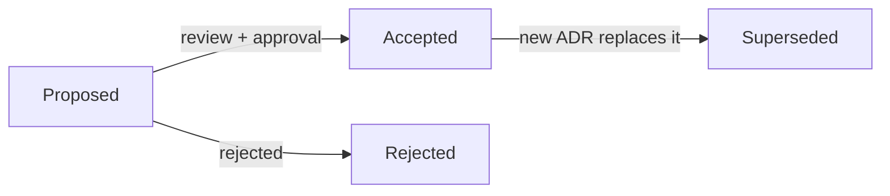

# Architecture Decision Records

Significant, hard-to-reverse decisions are recorded here in the
[MADR](https://adr.github.io/madr/) format. An ADR is never edited after it is
accepted; a new ADR supersedes it.

## How to add one

1. Copy [`template.md`](template.md) to `NNNN-short-title.md` (next number).
2. Fill in context, the options considered, the decision, and consequences.
3. Open it in the same PR as the change it governs (or before it).

## Index

| ADR | Decision | Status |
| --- | --- | --- |
| [0001](0001-record-architecture-decisions.md) | Record architecture decisions as ADRs | Accepted |
| [0002](0002-module-layering.md) | Module layering: transport-agnostic application layer, ratcheted by arch tests | Accepted |
| [0003](0003-tenant-scoped-rbac.md) | Tenant-scoped RBAC in the database; permission catalog stays in code | Accepted |
| [0004](0004-global-users-and-memberships.md) | Global users with tenant memberships (N:N) | Accepted |
| [0005](0005-per-module-migrations.md) | Per-module baseline migrations | Accepted |
| [0006](0006-api-spec-swag-then-spike.md) | Keep swag; spike OpenAPI-first on one module before deciding | Accepted |
| [0007](0007-row-level-security-after-schema.md) | PostgreSQL RLS as defense in depth, after the schema rework | Accepted |
| [0008](0008-idempotency-mismatch-422.md) | Idempotency key reused with a different body returns 422 | Accepted |
| [0009](0009-standard-webhooks.md) | Outbound/inbound webhooks follow the Standard Webhooks spec | Accepted |
| [0010](0010-mfa-totp-first.md) | MFA: TOTP and recovery codes first, WebAuthn later | Accepted |
| [0011](0011-versioned-event-envelope.md) | Versioned event envelope; webhooks subscribe to domain events | Accepted |
