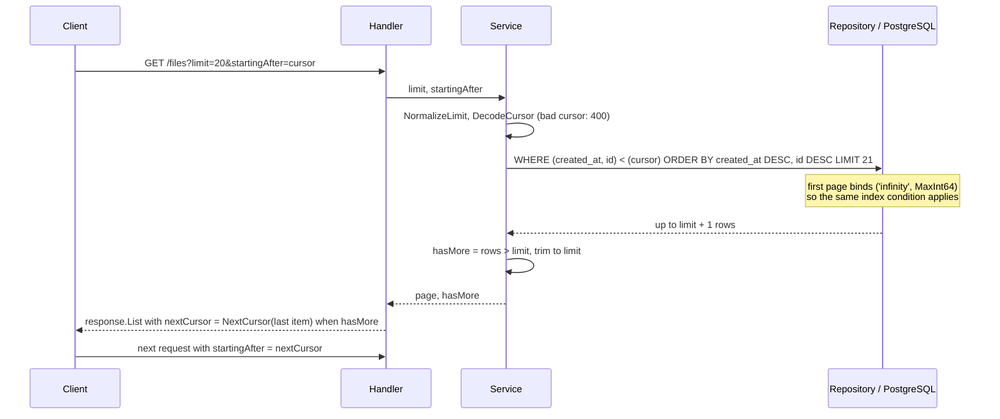
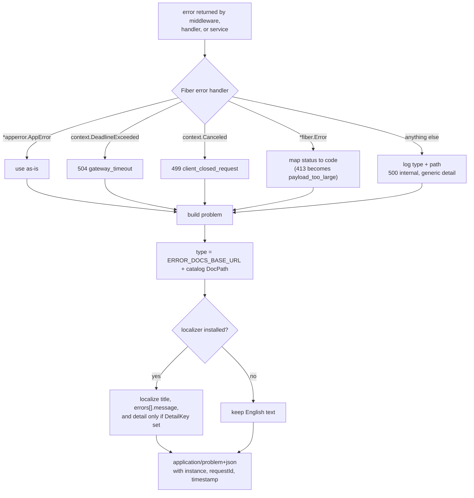
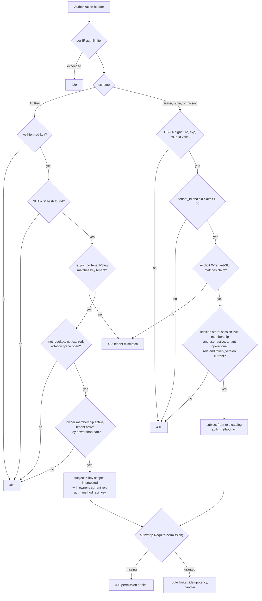

# API Design System

Conventions for every HTTP endpoint in this service. Changes here are public
contract changes; treat them as breaking unless additive. Middleware order and
module boundaries are in [Architecture](architecture.md#request-lifecycle).

## Base and versioning

- Base path: `/api/v1`. `/api/v2` exists only when at least one module
  implements `app.V2Module`; Swagger documents v1.
- The path selects the surface. `Accept-Version` is an optional assertion
  (`1`, `v1`, `2`, or `v2`); when present it must match the path, otherwise
  `406 api.version_unsupported`.
- Version-shaped paths that are not mounted (for example `/api/v3`) also return
  `406 api.version_unsupported`, never a generic 404.
- Every versioned response carries `API-Version` and `Vary: Accept-Version`.
  Deprecated versions add `Deprecation` (RFC 9745 `@<unix-seconds>`), `Sunset`
  (HTTP-date), and `Link` (`rel="deprecation"` to `DocsURL`,
  `rel="successor-version"` to the successor path).
- Additive fields are non-breaking. Removing/renaming fields or changing types,
  status codes, or error codes requires a new major version or a documented
  deprecation window.

## JSON conventions

| Rule | Example |
|---|---|
| camelCase keys | `accessToken`, `nextCursor` |
| IDs are JSON numbers (int64); timestamps are RFC 3339 UTC strings | `"createdAt": "2026-10-24T12:00:00Z"` |
| Optional values are omitted or `null`; empty lists are `[]`, never `null` | `"data": []` |
| Requests reject unknown fields and trailing JSON values | `{"name":"x","extra":1}` is rejected |
| Bodies are `application/json`; uploads are `multipart/form-data` | `POST /files/upload` |

## Success responses

| Status | Body |
|---|---|
| `200 OK` | The resource directly (no `{data,meta}` wrapper) |
| `201 Created` | The created resource; `Location` where applicable |
| `204 No Content` | No body |
| List | Stripe-style envelope (below) |

```json
{
  "object": "list",
  "url": "/api/v1/users",
  "data": [],
  "hasMore": false,
  "nextCursor": null
}
```

## Pagination

Forward-only cursor pagination: `limit` (1-100, default 20; a non-positive
value becomes 20 and anything above 100 becomes 100) + `startingAfter`. Cursors are opaque base64url of
`<created_at RFC3339Nano>:<id>`. Offset helpers are for small admin/export
tables only.



Cursor SQL always uses the plain row comparison
`(created_at, id) < (@cursor_created_at, @cursor_id)`; repositories bind
`DBCursor.CreatedAtParam()`/`IDParam()`. Never write `NOT @has_cursor OR ...`:
under a generic (prepared) plan the OR form can only filter, so a deep page
scans every newer row (measured on 200k rows: 2,742 buffers vs 5 with the row
comparison as an index condition).

## Update semantics

| Style | Routes |
|---|---|
| **Partial update** (pointer DTO fields; omitted fields unchanged) | `PUT /users/me`, `PUT /users/:id` (`name`, `email`; own id only), `PUT /admin/api-keys/:id` (`name`, `scopes`) |
| **Full replace** (omitted optional fields reset to defaults) | `PUT /webhooks/endpoints/:id` (`url`/`status`), `PUT /webhooks/inbound-sources/:id` (`name`/`slug`/`status`), `PUT /admin/features/flags/{key}` (database default/kill switch/description) |
| **Upsert** | Notification preference and feature-flag target `PUT`s |
| **RPC-style, kept for compatibility** | `POST /files/upload` (multipart create), `POST /admin/api-keys/:id/revoke` (alias of `DELETE /admin/api-keys/:id`) |

New modules use `PUT` only for full replacement, `PATCH` with pointer (or
explicitly nullable) fields for partial updates, create with
`POST /<collection>`, and model state transitions as sub-resource actions only
when no standard method fits.

## Errors (RFC 9457)

All errors use `application/problem+json`:

```json
{
  "type": "/errors/user-email-taken",
  "title": "Email already in use",
  "status": 409,
  "code": "user.email_taken",
  "detail": "email already registered",
  "instance": "/api/v1/auth/register",
  "requestId": "...",
  "timestamp": "2026-10-24T12:00:00.000Z",
  "errors": [{"path": "email", "code": "invalid_email", "message": "..."}]
}
```



| Rule | Detail |
|---|---|
| `code` | Stable dotted catalog identifier; clients may branch on it. Platform codes in `pkg/apperror/catalog.go`, module codes in `internal/modules/<m>/catalog/errors.go`. |
| `detail` | Public text only; never SQL, stack traces, or internal causes. Unhandled errors are logged and rendered as a generic 500. |
| `type` | `ERROR_DOCS_BASE_URL` + the catalog `DocPath`. |
| Validation | `422` with a flat `errors[]` (`path`, `code`, `message`). |
| Localization | `title` and `errors[].message` follow `Accept-Language` (`en`/`vi`) when i18n is enabled; `detail` only when the error carries `DetailKey` (`WithDetailKey`). `code`, `type`, `status`, `instance`, and paths never change. |
| Authorization | `403 permission.denied`. |
| Existence | Never disclose another user's or tenant's resource; return `404`. |

### Status codes

| Code | Meaning |
|---|---|
| 200 | Read/update success |
| 201 | Resource created |
| 204 | Deleted/no content |
| 400 | Malformed request, invalid cursor, invalid token |
| 401 | Missing/invalid authentication |
| 403 | Authenticated but not permitted, or tenant mismatch |
| 404 | Not found (including non-owned or cross-tenant resources) |
| 406 | Accept-Version mismatch or unsupported `/api/vN` |
| 409 | Conflict, duplicate, last-admin, idempotency key still in progress, data export not ready |
| 410 | Expired data export |
| 413 | Body or upload too large |
| 415 | Unsupported media type |
| 422 | Validation failed, or `Idempotency-Key` reused with a different body (`idempotency.key_mismatch`) |
| 429 | Rate limited |
| 499 | Client closed the request (logged; usually never delivered) |
| 500 | Internal error |
| 503 | Dependency degraded / not ready, or required audit intent unavailable |
| 504 | Request timeout |

## Authentication and authorization

Every authenticated module route accepts both credential types through one
chain (`app.Deps.Authenticate()`), after a per-IP `auth` limiter. The route's
`authzhttp.Require` then decides access, so an API key reaches a route only when
its scopes include the permission. Routes that act on the caller's sign-in
sessions or global identity are JWT-only: `POST /auth/logout-all`,
`GET /auth/sessions`, `DELETE /auth/sessions/:id`, and
`POST /auth/invitations/accept`; `DELETE /users/:id` on the caller's own id
refuses API keys.



| Aspect | JWT (`Authorization: Bearer <jwt>`) | API key (`Authorization: ApiKey <prefix>_<secret>`) |
|---|---|---|
| Credential | HS256 pinned; requires `exp`, checks `iss`/`aud`, rejects a future `iat` (30s leeway); carries the user id, `tenant_id`, `sid` (session id), `token_version`, and the transitional membership `role`; the `kid` header selects the verification key (`JWT_SECRET` or a `JWT_PREVIOUS_SECRETS` entry), an unknown `kid` is `401`, and a token without `kid` verifies against the active secret only | Secret is 32 random bytes, unpadded base64url; only its SHA-256 hash is stored; shown once at creation/rotation |
| Tenant | `tenant_id` claim is authoritative; a missing/zero/negative `tenant_id` or `sid` claim is `401` (tokens minted before sessions existed must log in again) | Key's bound tenant is authoritative |
| Revocation | Session store loads the token's session and requires it unrevoked, the membership and user active, the tenant operational, and the role and token version to match (5s snapshot per session, generation-keyed per-user invalidation); revoking a session, a membership change, or `POST /auth/logout-all` (version bump) apply on the next request | Revoke is immediate; rotation keeps the old key valid for a 24-hour grace window unless revoked; a ban or removal revokes keys issued before it |
| Permissions | Derived from the role catalog | Explicit scopes intersected with the owner's **current** role, so a key never exceeds its scopes or survives a demotion |
| Locals set | `user_id`, `tenant_id`, `auth_method=jwt` | `user_id`, `tenant_id`, `api_key_id`, `auth_method=api_key` |

- Each sign-in opens a session (the RFC 9700 refresh-token family). Refresh
  tokens rotate atomically, are single-use, version-bound, and scoped to the
  issuing tenant. Presenting an already-used refresh token is reuse: the whole
  session is revoked (`refresh_reuse`) and the call returns `401
  auth.refresh_invalid`, so both the legitimate client and an attacker must
  sign in again. Access tokens are short-lived.
- `POST /auth/logout-all` requires `sessions:revoke` (every built-in role holds
  it), revokes every session of the user in every tenant, and bumps the token
  version, invalidating access tokens immediately.
- Permissions are declared in module catalogs (`catalog/permissions.go`) and
  shared back-office permissions in `internal/platform/authz/permissions.go`;
  routes use `authzhttp.Require`. Never check role strings ad hoc in handlers.
- Object-level checks use `authz.Subject` (explicit permissions, tenant, owner,
  cross-tenant flag, attributes) with `Policy`/`PolicySet`, `TenantPolicy`, and
  `OwnerPolicy`. `Authorize` runs an RBAC pre-check, then deny-overrides
  evaluation: deny is `403 permission.denied`, conceal is `404`. With no
  subject, only an `authz.SystemContext` (trusted background caller) is
  allowed; any other subject-less call is `403` (fail closed).

## Tenants

| Rule | Behavior |
|---|---|
| Selection | `X-Tenant-Slug` (lowercase `[a-z0-9-]{1,63}`) on `/api/v1` routes. Without it, local/test mode resolves `TENANT_DEFAULT_SLUG` (`default`); `TENANT_REQUIRE_HEADER=true` rejects header-less requests and is **required in production**. |
| Unknown tenant | Invalid, unknown, or suspended slugs (including the default) return `404 tenant not found`. Startup checks only existence, so a suspended default tenant does not crash the API or seed. |
| Browser fallback | Validated `?tenant=<slug>` is accepted on `GET /auth/google` and the reset/verify endpoints; an explicit header wins. Reset, verification, and invitation links include `?tenant=<slug>` so the frontend knows where to sign in. |
| Authenticated requests | Use the JWT claim or the key's tenant. An explicit header resolving elsewhere is `403 permission.denied` (`tenant mismatch`). An API key without a header stays usable for its own tenant. The key owner's membership and tenant status are re-read on every authentication, so bans, removals, deletions, role changes, and suspensions apply immediately (`401`). |
| Slug cache | `tenant.CachedResolver`: 30s for hits, 5s for unknown slugs, 1,024 entries per process. Suspension reaches header-resolved public routes within 30s; authenticated requests are rejected independently by the session/API-key checks. |
| Scoping | Users are global (ADR 0004): an email and a Google subject belong to one live account across all tenants, and a user joins tenants through memberships. Login, registration, refresh, and member lists use the request tenant; login needs an active membership there. Password reset and email verification are per user and ignore the tenant for the token lookup. Non-member user ids and cross-tenant file/notification ids return `404`, refresh tokens of another tenant `401`. |
| OAuth | Tenant bound into the signed `state`; the callback ignores `X-Tenant-Slug` and rejects unknown or suspended tenants (including mid-flow). Require-header mode does not block it. |
| Logout | `POST /auth/logout` revokes the session of the presented refresh token by possession, with or without the header; `204` even if already gone. |
| Idempotency | Scope includes tenant ID/slug, so the same key/body/IP in another tenant is a new request. |
| Responses | `UserResponse`/`FileResponse` include additive `tenantId`; `UserResponse` is the user as a member of that tenant (`role`, `membershipStatus`, `joinedAt`, `bannedAt`). |
| Remaining | Row-level security and per-tenant limits/quotas. |

## Users, memberships, sessions, and invitations

Users are global identities; a user joins tenants through memberships
(ADR 0004). Everything below runs in the request tenant unless stated.

| Flow | Behavior |
|---|---|
| Register `POST /auth/register` | Creates user + password + active `user` membership in the request tenant (gated by the `user_registration` flag). An address that already has an account in **any** tenant gets `409 user.email_taken`; an existing user joins another tenant only through an invitation. An address banned in this tenant is refused even after the banned account was deleted. |
| Login `POST /auth/login` | Global password plus an active membership in the request tenant; a correct password without one (never joined, banned, removed) gets the same `401 auth.invalid_credentials` as a wrong password. Opens a session; the JWT carries `sid`. |
| Google OAuth | Resolves the identity through `user_identities`: an existing link, a verified local account with the same address (linking requires both a verified local email and Google `verified_email`), or a new account with a membership in the state tenant (`user_registration` flag). An existing user must already be an active member of the state tenant; Google sign-in never joins a tenant implicitly. |
| Password reset / email verification | Per user. The emailed link keeps `?tenant=<slug>` only so the frontend knows where to sign in afterwards. |
| `GET /auth/sessions` | JWT only, `profile:read`. Cursor list of the caller's live sessions in the request tenant, newest first (`id`, `userAgent`, `ip`, `createdAt`, `lastUsedAt`, `current`). |
| `DELETE /auth/sessions/:id` | JWT only, `sessions:revoke`, Tier 2 audited (`auth.session_revoked`). Revokes one of the caller's sessions in the request tenant (`204`); its refresh tokens stop working and its access tokens are rejected. Another user's session is `404`. |
| `POST /auth/logout-all` | Revokes every session in every tenant and bumps `token_version`. |
| `PUT /users/:id` | Own id only (the global profile is editable only by its owner); another id is `403 permission.denied`, even for a tenant admin. |
| `DELETE /users/:id` | Own id: deletes the global account (every tenant; JWT only; refused with `409` while the caller is the last active admin of any tenant). Another id: removes that membership from the request tenant (`admin:users:delete`); the account and other tenants are untouched. |
| Admin ban/unban/role | Membership changes in the request tenant; ban, role change, and removal end the member's sessions there. API keys issued before a ban or removal stay revoked after an unban or re-join. |
| Member lists | `GET /users`, `GET /admin/users` paginate members by `(joinedAt, id)`; `UserResponse` adds `membershipStatus` and `joinedAt`. |

Invitations (pending invites are `invitations` rows; there is no "invited"
membership state):

| Route | Auth | Behavior |
|---|---|---|
| `POST /invitations` | `invitations:write` (admin only), `Idempotency-Key` | Invites an address (role defaults to `user`) and emails a link; the token is never returned. Re-inviting a pending address replaces its token, role, and 7-day expiry. An active or banned member is `409 membership.exists`. Tier 1 audited (`invitation.created`, committed with the email job). |
| `GET /invitations` | `invitations:read` (admin only) | Cursor list of the tenant's pending invitations, newest first. |
| `DELETE /invitations/:id` | `invitations:write` | Deletes a pending invitation (`204`); its link stops working. Tier 1 (`invitation.revoked`). |
| `POST /auth/invitations/accept` | JWT only, `profile:write`, `Idempotency-Key` | A signed-in user (from any tenant) joins the invitation's tenant. The token is checked by possession; the invitation must be pending, unexpired, addressed to the caller's current email, and its tenant operational. Marks the email verified; reactivates a removed membership; an active or banned membership is `409 membership.exists`. Returns the new membership (`200 UserResponse`); sign in again with that tenant's `X-Tenant-Slug`. Tier 1 (`invitation.accepted`). |
| `POST /auth/invitations/signup` | Public (token possession), strict limiter, `Idempotency-Key` | Creates the account for the invited address and joins the tenant (send `X-Tenant-Slug` from the link). The email is verified by the token; not gated by `user_registration`. An address that already has an account is `409 user.email_taken` (sign in and accept instead). `201 UserResponse`; no tokens are issued. Tier 1 (`invitation.accepted`). |

Unknown, expired, already accepted, or misaddressed invitation tokens are
`400 invitation.invalid`.

## Privacy: data export and erasure

All routes are in the request tenant; another user's or tenant's export id is
`404` (never `403`). See [ADR 0013](adr/0013-gdpr-data-export-and-erasure.md).

| Route | Auth | Behavior |
|---|---|---|
| `POST /me/data-exports` | `profile:read`, `Idempotency-Key`, Tier 2 audit (`data_export.requested`) | Creates one tenant-scoped export request and enqueues `privacy.data_export` in the same transaction. One `queued`/`running` export per membership; a second is `409 data_export.in_progress`. Returns `201 DataExportResponse` (`status: queued`). |
| `GET /me/data-exports` | `profile:read` | Cursor list of the caller's exports, newest first. |
| `GET /me/data-exports/:id` | `profile:read` | Status of one export (`queued`, `running`, `ready`, `failed`, `expired`). A ready export includes `downloadUrl`; unknown/other-owner/cross-tenant ids are `404 data_export.not_found`. |
| `GET /me/data-exports/:id/download` | `profile:read` | Streams the ready JSON document with `Cache-Control: private, no-store`. `409 data_export.not_ready` before it is ready; `410 data_export.expired` once expired; after the hourly purge deletes the row it is `404`. Other users/tenants get `404`. |
| `POST /me/erasure` | JWT only, `profile:write`, current password, Tier 1 (`user.erasure_requested`) | Re-authenticates with `currentPassword`, then queues one `privacy.erase` job per membership plus `privacy.erase.finalize`. `202 {status: accepted}`. API keys are refused; refused with `409 user.last_admin` when the caller is the last active admin of any tenant; passwordless accounts cannot self-erase this way. |
| `POST /admin/users/:id/erasure` | JWT only, `admin:users:delete`, Tier 1 (`admin.user.erasure_requested`) | Same global erasure for a member of the request tenant; no password re-auth (the admin is already authenticated). `404` for a non-member, `409 user.last_admin` for the last active admin. API keys are refused because this ends global access. |

The export document is `{userId, tenantId, generatedAt, sections: {identity,
files, notifications, apikeys, features, webhooks}}`. Files include metadata
plus base64 content; apikeys include metadata and scopes, never a hash;
features include only user targets; webhooks include user-attributed event
payloads and delivery summaries. The document is deleted at expiry (7 days),
and failed/stuck builds are cleaned by the same hourly
`privacy.exports.purge` job (blob, then row). Erasure anonymizes the global
user (`erased+<id>@invalid`, empty name, `status: deleted`) only after every
membership is `removed`, and deletes credentials, identities, sessions, and
tokens. Audit rows keep only ids and outcomes.

## Headers

| Header | Direction | Contract |
|---|---|---|
| `X-Request-Id` | in/out | Accepted if valid, otherwise generated; echoed on responses. |
| `X-Tenant-Slug` | in | Selects the tenant; in the default CORS allow list. |
| `Idempotency-Key` | in | Opt-in on mutating routes; 1-128 chars of `[A-Za-z0-9._:-]`. |
| `Idempotent-Replayed` | out | `true` on a replayed response. |
| `Accept-Language` | in | `en`/`vi` with q-values, case-insensitive tags, region truncation (`vi-VN` → `vi`), wildcards, `I18N_DEFAULT_LOCALE` fallback. |
| `Content-Language`, `Vary: Accept-Language` | out | Negotiated locale. |
| `Accept-Version` | in | Asserts the path version. |
| `API-Version`, `Vary: Accept-Version`, `Deprecation`, `Sunset`, `Link` | out | Version metadata. |

`Location`, `ETag`, locale, and version metadata are exposed through CORS.

## Rate limits and quotas

- Configured via `RATE_LIMIT_*`; tiers are strict/normal/relaxed with separate
  keyspaces. Cache-backed (Redis in production; memory is single-replica only).
- Keyed per API key when authenticated with `ApiKey`, otherwise per user, then
  per IP. `429` is retryable. Rotating a key moves later requests to a new
  bucket.
- Every authenticated route runs an IP-keyed `auth` limiter
  (`RATE_LIMIT_AUTH_MAX`/`RATE_LIMIT_AUTH_WINDOW_SECS`) before credential
  verification, so bogus credentials cannot drive unthrottled lookups.
- Login attempts, password-reset requests, and verification resends have
  dedicated lockouts. Login failures count per (email, client IP), across
  tenants because the password is global; the
  account locks for every IP only after 5x the per-IP threshold, so one client
  cannot lock someone else out.

## Idempotency

| Situation | Response |
|---|---|
| First request with a key | Runs normally; a 2xx is cached for 24h |
| Same key, same body, after success | Replayed response with `Idempotent-Replayed: true` (not re-audited) |
| Same key while the first is in progress | `409` |
| Same key, different body (non-multipart, up to 1 MiB, SHA-256 bound) | `422` `idempotency.key_mismatch` (ADR 0008; was `409` before) |
| Lock claim reply lost | The lock key is re-read: own token runs, another token gets `409`, missing key or read error fails open |
| Cache unavailable | Fails open (request runs without idempotency) |

- Send `Idempotency-Key` on POST/PUT/PATCH/DELETE when retries are possible.
  The scope is method, path, tenant ID/slug, and caller (user ID, or IP for
  public routes).
- **Excluded by design:** auth token-minting endpoints, and secret-returning
  routes (API-key create/rotate, webhook endpoint/inbound-source create and
  `rotate-secret`) so plaintext secrets never enter the shared cache. A retried
  rotation rotates again and returns the newest secret.
- Operational detail (locks, TTLs, metrics): [Operations](operations.md).

## Audit and fail-closed behavior

- Privileged mutations are audited before or atomically with the write. A
  Tier 1 mutation whose audit row cannot commit rolls back and returns
  `503 system.audit_unavailable` (retryable). A Tier 2 route whose required
  pre-write intent cannot be stored returns the same 503 before the handler
  runs.
- Retrying after 503 is safe with the same `Idempotency-Key` where supported.
  Replayed responses are not re-audited.
- Audit metadata is sanitized: passwords, tokens, emails, and URLs are
  redacted; size/depth are bounded. No public endpoint echoes audit data.
- A completion failure after a Tier 2 mutation cannot undo the write; alert on
  `audit_completion_failures_total` and stale `started` rows.

## Files

- `POST /files/upload` accepts multipart `file`, enforces size and a MIME
  allowlist, and stores blobs under `<tenantID>/<userID>/<uuid>.<ext>`.
- Downloads are authenticated and tenant/ownership checked; there is no public
  `/uploads` tree. Cross-tenant or other-owner ids return `404`, never `403`
  (`authz.TenantPolicy` + `authz.OwnerPolicy`; admin services use the tenant
  policy only).
- Deletes are soft; `includeDeleted=true` exposes trash to the owner and
  `POST /files/:id/restore` requires `files:restore`.
- `Content-Disposition` follows RFC 6266/5987.

## Webhooks

| Route group | Contract |
|---|---|
| `/api/v1/webhooks/endpoints`, `/deliveries`, `/inbound-sources` | `webhooks:read` / `webhooks:write` (`admin` role). Endpoint/source create return a plaintext `secret` once; `rotate-secret` returns the new one once; reads never include it. |
| Mutations | Create/update/delete, `rotate-secret`, and delivery replay are Tier 2: a required `audithttp.Guard` intent is written first (`503 system.audit_unavailable` changes nothing). The domain event (`webhook.endpoint.*`, `webhook.inbound_source.*`, `webhook.delivery.replayed`) is recorded as its child. Update/delete/replay accept `Idempotency-Key`. |
| Delivery list | Filters `endpointId`, `status=pending|succeeded|dead`, cursor `limit`/`startingAfter`. `GET /deliveries/:id` includes the payload snapshot; lists omit it. |
| Replay | `POST /deliveries/:id/replay` creates a new event (new `id`) with the original type, `dataVersion`, actor, and data, delivered with the endpoint's current URL and active secret; `201`. |
| Outbound requests | At-least-once [Standard Webhooks](https://github.com/standard-webhooks/standard-webhooks/blob/main/spec/standard-webhooks.md). Headers `webhook-id` (event id, dedupe key), `webhook-timestamp`, `webhook-signature: v1,<base64>` (space-separated during rotation). HMAC-SHA256 over `<webhook-id>.<webhook-timestamp>.<raw-body>` with the decoded `whsec_` key. Body: the versioned envelope `{id, type, dataVersion, occurredAt, tenantId, actor, data}`. |
| Event payloads | Contract structs in `internal/contracts/<producer>`, never REST DTOs. Additive changes keep `dataVersion`; breaking ones get a new `dataVersion` or type. |
| Retries | `408`, `425`, `429`, `5xx` retry; other `3xx`/`4xx` are `dead`. `Retry-After` (seconds or HTTP date) is honored, capped by config. Targets are SSRF-checked at dial time (private/loopback/link-local need `WEBHOOK_SSRF_ALLOWLIST`); redirects are never followed. |
| Inbound | `POST /api/v1/webhooks/inbound/{id}` is public: no JWT, tenant header, or idempotency middleware. Requires `webhook-id`, `webhook-timestamp`, `webhook-signature` (Standard Webhooks, signed with the source's `whsec_` secret); the event type is the body's `type`. Unknown/disabled source `404`, bad/stale signature `401`, malformed JSON/IDs/type `400`, new event `202`, repeat `(source, webhook-id)` `200` with `duplicate: true`. |

Full signing, retry, secret, and operations contract: [Webhooks](webhooks.md).

## API keys

- `POST /admin/api-keys` returns the plaintext key once; list/get never do.
  Name, owner (`userId`, defaults to the caller), scopes, and optional
  `expiresAt` are recorded. Scopes must be known permissions within the owner's
  role.
- `PUT /admin/api-keys/:id` updates name/scopes; `DELETE /admin/api-keys/:id`
  or `POST /admin/api-keys/:id/revoke` revokes immediately (idempotent);
  `POST /admin/api-keys/:id/rotate` issues a new secret while the old one stays
  valid for 24 hours unless revoked. Create, update, and rotate reject (`400`)
  any scope the caller does not hold, so an API-key caller cannot mint a
  broader key.
- Routes require `admin:api_keys:read|create|update|revoke|rotate`, are
  tenant-scoped, and return `404` for another tenant's key id. Mutations accept
  `Idempotency-Key` except create and rotate.
- Every lifecycle mutation is Tier 1 audited (`api_key.created|updated|revoked|rotated`
  in the mutation transaction): an audit failure rolls back and returns
  `503 system.audit_unavailable` with no secret. Re-revoking writes no second
  row. Metadata never carries the secret or hash.

## Notifications

All routes require a JWT or a scoped API key and are scoped to the
authenticated user and request tenant; other users' or tenants' ids return
`404`.

| Route | Behavior |
|---|---|
| `GET /notifications/` | Cursor list (`limit`, `startingAfter`), `unreadOnly=true`, standard list envelope |
| `GET /notifications/unread-count` | `{count}` |
| `GET /notifications/:id` | One owned notification |
| `POST /notifications/:id/read` | Sets `read_at` once; repeats do not move it |
| `POST /notifications/read-all` | Marks every unread row; `{updated}` |
| `POST /notifications/send` | Admin-only (`notifications:send`), target in the request tenant; `201` with `notification` (null when in-app is disabled) and `emailQueued`. Tier 2 audited (`notification.sent`). |
| `GET /notification-preferences/` | Explicit rows only; a missing row means enabled |
| `PUT /notification-preferences/` | Upsert `{type, channel, enabled}`; `type` matches `^[a-z0-9][a-z0-9._-]*$` (max 100); channels `in_app`, `email` |

Writes accept `Idempotency-Key`. The caller's own state changes are audited by
the best-effort generic middleware. With email enabled, the in-app row and the
durable `email.send` job commit together; an enqueue failure returns `500` and
leaves no row. Both channels disabled suppresses the notification (create is a
successful no-op; admin send returns `notification: null`,
`emailQueued: false`). Email delivery is at-least-once.

## Jobs and asynchronous work

- Email verification/reset, notification email, and other durable work are
  queued in PostgreSQL; delivery is at-least-once, so clients must tolerate
  duplicate emails.
- Outbound webhooks use the same queue. Identity registration, file
  upload/delete (user and admin), and file restore publish `user.registered`,
  `file.uploaded`, `file.deleted`, and `file.restored` domain events with
  `events.PublishTx` inside the mutation's transaction, so a publish failure
  fails the mutation. Webhooks subscribes durably and fans out after commit.
- Terminal jobs clear payloads; succeeded/dead rows are retained 30 days.
- Email payloads are encrypted at rest; notification emails use the same
  `email.send`/`email.send.encrypted` kinds as identity emails.

## Feature flags

| Route | Behavior |
|---|---|
| `GET /admin/features/flags` | Catalog with database default, kill switch, configured marker, and the caller's effective value/source |
| `GET /admin/features/flags/{key}` | Flag plus current-tenant targets; unknown key `404` |
| `PUT /admin/features/flags/{key}` | Replaces database default, kill switch, description. `killSwitch` required; omitting `enabled` clears the default (NULL) |
| `DELETE /admin/features/flags/{key}` | Removes the row (reverts to environment/compiled defaults); idempotent; `409` while any tenant has a target |
| `GET`/`PUT /admin/features/flags/{key}/targets` | List/upsert targets; omit `userId` for tenant-wide; tenant always from the request context; another tenant's user is `400` |
| `DELETE .../targets/{id}` | Scoped to tenant and flag |

- Precedence: force-off > kill switch > user target > tenant target > database
  default > environment > compiled default ([Feature Flags](feature-flags.md)).
- Flag-row writes are process-wide and allowed only for admins of the platform
  tenant (id 1); others get `403 permission.denied`.
- Reads require `admin:features:read`; mutations require
  `admin:features:write`, accept `Idempotency-Key`, and use a required
  `audithttp.Guard`.
- A route gated by a disabled flag returns `404 feature.disabled`.

## Compatibility checklist

| Change | Classification |
|---|---|
| New field, new endpoint | Additive |
| New enum value | Allowed if clients are tolerant; document it |
| New permission | Additive; grant it deliberately |
| New required request field | Breaking |
| Changed error code or status | Breaking |
| Changed tenant selection (omitting `X-Tenant-Slug` must keep the default tenant) | Breaking |
| New migration | Fresh installs update the baseline; deployed DBs get `make migrate-create module=<owner> name=<purpose>` |
