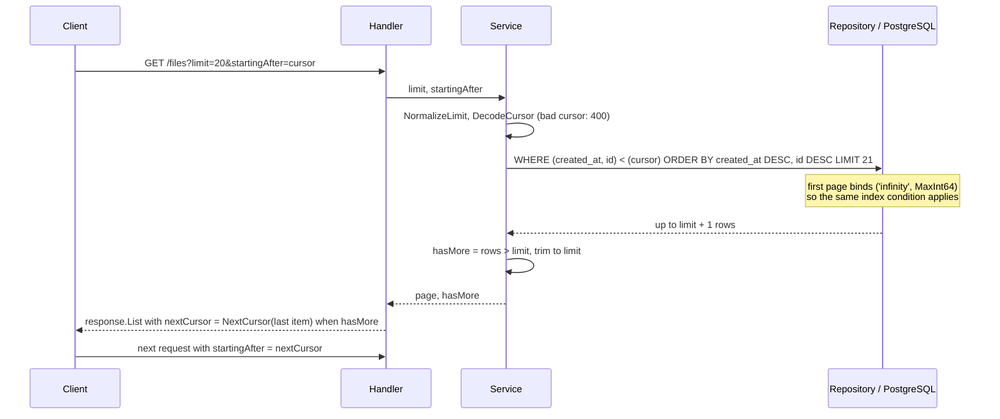
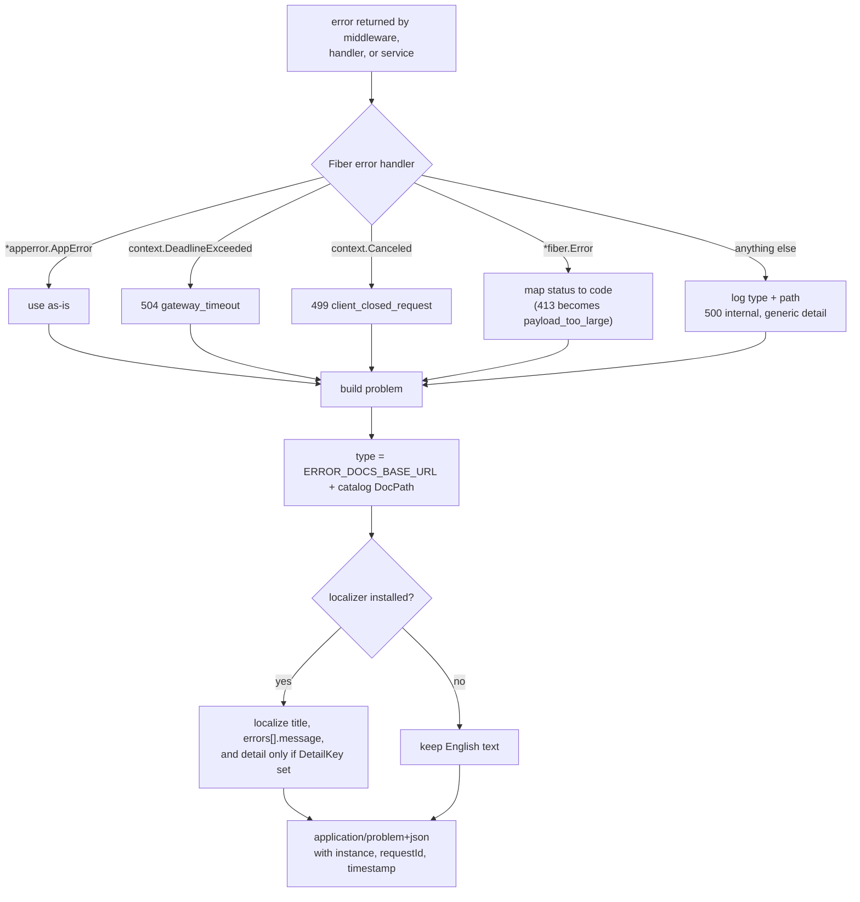
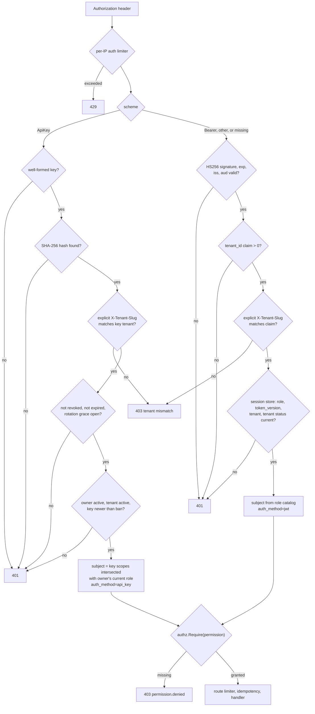

# API Design System

Conventions for every HTTP endpoint in this service. Changes here are public
contract changes; treat them as breaking unless additive. Middleware order and
module boundaries are in [Architecture](architecture.md#request-lifecycle).

## Base and versioning

- Base path: `/api/v1`. `/api/v2` exists only when at least one module
  implements `app.V2Module`; Swagger documents v1.
- The path selects the surface. `Accept-Version` is an optional assertion
  (`1`, `v1`, `2`, or `v2`); when present it must match the path, otherwise
  `406 api.version_unsupported`.
- Version-shaped paths that are not mounted (for example `/api/v3`) also return
  `406 api.version_unsupported`, never a generic 404.
- Every versioned response carries `API-Version` and `Vary: Accept-Version`.
  Deprecated versions add `Deprecation` (RFC 9745 `@<unix-seconds>`), `Sunset`
  (HTTP-date), and `Link` (`rel="deprecation"` to `DocsURL`,
  `rel="successor-version"` to the successor path).
- Additive fields are non-breaking. Removing/renaming fields or changing types,
  status codes, or error codes requires a new major version or a documented
  deprecation window.

## JSON conventions

| Rule | Example |
|---|---|
| camelCase keys | `accessToken`, `nextCursor` |
| IDs are JSON numbers (int64); timestamps are RFC 3339 UTC strings | `"createdAt": "2026-10-24T12:00:00Z"` |
| Optional values are omitted or `null`; empty lists are `[]`, never `null` | `"data": []` |
| Requests reject unknown fields and trailing JSON values | `{"name":"x","extra":1}` is rejected |
| Bodies are `application/json`; uploads are `multipart/form-data` | `POST /files/upload` |

## Success responses

| Status | Body |
|---|---|
| `200 OK` | The resource directly (no `{data,meta}` wrapper) |
| `201 Created` | The created resource; `Location` where applicable |
| `204 No Content` | No body |
| List | Stripe-style envelope (below) |

```json
{
  "object": "list",
  "url": "/api/v1/users",
  "data": [],
  "hasMore": false,
  "nextCursor": null
}
```

## Pagination

Forward-only cursor pagination: `limit` (1-100, default 20; a non-positive
value becomes 20 and anything above 100 becomes 100) + `startingAfter`. Cursors are opaque base64url of
`<created_at RFC3339Nano>:<id>`. Offset helpers are for small admin/export
tables only.



Cursor SQL always uses the plain row comparison
`(created_at, id) < (@cursor_created_at, @cursor_id)`; repositories bind
`DBCursor.CreatedAtParam()`/`IDParam()`. Never write `NOT @has_cursor OR ...`:
under a generic (prepared) plan the OR form can only filter, so a deep page
scans every newer row (measured on 200k rows: 2,742 buffers vs 5 with the row
comparison as an index condition).

## Update semantics

| Style | Routes |
|---|---|
| **Partial update** (pointer DTO fields; omitted fields unchanged) | `PUT /users/me`, `PUT /users/:id` (`name`, `email`), `PUT /admin/api-keys/:id` (`name`, `scopes`) |
| **Full replace** (omitted optional fields reset to defaults) | `PUT /webhooks/endpoints/:id` (`url`/`status`), `PUT /webhooks/inbound-sources/:id` (`name`/`slug`/`status`), `PUT /admin/features/flags/{key}` (database default/kill switch/description) |
| **Upsert** | Notification preference and feature-flag target `PUT`s |
| **RPC-style, kept for compatibility** | `POST /files/upload` (multipart create), `POST /admin/api-keys/:id/revoke` (alias of `DELETE /admin/api-keys/:id`) |

New modules use `PUT` only for full replacement, `PATCH` with pointer (or
explicitly nullable) fields for partial updates, create with
`POST /<collection>`, and model state transitions as sub-resource actions only
when no standard method fits.

## Errors (RFC 9457)

All errors use `application/problem+json`:

```json
{
  "type": "/errors/user-email-taken",
  "title": "Email already in use",
  "status": 409,
  "code": "user.email_taken",
  "detail": "email already registered",
  "instance": "/api/v1/auth/register",
  "requestId": "...",
  "timestamp": "2026-10-24T12:00:00.000Z",
  "errors": [{"path": "email", "code": "invalid_email", "message": "..."}]
}
```



| Rule | Detail |
|---|---|
| `code` | Stable dotted catalog identifier; clients may branch on it. Platform codes in `pkg/apperror/catalog.go`, module codes in `internal/modules/<m>/catalog/errors.go`. |
| `detail` | Public text only; never SQL, stack traces, or internal causes. Unhandled errors are logged and rendered as a generic 500. |
| `type` | `ERROR_DOCS_BASE_URL` + the catalog `DocPath`. |
| Validation | `422` with a flat `errors[]` (`path`, `code`, `message`). |
| Localization | `title` and `errors[].message` follow `Accept-Language` (`en`/`vi`) when i18n is enabled; `detail` only when the error carries `DetailKey` (`WithDetailKey`). `code`, `type`, `status`, `instance`, and paths never change. |
| Authorization | `403 permission.denied`. |
| Existence | Never disclose another user's or tenant's resource; return `404`. |

### Status codes

| Code | Meaning |
|---|---|
| 200 | Read/update success |
| 201 | Resource created |
| 204 | Deleted/no content |
| 400 | Malformed request, invalid cursor, invalid token |
| 401 | Missing/invalid authentication |
| 403 | Authenticated but not permitted, or tenant mismatch |
| 404 | Not found (including non-owned or cross-tenant resources) |
| 406 | Accept-Version mismatch or unsupported `/api/vN` |
| 409 | Conflict, duplicate, last-admin, idempotency in progress or body mismatch |
| 413 | Body or upload too large |
| 415 | Unsupported media type |
| 422 | Validation failed |
| 429 | Rate limited |
| 499 | Client closed the request (logged; usually never delivered) |
| 500 | Internal error |
| 503 | Dependency degraded / not ready, or required audit intent unavailable |
| 504 | Request timeout |

## Authentication and authorization

Every authenticated module route accepts both credential types through one
chain (`app.Deps.Authenticate()`), after a per-IP `auth` limiter. The route's
`authz.Require` then decides access, so an API key reaches a route only when
its scopes include the permission. `POST /auth/logout-all` is the exception:
JWT-only.



| Aspect | JWT (`Authorization: Bearer <jwt>`) | API key (`Authorization: ApiKey <prefix>_<secret>`) |
|---|---|---|
| Credential | HS256 pinned; requires `exp`, checks `iss`/`aud`, rejects a future `iat` (30s leeway); carries `token_version` and `tenant_id` | Secret is 32 random bytes, unpadded base64url; only its SHA-256 hash is stored; shown once at creation/rotation |
| Tenant | `tenant_id` claim is authoritative; missing/zero/negative claim is `401` (tokens minted before multi-tenancy must log in again) | Key's bound tenant is authoritative |
| Revocation | Session store compares role, token version, tenant, and tenant status (5s cache, generation-keyed invalidation); `POST /auth/logout-all` bumps the version | Revoke is immediate; rotation keeps the old key valid for a 24-hour grace window unless revoked; a ban revokes keys issued before it |
| Permissions | Derived from the role catalog | Explicit scopes intersected with the owner's **current** role, so a key never exceeds its scopes or survives a demotion |
| Locals set | `user_id`, `tenant_id`, `auth_method=jwt` | `user_id`, `tenant_id`, `api_key_id`, `auth_method=api_key` |

- Refresh tokens rotate atomically, are single-use, version-bound, and scoped
  to the issuing tenant. Access tokens are short-lived.
- `POST /auth/logout-all` requires `sessions:revoke` (every built-in role holds
  it), revokes all refresh tokens, and bumps the token version, invalidating
  access tokens immediately.
- Permissions are declared in module catalogs (`catalog/permissions.go`) and
  shared back-office permissions in `internal/platform/authz/permissions.go`;
  routes use `authz.Require`. Never check role strings ad hoc in handlers.
- Object-level checks use `authz.Subject` (explicit permissions, tenant, owner,
  cross-tenant flag, attributes) with `Policy`/`PolicySet`, `TenantPolicy`, and
  `OwnerPolicy`. `Authorize` runs an RBAC pre-check, then deny-overrides
  evaluation: deny is `403 permission.denied`, conceal is `404`.

## Tenants

| Rule | Behavior |
|---|---|
| Selection | `X-Tenant-Slug` (lowercase `[a-z0-9-]{1,63}`) on `/api/v1` routes. Without it, local/test mode resolves `TENANT_DEFAULT_SLUG` (`default`); `TENANT_REQUIRE_HEADER=true` rejects header-less requests and is **required in production**. |
| Unknown tenant | Invalid, unknown, or suspended slugs (including the default) return `404 tenant not found`. Startup checks only existence, so a suspended default tenant does not crash the API or seed. |
| Browser fallback | Validated `?tenant=<slug>` is accepted on `GET /auth/google` and the reset/verify endpoints; an explicit header wins. Reset/verification links include `?tenant=<slug>`. |
| Authenticated requests | Use the JWT claim or the key's tenant. An explicit header resolving elsewhere is `403 permission.denied` (`tenant mismatch`). An API key without a header stays usable for its own tenant. Key owner and tenant status are re-read on every authentication, so bans, deletions, role changes, and suspensions apply immediately (`401`). |
| Slug cache | `tenant.CachedResolver`: 30s for hits, 5s for unknown slugs, 1,024 entries per process. Suspension reaches header-resolved public routes within 30s; authenticated requests are rejected independently by the session/API-key checks. |
| Scoping | Emails and Google IDs are unique per tenant. Login, registration, refresh, reset, and verification use the request tenant. Cross-tenant user/file/notification ids return `404`, refresh tokens `401`, reset/verification tokens `400` (without consuming the token). |
| OAuth | Tenant bound into the signed `state`; the callback ignores `X-Tenant-Slug` and rejects unknown or suspended tenants (including mid-flow). Require-header mode does not block it. |
| Logout | `POST /auth/logout` revokes the presented refresh token by possession, with or without the header; `204` even if already gone. |
| Idempotency | Scope includes tenant ID/slug, so the same key/body/IP in another tenant is a new request. |
| Responses | `UserResponse`/`FileResponse` include additive `tenantId`. |
| Remaining | Row-level security and per-tenant limits/quotas. |

## Headers

| Header | Direction | Contract |
|---|---|---|
| `X-Request-Id` | in/out | Accepted if valid, otherwise generated; echoed on responses. |
| `X-Tenant-Slug` | in | Selects the tenant; in the default CORS allow list. |
| `Idempotency-Key` | in | Opt-in on mutating routes; 1-128 chars of `[A-Za-z0-9._:-]`. |
| `Idempotent-Replayed` | out | `true` on a replayed response. |
| `Accept-Language` | in | `en`/`vi` with q-values, case-insensitive tags, region truncation (`vi-VN` → `vi`), wildcards, `I18N_DEFAULT_LOCALE` fallback. |
| `Content-Language`, `Vary: Accept-Language` | out | Negotiated locale. |
| `Accept-Version` | in | Asserts the path version. |
| `API-Version`, `Vary: Accept-Version`, `Deprecation`, `Sunset`, `Link` | out | Version metadata. |

`Location`, `ETag`, locale, and version metadata are exposed through CORS.

## Rate limits and quotas

- Configured via `RATE_LIMIT_*`; tiers are strict/normal/relaxed with separate
  keyspaces. Cache-backed (Redis in production; memory is single-replica only).
- Keyed per API key when authenticated with `ApiKey`, otherwise per user, then
  per IP. `429` is retryable. Rotating a key moves later requests to a new
  bucket.
- Every authenticated route runs an IP-keyed `auth` limiter
  (`RATE_LIMIT_AUTH_MAX`/`RATE_LIMIT_AUTH_WINDOW_SECS`) before credential
  verification, so bogus credentials cannot drive unthrottled lookups.
- Login attempts, password-reset requests, and verification resends have
  dedicated lockouts. Login failures count per (tenant, email, client IP); the
  account locks for every IP only after 5x the per-IP threshold, so one client
  cannot lock someone else out.

## Idempotency

| Situation | Response |
|---|---|
| First request with a key | Runs normally; a 2xx is cached for 24h |
| Same key, same body, after success | Replayed response with `Idempotent-Replayed: true` (not re-audited) |
| Same key while the first is in progress | `409` |
| Same key, different body (non-multipart, up to 1 MiB, SHA-256 bound) | `409` |
| Lock claim reply lost | The lock key is re-read: own token runs, another token gets `409`, missing key or read error fails open |
| Cache unavailable | Fails open (request runs without idempotency) |

- Send `Idempotency-Key` on POST/PUT/PATCH/DELETE when retries are possible.
  The scope is method, path, tenant ID/slug, and caller (user ID, or IP for
  public routes).
- **Excluded by design:** auth token-minting endpoints, and secret-returning
  routes (API-key create/rotate, webhook endpoint/inbound-source create and
  `rotate-secret`) so plaintext secrets never enter the shared cache. A retried
  rotation rotates again and returns the newest secret.
- Operational detail (locks, TTLs, metrics): [Operations](operations.md).

## Audit and fail-closed behavior

- Privileged mutations are audited before or atomically with the write. A
  Tier 1 mutation whose audit row cannot commit rolls back and returns
  `503 system.audit_unavailable` (retryable). A Tier 2 route whose required
  pre-write intent cannot be stored returns the same 503 before the handler
  runs.
- Retrying after 503 is safe with the same `Idempotency-Key` where supported.
  Replayed responses are not re-audited.
- Audit metadata is sanitized: passwords, tokens, emails, and URLs are
  redacted; size/depth are bounded. No public endpoint echoes audit data.
- A completion failure after a Tier 2 mutation cannot undo the write; alert on
  `audit_completion_failures_total` and stale `started` rows.

## Files

- `POST /files/upload` accepts multipart `file`, enforces size and a MIME
  allowlist, and stores blobs under `<tenantID>/<userID>/<uuid>.<ext>`.
- Downloads are authenticated and tenant/ownership checked; there is no public
  `/uploads` tree. Cross-tenant or other-owner ids return `404`, never `403`
  (`authz.TenantPolicy` + `authz.OwnerPolicy`; admin services use the tenant
  policy only).
- Deletes are soft; `includeDeleted=true` exposes trash to the owner and
  `POST /files/:id/restore` requires `files:restore`.
- `Content-Disposition` follows RFC 6266/5987.

## Webhooks

| Route group | Contract |
|---|---|
| `/api/v1/webhooks/endpoints`, `/deliveries`, `/inbound-sources` | `webhooks:read` / `webhooks:write` (`admin` role). Endpoint/source create return a plaintext `secret` once; `rotate-secret` returns the new one once; reads never include it. |
| Mutations | Create/update/delete, `rotate-secret`, and delivery replay are Tier 2: a required `audit.Guard` intent is written first (`503 system.audit_unavailable` changes nothing). The domain event (`webhook.endpoint.*`, `webhook.inbound_source.*`, `webhook.delivery.replayed`) is recorded as its child. Update/delete/replay accept `Idempotency-Key`. |
| Delivery list | Filters `endpointId`, `status=pending|succeeded|dead`, cursor `limit`/`startingAfter`. `GET /deliveries/:id` includes the payload snapshot; lists omit it. |
| Replay | `POST /deliveries/:id/replay` creates a new delivery with the endpoint's current URL and active secret; `201`. |
| Outbound requests | At-least-once. Headers `X-Webhook-Id`, `X-Webhook-Delivery` (dedupe key), `X-Webhook-Event`, `X-Webhook-Timestamp`, `X-Webhook-Signature: v1=<hex>`, `X-Webhook-Attempt`. HMAC-SHA256 over `<X-Webhook-Id>.<timestamp>.<X-Webhook-Event>.<raw-body>`. |
| Retries | `408`, `425`, `429`, `5xx` retry; other `3xx`/`4xx` are `dead`. `Retry-After` (seconds or HTTP date) is honored, capped by config. Targets are SSRF-checked at dial time (private/loopback/link-local need `WEBHOOK_SSRF_ALLOWLIST`); redirects are never followed. |
| Inbound | `POST /api/v1/webhooks/inbound/{id}` is public: no JWT, tenant header, or idempotency middleware. Requires `X-Webhook-Id`, `X-Webhook-Timestamp`, `X-Webhook-Signature`. Unknown/disabled source `404`, bad/stale signature `401`, malformed JSON/IDs `400`, new event `202`, repeat `(source, X-Webhook-Id)` `200` with `duplicate: true`. |

Full signing, retry, secret, and operations contract: [Webhooks](webhooks.md).

## API keys

- `POST /admin/api-keys` returns the plaintext key once; list/get never do.
  Name, owner (`userId`, defaults to the caller), scopes, and optional
  `expiresAt` are recorded. Scopes must be known permissions within the owner's
  role.
- `PUT /admin/api-keys/:id` updates name/scopes; `DELETE /admin/api-keys/:id`
  or `POST /admin/api-keys/:id/revoke` revokes immediately (idempotent);
  `POST /admin/api-keys/:id/rotate` issues a new secret while the old one stays
  valid for 24 hours unless revoked. Create, update, and rotate reject (`400`)
  any scope the caller does not hold, so an API-key caller cannot mint a
  broader key.
- Routes require `admin:api_keys:read|create|update|revoke|rotate`, are
  tenant-scoped, and return `404` for another tenant's key id. Mutations accept
  `Idempotency-Key` except create and rotate.
- Every lifecycle mutation is Tier 1 audited (`api_key.created|updated|revoked|rotated`
  in the mutation transaction): an audit failure rolls back and returns
  `503 system.audit_unavailable` with no secret. Re-revoking writes no second
  row. Metadata never carries the secret or hash.

## Notifications

All routes require a JWT or a scoped API key and are scoped to the
authenticated user and request tenant; other users' or tenants' ids return
`404`.

| Route | Behavior |
|---|---|
| `GET /notifications/` | Cursor list (`limit`, `startingAfter`), `unreadOnly=true`, standard list envelope |
| `GET /notifications/unread-count` | `{count}` |
| `GET /notifications/:id` | One owned notification |
| `POST /notifications/:id/read` | Sets `read_at` once; repeats do not move it |
| `POST /notifications/read-all` | Marks every unread row; `{updated}` |
| `POST /notifications/send` | Admin-only (`notifications:send`), target in the request tenant; `201` with `notification` (null when in-app is disabled) and `emailQueued`. Tier 2 audited (`notification.sent`). |
| `GET /notification-preferences/` | Explicit rows only; a missing row means enabled |
| `PUT /notification-preferences/` | Upsert `{type, channel, enabled}`; `type` matches `^[a-z0-9][a-z0-9._-]*$` (max 100); channels `in_app`, `email` |

Writes accept `Idempotency-Key`. The caller's own state changes are audited by
the best-effort generic middleware. With email enabled, the in-app row and the
durable `email.send` job commit together; an enqueue failure returns `500` and
leaves no row. Both channels disabled suppresses the notification (create is a
successful no-op; admin send returns `notification: null`,
`emailQueued: false`). Email delivery is at-least-once.

## Jobs and asynchronous work

- Email verification/reset, notification email, and other durable work are
  queued in PostgreSQL; delivery is at-least-once, so clients must tolerate
  duplicate emails.
- Outbound webhooks use the same queue. Identity registration, file
  upload/delete (user and admin), and file restore emit `user.registered`,
  `file.uploaded`, `file.deleted`, and `file.restored` inside the mutation's
  transaction (`DispatchTx`), so an outbox failure fails the mutation; only the
  unwired fallback dispatches after commit and logs failures.
- Terminal jobs clear payloads; succeeded/dead rows are retained 30 days.
- Email payloads are encrypted at rest; notification emails use the same
  `email.send`/`email.send.encrypted` kinds as identity emails.

## Feature flags

| Route | Behavior |
|---|---|
| `GET /admin/features/flags` | Catalog with database default, kill switch, configured marker, and the caller's effective value/source |
| `GET /admin/features/flags/{key}` | Flag plus current-tenant targets; unknown key `404` |
| `PUT /admin/features/flags/{key}` | Replaces database default, kill switch, description. `killSwitch` required; omitting `enabled` clears the default (NULL) |
| `DELETE /admin/features/flags/{key}` | Removes the row (reverts to environment/compiled defaults); idempotent; `409` while any tenant has a target |
| `GET`/`PUT /admin/features/flags/{key}/targets` | List/upsert targets; omit `userId` for tenant-wide; tenant always from the request context; another tenant's user is `400` |
| `DELETE .../targets/{id}` | Scoped to tenant and flag |

- Precedence: force-off > kill switch > user target > tenant target > database
  default > environment > compiled default ([Feature Flags](feature-flags.md)).
- Flag-row writes are process-wide and allowed only for admins of the platform
  tenant (id 1); others get `403 permission.denied`.
- Reads require `admin:features:read`; mutations require
  `admin:features:write`, accept `Idempotency-Key`, and use a required
  `audit.Guard`.
- A route gated by a disabled flag returns `404 feature.disabled`.

## Compatibility checklist

| Change | Classification |
|---|---|
| New field, new endpoint | Additive |
| New enum value | Allowed if clients are tolerant; document it |
| New permission | Additive; grant it deliberately |
| New required request field | Breaking |
| Changed error code or status | Breaking |
| Changed tenant selection (omitting `X-Tenant-Slug` must keep the default tenant) | Breaking |
| New migration | Fresh installs update the baseline; deployed DBs get `make migrate-create module=<owner> name=<purpose>` |
