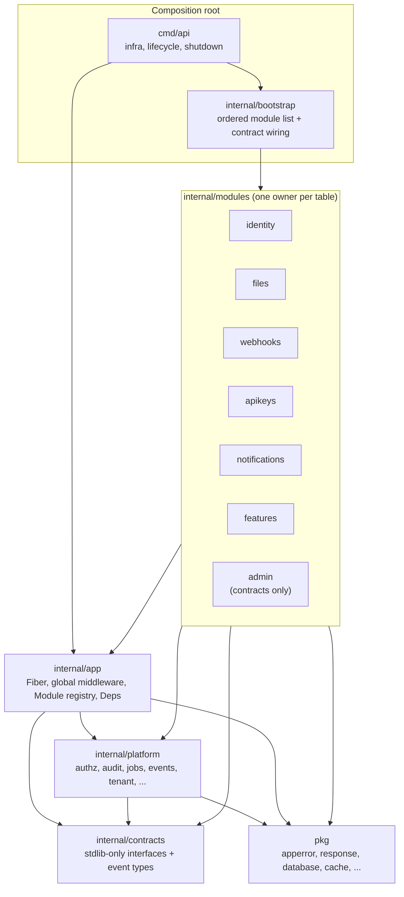
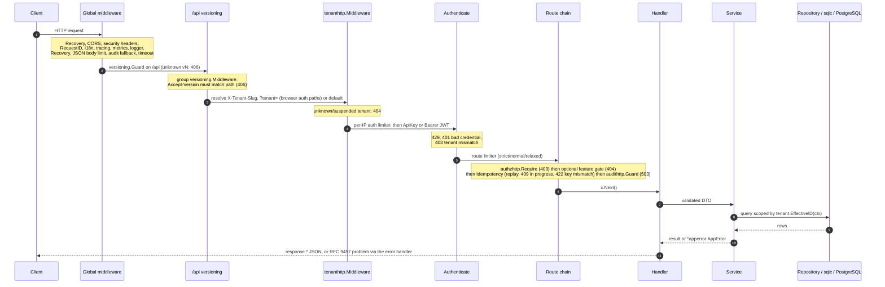
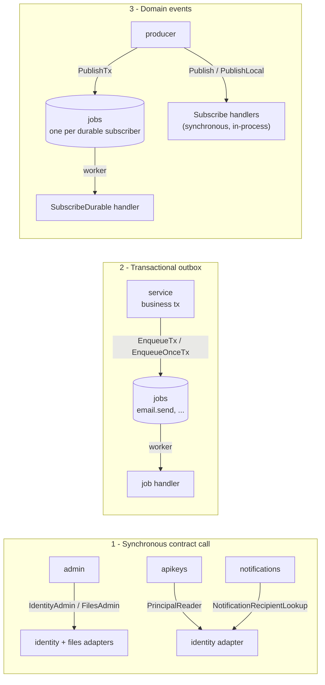
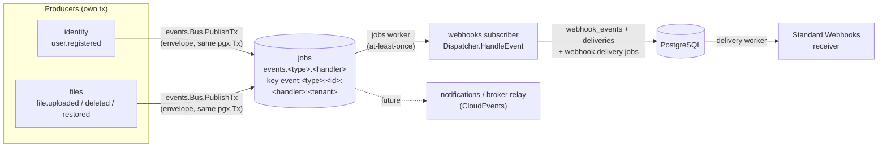
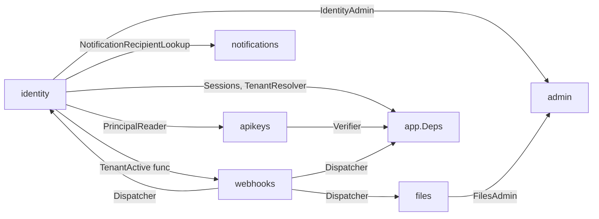
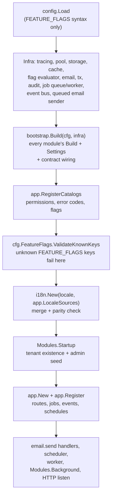

# Architecture

This repository is a **modular monolith**: one deployable, module-owned HTTP
surfaces, and platform packages for cross-cutting mechanics. The goal is to
support many business modules without microservice overhead.

Related: [Data Model](data-model.md) (ER diagrams and table ownership),
[API Design](api-design.md), [Module Template](module-template.md),
[Operations](operations.md).

## Module map

Arrows are the **only** allowed import directions. `test/arch/imports_test.go`
(`make arch`) enforces them:

| Rule | Enforced by |
|---|---|
| A module never imports another module (including its generated `sqlc`). Use `internal/contracts` or a narrow exported interface. | module boundary walk |
| `internal/platform/*` and `pkg/*` never import `internal/modules/*`. | no-business-imports check |
| `internal/app` never imports modules; only `cmd/*` imports `internal/bootstrap`. | composition-root check |
| `internal/contracts` is stdlib-only (no repositories, DTOs, sqlc, storage, database, or session). | stdlib-only check |
| `admin` never imports identity/files, sqlc, `pkg/storage`, `pkg/database`, or the session store. | admin check |
| The deleted shared `internal/{handler,service,dto,repository}` and `internal/sqlc` packages cannot return. | legacy-package checks |
| Module SQL touches only owned tables (or platform tables). | `test/arch/table_ownership_test.go` |
| Core packages (`pkg/apperror`, `pkg/storage`, `platform/authz`, `tenant`, `audit`, `apikey`, `features`) and every module `service`/`repository` never import Fiber/fasthttp, even transitively; `pkg/storage` and `files/service` never import the AWS SDK. | `test/arch/framework_free_test.go` |
| Inside a module, `service/` never imports sqlc, pgx, Fiber, or its own `dto/`/`handler/`; `handler/` never imports `repository/`, sqlc, or pgx ([ADR 0002](adr/0002-module-layering.md)). Existing violations are frozen in `layering_allowlist.txt`, which only shrinks. | `test/arch/layering_test.go` |

### Packages

| Path | Responsibility |
|---|---|
| `cmd/api` | Infra setup, catalog registration, worker lifecycle, graceful shutdown |
| `cmd/migrate` | The only DDL entrypoint |
| `cmd/seed` | Standalone admin seeder (schema must already exist) |
| `config` | Env parsing, one file per concern (`app.go`, `auth.go`, `database.go`, `webhook.go`, ...); `Config.Validate` runs the section validators in a fixed order and reports the first error |
| `internal/app` | Fiber app, global middleware, infra routes, module registry + provider hooks, `app.Infra` (shared config in `Infra.Platform`: App, JWT, Tenant), system-context job registrar |
| `internal/bootstrap` | The single ordered module list + contract cross-wiring (used by `cmd/api` and `test/arch`) |
| `internal/contracts/<provider>` | Stdlib-only contracts grouped by providing module: `identity` (admin, principal reader, notification recipient), `files` (admin), `notifications` (notifier), `privacy` (exporter/eraser registry), `webhooks` (event/dispatcher) |
| `internal/platform/*` | Cross-cutting mechanics (table below) |
| `internal/platform/middleware` | HTTP middleware: JWT, rate limit, logger, idempotency, ... |
| `pkg/*` | Reusable infrastructure: errors, response, database, cache, storage, email, webhook client, ... |

| Module | Owns |
|---|---|
| `identity` | Auth, global users, memberships, invitations, sessions, tokens, data exports/erasure, tenant lifecycle, admin seed (dto/repository/service/handler + adapter + queries/sqlc) |
| `files` | Upload, metadata, download, soft delete, restore (+ adapter + queries/sqlc) |
| `features` | Admin feature-flag catalogue surface (+ queries/sqlc) |
| `notifications` | In-app feed, channel preferences, durable email channel (+ queries/sqlc) |
| `admin` | Back-office facade (dto/service/handler, contracts-only) |
| `webhooks` | Outbound endpoints/deliveries, inbound sources/events, public HMAC receiver, dispatcher + delivery worker (+ queries/sqlc) |
| `apikeys` | Tenant-scoped API-key lifecycle (+ adapter) |

| Platform package | Responsibility |
|---|---|
| `apikey` | Key generation/hash, verifier, rotation grace; `apikeyhttp.Authenticate` is the `ApiKey` middleware |
| `authz` | Subject/policies, permission catalog, ABAC, `Authorize`, `SystemContext`; route middleware in `authzhttp` (`Require`, `RequireAny`, `SetSubject`, `SubjectFromFiber`) |
| `audit` | Audit recorder and Tier 1 `TxRecorder`; `audithttp` holds `Guard`, `Policy`/`Mode*`, `AddMetadata`, and the fallback mutating-request middleware |
| `events` | Typed in-process bus + durable job-backed subscriptions |
| `features` | Compile-time flag catalog, evaluator, snapshot cache, DB store; route gate in `featureshttp` |
| `i18n` | Embedded `en`/`vi` catalogs, `Accept-Language` negotiation, localization |
| `jobs` | Durable PostgreSQL queue, worker, leases, retention |
| `requestctx` | Request ID + actor propagation through context |
| `scheduler` | PostgreSQL-leader interval/cron scheduler + unique run ledger |
| `session` | Token-version/session cache |
| `tenant` | Request tenant resolver and context helpers; `tenanthttp` holds the `X-Tenant-Slug` middleware and `ID`/`Slug` readers for `fiber.Ctx` |
| `tracing` | OpenTelemetry provider (no-op when disabled) |
| `versioning` | V1/V2 policy, `Accept-Version` assertions, deprecation headers |

## Request lifecycle

| Stage | Mounted on | Notes |
|---|---|---|
| Global middleware | every route, in the order shown | `i18n.Middleware` runs right after request ID so every response, errors included, carries the negotiated locale. `audithttp.Middleware` is a fallback and skips routes guarded by `audithttp.Guard`. |
| `versioning.Guard` | `/api` | Rejects unknown `/api/vN` before routing. |
| `versioning.Middleware` + `tenanthttp.Middleware` | `/api/v1` and `/api/v2` groups | v2 exists only when a module implements `app.V2Module`. Probes (`/healthz`, `/readyz`, `/metrics`) stay outside tenant resolution. |
| `deps.Authenticate()` | module group or route | Per-IP `auth` limiter first, then `apikeyhttp.Authenticate` wrapping `JWTAuth`. |
| Route chain | each route | `limiter → authzhttp.Require → [features gate] → deps.Idempotency → audithttp.Guard → handler`. Idempotency replays short-circuit before the guard, so replays are never re-audited. |

### Tenant and credential resolution

- `tenanthttp.Middleware` validates `[a-z0-9-]{1,63}` and resolves the slug: header;
  validated `?tenant=` fallback only on `/auth/google`, `/auth/reset-password`,
  and `/auth/verify-email`; otherwise `TENANT_DEFAULT_SLUG`
  (`TENANT_REQUIRE_HEADER=true` disables the default). It stores
  `tenant_id`/`tenant_slug` in Fiber locals and the request context.
- The Google OAuth callback is exempt so require-header mode cannot reject it
  before the handler validates the signed `state`; the handler installs the
  state tenant itself.
- `JWTAuth` treats the token's `tenant_id` claim as authoritative, rejects a
  non-positive claim (401), and rejects an explicit header that resolves to a
  different tenant (403). It clears `tenant_slug` when the claim overrides a
  header-less default resolution.
- `Authorization: ApiKey ...` verifies the credential, re-reads the owner
  principal, and installs the same locals plus an `authz.Subject` limited to
  the key's scopes. See [API Design](api-design.md#authentication-and-authorization).
- The public webhook receiver (`POST /webhooks/inbound/:id`) mounts auth per
  route instead of on the group, so it bypasses JWT and tenant-header
  selection. The source row supplies the tenant; the source HMAC authenticates
  the caller.

## Cross-module communication

### Event backbone

Domain events (ADR 0011) are the only way a producer triggers work in another
module asynchronously. Every event is one versioned envelope
(`events.Event`: `id` UUIDv7, `type`, `dataVersion`, `occurredAt`,
`tenantId`, `actor`, `data`), with the payload struct and version owned by the
producer in `internal/contracts/<producer>`. Producers publish with
`PublishTx` in their own transaction; subscribers register through
`app.EventProvider` and run on the shared jobs worker.

- An event exists if and only if the producer's change commits; a publish
  failure rolls the change back.
- Producers do not know their subscribers: adding a subscriber is a new
  `SubscribeDurable` call, never a producer change.
- Payloads evolve additively; a breaking change gets a new `dataVersion` or a
  new type. Webhook bodies are the envelope itself, so REST DTO changes cannot
  leak into webhook contracts.

| Mechanism | Use when | Guarantees |
|---|---|---|
| **Contract** (`internal/contracts/<provider>`) | A module must read or act on another module's data now. | Stdlib-only interface; provider implements it in its `adapter` package; `internal/bootstrap` passes it to the consumer. No shared transaction. |
| **Privacy contract** (`internal/contracts/privacy`) | A GDPR export or erasure must reach every module holding per-user data. | Modules register an exporter/eraser through `app.PrivacyProvider`; identity orchestrates through the registry, so no module imports another. |
| **Outbox** (`jobs` table) | A side effect must exist if and only if the business change commits. | Job row commits with the business row (`EnqueueTx`/`EnqueueOnceTx`); delivery is at-least-once, so handlers are idempotent. |
| **Durable event** (`events.PublishTx` + `SubscribeDurable`) | Several independent reactions to one fact. | One job per subscription, key `event:<type>:<id>:<handler>:<tenantId>`; at-least-once. |
| **Local event** (`Subscribe`) | In-process reactions that may fail with the request. | Runs synchronously before commit; panics recovered per handler, errors combined with `errors.Join`. Keep irreversible side effects out. |

Contract wiring performed by `internal/bootstrap`:

Arrows read "provider supplies X to consumer". Notifications exposes
`notifications.Notifier` (`internal/contracts/notifications`) for other
modules and never imports identity or reads `users`; the identity export job
consumes it through a late-bound `SetNotifier` after both modules are built.
The privacy registry is wired the same way: each module implements
`app.PrivacyProvider`, `bootstrap` owns the `privacy.Registry`, and identity's
export/erase jobs call the registered exporters/erasers.

## Multi-tenant model

Users are global identities that join tenants through memberships (ADR 0004):
one account (one email, one password, linked Google identity) can be a member
of several tenants, each membership with its own role and status. Tenant `1` (`default`) is seeded by
the baseline and keeps header-less local/test requests and pre-tenancy rows
working; production sets `TENANT_REQUIRE_HEADER=true`. Startup checks tenant
**existence** regardless of status, so a suspended default tenant starts
normally and its requests return 404.

| Area | Isolation rule |
|---|---|
| Schema | Every tenant-owned table has `tenant_id … REFERENCES tenants(id)` and composite child FKs; per-member rows of other modules reference `(tenant_id, user_id) → memberships`. `users` and per-user credential rows are global. See [Data Model](data-model.md). |
| Identity | Membership, session, refresh-token, invitation, member-list, and stats queries filter `tenant_id`; global user rows are reached through the caller's membership. Emails and Google subjects are globally unique among live accounts; the last-admin trigger (on `memberships`) counts only the affected tenant. Login requires an active membership in the request tenant. Reset/verification tokens are per user; their links carry `?tenant=<slug>` only for the frontend (header wins). |
| Files | Every metadata read/write, list, admin list/stats, download, delete, and restore filters the request tenant. Services re-check the returned tenant/owner. New blobs use `<tenantID>/<userID>/<uuid>.<ext>`; old rows keep `<userID>/<uuid>`. |
| Notifications | Every query filters `(tenant_id, user_id)`; another user's or tenant's id is not found. |
| Webhooks | Endpoints, secrets, deliveries, attempts, sources, and inbound events all lead with `tenant_id`. The only unscoped lookup is the public receiver's source-by-ID, which then authenticates with HMAC and installs the source tenant. |
| API keys | Tenant/user-bound rows with only a SHA-256 hash at rest; scopes are a subset of the owner's role. Rotation marks the old row and creates the new key in one transaction (grace window); revocation is immediate; last use is touched on a throttled interval. |
| Feature flags | Targets are tenant-owned (`tenant.EffectiveID(ctx)`); a composite FK keeps user targets in their tenant. Definitions, defaults, and kill switches are process-wide. See [Feature Flags](feature-flags.md). |
| Jobs, events, audit | Enqueue writes `jobs.tenant_id` from the context; the worker restores it with `tenant.WithID`. Event metadata carries tenant/request/actor; audit rows record the request tenant. Retention and metrics stay global. |
| Scheduler | One global leader. Each schedule chooses a tenant in its spec; the job stores it. `scheduler_leases`/`scheduler_runs` have no tenant column. |
| OAuth | The tenant is bound into `state` and the state cookie; the callback rejects unknown/suspended tenants instead of trusting `X-Tenant-Slug`. |
| Sessions | Tokens without a positive `tenant_id` or `sid` claim are rejected. The session validator loads the token's session and compares its tenant, the membership role and status, the user status and token version, and the tenant status, so a revocation, ban, role change, or suspension takes effect within the 5-second session-cache TTL. |
| Idempotency | Cache keys include tenant ID/slug, method, path, and caller, so a replayed `201` cannot cross tenants. |
| Logout | Revokes the refresh token's session by possession, so it works even without the header. A reused refresh token revokes its whole session. |

Repositories derive the tenant from `tenant.EffectiveID(ctx)`; the tenant-1
fallback is only for jobs, internal callers, and tests. Cross-tenant ids or
tokens behave as not found. Row-level security and per-tenant limits remain
future work.

## Authorization

- Routes are protected by permissions, never role strings:
  `authzhttp.Require(authz.Permission...)` (every route; enforced by `test/arch`).
  API-key subjects use their explicit scopes; JWT subjects derive them from the
  role catalog.
- Services add object-level checks with `authz.Authorize`: an RBAC pre-check,
  then a deny-overrides `PolicySet` over a `Resource` that fails closed when
  empty. `TenantPolicy` allows only the subject's tenant (or a `CrossTenant`
  platform subject); `OwnerPolicy` only the owner.
- `authz.Authorize` is the single service-level path and fails closed: a
  subject is evaluated against permission + policies; a context marked with
  `authz.SystemContext` (job handlers via `internal/app`'s registrar wrapper,
  the admin seeder) is allowed when it carries no subject; anything else is
  `403`. Never derive a system context from an HTTP request.
- Framework split: core packages (`pkg/apperror`, `platform/authz`, `tenant`,
  `audit`, `apikey`, `features`) and every module `service`/`repository` are
  Fiber-free; Fiber adapters live in `*http` subpackages (`apperrorhttp`,
  `authzhttp`, `tenanthttp`, `audithttp`, `apikeyhttp`, `featureshttp`).
  `test/arch/framework_free_test.go` enforces it, and keeps the AWS SDK in
  `pkg/storage/s3store` (driver selection: `pkg/storage/drivers`).

| Decision | HTTP |
|---|---|
| Missing permission (`authzhttp.Require`) or explicit deny | `403 permission.denied` |
| Boundary mismatch (`Conceal`, other tenant/owner) | `404` |

Files use tenant + owner policies; admin files use the tenant policy only. A
call without a subject is allowed only under `authz.SystemContext` and still
keeps the repository's tenant scoping.

## Data and transactions

- One transaction scopes one module/aggregate (`database.TxManager.WithTx`).
  Never span modules in a transaction; use jobs or events.
- The `jobs` table is the durable outbox. `EnqueueTx` commits the job with the
  business row; `EnqueueOnce`/`EnqueueOnceTx` add a partial unique
  `(tenant_id, idempotency_key)` for producer retries and event fan-out.
- The scheduler writes its `scheduler_runs` row and job in one transaction;
  the unique `(schedule, scheduled_for)` ledger is the idempotency boundary
  across leader changes, and the lease row is the only cross-replica
  coordination point.
- Email delivery and durable events are at-least-once; handlers must be
  idempotent. Terminal jobs clear their payload and are purged after a global
  retention window. Email and password-reset payloads are AES-256-GCM sealed
  with a key derived (HKDF) from `DATA_ENCRYPTION_KEY`; envelopes name their
  key, so it rotates in two phases through `DATA_ENCRYPTION_PREVIOUS_KEYS`
  ([Key rotation](operations.md#key-rotation)).
- **Outbound webhooks.** Identity registration, file upload/delete (user and
  admin), and file restore publish `user.registered`, `file.uploaded`,
  `file.deleted`, and `file.restored` with `events.PublishTx` inside the
  mutation's transaction, so a publish failure rolls the mutation back
  (fail-closed). The webhooks durable subscription fans out to matching
  endpoints, storing the envelope once in `webhook_events` and committing each
  delivery row with its first `webhook.delivery` job. Deliveries snapshot URL,
  max attempts, timeout, and sealed secret. Retries schedule new jobs
  (honoring `Retry-After`) and every attempt is kept. Requests follow Standard
  Webhooks; receivers deduplicate on `webhook-id`.
- **Inbound webhooks.** The tenant comes from the source row; the Standard
  Webhooks HMAC covers `<webhook-id>.<webhook-timestamp>.<raw-body>`;
  deduplication is unique per `(tenant, source, external_event_id)`. See
  [Webhooks](webhooks.md).
- **Notifications.** With the email channel enabled, the in-app row and its
  email job commit or roll back together. A suppressed notification (both
  channels disabled) writes nothing. Without transactional sender support the
  service falls back to a post-insert send; production wiring always uses the
  queued transactional sender.

## Schema ownership

- Only `cmd/migrate` applies DDL. The API and seed assume the schema exists;
  `cmd/migrate` also verifies required tenant tables/columns/indexes and that
  the `default` tenant exists with id 1.
- Fresh installs apply the single init (ADR 0012):
  `migrations/20260101000000_platform_init_schema.{up,down}.sql`, one `-- owner:`
  section per owner, shared functions first, then identity, platform tables,
  and modules in FK order.
- Once a database is deployed, add timestamped migrations
  (`make migrate-create module=<owner> name=<purpose>`); never edit a shipped
  migration. Legacy databases keep their recorded history (see README).
- `feature_flags` is global configuration; `scheduler_leases` and
  `scheduler_runs` are tenant-independent with no foreign keys; identity's
  `users`, `user_passwords`, `user_identities`, and reset/verification tokens
  are global per-user rows (ADR 0004). Everything else is tenant-owned with
  tenant-leading indexes. `data_exports` (identity) is tenant-owned and
  references `(tenant_id, user_id) → memberships`.
- `api_keys.key_hash` is globally unique; it is the only lookup made before a
  request tenant can be trusted.
- `files.storage_path` is the authoritative blob key; moving a blob without
  updating it (or vice versa) breaks the file.

Table-by-table details, keys, and FK actions: [Data Model](data-model.md).

## Cross-cutting conventions

| Concern | Convention |
|---|---|
| Authorization | Module permissions live in `catalog/permissions.go` and register through `app.PermissionProvider`; only shared back-office permissions stay in `internal/platform/authz`. Notification routes use `notifications:read`/`notifications:write`; sending to another user needs admin-only `notifications:send`. Legacy exceptions: [Module Template](module-template.md#legacy-exceptions-do-not-copy). |
| Privacy | `internal/contracts/privacy` exporters/erasers are registered by every module with per-user data; identity owns `data_exports` and orchestrates export/erasure jobs (ADR 0013). Export documents live 7 days; erasure anonymizes the global user after every membership is removed. |
| Audit | Privileged mutations are fail-closed. Tier 1 services (identity registration/profile/password/delete, invitations create/revoke/accept/sign-up, tenant lifecycle, admin role/ban/unban, admin file delete/restore, API-key lifecycle) call `audit.TxRecorder.RecordTx` in the mutation transaction. Tier 2 routes use `audithttp.Guard`: an `outcome=started` intent row before the handler, completed as succeeded/failed/denied; a required guard returns `503 system.audit_unavailable` when the intent cannot be stored. Rows carry actor type/role, source, request ID, IP, route, and tenant. `audit.NewServiceEvent` enriches domain events from the context. |
| Errors | `*apperror.AppError` with a stable catalog code, rendered as RFC 9457 `application/problem+json`. With `Deps.I18n`, titles and validation messages follow `Accept-Language`; `DetailKey` opts a detail in. A nil localizer keeps English. |
| i18n | `en`/`vi` catalogs must keep identical keys and `{placeholders}` (`i18n.New` fails otherwise). `vi-VN` truncates to `vi`; unsupported languages fall back to `I18N_DEFAULT_LOCALE`. |
| API versions | `/api/v1` always; opt-in `/api/v2` via `app.V2Module`. `Accept-Version` must match the path (406 `api.version_unsupported`). Responses carry `API-Version`, `Vary: Accept-Version`, and configured deprecation metadata. Swagger stays on v1. |
| Idempotency | Opt-in `Idempotency-Key` on mutating routes, cache-backed, 24h replay, body-bound for non-multipart requests. Secret-returning creates are excluded so plaintext secrets never enter the shared cache. |
| Feature flags | Module-declared catalog (`catalog/flags.go`, `app.FlagProvider`), precedence force-off > kill switch > user > tenant > database default > environment > compiled default. Admin writes invalidate the local snapshot. |
| Observability | Request IDs, structured `slog`, Prometheus HTTP/job/event/scheduler/audit metrics, readiness checks for DB/cache. Labels stay bounded (`event`, `schedule`, `outcome`), never tenant IDs. |

## Module registration and catalogs

- Catalog registries (`authz`, `apperror`, `features`) are process-wide
  copy-on-write snapshots behind an `atomic.Pointer`, so the per-request read
  path takes no lock. Registration fails on invalid identifiers, unknown roles,
  or a key owned by another module; identical re-registration by the same
  owner is a no-op so tests can build the app repeatedly.
- Platform-wide entries stay central: `permission.denied`, `feature.disabled`,
  `rate_limit.exceeded`, `api.version_unsupported`, `system.*`, generic status
  titles, validation messages, and the shared back-office permissions
  (`admin:users:*`, `admin:files:*`, `admin:stats:read`).
- `internal/bootstrap` is the only non-`cmd` package that imports several
  modules. `test/arch` uses the same `bootstrap.Build`, so route authorization,
  audit coverage, group-middleware overlap, and SQL table ownership are
  checked for every registered module.
- `app.Infra` carries process-wide infrastructure and only the shared
  configuration (`Infra.Platform`: App, JWT, Tenant). Module-owned sections
  reach a module only through its `Settings` struct: `bootstrap.Build(cfg,
  infra)` passes OAuth/admin seed to identity, storage limits to files, and
  webhook delivery plus secret keys to webhooks, so no module reads another's
  settings.
- `APP_ROLE` selects what the process runs: `all` registers routes and runs
  the worker; `api` registers routes only; `worker` registers module jobs,
  events, and schedules without routes (`app.RegisterBackground`) and serves
  only probes and metrics.

## Strangler status

The migration is complete. Every module owns its DTOs, repositories,
services, and handlers under `internal/modules/<name>`; each module with SQL
owns its `queries/` and generated `sqlc/` package (configured by its own
`internal/modules/<name>/sqlc.yaml`; `admin` is contract-only). There is no shared legacy layer, no shared
generated package, and no cross-module SQL: identity and files each own their
half of the admin dashboard stats (`AdminUserStats` / `AdminFileStats`).

## Extension checklist

Use the generator [`cmd/gen`](../cmd/gen/main.go) and the
[Module Template](module-template.md). Short form:

1. `make gen module=<name>`: module.go/build.go (`Build` + providers),
   catalog (permissions, error codes, en/vi strings), ADR 0002 layers with
   `service/ports.go`, `queries/` + the module's `sqlc.yaml`, tests, README,
   an init migration pair, and the `internal/bootstrap/modules.go` entry (the
   only central edit).
2. `make gen resource=<r> module=<name>` for tenant-scoped CRUD (migration,
   queries, repository, service, handler, routes, permissions, tests);
   `make gen command=<Name>` / `query=<Name>` for CQRS use cases.
3. Other tables or columns: `make migrate-create module=<name> name=<purpose>`.
4. Add handler/service/repository/DTO and protected routes in the module.
5. Implement the optional `app.EventProvider`, `app.JobProvider`,
   `app.ScheduleProvider`, or `app.FlagProvider` hooks instead of wiring work
   imperatively.
6. Add unit + integration tests; run `make check`, `go test -race ./...`, and
   `make swagger`.
7. For durable work, enqueue a job transactionally; never use `async.Go` for
   work that must survive a restart.
