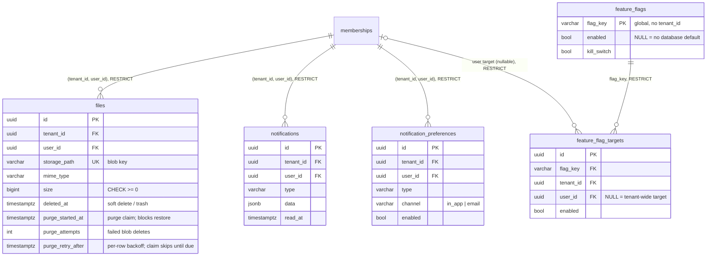
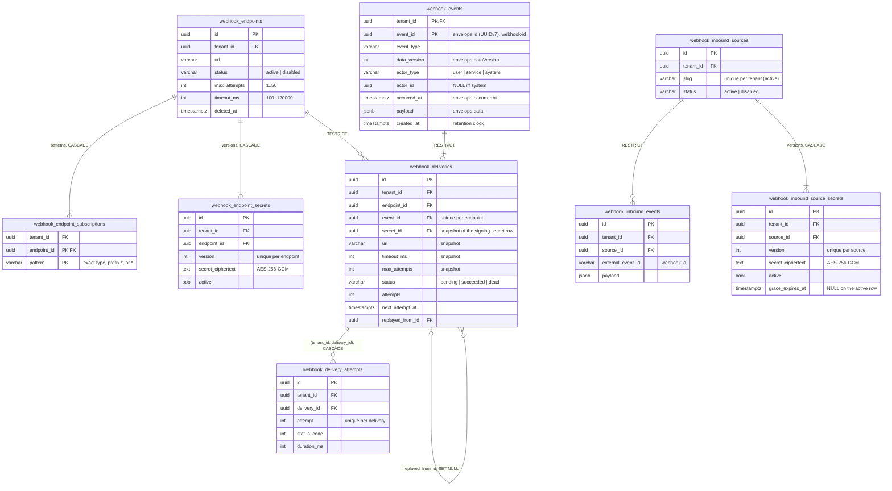
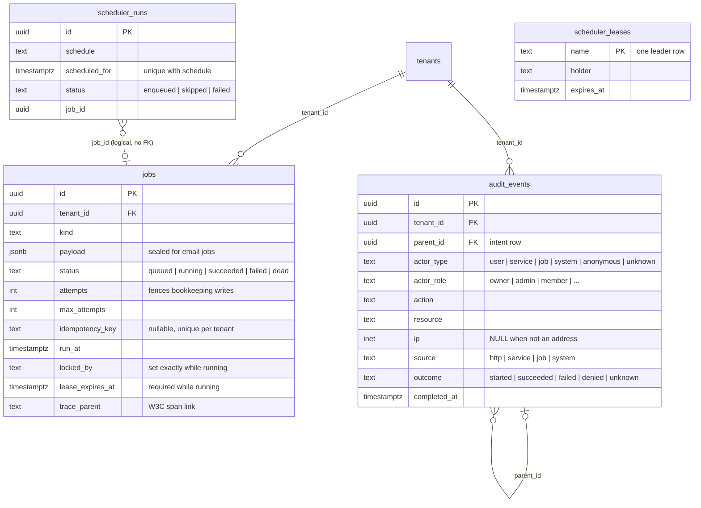

# Data Model

The fresh-install schema is one init migration,
`migrations/20260101000000_platform_init_schema.{up,down}.sql`, applied only by
`cmd/migrate`. Its `-- owner:` sections, in order:

| Section owner | Creates |
|---|---|
| `platform` | `update_updated_at()` trigger function |
| `identity` | `tenants` (seeds the pinned UUIDv7 `default` tenant), `tenant_settings`, `users`, `user_passwords`, `user_identities`, `memberships`, `data_exports`, `permissions`, `roles`, `role_permissions`, `membership_roles`, `platform_role_assignments`, `invitations`, `sessions`, `refresh_tokens`, `password_reset_tokens`, `email_verification_tokens`, `mfa_factors`, `mfa_recovery_codes`, `webauthn_credentials` |
| `platform` | `jobs` |
| `platform` | `scheduler_leases`, `scheduler_runs` |
| `platform` | `audit_events` and its append-only triggers |
| `apikeys` | `api_keys`, `api_key_scopes` |
| `files` | `files` |
| `features` | `feature_flags`, `feature_flag_targets` |
| `notifications` | `notifications`, `notification_preferences` |
| `webhooks` | every `webhook_*` table |

The down file drops exactly what the up file created, leaving an empty schema.
Every table has exactly one owner, and a migration file or section may only
create its owner's tables; modules read
other modules' data through contracts, never through SQL (both enforced by
`test/arch`). See [Architecture](architecture.md#schema-ownership) for the
migration policy.

## Ownership at a glance

| Owner | Tables |
|---|---|
| `identity` | `tenants`, `tenant_settings`, `users` (global), `user_passwords`, `user_identities`, `memberships`, `data_exports`, `permissions`, `roles`, `role_permissions`, `membership_roles`, `platform_role_assignments`, `invitations`, `sessions`, `refresh_tokens`, `password_reset_tokens`, `email_verification_tokens`, `mfa_factors`, `mfa_recovery_codes`, `webauthn_credentials` |
| `apikeys` | `api_keys`, `api_key_scopes` |
| `files` | `files` |
| `notifications` | `notifications`, `notification_preferences` |
| `features` | `feature_flags` (global), `feature_flag_targets` |
| `webhooks` | `webhook_endpoints`, `webhook_endpoint_subscriptions`, `webhook_endpoint_secrets`, `webhook_events`, `webhook_deliveries`, `webhook_delivery_attempts`, `webhook_inbound_sources`, `webhook_inbound_events` |
| platform | `jobs`, `audit_events`, `scheduler_leases`, `scheduler_runs` |

Conventions that apply to every diagram below:

- Every tenant-owned table has `tenant_id UUID NOT NULL REFERENCES
  tenants(id)` with **no default**: a row must always state its tenant (RLS
  `WITH CHECK` additionally requires it to match the transaction scope).
  `tenant.DefaultID` (`0192c9b0-7e4a-7000-8000-000000000001`, slug
  `default`) is a real seeded tenant, the tenant of the default slug, not a
  fallback. Exceptions: `api_key_scopes`, a child fully owned by
  its key, has no `tenant_id` of its own (the key id is global; the parent row
  holds the tenant); `users` and the per-user rows `user_passwords`,
  `user_identities`, `password_reset_tokens`, `email_verification_tokens`,
  `mfa_factors`, `mfa_recovery_codes`, and `webauthn_credentials` are global
  and have no `tenant_id`.
- Every table with a `tenant_id` has `ENABLE`/`FORCE ROW LEVEL SECURITY` and a
  `tenant_isolation` policy on `app_tenant_visible(tenant_id)`;
  `roles` additionally lets every tenant read the system roles (`tenant_id IS
  NULL`), whose writes need the bypass (startup catalog sync).
  `api_key_scopes` has no tenant column and stays unprotected because it is
  reachable only through its key; `feature_flags` is process-wide.
- Child rows reference their parent through a **composite** foreign key, so a
  row can never point at a parent in another tenant. Every per-member row in
  another module references `(tenant_id, user_id) → memberships(tenant_id,
  user_id)` `ON DELETE RESTRICT`; identity's own children use
  `(tenant_id, session_id) → sessions(tenant_id, id)` and
  `(tenant_id, invited_by | accepted_by) → memberships(tenant_id, user_id)`.
- Every surrogate primary key is `UUID DEFAULT uuidv7()` (PostgreSQL 18's
  native function). Go code that needs the id before insert calls
  `uuid.NewV7()`; foreign keys and reference columns are `UUID`. Exceptions
  are `feature_flags.flag_key`, `scheduler_leases.name`, and the natural
  keys of `api_key_scopes (api_key_id, permission_key)`,
  `webhook_endpoint_subscriptions (endpoint_id, pattern)`, and
  `webhook_events (tenant_id, event_id)` (the event id itself is a UUID).
  Token hashes are `BYTEA` with an exact 32-byte (SHA-256) `CHECK`.
  Timestamps are `TIMESTAMPTZ`.
- Delete actions: `CASCADE` only for rows fully owned by their parent
  (`tenant_settings`, a user's password, identities, and reset/verification
  tokens, a membership's sessions, a session's refresh tokens, API-key scopes, endpoint subscriptions and secrets, delivery
  attempts); `RESTRICT` for business and history rows; `SET NULL` for
  `webhook_deliveries.replayed_from_id`.

## Tenants, identity, and credentials

Users are global identities that join tenants through memberships.
The membership, not the user, is the tenant-scoped principal: every
cross-module reference to "a user in a tenant" is a `(tenant_id, user_id)`
foreign key to `memberships`.

```mermaid
erDiagram
    tenants ||--|| tenant_settings : "CASCADE"
    tenants ||--o{ memberships : "RESTRICT"
    users ||--o{ memberships : "RESTRICT"
    users ||--o| user_passwords : "CASCADE"
    users ||--o{ user_identities : "one per provider, CASCADE"
    users ||--o| password_reset_tokens : "one per user, CASCADE"
    users ||--o| email_verification_tokens : "one per user, CASCADE"
    users ||--o{ mfa_factors : "one confirmed TOTP, CASCADE"
    users ||--o{ mfa_recovery_codes : "ten per set, CASCADE"
    users ||--o{ webauthn_credentials : "passkeys, CASCADE"
    tenants ||--o{ invitations : "RESTRICT"
    memberships ||--o{ invitations : "invited_by, accepted_by, RESTRICT"
    memberships ||--o{ sessions : "(tenant_id, user_id), CASCADE"
    memberships ||--o{ data_exports : "(tenant_id, user_id), RESTRICT"
    sessions ||--o{ refresh_tokens : "(tenant_id, session_id), CASCADE"
    memberships ||--o{ api_keys : "(tenant_id, user_id), RESTRICT"
    api_keys ||--o{ api_key_scopes : "CASCADE"
    permissions ||--o{ api_key_scopes : "permission RESTRICT"
    roles ||--o{ role_permissions : "CASCADE"
    permissions ||--o{ role_permissions : "RESTRICT"
    roles ||--o{ membership_roles : "RESTRICT"
    memberships ||--o{ membership_roles : "(tenant_id, user_id), CASCADE"
    roles ||--o{ platform_role_assignments : "RESTRICT"
    users ||--o{ platform_role_assignments : "CASCADE"

    tenants {
        uuid id PK
        varchar slug UK "[a-z0-9-]{1,63}"
        varchar name
        varchar status "trialing | active | suspended | pending_deletion | deleted"
        timestamptz status_changed_at
        timestamptz trial_ends_at "required while trialing"
        timestamptz deletion_scheduled_at "set iff pending_deletion or deleted"
        timestamptz purged_at "set once the deleted-tenant purge completes"
        uuid purge_cursor "highest membership user id whose erasers succeeded"
        timestamptz purge_progress_at "orders unfinished purges by least recent progress"
    }
    tenant_settings {
        uuid tenant_id PK, FK
        varchar locale "BCP 47"
        varchar timezone "IANA, validated by the service"
    }
    users {
        uuid id PK
        varchar email "normalized, unique among live rows"
        varchar name
        timestamptz email_verified_at
        varchar status "active | suspended | deleted"
        int token_version "bumped by global credential events"
        timestamptz credentials_changed_at
        timestamptz deleted_at "set iff status = deleted"
    }
    user_passwords {
        uuid user_id PK, FK
        text password_hash "argon2id PHC"
        timestamptz changed_at
    }
    user_identities {
        uuid id PK
        uuid user_id FK "unique with provider"
        varchar provider "google"
        varchar subject "unique with provider"
        varchar email "address reported at link time"
    }
    memberships {
        uuid id PK
        uuid tenant_id FK "unique with user_id"
        uuid user_id FK
        varchar status "active | suspended | removed"
        timestamptz banned_at "ban marker, kept through removal"
        bytea banned_email_hash "keyed HMAC-SHA256 marker, kept through removal"
        varchar banned_email_hash_kid "key that wrote the marker"
        timestamptz erasure_requested_at "reserves a suspended member for erasure"
        timestamptz removed_at "set iff removed"
        timestamptz credentials_revoked_at "never cleared"
    }
    data_exports {
        uuid id PK
        uuid tenant_id FK
        uuid user_id FK
        varchar status "queued | running | ready | failed | expired"
        varchar storage_path "ready export blob key"
        timestamptz expires_at "ready + 7 days"
        timestamptz created_at
        timestamptz updated_at
    }
    invitations {
        uuid id PK
        uuid tenant_id FK
        varchar email_normalized "one pending row per tenant"
        uuid role_id FK "tenant role granted by the invitation"
        bytea token_hash UK "SHA-256 only"
        uuid invited_by FK
        timestamptz expires_at
        timestamptz accepted_at "set together with accepted_by"
        uuid accepted_by FK
    }
    sessions {
        uuid id PK
        uuid tenant_id FK
        uuid user_id FK
        int token_version "user version at sign-in"
        varchar user_agent
        inet ip
        text amr "pwd | google | otp | rc"
        timestamptz mfa_verified_at "AAL2 freshness; NULL until a second factor"
        timestamptz expires_at "absolute session lifetime"
        timestamptz last_used_at
        timestamptz revoked_at "set together with revoked_reason"
        varchar revoked_reason "logout | logout_all | revoked | refresh_reuse | mfa_changed | ..."
    }
    refresh_tokens {
        uuid id PK
        uuid tenant_id FK
        uuid session_id FK
        bytea token_hash UK "SHA-256 only"
        timestamptz expires_at
        timestamptz used_at "rotation marker"
    }
    password_reset_tokens {
        uuid id PK
        uuid user_id FK, UK
        bytea token_hash UK
        timestamptz expires_at
    }
    email_verification_tokens {
        uuid id PK
        uuid user_id FK, UK
        varchar email "target address"
        bytea token_hash UK
        timestamptz expires_at
    }
    mfa_factors {
        uuid id PK
        uuid user_id FK "unique when confirmed; unique when pending"
        varchar type "totp"
        text secret_ciphertext "sealed with DATA_ENCRYPTION_KEY"
        timestamptz confirmed_at
        bigint last_used_step "RFC 6238 replay guard"
    }
    mfa_recovery_codes {
        uuid id PK
        uuid user_id FK
        bytea code_hash "SHA-256, unique per user"
        timestamptz used_at "single use"
    }
    webauthn_credentials {
        uuid id PK
        uuid user_id FK
        bytea credential_id UK "WebAuthn credential id"
        bytea public_key "COSE public key"
        bigint sign_count "monotonic signature counter"
        uuid aaguid "authenticator model"
        text_array transports
        boolean backup_eligible
        boolean backup_state
        varchar name
        timestamptz created_at
        timestamptz last_used_at
    }
    api_keys {
        uuid id PK
        uuid tenant_id FK
        uuid user_id FK
        varchar prefix
        bytea key_hash UK "SHA-256 only"
        timestamptz expires_at
        timestamptz revoked_at
        timestamptz rotated_at "set together with rotation_grace_until"
        timestamptz rotation_grace_until
        timestamptz last_used_at
    }
    api_key_scopes {
        uuid api_key_id PK, FK
        text permission_key PK, FK "authz permission format"
    }
    permissions {
        text key PK "catalog key, owner TEXT"
        text owner "module or platform"
    }
    roles {
        uuid id PK
        uuid tenant_id FK "NULL = system role"
        varchar scope "tenant | platform"
        varchar key "unique per tenant, NULLS NOT DISTINCT"
        varchar name
    }
    role_permissions {
        uuid role_id PK, FK
        text permission_key PK, FK
    }
    membership_roles {
        uuid tenant_id PK, FK "with user_id -> memberships"
        uuid user_id PK
        uuid role_id PK, FK
    }
    platform_role_assignments {
        uuid user_id PK, FK
        uuid role_id PK, FK "platform role only"
    }
```

- **Tenant lifecycle** (enforced by `identity/service/tenants.go`; the
  timestamps each state needs are pinned by `CHECK`s): `trialing → active |
  suspended | pending_deletion`, `active → suspended | pending_deletion`,
  `suspended → active | pending_deletion`, `pending_deletion → suspended
  (cancelled) | deleted`; `deleted` is terminal. Cancelling a deletion lands on
  `suspended`, never directly on `active`. A `pending_deletion` tenant
  cannot become `deleted` before `deletion_scheduled_at` (`409
  tenant.deletion_not_due`, a 30-day grace period); the hourly audited
  `identity.tenants.finalize_deletions` job performs the due transition as a
  system actor. Only `trialing` and `active` tenants serve requests, and a
  `trialing` tenant stops serving the moment `trial_ends_at` passes (its status
  is then moved to `suspended` by the hourly audited trial-expiry job). The default
  tenant can never enter `pending_deletion` or `deleted`. Tenants are never
  hard-deleted, so every `tenants` reference is `RESTRICT`/`NO ACTION`. A
  `deleted` tenant keeps its row and `audit_events`; the hourly purge erases
  each member's data, then every module's tenant-wide rows in bounded 500-row
  pages (deleting file/export blobs before their rows), persists
  `purge_cursor` after each member so a run resumes where it stopped, and
  stamps `purged_at` (a `CHECK` allows it only on `deleted`).
- **Users** are global. `email` is stored normalized (`CHECK (email =
  lower(btrim(email)))`) and the partial unique index `idx_users_email_live`
  allows one live account per address; deleting an account (`status =
  'deleted'` + `deleted_at`) frees the address. There is no `tenant_id`,
  `role`, or password column: credentials live in `user_passwords` and
  `user_identities`, roles in `membership_roles`, and bans on `memberships`.
  `token_version` is bumped
  by every global credential event (password change or reset, email change,
  logout-all, account deletion) and by enabling a second factor (TOTP
  confirmation and the platform MFA reset), which invalidates every token and
  session of the user in every tenant. Disabling a factor does not bump it;
  it revokes the user's other sessions instead.
- **Memberships** are the user ↔ tenant N:N join and the parent key
  (`uq_memberships_tenant_user`) of every cross-module per-member row, which
  is why both parents are `RESTRICT` and rows are never hard-deleted (the
  tenant purge is the one exception: it deletes one membership after that
  member's erasers and invitations are gone). A ban is
  `status = 'suspended'` + `banned_at`; an erasure request reserves the
  membership with `status = 'suspended'` + `erasure_requested_at` and no ban
  marker; leaving or being removed is `status = 'removed'` + `removed_at`.
  There is no `invited` state: a pending
  invite is an `invitations` row (it can target an address with no account).
  `credentials_revoked_at` is set by a ban, an erasure reservation, or removal
  and never cleared, so API keys created at or before it stay invalid after an
  unban or re-join.
  `banned_email_hash` is a keyed pseudonymous marker of the normalized
  address: HMAC-SHA256 under a key derived with HKDF-SHA256 from the active
  data-encryption key (`DATA_ENCRYPTION_KEY`, the same key set that seals job
  payloads), computed in Go and written by a ban. `banned_email_hash_kid`
  records which key wrote it (a short fingerprint). A removed membership keeps
  `banned_at` and the marker, so a ban survives removal and erasure (the
  user's email may since have been anonymized); an unban while the membership
  is still suspended clears all three. `EmailBannedInTenant` matches the
  marker computed under the active key and every configured previous key, and
  is used by registration, invitation acceptance/sign-up, Google sign-up, the
  admin seed, and email changes (GDPR Art.17(3)(e)). A database reader cannot
  confirm a banned address or dictionary-recover it without the key. Removing
  a previous key from `DATA_ENCRYPTION_PREVIOUS_KEYS` makes bans it wrote
  ineffective, because after erasure the address is gone and the marker cannot
  be re-hashed; API startup warns and counts the affected rows.
- **Data exports** belong to one membership. A `queued`/`running`
  row is the active request (partial unique index); `ready` rows carry the
  document key and a 7-day `expires_at`; a failed export is retried only while
  the job has attempts. Expired, failed, and stale (>1 day) queued/running rows
  are removed by `privacy.exports.purge` (blob, then row); erasure removes them
  immediately. The export's identity section covers the profile, membership,
  sessions, linked `user_identities` (no tokens), MFA state (no secret or
  recovery hashes), passkeys by name/created/last-used (never key material),
  current `membership_roles` with grant times, invitations
  sent/received, and the user's own `audit_events` (capped at 1000, newest
  first).
- **RBAC**: `permissions` is the code-owned catalog synchronized at
  API startup (key + registering owner). `roles` holds system roles
  (`tenant_id IS NULL`, seeded: tenant `owner`, `admin`, `member`; platform
  `platform_admin`) and tenant-defined roles (`tenant_id` set, `scope =
  'tenant'`). `role_permissions` is the grant table; `membership_roles` assigns
  tenant-scoped roles to a membership (a trigger rejects cross-tenant and
  platform roles). `platform_role_assignments` is the only cross-tenant grant
  and accepts only `scope = 'platform'` roles. `api_key_scopes.permission_key`
  references the catalog (`RESTRICT`). Tenant role rank is `owner` 3 > `admin`
  2 > `member` 1; a tenant-defined role that grants `admin:users:role`,
  `admin:users:ban`, or `admin:users:delete` has the admin rank 2 (a delegated
  administrator: it manages members but not admins or owners), and any other
  tenant role stays at 1. A caller may grant a role only at
  or below its effective rank and only while holding every permission the role
  grants (owner alone grants owner), and may manage a member only
  with a strictly higher effective rank (owners may manage co-owners).
- The last-owner trigger (`protect_last_owner`) lives on `memberships` and
  `membership_roles`: removing the last active system `owner` of an
  operational tenant is refused. Counting and locking are scoped to the
  tenant; services take the same per-tenant advisory lock, and the repository
  maps the trigger exception (private SQLSTATE `LO001`, class `LO` for
  last-owner) or a deadlock (`40P01`) to `409`.
  Concurrent owner removals serialize on the advisory lock, so two requests
  cannot each observe the other owner and both commit. The platform tenant
  create endpoint makes the caller the tenant's first owner, so an HTTP-created
  tenant never starts ownerless.
- **Invitations**: one pending row per `(tenant_id, email_normalized)`
  (partial unique `WHERE accepted_at IS NULL`); re-inviting refreshes the
  token, `role_id`, and expiry. Revoking deletes the pending row (the trail is in
  `audit_events`); accepting stamps `accepted_at`/`accepted_by` in the
  transaction that creates or reactivates the membership. A ban or removal
  deletes the member's pending invitations in the same transaction, and
  acceptance re-checks the inviter's current rank and permissions. Erasure
  replaces `email_normalized` with the user's erased address on invitations
  they accepted or that were addressed to them; `accepted_by` stays the
  membership id. The global finalizer sweeps every tenant (also one the user
  never joined); the tenant-scoped admin path only the request tenant.
- **Sessions** are the RFC 9700 refresh-token family, so there is no separate
  family id: every rotated refresh token references its session. Presenting a
  token that a rotation consumed less than 10 seconds ago in a still-live
  session is a concurrent refresh (`401 auth.refresh_concurrent`, session
  kept); any other replay revokes the session (`revoked_reason =
  'refresh_reuse'`). `refresh_tokens` is append-only apart from `used_at`;
  used tokens are kept until they expire so a replay is recognized as reuse.
- Password-reset and email-verification tokens are **per user**
  (`user_id UNIQUE`), not per tenant: the password is a global credential.
- **MFA is per user**: `mfa_factors` holds at most one confirmed
  TOTP factor (partial unique `WHERE confirmed_at IS NOT NULL`) and one pending
  enrollment (`WHERE confirmed_at IS NULL`). The secret is sealed with
  `DATA_ENCRYPTION_KEY`; `last_used_step` makes one RFC 6238 step usable once.
  Re-enrolling overwrites the pending secret and resets its timestamp; a
  pending enrollment can only be confirmed within 15 minutes. A password change
  or reset deletes a pending enrollment in the same transaction.
  `mfa_recovery_codes` stores SHA-256 hashes; `used_at` makes each code single
  use.
- **Passkeys are per user**: `webauthn_credentials` stores the COSE public key,
  the globally unique credential id, the monotonic signature counter, the
  AAGUID, transport hints, and the backup flags. The private key never leaves
  the authenticator. A counter that does not advance is rejected as a possible
  clone. The table has no `tenant_id` (a passkey signs in to every tenant the
  user belongs to) and is erased with the global account.
- `api_keys.key_hash` is the only global (pre-tenant) lookup: the request
  tenant cannot be trusted until the key is verified, so that statement runs
  with the RLS bypass while the request's last-used write stays under the key's
  tenant. A key's owner is a membership (`(tenant_id, user_id) → memberships`).
- `api_key_scopes` holds one row per granted permission. Every API-key query
  returns the scopes as one array sorted in byte order, so the API still
  returns a `scopes` array exactly as before. Create and update change the key
  and its scope rows in a single statement. `permission_key` is checked
  against the authz permission format and pinned to `permissions(key)` by a
  `RESTRICT` foreign key.
- `CHECK ((rotation_grace_until IS NULL) = (rotated_at IS NULL))`: rotation is
  the only writer of either column and always sets both.

| Table | Key constraint / index | Why |
|---|---|---|
| `users` | partial unique `(email) WHERE status <> 'deleted'` | One live account per address, globally. |
| `tenants` | partial `(id) WHERE status = 'deleted' AND purged_at IS NULL` | The hourly deleted-tenant purge scans only unfinished deletions. |
| `data_exports` | partial unique `(tenant_id, user_id) WHERE status IN ('queued','running')`; `(tenant_id, user_id, created_at DESC, id DESC)`; partial `(expires_at)` | One active export per membership; caller list cursor; hourly expiry purge. |
| `memberships` | unique `(tenant_id, user_id)`; `(user_id)`; `(tenant_id, created_at DESC, user_id DESC)`; partial `(tenant_id, banned_email_hash)` for banned rows | Cross-module FK parent; per-user lookups (login, account deletion); member-list cursor (`joinedAt`, id); keyed ban check. |
| `roles` | unique `(tenant_id, key) NULLS NOT DISTINCT` | One system role per key, one tenant role per key. |
| `membership_roles` | primary key `(tenant_id, user_id, role_id)`; `(role_id)` | Load a member's roles; invalidate the holders of a changed role and reject a role delete in use. |
| `role_permissions` | primary key `(role_id, permission_key)`; `(permission_key)` | Grant set; catalog prune and permission delete. |
| `invitations` | `token_hash` unique; partial unique `(tenant_id, email_normalized) WHERE accepted_at IS NULL`; `(tenant_id, created_at DESC, id DESC)`; partial `(expires_at)` on pending rows | Token lookup; one pending invite per address; list cursor; expiry purge. |
| `sessions` | unique `(tenant_id, id)`; `(tenant_id, user_id, created_at DESC)`; partial `(user_id) WHERE revoked_at IS NULL`; `(last_used_at)` | Refresh-token FK parent; "my sessions"; revoking a user's live sessions across tenants; stale-session purge. |
| `refresh_tokens` | `token_hash` unique; `(tenant_id, session_id)`; `(expires_at)` | Rotation lookup; FK cascade and the purge's live-token check; expiry purge. |
| `mfa_factors` | partial unique `(user_id) WHERE type = 'totp' AND confirmed_at IS NOT NULL`; partial unique `(user_id) WHERE type = 'totp' AND confirmed_at IS NULL` | One confirmed factor and one pending enrollment per user. |
| `mfa_recovery_codes` | unique `(user_id, code_hash)`; partial `(user_id) WHERE used_at IS NULL` | Code lookup; unused-code count. |

## Files, notifications, and feature flags

| Table | Key constraint / index | Why |
|---|---|---|
| `files` | `storage_path` unique | Authoritative blob key (`<tenantID>/<userID>/<uuid>.<ext>` for new uploads). |
| `notifications` | feed index `(tenant_id, user_id, created_at DESC, id DESC)` + partial unread variant | Cursor feed and unread badge. |
| `notification_preferences` | unique `(tenant_id, user_id, type, channel)` | Idempotent upsert; a missing row means enabled. |
| `feature_flag_targets` | `UNIQUE NULLS NOT DISTINCT (tenant_id, flag_key, user_id)`; index `(flag_key)` | One tenant-wide target (`user_id` NULL) and one target per user, with one `ON CONFLICT` target for both upserts; the unique index is also the tenant-leading list index, and `(flag_key)` serves the `RESTRICT` check on flag delete. |

## Webhooks

- An endpoint's event-type patterns are `webhook_endpoint_subscriptions` rows;
  reads return them as one `eventTypes` array sorted in byte order (create and
  update sort them too). Matching is unchanged: the dispatcher loads the
  patterns and applies `service.Match` (exact type, `prefix.*`, `*`).
- `webhook_events` stores each event once. The first delivery of an event
  writes it in the same transaction as the delivery row and its job; later
  endpoints of the event reuse it. Its columns are the versioned event
  envelope, and every delivery of the event signs the same
  `{id, type, dataVersion, occurredAt, tenantId, actor, data}` body built from
  this row. A replay is a new event (new id and `occurredAt`) carrying the
  original type, `dataVersion`, actor, and payload.
- `(tenant_id, endpoint_id, event_id)` is unique, so re-dispatching the same
  domain event never creates a second delivery.
- `(tenant_id, source_id, external_event_id)` is unique: the inbound dedupe key.
- Delivery `url`/`secret_id`/`timeout_ms`/`max_attempts` are snapshots
  taken at dispatch; editing or rotating an endpoint cannot change a queued
  request. Deliveries use `RESTRICT` because endpoints are soft-deleted and the
  delivery log is history.
- Attempts reference their delivery through `(tenant_id, delivery_id) →
  webhook_deliveries (tenant_id, id)`, so an attempt cannot carry a different
  tenant than its delivery.
- Retention deletes terminal deliveries (attempts cascade), then events older
  than the window that no delivery references (`RESTRICT` on the event FK is
  the final guard), then old inbound events; each step is batched.

## Platform tables

- `jobs` is the durable queue and outbox. The partial unique
  `(tenant_id, idempotency_key)` index backs `EnqueueOnce`/`EnqueueOnceTx`.
  Claim and purge are global passes by design. `lease_expires_at` is
  `now()` + the owning worker's lease, written on claim and every heartbeat;
  the `jobs_running_has_lease` `CHECK` requires it on `running` rows, and
  lease recovery reclaims only rows where it is past (partial index
  `idx_jobs_running_lease_expires_at`). `jobs_running_has_owner`
  (`(status = 'running') = (locked_by IS NOT NULL)`) holds because the claim
  sets `locked_by` and every transition out of `running` (succeed, fail,
  release, lease-expiry requeue or dead-letter) clears it.
- `audit_events` is append-only: triggers reject `DELETE`/`TRUNCATE` and limit
  updates to completing a `started` intent. `actor_type` says what kind of
  principal acted; an administrator is `actor_type = 'user'` with
  `actor_role = 'admin'`. The recorder stores a canonical address in `ip`
  (IPv6 zone dropped) and NULL for anything that does not parse, never the raw
  value. `parent_id` names the intent row a domain event belongs to. It is indexed but
  has no self-foreign-key: `audit_events` is partitioned, so a child may even be
  written before its parent.
- `scheduler_leases` and `scheduler_runs` are deliberately tenant-independent
  with no foreign keys; the unique `(schedule, scheduled_for)` ledger is the
  exactly-once boundary across leader changes. `scheduler_runs` has no
  status/error `CHECK`: skipped runs record their reason in `error`, so
  `(status = 'failed') = (error IS NOT NULL)` would not hold.
