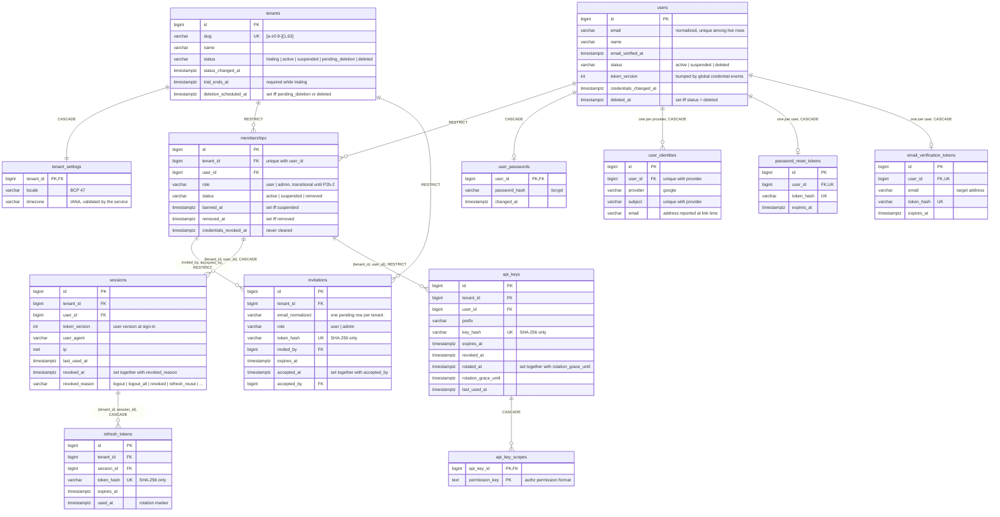
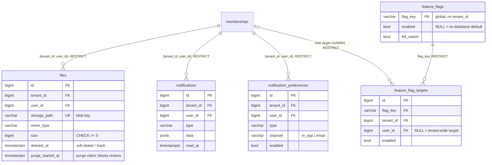
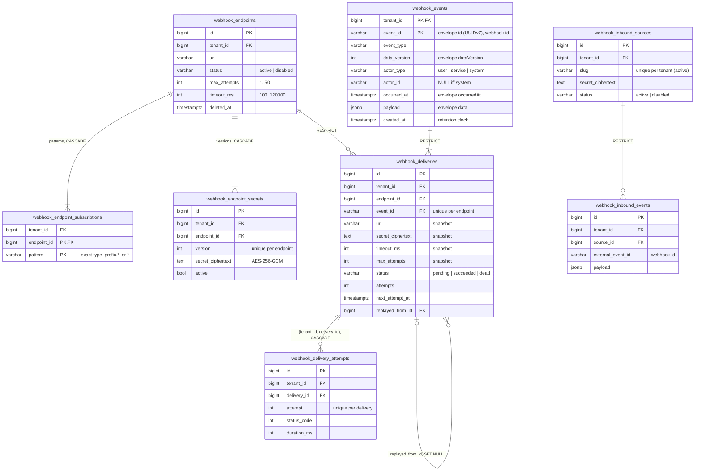
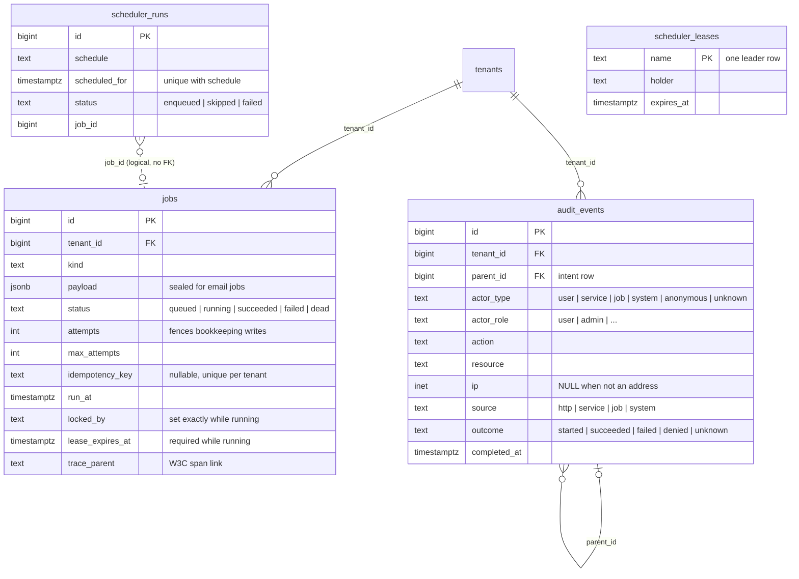

# Data Model

The fresh-install schema is one init migration (ADR 0012),
`migrations/20260101000000_platform_init_schema.{up,down}.sql`, applied only by
`cmd/migrate`. Its `-- owner:` sections, in order:

| Section owner | Creates |
|---|---|
| `platform` | `update_updated_at()` trigger function |
| `identity` | `tenants` (seeds id 1 `default`), `tenant_settings`, `users`, `user_passwords`, `user_identities`, `memberships`, `invitations`, `sessions`, `refresh_tokens`, `password_reset_tokens`, `email_verification_tokens` |
| `platform` | `jobs` |
| `platform` | `scheduler_leases`, `scheduler_runs` |
| `platform` | `audit_events` and its append-only triggers |
| `apikeys` | `api_keys`, `api_key_scopes` |
| `files` | `files` |
| `features` | `feature_flags`, `feature_flag_targets` |
| `notifications` | `notifications`, `notification_preferences` |
| `webhooks` | every `webhook_*` table |

The down file drops exactly what the up file created, leaving an empty schema.
Every table has exactly one owner, and a migration file or section may only
create its owner's tables; modules read
other modules' data through contracts, never through SQL (both enforced by
`test/arch`). See [Architecture](architecture.md#schema-ownership) for the
migration policy.

## Ownership at a glance

| Owner | Tables |
|---|---|
| `identity` | `tenants`, `tenant_settings`, `users` (global), `user_passwords`, `user_identities`, `memberships`, `invitations`, `sessions`, `refresh_tokens`, `password_reset_tokens`, `email_verification_tokens` |
| `apikeys` | `api_keys`, `api_key_scopes` |
| `files` | `files` |
| `notifications` | `notifications`, `notification_preferences` |
| `features` | `feature_flags` (global), `feature_flag_targets` |
| `webhooks` | `webhook_endpoints`, `webhook_endpoint_subscriptions`, `webhook_endpoint_secrets`, `webhook_events`, `webhook_deliveries`, `webhook_delivery_attempts`, `webhook_inbound_sources`, `webhook_inbound_events` |
| platform | `jobs`, `audit_events`, `scheduler_leases`, `scheduler_runs` |

Conventions that apply to every diagram below:

- Every tenant-owned table has `tenant_id BIGINT NOT NULL DEFAULT 1 REFERENCES
  tenants(id)` (identity's `memberships` and `invitations` declare it without
  the default, `ON DELETE RESTRICT`); the diagrams draw that edge only where
  it matters to keep them readable. Tenant `1` (`default`) is seeded by the
  baseline. Exceptions: `api_key_scopes`, a child fully owned by its key, has
  no `tenant_id` of its own (the key id is global; the parent row holds the
  tenant); `users` and the per-user rows `user_passwords`, `user_identities`,
  `password_reset_tokens`, and `email_verification_tokens` are global (ADR
  0004) and have no `tenant_id`.
- Child rows reference their parent through a **composite** foreign key, so a
  row can never point at a parent in another tenant. Every per-member row in
  another module references `(tenant_id, user_id) → memberships(tenant_id,
  user_id)` `ON DELETE RESTRICT`; identity's own children use
  `(tenant_id, session_id) → sessions(tenant_id, id)` and
  `(tenant_id, invited_by | accepted_by) → memberships(tenant_id, user_id)`.
- Primary keys are `BIGINT GENERATED ALWAYS AS IDENTITY`, except
  `feature_flags.flag_key`, `scheduler_leases.name`, and the natural keys of
  `api_key_scopes (api_key_id, permission_key)`,
  `webhook_endpoint_subscriptions (endpoint_id, pattern)`, and
  `webhook_events (tenant_id, event_id)`. Timestamps are `TIMESTAMPTZ`.
- Delete actions: `CASCADE` only for rows fully owned by their parent
  (`tenant_settings`, a user's password, identities, and reset/verification
  tokens, a membership's sessions, a session's refresh tokens, API-key scopes, endpoint subscriptions and secrets, delivery
  attempts); `RESTRICT` for business and history rows; `SET NULL` for
  `webhook_deliveries.replayed_from_id`.

## Tenants, identity, and credentials

Users are global identities that join tenants through memberships (ADR 0004).
The membership, not the user, is the tenant-scoped principal: every
cross-module reference to "a user in a tenant" is a `(tenant_id, user_id)`
foreign key to `memberships`.

- **Tenant lifecycle** (enforced by `identity/service/tenants.go`; the
  timestamps each state needs are pinned by `CHECK`s): `trialing → active |
  suspended | pending_deletion`, `active → suspended | pending_deletion`,
  `suspended → active | pending_deletion`, `pending_deletion → active
  (cancelled) | deleted`; `deleted` is terminal. Only `trialing` and `active`
  tenants serve requests. Tenant 1 can never enter `pending_deletion` or
  `deleted`. Tenants are never hard-deleted, so every `tenants` reference is
  `RESTRICT`/`NO ACTION`.
- **Users** are global. `email` is stored normalized (`CHECK (email =
  lower(btrim(email)))`) and the partial unique index `idx_users_email_live`
  allows one live account per address; deleting an account (`status =
  'deleted'` + `deleted_at`) frees the address. There is no `tenant_id`,
  `role`, or password column: credentials live in `user_passwords` and
  `user_identities`, roles and bans on `memberships`. `token_version` is bumped
  by every global credential event (password change or reset, email change,
  logout-all, account deletion) and invalidates every token and session of
  the user in every tenant.
- **Memberships** are the user ↔ tenant N:N join and the parent key
  (`uq_memberships_tenant_user`) of every cross-module per-member row, which
  is why both parents are `RESTRICT` and rows are never hard-deleted. A ban is
  `status = 'suspended'` + `banned_at`; leaving or being removed is
  `status = 'removed'` + `removed_at`. There is no `invited` state: a pending
  invite is an `invitations` row (it can target an address with no account).
  `credentials_revoked_at` is set by a ban or removal and never cleared, so
  API keys created at or before it stay invalid after an unban or re-join.
  `role` is transitional; P2b-2 replaces it with `membership_roles`.
- The last-admin trigger (`protect_last_admin`) lives on `memberships`: a
  tenant keeps at least one active admin membership. Counting and locking are
  scoped to the tenant; services also take a per-tenant advisory lock, and the
  repository maps the trigger exception (`P0001`) or a deadlock (`40P01`) to
  `409`.
- **Invitations**: one pending row per `(tenant_id, email_normalized)`
  (partial unique `WHERE accepted_at IS NULL`); re-inviting refreshes the
  token, role, and expiry. Revoking deletes the pending row (the trail is in
  `audit_events`); accepting stamps `accepted_at`/`accepted_by` in the
  transaction that creates or reactivates the membership.
- **Sessions** are the RFC 9700 refresh-token family, so there is no separate
  family id: every rotated refresh token references its session, and
  presenting an already-used token revokes the session (`revoked_reason =
  'refresh_reuse'`). `refresh_tokens` is append-only apart from `used_at`;
  used tokens are kept until they expire so a replay is recognized as reuse.
- Password-reset and email-verification tokens are **per user**
  (`user_id UNIQUE`), not per tenant: the password is a global credential.
- `api_keys.key_hash` is the only global (pre-tenant) lookup: the request
  tenant cannot be trusted until the key is verified. A key's owner is a
  membership (`(tenant_id, user_id) → memberships`).
- `api_key_scopes` holds one row per granted permission. Every API-key query
  returns the scopes as one array sorted in byte order, so the API still
  returns a `scopes` array exactly as before. Create and update change the key
  and its scope rows in a single statement. `permission_key` is checked
  against the authz permission format; the RBAC phase adds a `permissions`
  catalog table and replaces that `CHECK` with a foreign key.
- `CHECK ((rotation_grace_until IS NULL) = (rotated_at IS NULL))`: rotation is
  the only writer of either column and always sets both.

| Table | Key constraint / index | Why |
|---|---|---|
| `users` | partial unique `(email) WHERE status <> 'deleted'` | One live account per address, globally. |
| `memberships` | unique `(tenant_id, user_id)`; `(user_id)`; `(tenant_id, created_at DESC, user_id DESC)`; partial `(tenant_id, user_id)` for suspended rows and for active admins | Cross-module FK parent; per-user lookups (login, account deletion); member-list cursor (`joinedAt`, id); ban check; last-admin count. |
| `invitations` | `token_hash` unique; partial unique `(tenant_id, email_normalized) WHERE accepted_at IS NULL`; `(tenant_id, created_at DESC, id DESC)`; partial `(expires_at)` on pending rows | Token lookup; one pending invite per address; list cursor; expiry purge. |
| `sessions` | unique `(tenant_id, id)`; `(tenant_id, user_id, created_at DESC)`; partial `(user_id) WHERE revoked_at IS NULL`; `(last_used_at)` | Refresh-token FK parent; "my sessions"; revoking a user's live sessions across tenants; stale-session purge. |
| `refresh_tokens` | `token_hash` unique; `(tenant_id, session_id)`; `(expires_at)` | Rotation lookup; FK cascade and the purge's live-token check; expiry purge. |

## Files, notifications, and feature flags

| Table | Key constraint / index | Why |
|---|---|---|
| `files` | `storage_path` unique | Authoritative blob key (`<tenantID>/<userID>/<uuid>.<ext>` for new uploads). |
| `notifications` | feed index `(tenant_id, user_id, created_at DESC, id DESC)` + partial unread variant | Cursor feed and unread badge. |
| `notification_preferences` | unique `(tenant_id, user_id, type, channel)` | Idempotent upsert; a missing row means enabled. |
| `feature_flag_targets` | `UNIQUE NULLS NOT DISTINCT (tenant_id, flag_key, user_id)`; index `(flag_key)` | One tenant-wide target (`user_id` NULL) and one target per user, with one `ON CONFLICT` target for both upserts; the unique index is also the tenant-leading list index, and `(flag_key)` serves the `RESTRICT` check on flag delete. |

## Webhooks

- An endpoint's event-type patterns are `webhook_endpoint_subscriptions` rows;
  reads return them as one `eventTypes` array sorted in byte order (create and
  update sort them too). Matching is unchanged: the dispatcher loads the
  patterns and applies `service.Match` (exact type, `prefix.*`, `*`).
- `webhook_events` stores each event once. The first delivery of an event
  writes it in the same transaction as the delivery row and its job; later
  endpoints of the event reuse it. Its columns are the versioned event
  envelope (ADR 0011), and every delivery of the event signs the same
  `{id, type, dataVersion, occurredAt, tenantId, actor, data}` body built from
  this row. A replay is a new event (new id and `occurredAt`) carrying the
  original type, `dataVersion`, actor, and payload.
- `(tenant_id, endpoint_id, event_id)` is unique, so re-dispatching the same
  domain event never creates a second delivery.
- `(tenant_id, source_id, external_event_id)` is unique: the inbound dedupe key.
- Delivery `url`/`secret_ciphertext`/`timeout_ms`/`max_attempts` are snapshots
  taken at dispatch; editing or rotating an endpoint cannot change a queued
  request. Deliveries use `RESTRICT` because endpoints are soft-deleted and the
  delivery log is history.
- Attempts reference their delivery through `(tenant_id, delivery_id) →
  webhook_deliveries (tenant_id, id)`, so an attempt cannot carry a different
  tenant than its delivery.
- Retention deletes terminal deliveries (attempts cascade), then events older
  than the window that no delivery references (`RESTRICT` on the event FK is
  the final guard), then old inbound events; each step is batched.

## Platform tables

- `jobs` is the durable queue and outbox. The partial unique
  `(tenant_id, idempotency_key)` index backs `EnqueueOnce`/`EnqueueOnceTx`.
  Claim and purge are global passes by design. `lease_expires_at` is
  `now()` + the owning worker's lease, written on claim and every heartbeat;
  the `jobs_running_has_lease` `CHECK` requires it on `running` rows, and
  lease recovery reclaims only rows where it is past (partial index
  `idx_jobs_running_lease_expires_at`). `jobs_running_has_owner`
  (`(status = 'running') = (locked_by IS NOT NULL)`) holds because the claim
  sets `locked_by` and every transition out of `running` (succeed, fail,
  release, lease-expiry requeue or dead-letter) clears it.
- `audit_events` is append-only: triggers reject `DELETE`/`TRUNCATE` and limit
  updates to completing a `started` intent. `actor_type` says what kind of
  principal acted; an administrator is `actor_type = 'user'` with
  `actor_role = 'admin'`. The recorder stores a canonical address in `ip`
  (IPv6 zone dropped) and NULL for anything that does not parse, never the raw
  value. `parent_id` references the intent row a domain event belongs to.
- `scheduler_leases` and `scheduler_runs` are deliberately tenant-independent
  with no foreign keys; the unique `(schedule, scheduled_for)` ledger is the
  exactly-once boundary across leader changes. `scheduler_runs` has no
  status/error `CHECK`: skipped runs record their reason in `error`, so
  `(status = 'failed') = (error IS NOT NULL)` would not hold.
