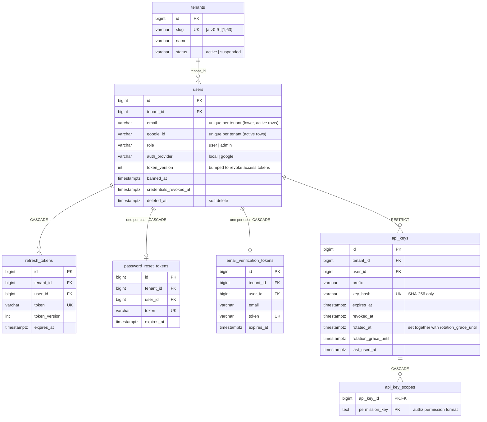
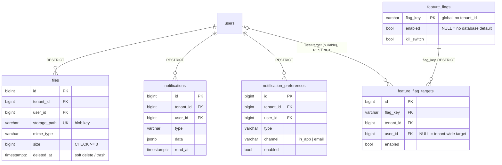
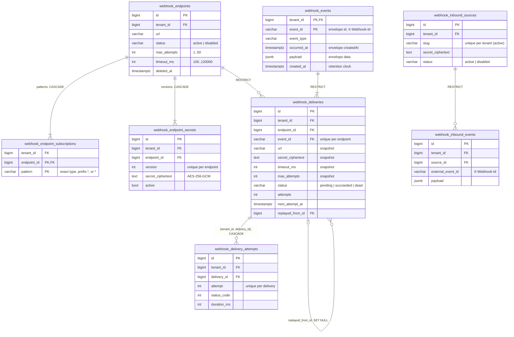
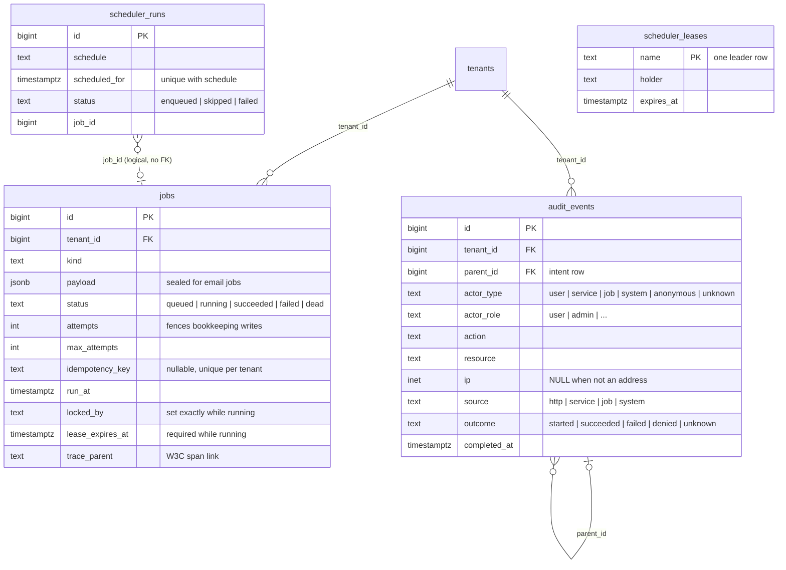

# Data Model

The fresh-install schema is a per-owner baseline (ADR 0005) applied only by
`cmd/migrate`, in timestamp order:

| Version | File | Creates |
|---|---|---|
| `20260101000000` | `platform_functions` | `update_updated_at()` trigger function |
| `20260101000100` | `identity_init` | `tenants` (seeds id 1 `default`), `users`, `refresh_tokens`, `password_reset_tokens`, `email_verification_tokens` |
| `20260101000200` | `platform_jobs` | `jobs` |
| `20260101000300` | `platform_scheduler` | `scheduler_leases`, `scheduler_runs` |
| `20260101000400` | `platform_audit` | `audit_events` and its append-only triggers |
| `20260101000500` | `apikeys_init` | `api_keys`, `api_key_scopes` |
| `20260101000600` | `files_init` | `files` |
| `20260101000700` | `features_init` | `feature_flags`, `feature_flag_targets` |
| `20260101000800` | `notifications_init` | `notifications`, `notification_preferences` |
| `20260101000900` | `webhooks_init` | every `webhook_*` table |

Each `.down.sql` drops exactly what its `.up.sql` created; applying every down
file in reverse order leaves an empty schema. Every table has exactly one
owner, and a migration file may only create its owner's tables; modules read
other modules' data through contracts, never through SQL (both enforced by
`test/arch`). See [Architecture](architecture.md#schema-ownership) for the
migration policy.

## Ownership at a glance

| Owner | Tables |
|---|---|
| `identity` | `tenants`, `users`, `refresh_tokens`, `password_reset_tokens`, `email_verification_tokens` |
| `apikeys` | `api_keys`, `api_key_scopes` |
| `files` | `files` |
| `notifications` | `notifications`, `notification_preferences` |
| `features` | `feature_flags` (global), `feature_flag_targets` |
| `webhooks` | `webhook_endpoints`, `webhook_endpoint_subscriptions`, `webhook_endpoint_secrets`, `webhook_events`, `webhook_deliveries`, `webhook_delivery_attempts`, `webhook_inbound_sources`, `webhook_inbound_events` |
| platform | `jobs`, `audit_events`, `scheduler_leases`, `scheduler_runs` |

Conventions that apply to every diagram below:

- Every tenant-owned table has `tenant_id BIGINT NOT NULL DEFAULT 1 REFERENCES
  tenants(id)`; the diagrams draw that edge only once (first diagram) to keep
  them readable. Tenant `1` (`default`) is seeded by the baseline. The one
  exception is `api_key_scopes`, a child fully owned by its key, which has no
  `tenant_id` of its own (the key id is global; the parent row holds the
  tenant).
- Child rows reference their parent through a **composite** `(tenant_id, id)`
  foreign key (for example `(tenant_id, user_id) → users(tenant_id, id)`), so a
  row can never point at a parent in another tenant.
- Primary keys are `BIGINT GENERATED ALWAYS AS IDENTITY`, except
  `feature_flags.flag_key`, `scheduler_leases.name`, and the natural keys of
  `api_key_scopes (api_key_id, permission_key)`,
  `webhook_endpoint_subscriptions (endpoint_id, pattern)`, and
  `webhook_events (tenant_id, event_id)`. Timestamps are `TIMESTAMPTZ`.
- Delete actions: `CASCADE` only for rows fully owned by their parent (auth
  tokens, API-key scopes, endpoint subscriptions and secrets, delivery
  attempts); `RESTRICT` for business and history rows; `SET NULL` for
  `webhook_deliveries.replayed_from_id`.

## Tenants, identity, and credentials

- A trigger refuses to remove or demote the last admin **of a tenant**.
- `api_keys.key_hash` is the only global (pre-tenant) lookup: the request
  tenant cannot be trusted until the key is verified.
- `api_key_scopes` holds one row per granted permission. Every API-key query
  returns the scopes as one array sorted in byte order, so the API still
  returns a `scopes` array exactly as before. Create and update change the key
  and its scope rows in a single statement. `permission_key` is checked
  against the authz permission format; the RBAC phase adds a `permissions`
  catalog table and replaces that `CHECK` with a foreign key.
- `CHECK ((rotation_grace_until IS NULL) = (rotated_at IS NULL))`: rotation is
  the only writer of either column and always sets both.

## Files, notifications, and feature flags

| Table | Key constraint / index | Why |
|---|---|---|
| `files` | `storage_path` unique | Authoritative blob key (`<tenantID>/<userID>/<uuid>.<ext>` for new uploads). |
| `notifications` | feed index `(tenant_id, user_id, created_at DESC, id DESC)` + partial unread variant | Cursor feed and unread badge. |
| `notification_preferences` | unique `(tenant_id, user_id, type, channel)` | Idempotent upsert; a missing row means enabled. |
| `feature_flag_targets` | `UNIQUE NULLS NOT DISTINCT (tenant_id, flag_key, user_id)`; index `(flag_key)` | One tenant-wide target (`user_id` NULL) and one target per user, with one `ON CONFLICT` target for both upserts; the unique index is also the tenant-leading list index, and `(flag_key)` serves the `RESTRICT` check on flag delete. |

## Webhooks

- An endpoint's event-type patterns are `webhook_endpoint_subscriptions` rows;
  reads return them as one `eventTypes` array sorted in byte order (create and
  update sort them too). Matching is unchanged: the dispatcher loads the
  patterns and applies `webhookcontracts.Match` (exact type, `prefix.*`, `*`).
- `webhook_events` stores each event once. The first delivery of an event
  writes it in the same transaction as the delivery row and its job; later
  endpoints of the event reuse it. Every delivery of the event signs the same
  `{id, type, createdAt, data}` envelope built from this row. A replay is a
  new event (new id and `createdAt`) carrying a copy of the original payload.
- `(tenant_id, endpoint_id, event_id)` is unique, so re-dispatching the same
  domain event never creates a second delivery.
- `(tenant_id, source_id, external_event_id)` is unique: the inbound dedupe key.
- Delivery `url`/`secret_ciphertext`/`timeout_ms`/`max_attempts` are snapshots
  taken at dispatch; editing or rotating an endpoint cannot change a queued
  request. Deliveries use `RESTRICT` because endpoints are soft-deleted and the
  delivery log is history.
- Attempts reference their delivery through `(tenant_id, delivery_id) →
  webhook_deliveries (tenant_id, id)`, so an attempt cannot carry a different
  tenant than its delivery.
- Retention deletes terminal deliveries (attempts cascade), then events older
  than the window that no delivery references (`RESTRICT` on the event FK is
  the final guard), then old inbound events; each step is batched.

## Platform tables

- `jobs` is the durable queue and outbox. The partial unique
  `(tenant_id, idempotency_key)` index backs `EnqueueOnce`/`EnqueueOnceTx`.
  Claim and purge are global passes by design. `lease_expires_at` is
  `now()` + the owning worker's lease, written on claim and every heartbeat;
  the `jobs_running_has_lease` `CHECK` requires it on `running` rows, and
  lease recovery reclaims only rows where it is past (partial index
  `idx_jobs_running_lease_expires_at`). `jobs_running_has_owner`
  (`(status = 'running') = (locked_by IS NOT NULL)`) holds because the claim
  sets `locked_by` and every transition out of `running` (succeed, fail,
  release, lease-expiry requeue or dead-letter) clears it.
- `audit_events` is append-only: triggers reject `DELETE`/`TRUNCATE` and limit
  updates to completing a `started` intent. `actor_type` says what kind of
  principal acted; an administrator is `actor_type = 'user'` with
  `actor_role = 'admin'`. The recorder stores a canonical address in `ip`
  (IPv6 zone dropped) and NULL for anything that does not parse, never the raw
  value. `parent_id` references the intent row a domain event belongs to.
- `scheduler_leases` and `scheduler_runs` are deliberately tenant-independent
  with no foreign keys; the unique `(schedule, scheduled_for)` ledger is the
  exactly-once boundary across leader changes. `scheduler_runs` has no
  status/error `CHECK`: skipped runs record their reason in `error`, so
  `(status = 'failed') = (error IS NOT NULL)` would not hold.
