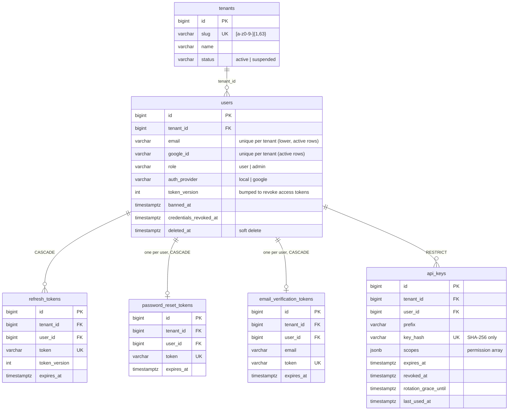
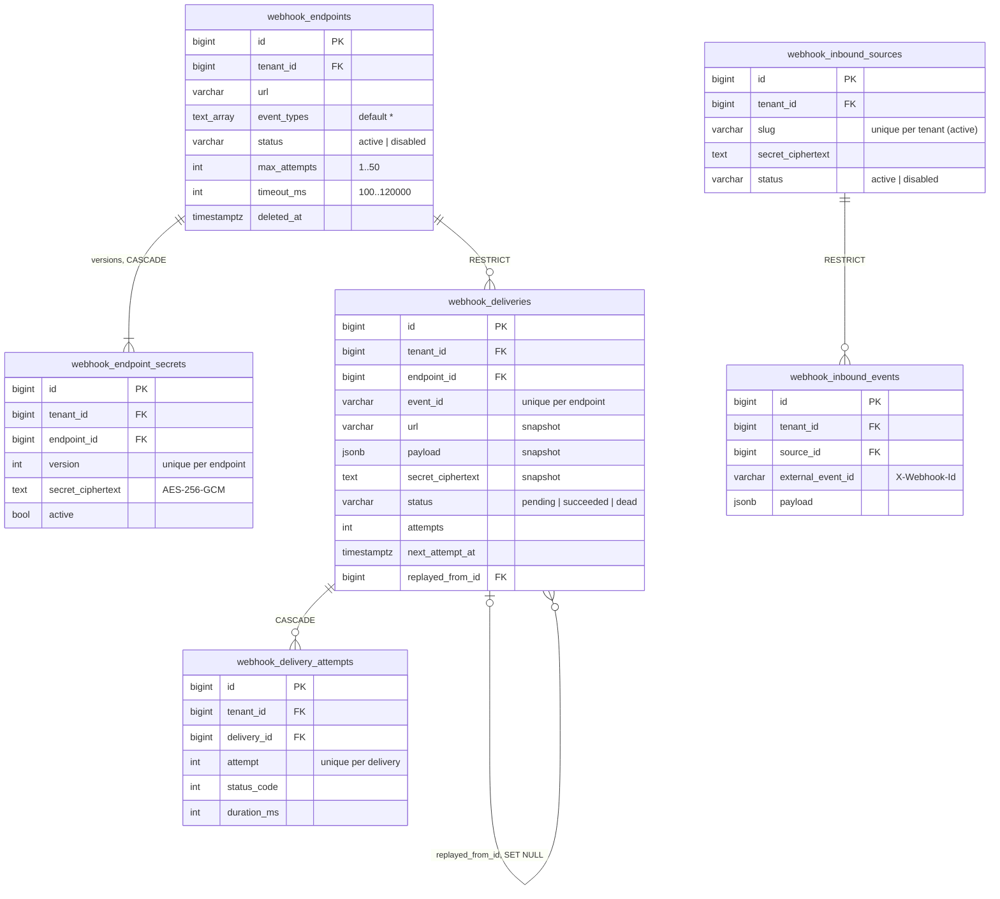
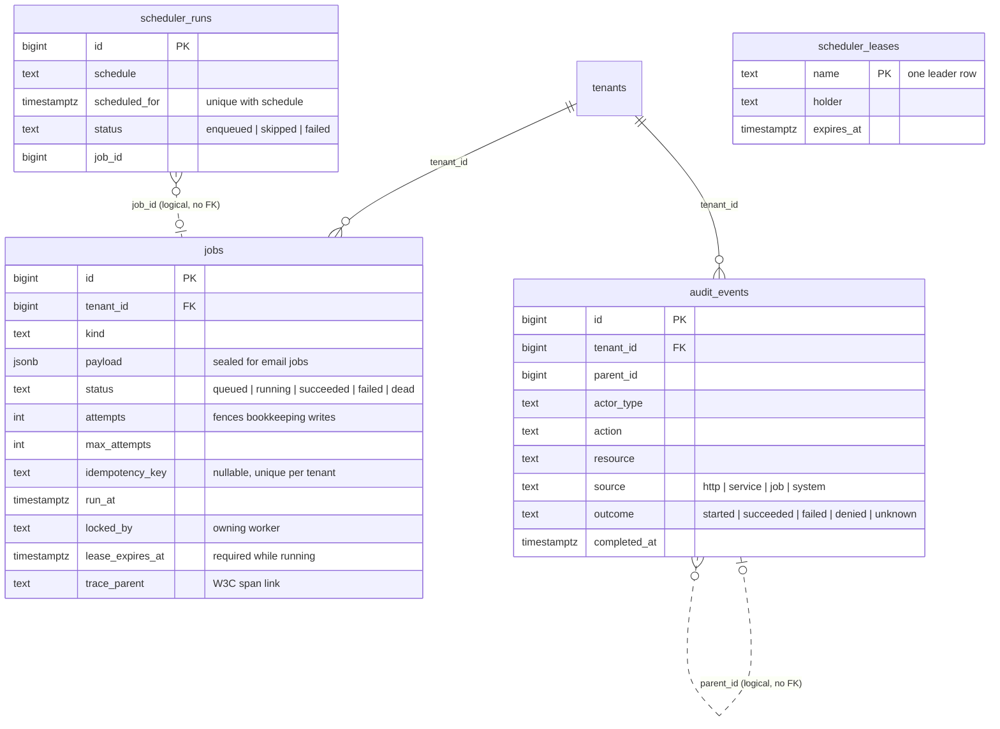

# Data Model

The schema lives in one baseline, `migrations/000001_init_schema.up.sql`,
applied only by `cmd/migrate`. Every table has exactly one owner; modules read
other modules' data through contracts, never through SQL (enforced by
`test/arch`). See [Architecture](architecture.md#schema-ownership) for the
migration policy.

## Ownership at a glance

| Owner | Tables |
|---|---|
| `identity` | `tenants`, `users`, `refresh_tokens`, `password_reset_tokens`, `email_verification_tokens` |
| `apikeys` | `api_keys` |
| `files` | `files` |
| `notifications` | `notifications`, `notification_preferences` |
| `features` | `feature_flags` (global), `feature_flag_targets` |
| `webhooks` | `webhook_endpoints`, `webhook_endpoint_secrets`, `webhook_deliveries`, `webhook_delivery_attempts`, `webhook_inbound_sources`, `webhook_inbound_events` |
| platform | `jobs`, `audit_events`, `scheduler_leases`, `scheduler_runs` |

Conventions that apply to every diagram below:

- Every tenant-owned table has `tenant_id BIGINT NOT NULL DEFAULT 1 REFERENCES
  tenants(id)`; the diagrams draw that edge only once (first diagram) to keep
  them readable. Tenant `1` (`default`) is seeded by the baseline.
- Child rows reference their parent through a **composite** `(tenant_id, id)`
  foreign key (for example `(tenant_id, user_id) → users(tenant_id, id)`), so a
  row can never point at a parent in another tenant.
- Primary keys are `BIGINT GENERATED ALWAYS AS IDENTITY`, except
  `feature_flags.flag_key` and `scheduler_leases.name`. Timestamps are
  `TIMESTAMPTZ`.
- Delete actions: `CASCADE` only for rows fully owned by their parent (auth
  tokens, endpoint secrets, delivery attempts); `RESTRICT` for business and
  history rows; `SET NULL` for `webhook_deliveries.replayed_from_id`.

## Tenants, identity, and credentials

- A trigger refuses to remove or demote the last admin **of a tenant**.
- `api_keys.key_hash` is the only global (pre-tenant) lookup: the request
  tenant cannot be trusted until the key is verified.

## Files, notifications, and feature flags

| Table | Key constraint / index | Why |
|---|---|---|
| `files` | `storage_path` unique | Authoritative blob key (`<tenantID>/<userID>/<uuid>.<ext>` for new uploads). |
| `notifications` | feed index `(tenant_id, user_id, created_at DESC, id DESC)` + partial unread variant | Cursor feed and unread badge. |
| `notification_preferences` | unique `(tenant_id, user_id, type, channel)` | Idempotent upsert; a missing row means enabled. |
| `feature_flag_targets` | unique `(flag_key, tenant_id)` where `user_id IS NULL`; unique `(flag_key, tenant_id, user_id)` otherwise | One tenant target and one target per user. |

## Webhooks

- `(tenant_id, endpoint_id, event_id)` is unique, so re-dispatching the same
  domain event never creates a second delivery.
- `(tenant_id, source_id, external_event_id)` is unique: the inbound dedupe key.
- Delivery `url`/`payload`/`secret_ciphertext` are snapshots; editing or
  rotating an endpoint cannot change a queued request. Deliveries use
  `RESTRICT` because endpoints are soft-deleted and the delivery log is history.

## Platform tables

- `jobs` is the durable queue and outbox. The partial unique
  `(tenant_id, idempotency_key)` index backs `EnqueueOnce`/`EnqueueOnceTx`.
  Claim and purge are global passes by design. `lease_expires_at` is
  `now()` + the owning worker's lease, written on claim and every heartbeat;
  the `jobs_running_has_lease` `CHECK` requires it on `running` rows, and
  lease recovery reclaims only rows where it is past (partial index
  `idx_jobs_running_lease_expires_at`).
- `audit_events` is append-only: triggers reject `DELETE`/`TRUNCATE` and limit
  updates to completing a `started` intent.
- `scheduler_leases` and `scheduler_runs` are deliberately tenant-independent
  with no foreign keys; the unique `(schedule, scheduled_for)` ledger is the
  exactly-once boundary across leader changes.
