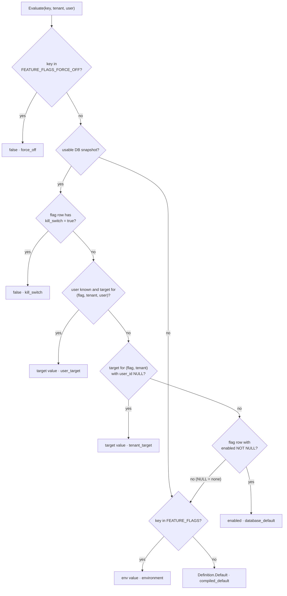
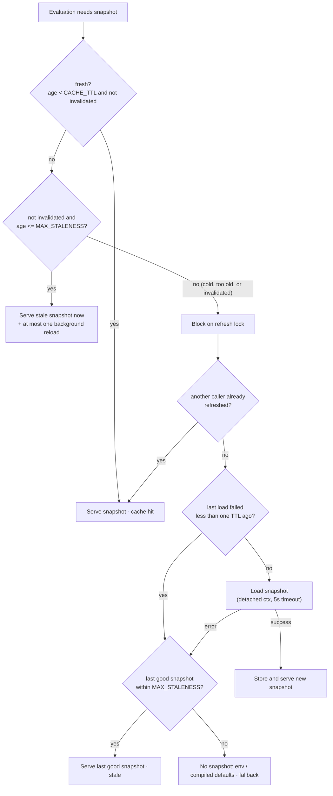

# Feature Flags

Feature flags are compile-time keys with optional PostgreSQL state, tenant/user
targets, and an in-process snapshot cache. They are owned by
`internal/platform/features` (catalog, evaluator, database store, metrics) and
administered through `internal/modules/features` (HTTP + sqlc).

The feature is deliberately dependency-free: no flag provider SDK, no external
service, and no new module-to-module imports.

## Catalog

Only registered flags exist. Each module declares its flags in
`internal/modules/<m>/catalog/flags.go` (a `features.Key` constant plus a
`features.Definition`) and returns them from `FeatureFlags()`
(`app.FlagProvider`); `app.RegisterCatalogs` registers them at startup, owned
by the module, and fails on a key another module already owns. Config loading
checks `FEATURE_FLAGS`/`FEATURE_FLAGS_FORCE_OFF` syntax only; `cmd/api` calls
`cfg.FeatureFlags.ValidateKnownKeys()` right after registration, so unknown
keys still fail startup, and the admin API returns `404` for them, so a typo
cannot silently disable a feature.

Current catalog:

| Key | Owner | Compiled default | Purpose |
| --- | --- | --- | --- |
| `user_registration` | identity | `true` | Allow public registration. |
| `email_verification` | identity | `false` | Require email verification before authenticated actions. |
| `google_oauth` | identity | `true` | Expose Google OAuth login/callback. |
| `file_uploads` | files | `true` | Allow authenticated file uploads. |

### Gates

Each flag is enforced by its owning module with the request subject
(tenant, plus the user when one is known), so tenant/user targets apply:

| Key | Enforced at | Subject | When off |
| --- | --- | --- | --- |
| `user_registration` | `POST /auth/register` (handler) and new-account creation in `GET /auth/google/callback` | request tenant; callback: tenant in the signed `state` | `404 feature.disabled` |
| `google_oauth` | `GET /auth/google` and `GET /auth/google/callback` (handler) | redirect: resolved tenant; callback: tenant in the signed `state` | `404 feature.disabled` |
| `file_uploads` | `POST /files/upload` (route middleware after auth, before idempotency/audit) | request tenant + JWT user | `404 feature.disabled` |
| `email_verification` | `POST /auth/login`, `POST /auth/refresh` | user's tenant + user | when **on**, unverified users get `403 auth.email_not_verified` |

- `email_verification` is a requirement, not a route gate. It is OR-ed with
  `REQUIRE_EMAIL_VERIFICATION`: the flag can add the requirement for a tenant
  or user but never lifts the configured one. Like the config, it is checked
  when tokens are minted (login/refresh); already-issued access tokens stay
  valid until they expire.
- `google_oauth` defaults to **on** so existing deployments keep working;
  Google credentials (`GOOGLE_CLIENT_ID`/`GOOGLE_CLIENT_SECRET`) remain the
  real switch. Disable it globally or per tenant to return
  `404 feature.disabled`.
- `user_registration` gates only *new* Google accounts: the callback passes
  the flag to the identity service, which still signs in an existing Google
  user and links a verified local account, but refuses to create one. Use
  `google_oauth` to disable Google sign-in entirely for a tenant.

`feature.disabled` is a `404`: a disabled feature behaves like an absent
route (consistent with "Google OAuth not configured"), and the stable code
lets clients distinguish it from a mistyped URL. `403` was rejected because it
implies a permission problem the caller could fix by changing role.

Platform helpers: `features.Require(ctx, evaluator, key, subject)` returns the
typed error, and `featureshttp.Middleware(evaluator, key)` gates a route using the
request tenant and `user_id` local. A nil evaluator uses compiled defaults
only, so an unwired gate fails closed for default-off flags.

Using a flag to change a route is a product decision made by the owning
module. The evaluator is available to every module through `app.Deps.Flags`:

```go
enabled := deps.Flags.Enabled(
    c.Context(),
    features.KeyFileUploads,
    features.SubjectFromContext(c.Context(), httpx.AuthUserID(c)),
)
```

`app.New` replaces a nil `Deps.Flags` with an evaluator backed by environment
values, force-off, and compiled defaults, so modules never need a nil check.

## Precedence

Evaluation stops at the first matching source, highest first. Each result is
labelled with its `source` (the metric label and the admin API's effective
source).



| Source | Rule |
| --- | --- |
| Force-off | `FEATURE_FLAGS_FORCE_OFF` contains the key. Always `false`; checked before any snapshot lookup, so it works while the database is down. |
| Kill switch | `feature_flags.kill_switch` is true. Always `false`; the row and targets remain for a later re-enable. |
| User target | `feature_flag_targets` row for `(flag, tenant, user)`; only evaluated when a user is known. |
| Tenant target | `feature_flag_targets` row for `(flag, tenant)` with `user_id IS NULL`. |
| Database default | `feature_flags.enabled` when not NULL. A NULL default (a row created to anchor targets or carry a kill switch) falls through. |
| Environment | `FEATURE_FLAGS` assignment. |
| Compiled default | `Definition.Default`. |

Without a usable snapshot (no store, cold start with the database down, or the
last good snapshot is older than the max staleness), evaluation skips the
database layers entirely.

A target can be `true` or `false`; both override lower levels. Tenant/user
lookups use the request tenant resolved by `tenanthttp.Middleware` (and the JWT
claim for authenticated routes). A user target is keyed by both tenant and
user, so the same user ID in another tenant does not inherit it.

## Configuration

| Variable | Default | Meaning |
| --- | --- | --- |
| `FEATURE_FLAGS` | empty | Comma-separated `key=true\|false` assignments; a bare key means true, e.g. `user_registration=false,file_uploads`. |
| `FEATURE_FLAGS_FORCE_OFF` | empty | Comma-separated keys that always evaluate false. |
| `FEATURE_FLAGS_CACHE_TTL_SECONDS` | `30` | How long a loaded database snapshot is fresh. |
| `FEATURE_FLAGS_MAX_STALENESS_SECONDS` | `300` | Maximum age of the last good snapshot when the database is unavailable. Never below the TTL. |

Config validation rejects malformed assignments, duplicate keys, unknown
catalog keys, negative timings, and `MAX_STALENESS < CACHE_TTL`. Zero timings
fall back to the defaults (useful for tests that build `Config` literals).

## Database

Both tables are created by the fresh-install baseline file `migrations/20260101000700_features_init.up.sql`:

- `feature_flags` is process-wide configuration: `flag_key` primary key,
  nullable `enabled` (database default; NULL = none), `kill_switch`,
  `description`, timestamps.
- `feature_flag_targets` is tenant-owned: `flag_key`, `tenant_id`, nullable
  `user_id`, `enabled`, timestamps. A `(tenant_id, user_id)` composite foreign
  key references `users(tenant_id, id)`, so a target cannot point at a user in
  another tenant. `feature_flag_targets_flag_key_fk` references
  `feature_flags(flag_key)` with `ON DELETE RESTRICT`: deleting a flag can never
  wipe another tenant's targets.
- A target upsert creates the parent flag row in the same statement when it is
  missing, with `enabled = NULL`, so a tenant can target a flag no platform
  admin has configured without forcing a default on every other tenant.

One unique index allows one tenant-wide target and one target per user per
flag: `idx_feature_flag_targets_tenant_flag_user` is `UNIQUE NULLS NOT DISTINCT
(tenant_id, flag_key, user_id)`, so the tenant-wide target (`user_id` NULL)
collides with itself and both upserts share one `ON CONFLICT` target. It is
also the tenant-leading index of the admin list query; `(flag_key)` is indexed
separately for the `RESTRICT` check on flag delete.

`cmd/migrate` verifies both tables, their tenant/key columns, and this unique
index (plus `users(tenant_id, id)`, which backs the composite foreign key).

## Cache and invalidation

The evaluator keeps one full snapshot in process memory.



| Behavior | Detail |
| --- | --- |
| Fresh | A snapshot younger than `FEATURE_FLAGS_CACHE_TTL_SECONDS` is served without a query. |
| Stale-while-revalidate | An expired snapshot still within `FEATURE_FLAGS_MAX_STALENESS_SECONDS` is served immediately while one background reload runs, so a slow database never stalls requests. |
| Blocking reload | Only with no usable snapshot (cold start, older than max staleness) or after `Invalidate`. Concurrent blocked callers serialize behind the refresh lock and reuse the fresh result. |
| Detached loads | Loads use `context.WithoutCancel` plus a 5s timeout, so a client disconnect cannot fail a load for everyone. A load that still returns `context.Canceled` is not a database failure and does not throttle the next reload. |
| Failed reload | The last good snapshot is served while no older than max staleness; after that, evaluation falls back to force-off/environment/compiled defaults. Failed reloads are throttled for one TTL so an outage does not query on every request. |
| Invalidate | The admin service calls `Evaluator.Invalidate` after every successful write, so the writing replica sees the change immediately. It marks the snapshot stale instead of dropping it: if the next reload fails the previous snapshot remains the fallback, so a database blip right after a write cannot lift a kill switch. A load already in flight when `Invalidate` runs is discarded and reloaded. |
| Other replicas | Converge within the cache TTL; there is no pub/sub dependency. |

## Admin API

All routes require a JWT and are mounted under `/api/v1/admin/features`.
`admin:features:read` guards reads; `admin:features:write` guards mutations.
Mutating routes accept `Idempotency-Key` through the normal middleware and then
run behind a required `audithttp.Guard` (fail-closed: an unavailable audit store
returns `503 system.audit_unavailable` before the write).

| Method | Path | Description |
| --- | --- | --- |
| GET | `/flags` | List every catalog flag with database default, kill switch, configured state, and the caller's effective value/source. |
| GET | `/flags/{key}` | Flag plus tenant targets. |
| PUT | `/flags/{key}` | Platform tenant only. Upsert the database default, kill switch, and description (description defaults to the existing value or catalog description). Omitting `enabled` stores NULL (no database default). |
| DELETE | `/flags/{key}` | Platform tenant only. Delete the database row; the flag reverts to env/compiled defaults. Idempotent for a valid catalog key; `409` while targets exist in any tenant. |
| GET | `/flags/{key}/targets` | List tenant-wide and user targets in the request tenant. |
| PUT | `/flags/{key}/targets` | Upsert a target. Omit `userId` for a tenant-wide target; include it for a user target. The tenant always comes from context, never the body. |
| DELETE | `/flags/{key}/targets/{id}` | Delete a target by ID, scoped to the request tenant and flag key. |

`killSwitch` is required on `PUT /flags/{key}`; `enabled` is required on
`PUT .../targets`. Requests reject unknown JSON fields. A user target whose
user is not in the request tenant returns `400` (composite FK); a target upsert
that races a concurrent flag delete returns `409`.

Flag rows are process-wide; targets are tenant-scoped. `PUT`/`DELETE
/flags/{key}` change behavior for every tenant, so they are allowed only for
administrators of the platform tenant (the compatibility tenant, id 1, read
strictly from the request context without the `EffectiveID` fallback). Any
other tenant's admin gets `403 permission.denied` and keeps read access and
management of its own tenant/user targets. `DELETE /flags/{key}` relies on the
RESTRICT foreign key (not a count-then-delete check), so a target created
concurrently in any tenant still blocks it; the `409` never names the tenants
that own targets. Use tenant/user targets for per-tenant rollout.

Audit: each mutation writes a required Guard intent row
(`admin.feature_flag.updated`, `admin.feature_flag.deleted`,
`admin.feature_flag_target.updated`, `admin.feature_flag_target.deleted`) and
completes it with the outcome. After a successful write the service records a
domain event with the same action, linked to the intent, carrying non-secret
metadata: `feature`, `enabled` (omitted when NULL), `killSwitch`, `source`,
and, for targets, `targetId`, `enabled`, and `userId`. The resource ID is the
flag key or the target ID.

## Metrics

| Metric | Labels | Meaning |
| --- | --- | --- |
| `feature_flag_evaluations_total` | `key`, `source`, `enabled` | Evaluation results by precedence source. |
| `feature_flag_snapshot_loads_total` | `result` | Database snapshot loads (`success`/`error`). |
| `feature_flag_cache_hits_total` | — | Evaluations served from a fresh snapshot. |
| `feature_flag_cache_misses_total` | — | Cold/expired snapshot evaluations. |
| `feature_flag_snapshot_stale_total` | — | Evaluations served from a stale snapshot during a database outage. |
| `feature_flag_snapshot_fallback_total` | — | Evaluations that fell back to env/compiled defaults. |
| `feature_flag_snapshot_age_seconds` | — | Age of the snapshot currently used. |
| `feature_flag_invalidations_total` | — | Local snapshot invalidations. |

Alert on sustained `feature_flag_snapshot_loads_total{result="error"}` or a
rising `feature_flag_snapshot_fallback_total`: both mean the evaluator is
serving defaults instead of database state.

## Operations

| Task | How |
| --- | --- |
| Stop a misbehaving feature now | Set `FEATURE_FLAGS_FORCE_OFF=<key>` and restart (independent of the database), or set the flag's kill switch through the admin API. |
| Roll out by tenant | Leave the database default off and add tenant/user targets. |
| Remove a flag row | Safe once its targets are removed (`409` until then); evaluation falls back to environment and compiled defaults. |
| Clear only the database default | `PUT` the flag without `enabled` while targets remain. |
| Remove a key from the catalog | Any remaining database row becomes unreachable; delete the row in the same release. |
| Schema | The evaluator never writes DDL and the API never migrates. Run `cmd/migrate` before a release that introduces the feature tables. |

## Tests

- `internal/platform/features`: catalog/parsing, every precedence layer,
  NULL database defaults and targets without a row, tenant scoping, TTL expiry,
  invalidation (with stale fallback), detached/canceled loads, stale serving,
  max staleness, in-flight invalidation, and the `Require`/`Middleware` gates.
- `internal/modules/features/{service,handler}`: catalog merge, target tenant
  scoping, platform-tenant restriction, idempotent delete and `409` conflicts,
  validation, audit domain events, permissions, route-level idempotency, and
  fail-closed audit guards.
- `internal/modules/identity/handler/feature_gates_test.go` and
  `internal/modules/files/module_test.go`: each gated key with tenant targets.
- `test/integration/feature_flags_test.go`: fresh-schema SQL, admin lifecycle,
  tenant/user precedence, cross-tenant rejection, platform-tenant 403, RESTRICT
  409, targets without a database default, audit metadata/intents, and
  permission enforcement.
