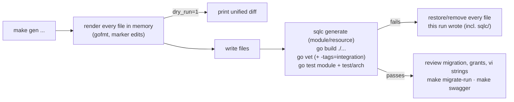
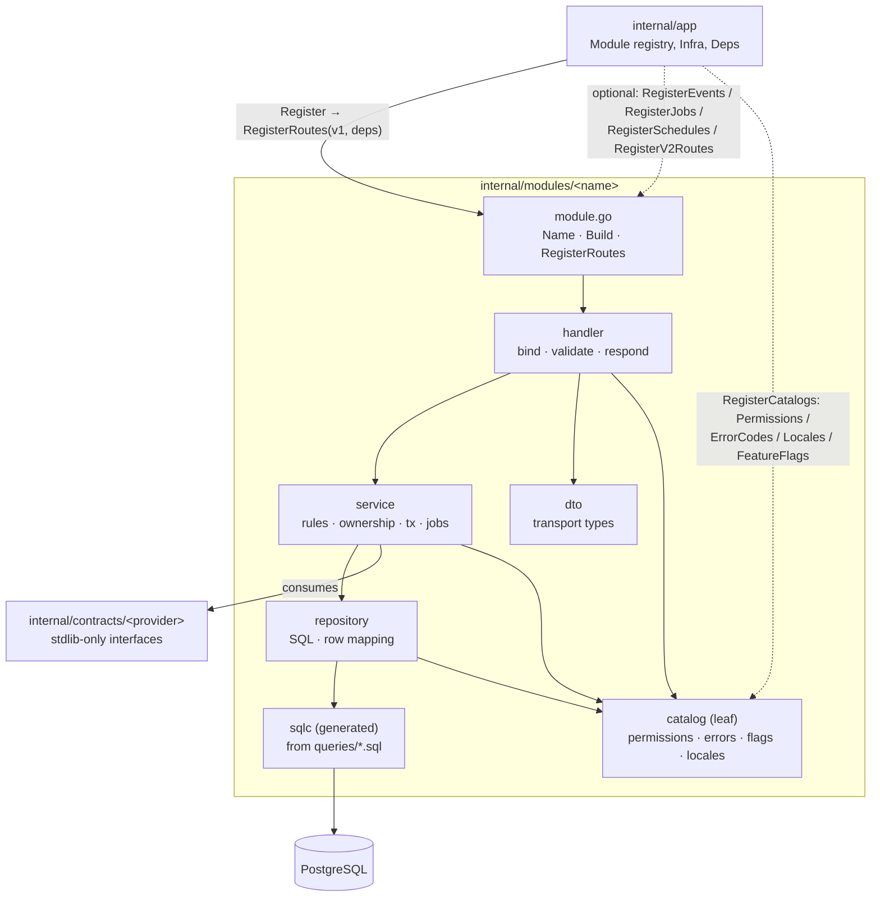
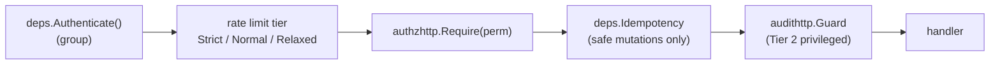
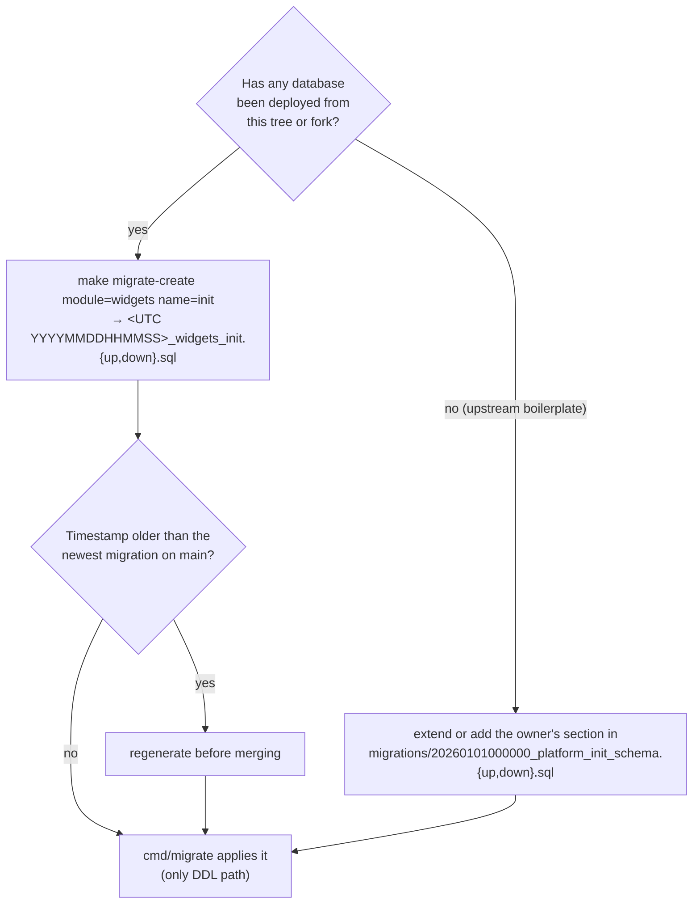
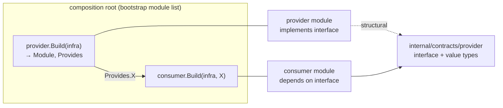
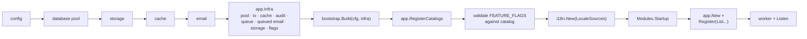

# Module Template

Canonical layout and checklist for a new business module in this modular
monolith. Read it with [Architecture](architecture.md) (dependency and schema
rules) and [Operations](operations.md) (runtime behavior).

## Quick start

`cmd/gen` (Go stdlib `text/template` + `embed`) generates code in the
[ADR 0002](adr/0002-module-layering.md) layout, so `test/arch` (including the
layering ratchet) passes for generated code with no allowlist entries.

```bash
make gen module=billing                              # module skeleton + bootstrap entry
make gen resource=invoice module=billing             # tenant-scoped CRUD slice
make gen command=IssueInvoice module=billing         # service/command_issue_invoice.go + POST route
make gen query=ListOverdueInvoices module=billing    # service/query_list_overdue_invoices.go + GET route
make gen module=billing dry_run=1                    # print a unified diff, write nothing
make gen command=IssueInvoice module=billing no_http=1   # use case only, no handler/route
```

The targets call `go run ./cmd/gen <module|resource|command|query> [--dry-run]
[--no-http] [--plural <plural>] [--module <module>] <name>` (flags may follow
the name; `go run ./cmd/gen -h` prints the usage). `scripts/new-module.sh
<name>` remains as a thin wrapper for `go run ./cmd/gen module <name>`.



| Command | Creates | Edits (at `gen:` markers) |
| --- | --- | --- |
| `module=<name>` | `module.go`, `build.go`, `generate.go`, `sqlc.yaml`, `README.md`, `module_test.go`, `catalog/` (permissions, errors, en/vi), `service/{ports,authorize,health}.go`, `repository/health.go`, `handler/health.go`, `dto/dto.go`, `queries/health.sql`, unit tests, `migrations/<UTC ts>_<name>_init.{up,down}.sql` | `internal/bootstrap/modules.go` (import, `Build`, `List`; idempotent) |
| `resource=<r> module=<m>` | `migrations/<UTC ts>_<m>_create_<plural>.{up,down}.sql`, `queries/<r>.sql`, `service/<r>.go`, `repository/<r>.go` (+ shared `repository/errors.go`), `handler/<r>.go`, `dto/<r>.go`, `routes_<r>.go`, service/handler tests with hand-written fakes, `<r>_integration_test.go` | `service/ports.go`, `module.go`, `build.go`, `catalog/{permissions,errors}.go`, `catalog/locales/{en,vi}.json`, `README.md` |
| `command=<Name>` / `query=<Name>` | `service/{command,query}_<name>.go` (+ test); unless `no_http=1`: `handler/`, `dto/`, `routes_*.go` (+ handler test) | `module.go`, `build.go`, `README.md` |

Rules the generator enforces:

- Module and resource names are lower_snake_case (Go keywords, layout names,
  `vendor`/`testdata` rejected); use-case names are PascalCase with at least
  two words. Nothing is ever overwritten.
- `resource`, `command`, and `query` only extend a module created by `cmd/gen`
  (its `module.go` carries the `// gen:routes` marker); keep the `gen:`
  marker comments in generated files and in `internal/bootstrap/modules.go`.
- A migration version is a UTC timestamp newer than every existing migration,
  so `module` then `resource` in the same second never collide.
- The resource table is `<module>_<plural>` (`--plural` for irregular
  nouns); sqlc's model is the singularized table name.

Generated code is admin-only until you grant roles in `catalog/permissions.go`,
and commands/queries return `501 <module>.not_implemented` until their
`Handle` is written, so an unfinished use case never reports success. Do not
commit a probe module created only to try the generator.

## 1. Module anatomy



### Layout

| Path | Responsibility |
| --- | --- |
| `module.go` | `package <name>`: `app.Module`, catalog providers, route table |
| `build.go` | `Build(infra app.Infra, settings Settings) (*Module, Provides, error)`, the module's `Settings` and `Provides` (see [section 2](#2-scaffold-skeleton) for the variants in existing modules) |
| `generate.go`, `sqlc.yaml` | `//go:generate sqlc generate -f sqlc.yaml`; the module's own sqlc configuration (paths relative to the file) |
| `module_test.go` | catalog registration/localization and a route test through `app.New` |
| `README.md` | ownership, routes, permissions, tables, jobs, contracts |
| `catalog/catalog.go` | `Owner` (== `Module.Name()`), `Register()`, `Locales()` (embedded) |
| `catalog/permissions.go` | `authz.Permission` constants + `Permissions() []authz.Grant` |
| `catalog/errors.go` | `apperror.Code` constants + `ErrorCodes() map[Code]Spec` |
| `catalog/flags.go` | optional: `features.Key` constants + `FeatureFlags()` |
| `catalog/locales/{en,vi}.json` | keys `<name>.*` or `errors.<code>.*` |
| `dto/` | request/response transport types; no HTTP or SQL |
| `handler/` | bind/validate HTTP, call service, write responses |
| `service/` | use cases, authorization (`authz.Authorize`), ownership checks; `ports.go` declares the interfaces it needs; `command_*.go` / `query_*.go` for CQRS slices |
| `repository/` | implements the service ports with sqlc and maps rows to service types; no HTTP |
| `queries/*.sql` | sqlc source owned by this module |
| `sqlc/` | generated by `make sqlc-generate` (do not edit) |
| `migrations/<UTC timestamp>_<name>_<purpose>.{up,down}.sql` | repository-level, owned by the module (`test/arch` checks the owner prefix and up/down pairs) |

When one service grows large, split it into files by responsibility inside
the same package rather than into new packages. The identity user service is
the reference: `user_service.go` (interface and constructor),
`registration.go`, `authentication.go` + `lockout.go`, `oauth_google.go`,
`profile.go`, `password.go`, `webhooks.go`, and `tx.go` (transaction helper).

### Optional module hooks

`app.Module` is only `Name()` + `RegisterRoutes(v1, deps)`. Everything else is
an optional interface detected by type assertion:

| Interface | Method | Invoked by |
| --- | --- | --- |
| `app.PermissionProvider` | `Permissions() []authz.Grant` | `app.RegisterCatalogs` |
| `app.ErrorProvider` | `ErrorCodes() map[apperror.Code]apperror.Spec` | `app.RegisterCatalogs` |
| `app.LocaleProvider` | `Locales() fs.FS` | `app.LocaleSources` → `i18n.New` |
| `app.FlagProvider` | `FeatureFlags() []features.Definition` | `app.RegisterCatalogs` |
| `app.V2Module` | `RegisterV2Routes(v2, deps)` | `app.Register` (mounts `/api/v2` only if one module opts in) |
| `app.ScheduleProvider` | `RegisterSchedules(*scheduler.Registry)` | `app.Register`, only when `deps.Schedules` is non-nil |
| `app.EventProvider` | `RegisterEvents(*events.Bus)` | `app.Register`, only when `deps.Events` is non-nil |
| `app.JobProvider` | `RegisterJobs(jobs.Registrar)` | `app.Register`, only when `deps.Jobs` is non-nil |

After every module is registered, durable event subscriptions are wired into
the worker (`events.RegisterJobs`).

### Import direction

| Package | Owns | May import | Must not import |
| --- | --- | --- | --- |
| `module.go` | identity, `Build`, catalog providers, routes | `internal/app`, own subpackages, `internal/contracts/*`, `platform`, `pkg` | another module |
| `catalog` | permissions, error codes, flags, en/vi strings | `platform/authz`, `platform/features`, `pkg/apperror`, stdlib | anything else (leaf, so every layer may import it) |
| `handler` | HTTP binding, validation, status/response shape, mapping service types to DTOs | own `dto`, own `service`, `platform/httpx`, `*http` adapters, `pkg` | own `repository`, sqlc, pgx |
| `service` | rules, authorization decisions (`authz.Authorize`), transactions, jobs | own service types and repository/port interfaces, `internal/contracts`, framework-free `platform`/`pkg` cores | Fiber/fasthttp (even transitively), sqlc, pgx, own `dto`/`handler` |
| `repository` | SQL, sqlc rows, persistence errors, mapping rows to service types | own `sqlc`, own service/domain types (existing code also uses `dto`), `pkg/database`, pgx | own `handler`, Fiber, another module's `sqlc` |
| `dto` | transport structs, validation tags | stdlib (or `pkg/pagination`) | repository, sqlc, Fiber |

`test/arch/layering_test.go` enforces the `service`/`handler` bans
([ADR 0002](adr/0002-module-layering.md)); violations that predate the rule
are frozen in `test/arch/layering_allowlist.txt`. New code must not add to
it, and fixing one means deleting its line. `test/arch/framework_free_test.go`
walks the transitive imports of every `service`/`repository` and of the core
platform packages and fails on Fiber or fasthttp. Fiber code goes in
`handler/` or a platform `<pkg>http` adapter (`authzhttp`, `audithttp`,
`tenanthttp`, `featureshttp`, `apikeyhttp`, `apperrorhttp`).

### Reference module: `files`

`internal/modules/files` is the reference implementation of ADR 0002 and has
no allowlist entries. Copy its shape, not identity's (identity still has the
most allowlisted violations).

| Path | Role |
| --- | --- |
| `service/ports.go` | service types (`File`, `NewFile`, `FileStats`, `ErrStoragePathTaken`) and the ports: `FileRepository`, `Transactor`, and the transaction-bound `TxRepos{Files, Audit, Events}` |
| `service/*_service.go` | use cases; imports only ports, `internal/contracts`, platform cores (`authz`, `audit`, `tenant`), `pkg/storage`, `pkg/apperror`, `pkg/pagination` |
| `service/events.go` | maps `File` to the `internal/contracts/files` event payloads and publishes them through `TxRepos.Events` |
| `repository/file_repository.go` | implements `service.FileRepository` over sqlc; `toFile` maps rows to `service.File`, and Postgres errors become `apperror.ErrNotFound` / `service.ErrStoragePathTaken` |
| `repository/tx.go` | `Transactor.InTx` opens a `database.TxManager` transaction and hands the service a `TxRepos` whose repository, audit writer, and event publisher are all bound to that `pgx.Tx` |
| `handler/mapping.go` | `service.File` → `dto.FileResponse` (download URL, `deletedAt`) |
| `adapter/admin.go` | `service.File` → `internal/contracts/files` types for the admin module |
| `build.go` | the only place that wires concrete types: repository, `NewTransactor(infra.Tx, infra.Audit, infra.Events)`, services, handler, adapter |

Transactional side effects never expose `pgx.Tx` to the service. The use case
writes through the collaborators it is given:

```go
err := s.tx.InTx(ctx, func(ctx context.Context, tx TxRepos) error {
	file, err := m.apply(ctx, tx.Files)
	if err != nil {
		return err
	}
	if err := tx.Audit.RecordTx(ctx, event); err != nil { // Tier 1 audit row
		return filesAuditWriteError(err)
	}
	// Domain event in the same transaction (events.PublishTx); webhooks
	// subscribes durably, so files never imports it.
	return publishEvent(ctx, tx.Events, m.eventType, m.dataVersion, file.TenantID, m.eventData(file))
})
```

`files.Build(infra, settings)` takes no other module: events go through
`infra.Events`. Unit tests use an in-memory `FileRepository` and a fake
`Transactor` (`service/upload_service_mocks_test.go`); rollback is covered
against PostgreSQL in `test/integration`.

Why a `catalog` subpackage: the module root imports its handler and service, so
a handler referencing a root constant would be an import cycle. The leaf can be
imported by every layer and by tests.

Keep the module root small. If a module needs several vertical slices (for
example `orders` and `invoices`), prefer separate modules over a large shared
package.

## 2. Scaffold skeleton

`make gen module=billing` produces this composition (excerpts; the
generated files carry full comments). Health is the skeleton's only use case:
it gives sqlc a query to compile (sqlc fails on an empty `queries/`) and is a
real, permission-protected database probe for the module.

`build.go` uses the most complete constructor form of the existing modules
(identity's), so a module can grow settings, contracts, and fallible setup
without changing its signature or the bootstrap call:

```go
type Settings struct{} // the module's own config section, filled by internal/bootstrap
type Provides struct{} // internal/contracts values for modules built later

func Build(infra app.Infra, settings Settings) (*Module, Provides, error) {
	handlers := Handlers{
		Health: billinghandler.NewHealthHandler(billingservice.NewHealthService(billingrepository.NewHealthRepository(infra.Pool))),
		// gen:build
	}
	return New(handlers), Provides{}, nil
}
```

| Existing module | `Build` signature today |
| --- | --- |
| identity | `Build(infra, Settings) (*Module, Provides, error)` (generated modules use this form) |
| webhooks | `Build(infra, Settings, tenantActive) (*Module, Provides, error)`: contracts follow `settings` |
| files | `Build(infra, Settings, webhooks) (*Module, Provides)`: the webhooks contract follows `settings` |
| apikeys | `Build(infra, principals) (*Module, Provides)` |
| notifications, features | `Build(infra, ...) *Module` |
| admin | `Build(identity, files) *Module` (contracts only) |

`module.go` keeps one `Handlers` struct and the route table; generated slices
add a field and a `register<Slice>Routes` call at the markers:

```go
type Handlers struct {
	Health   *billinghandler.HealthHandler
	Invoices *billinghandler.InvoiceHandler // added by gen resource
	// gen:handlers
}

func (m *Module) RegisterRoutes(v1 fiber.Router, deps app.Deps) {
	group := v1.Group("/billing", deps.Authenticate())
	group.Get("/health", deps.Limiters.Relaxed, authzhttp.Require(billingcatalog.PermissionRead), m.handlers.Health.Health)
	m.registerInvoiceRoutes(group, deps) // added by gen resource
	// gen:routes
}
```

`service/ports.go` declares what the use cases need; `repository/` implements
it and asserts the match at compile time
(`var _ billingservice.InvoiceRepository = (*InvoiceRepository)(nil)`):

```go
type InvoiceRepository interface {
	CreateInvoice(ctx context.Context, in InvoiceInput) (Invoice, error)
	GetInvoice(ctx context.Context, id int64) (Invoice, error)
	ListInvoices(ctx context.Context, cursor pagination.DBCursor) ([]Invoice, error)
	UpdateInvoice(ctx context.Context, id int64, in InvoiceInput) (Invoice, error)
	DeleteInvoice(ctx context.Context, id int64) error
}
```

### Generated resource slice

`make gen resource=invoice module=billing`:

| Layer | Generated behavior |
| --- | --- |
| Migration | `billing_invoices`: `BIGINT GENERATED ALWAYS AS IDENTITY` PK, `tenant_id ... REFERENCES tenants (id) ON DELETE RESTRICT`, `name VARCHAR(255)` with a non-blank `CHECK`, `created_at`/`updated_at` (`update_updated_at()` trigger), index `(tenant_id, created_at DESC, id DESC)`; the down file drops the table |
| Queries | `Create`/`Get`/`List`/`Update`/`Delete` with a `tenant_id` predicate each; `List` uses `(created_at, id) < (@cursor_created_at, @cursor_id)` |
| Repository | binds `tenant.EffectiveID(ctx)`, maps `pgx.ErrNoRows`/zero deleted rows to `apperror.ErrNotFound`, maps sqlc rows to `service.Invoice` |
| Service | `authz.Authorize` first (fail closed), input normalization (422), a row from another tenant is `404 billing.invoice_not_found`, a row escaping the tenant filter in a list fails loudly; imports no sqlc, pgx, Fiber, or `dto` |
| Handler/DTO | `httpx.BindAndValidate`, `httpx.ParamID`, `httpx.CursorQuery`, `pkg/response`, `Location` on create, Swagger annotations |
| Routes | `rl.Relaxed → authzhttp.Require(read)` for reads; `rl.Normal → authzhttp.Require(write/delete) → deps.Idempotency → audithttp.Guard(ModeRequired)` for writes |
| Catalog | `billing:invoices:{read,write,delete}` (admin-only), `billing.invoice_not_found` with en/vi titles |
| Tests | service test over a fake repository (CRUD, validation, tenant isolation, pagination, fail-closed), handler test over a fake service, `invoice_integration_test.go` (`-tags=integration`) running the routes through `app.New` on PostgreSQL: CRUD, cross-tenant id → 404, three succeeded audit rows |

Commands and queries (`make gen command=IssueInvoice module=billing`) get
`IssueInvoiceInput`/`IssueInvoiceResult` and an `IssueInvoiceHandler` in
`service/command_issue_invoice.go` that authorizes (`billing:write`; queries
use `billing:read`) and returns `501 billing.not_implemented` until written.
The HTTP adapter (`handler/`, `dto/`, `routes_command_issue_invoice.go`) is a
`POST` for a command (idempotency + required audit guard) and a `GET` for a
query; `no_http=1` skips it.

The generated `README.md` records ownership and lists every generated slice;
keep it current, it is the first file the next team reads.

### Module-owned configuration

`app.Infra` carries infrastructure plus only the shared configuration in
`Infra.Platform` (`App`, `JWT`, `Tenant`). A module that needs its own
`config` section adds fields to `Settings`; `bootstrap.Build(cfg, infra)`
fills it, so no module can read another module's settings (identity, files,
and webhooks do this).

## 3. Route wiring

`app.Register` mounts module routes below `/api/v1` (after versioning and
tenant middleware). A module never mounts global middleware or another
module's routes. Recommended per-route chain:



| Rule | Detail |
| --- | --- |
| One auth chain | `deps.Authenticate()`: `Authorization: ApiKey` is verified by `deps.APIKeyVerifier` (nil → API-key attempts get 401), everything else by JWT + session validation. API-key scopes become the subject's permissions, so `authzhttp.Require` gates both. Plain `middleware.JWTAuth` only with a commented security reason (today only `POST /auth/logout-all`, which revokes login sessions an API key does not have). |
| Where auth goes | On the module group (or per route for mixed public/private groups), never the root app. Do not capture a second config copy; `deps.Config`/`deps.Sessions` are already wired in. |
| Rate-limit tier | `Strict` for credential/token endpoints, `Normal` for mutations and uploads, `Relaxed` for reads. |
| Permissions | Every route, even reads. Public routes are an explicit product decision and still get a rate limit. |
| Idempotency | Only on mutating routes safe to replay. Never on login, refresh, logout, forgot/reset/verify, OAuth callbacks, or routes returning a plaintext secret/token (API-key create/rotate, webhook endpoint/source create and `rotate-secret`) — the replay cache would store it for 24h. |
| Audit | Privileged mutations are Tier 1 (`audit.TxRecorder` in the service transaction) or carry `audithttp.Guard` with `audithttp.ModeRequired` after idempotency. |
| Order | `test/arch` requires `authzhttp.Require` and `audithttp.Guard` to come before the final handler (a check after it never runs first), and `audithttp.Guard` after `deps.Idempotency`. |
| Errors/responses | Return `*apperror.AppError`; use `pkg/response`, never raw `c.JSON`. |
| Static paths | Metrics and audit use `c.Route().Path` as the template; generated paths create high-cardinality labels and a poor audit trail. |

Reference route table:

```go
func (m *Module) RegisterRoutes(v1 fiber.Router, deps app.Deps) {
	group := v1.Group("/widgets", deps.Authenticate())

	group.Get("/", deps.Limiters.Relaxed, authzhttp.Require(widgetscatalog.PermissionRead), m.handler.List)
	group.Get("/:id", deps.Limiters.Relaxed, authzhttp.Require(widgetscatalog.PermissionRead), m.handler.Get)
	group.Post("/", deps.Limiters.Normal, authzhttp.Require(widgetscatalog.PermissionWrite), deps.Idempotency, m.handler.Create)
	group.Put("/:id", deps.Limiters.Normal, authzhttp.Require(widgetscatalog.PermissionWrite), deps.Idempotency, m.handler.Update)
	group.Delete("/:id", deps.Limiters.Normal, authzhttp.Require(widgetscatalog.PermissionDelete), deps.Idempotency, m.handler.Delete)
}
```

For a public group, omit `deps.Authenticate()` and use `Strict` where
credentials are involved. For an admin-only sub-surface, mount it under the
existing admin group only after the owner agrees; otherwise expose a dedicated
permission and keep the module's routes together.

### Legacy exceptions (do not copy)

| Exception | Today | Target |
| --- | --- | --- |
| Public routes | The `publicRoutes` allowlist in `test/arch/routes_test.go` (anonymous/token-possession auth flows and the HMAC-authenticated webhook receiver) is the complete list of `/api/v1` routes without `authzhttp.Require`. Every other route, including all `files` routes and `POST /auth/logout-all` (`sessions:revoke`), requires a permission. | Adding to the list is a reviewed product decision. |
| Fallback-audited mutations | Only the public webhook receiver and the caller's own notification state (`read-all`, `:id/read`, preferences) are neither Tier 1 nor `audithttp.Guard`ed; the best-effort global middleware records them (`fallbackAudited` in `test/arch/audit_routes_test.go`). Webhook administration and `POST /notifications/send` are guarded. | Never extend the list with privileged mutations. |
| `identity` user reads/updates | `GET/DELETE /users/:id` require `profile:read`/`profile:write`, then allow another user's id only if the caller also holds the matching `admin:users:*` permission (`httpx.Can` in the handler; `DELETE` on another id removes the membership). `PUT /users/:id` accepts only the caller's own id (the global profile has one owner). | Keep the route permission; move row-level ownership into the service. |
| Membership references from other modules | `files`, `notifications`, `notification_preferences`, `api_keys`, and `feature_flag_targets` keep `(tenant_id, user_id) REFERENCES memberships (tenant_id, user_id) ON DELETE RESTRICT` (ADR 0004: users are global; the membership is the tenant-scoped principal). Memberships are never hard-deleted (removal is a status), so the key only guarantees the user is or was a member of that tenant and never cascades across the module boundary. | No new cross-module foreign keys; core identity references need explicit owner approval. |

## 4. Permissions and catalog

A module owns its permissions in `catalog/permissions.go` and returns them from
`Permissions() []authz.Grant`. One permission is one stable capability named
`<resource>:<verb>` (lower-case segments joined by `:`, validated at
registration). The resource is usually the module name (`files:read`,
`webhooks:write`) but may be narrower (`profile:write`, `sessions:revoke`);
back-office capabilities use an `admin:` prefix (`admin:features:write`,
`admin:api_keys:rotate`).

```go
const (
	PermissionRead   authz.Permission = "widgets:read"
	PermissionWrite  authz.Permission = "widgets:write"
	PermissionDelete authz.Permission = "widgets:delete"
)

// Admins receive every permission implicitly; grant other roles deliberately.
func Permissions() []authz.Grant {
	return []authz.Grant{
		{Permission: PermissionRead, Roles: []string{authz.RoleUser}},
		{Permission: PermissionWrite},  // admin-only
		{Permission: PermissionDelete}, // admin-only
	}
}
```

`app.RegisterCatalogs` registers every module's grants at startup, owned by
`Module.Name()`. Admins receive every registered permission by construction.
Startup fails on an invalid name, an unknown role, or a permission another
module already owns, so two modules never silently share one. Do not authorize
by role string in a handler; unknown roles have no permissions.

**Shared permissions stay central.** A permission checked by more than one
module cannot be owned by one of them without a cross-module import. Today that
is only the back-office set in `internal/platform/authz` (`admin:users:*`,
`admin:files:*`, `admin:stats:read`): the admin module's routes require them
and the identity/files services re-check them. Prefer designs where the module
that registers the route owns the permission.

Permission checklist:

1. Add constants and `Grant`s in `catalog/permissions.go`.
2. Grant `user` only when end users need the capability.
3. Protect every route with `authzhttp.Require` (or `RequireAny` for a documented
   union); `test/arch` fails on an unprotected route.
4. Add a role-matrix assertion in `module_test.go` if grants are non-trivial.
5. Mention the permission names in the module README.

Other catalog entries follow the same pattern:

| Entry | File | Provider | Rule |
| --- | --- | --- | --- |
| Error codes | `catalog/errors.go` | `app.ErrorProvider` | add `errors.<code>.title` to both `en.json` and `vi.json`; `i18n.New` fails on missing or mismatched keys |
| Locales | `catalog/locales/{en,vi}.json` | `app.LocaleProvider` | same keys and `{placeholders}` in both |
| Feature flags | `catalog/flags.go` | `app.FlagProvider` | see [Feature flags](feature-flags.md) |

Handler and service unit tests that do not build the app call
`<name>catalog.Register()` in an `init` of a `_test.go` file; an unregistered
code renders as 500 `system.internal` and logs an error.

## 5. Audit

| Tier | Mechanism | On audit write failure |
| --- | --- | --- |
| Tier 1 (privileged, in-transaction) | service calls `audit.TxRecorder.RecordTx` in the mutation transaction | transaction rolls back; `503 system.audit_unavailable` |
| Tier 2 (privileged route) | `audithttp.Guard` after idempotency (the zero `audithttp.Policy` mode is `ModeRequired`; best-effort must be set explicitly with `ModeBestEffort`, and any other value is treated as required) writes a started intent row, then completes it as succeeded/failed/denied | request fails with `system.audit_unavailable` |
| Fallback | global `audithttp.Middleware` | logged and counted in `audit_write_failures_total`; request succeeds |

The fallback middleware records a successful (2xx) POST/PUT/PATCH/DELETE with
actor, route template, request ID, IP, user agent, and status. It skips routes
marked guarded, requests a Tier 1 service already recorded, and idempotent
replays. Its `Action` is `<METHOD> <route template>`, for example
`POST /api/v1/widgets/`. `status` and `path` are reserved fallback metadata
keys: the middleware overwrites any value a handler put there.

Tier 1 services build the event with `audit.NewServiceEvent(ctx, action,
resource)`, set `ResourceID` and non-sensitive `Metadata`, and pass it to
`RecordTx`. Explicit domain actions use `<module>.<resource>.<verb>`, such as
`widgets.widget.published`. A best-effort explicit write outside a transaction
must count and log its own failure, because `Recorder.Record` only persists the
event:

```go
event := audit.Event{
	Action:     "widgets.widget.published",
	Resource:   "widget",
	ResourceID: strconv.FormatInt(widget.ID, 10),
	Metadata:   map[string]any{"ownerId": ownerID},
}
ctx, cancel := context.WithTimeout(context.WithoutCancel(ctx), 2*time.Second)
defer cancel()
if err := recorder.Record(ctx, event); err != nil {
	metrics.AuditWriteFailuresTotal.Inc()
	slog.Warn("audit write failed", "action", event.Action, "error", err)
}
```

`recorder` is the `audit.Recorder` injected into the service (`audit.Noop{}`
in tests).

Rules:

- Metadata must be JSON-marshalable and never contain passwords, tokens, email
  bodies, reset links, full request bodies, or PII. Record identifiers and
  outcomes.
- Never silently drop an audit failure.
- `audit_events` is append-only: database triggers reject `DELETE`, `TRUNCATE`,
  and every update except completing a started intent. Do not add update/delete
  paths.

## 6. Idempotency

`deps.Idempotency` is opt-in per route. With an `Idempotency-Key` header:

| Situation | Result |
| --- | --- |
| First request, 2xx | status, body, `Content-Type`, `Location`, `ETag` cached 24h |
| Retry with same key (and body) | replayed with `Idempotent-Replayed: true` |
| Same key, different non-multipart body (≤ 1 MiB, SHA-256 bound) | `409 Conflict` |
| Duplicate while the first is still running (2-minute owner lock) | `409 Conflict` |
| Cache read/write failure | fail open: the handler runs normally |

Apply it to create/update/delete/restore-style routes. Do not apply it to
token-minting or credential-verification endpoints, GET/HEAD/OPTIONS, or routes
whose side effect is not safe to repeat. Multipart bodies are not bound: reuse a
key only for the same file operation.

Use Redis (`CACHE_DRIVER=redis`) in any multi-replica deployment; the memory
cache is per process, so a retry landing on another replica executes again. See
[Operations](operations.md#6-idempotency-rate-limits-and-redis) for TTLs, outage behavior,
and cleanup.

## 7. Tables, queries, and migrations

### Ownership

One module owns each table:

| Owner | Tables |
| --- | --- |
| `identity` | `tenants`, `tenant_settings`, `users`, `user_passwords`, `user_identities`, `memberships`, `data_exports`, `invitations`, `sessions`, `refresh_tokens`, `password_reset_tokens`, `email_verification_tokens` |
| `files` | `files` |
| `features` | `feature_flags`, `feature_flag_targets` |
| `notifications` | `notifications`, `notification_preferences` |
| `webhooks` | `webhook_*` |
| `apikeys` | `api_keys` |
| platform (`jobs`, `audit`, `scheduler`) | `jobs`, `audit_events`, `scheduler_leases`, `scheduler_runs` |

New modules name tables after the module or with a `<name>_` prefix (`widgets`,
`widgets_events`); `test/arch/table_ownership_test.go` derives ownership from
that convention, so only differently named tables need a `tableOwners` entry.
`TestCodeSQLOnlyTouchesOwnedTables` checks two SQL sources and fails on a
reference to another owner's table, a table with no owner, or a CTE named like
another owner's table (a CTE must not shadow it):

| Source | Owner |
| --- | --- |
| `internal/modules/*/queries/*.sql` | the module |
| Inline SQL string literals in non-test Go under `internal/modules/**` and `internal/platform/**` (`sqlc/` and `testdata/` skipped) | the module, or `platform/<pkg>` |

Inline SQL is detected by UPPERCASE keywords (`FROM`, `JOIN`, `INSERT INTO`,
`DELETE FROM`, `UPDATE ... SET`, ...) followed by an identifier, so write
inline SQL keywords in uppercase or the scan misses it. Platform tables
(`jobs`, `audit_events`, `scheduler_*`) belong to their `platform/<pkg>`.
Reviewed exceptions go in `crossModuleReads`; the only one is
`platform/features` reading `feature_flags`/`feature_flag_targets` for the
flag snapshot (modules have none: tenants/users are read through
`internal/contracts/identity`). Never read or write another module's table,
even in a JOIN; use a contract/read model or a job.

### Schema conventions

| Topic | Convention |
| --- | --- |
| Primary key | `BIGINT GENERATED ALWAYS AS IDENTITY` (an explicit id needs `OVERRIDING SYSTEM VALUE`) |
| Tenant | tenant-owned tables: `tenant_id BIGINT NOT NULL DEFAULT 1 REFERENCES tenants(id)`; lead query indexes with `tenant_id` |
| Timestamps | `created_at`/`updated_at` `TIMESTAMP WITH TIME ZONE NOT NULL`; shared `update_updated_at()` trigger for mutable tables |
| Soft delete | `deleted_at` plus partial unique indexes for active rows |
| Pagination | `(created_at DESC, id DESC)` index |
| Foreign keys | fine inside the module; avoid cross-module ones. An unavoidable core reference (`user_id`) needs owner agreement, documentation, `(tenant_id, user_id)` → `memberships (tenant_id, user_id)`, and `ON DELETE RESTRICT`, never `CASCADE` |
| Indexes | every ownership and lookup path used by list/detail endpoints, in the same migration as the table |

### Migration rules



- Only `cmd/migrate` applies DDL; the API and seed commands assume the schema
  exists.
- The fresh-install schema is one init migration (ADR 0012, listed in
  [Data Model](data-model.md)) with one `-- owner: <module>` section per owner:
  shared functions, identity, platform tables, then modules in FK order. A
  new module's section goes after every table it references.
- Never edit a migration once a database has applied it, and never reuse or
  renumber a shipped one. Timestamp versions do not collide across branches;
  golang-migrate only applies versions above the recorded one.
- `test/arch/migrations_test.go` fails on duplicate versions (including two
  zero-padded spellings of one number), a missing up or down file, any
  version that is not a 14-digit UTC timestamp, a name that does not start
  with a module (or `platform`) owner, and a file or `-- owner:` section
  that creates another owner's table.
- A database recorded at a sequential version (the old `000001`–`000003`
  history or the former consolidated `000001`) is upgraded once, manually:
  apply the reviewed upgrade DDL, baseline it with `force 20260101000000` only
  after the schema matches, then run `cmd/migrate` to verify. Do not restore
  sequential files into `migrations/` (the arch test rejects them). See
  [Upgrading an existing database](../README.md#upgrading-an-existing-database).
- The down migration reverses only what its up created. It is for local/test
  reset and reviewed emergency use, not the production rollback plan.
- Keep migrations short. Backfills, reindexes, and large rewrites are jobs, not
  DDL transactions. Use expand/contract for incompatible column changes and
  make the API tolerate both shapes during rollout.
- On a live table use `CREATE INDEX CONCURRENTLY` when the runner permits it;
  otherwise schedule a maintenance window and document the lock.
- Test on a copy of a production-shaped database and take a verified
  backup/PITR snapshot first. A migration is not a backup.

Example table:

```sql
CREATE TABLE IF NOT EXISTS widgets (
    id BIGINT GENERATED ALWAYS AS IDENTITY PRIMARY KEY,
    tenant_id BIGINT NOT NULL DEFAULT 1 REFERENCES tenants(id),
    -- identity user ID; intentionally no cross-module foreign key
    owner_id BIGINT NOT NULL,
    name VARCHAR(255) NOT NULL,
    created_at TIMESTAMP WITH TIME ZONE NOT NULL DEFAULT NOW(),
    updated_at TIMESTAMP WITH TIME ZONE NOT NULL DEFAULT NOW(),
    deleted_at TIMESTAMP WITH TIME ZONE
);

CREATE INDEX IF NOT EXISTS idx_widgets_tenant_owner_created
    ON widgets (tenant_id, owner_id, created_at DESC, id DESC)
    WHERE deleted_at IS NULL;

DROP TRIGGER IF EXISTS trigger_widgets_updated_at ON widgets;
CREATE TRIGGER trigger_widgets_updated_at
    BEFORE UPDATE ON widgets
    FOR EACH ROW
    EXECUTE FUNCTION update_updated_at();
```

### Queries and sqlc

Put SQL in `internal/modules/<name>/queries/*.sql`. Each module owns its sqlc
configuration in `internal/modules/<name>/sqlc.yaml` (there is no root
`sqlc.yaml`); paths are relative to that file, and `generate.go` carries
`//go:generate sqlc generate -f sqlc.yaml`:

```yaml
version: "2"
sql:
  - engine: "postgresql"
    queries: "queries/"
    schema: "../../../migrations/"
    gen:
      go:
        package: "sqlc"
        out: "sqlc"
        sql_package: "pgx/v5"
        emit_json_tags: true
        emit_empty_slices: true
        omit_unused_structs: true
```

Then run `make sqlc-generate` (every `internal/modules/*/sqlc.yaml`) or
`go generate ./internal/modules/<name>/`. CI regenerates every module config
and fails on drift, and also fails when a module has `queries/` but no
`sqlc.yaml`. Generated code lands only in the module's own
`sqlc/` package; prefix query names (`ListWidgetsByOwner`, `CreateWidget`) and
never import another module's generated types (the architecture test enforces
it). sqlc is not a substitute for a migration: the schema must be applied
first.

## 8. Cross-module contracts

A module never imports another module's package. When module B needs data or
behavior from module A, the provider exposes a stdlib-only interface under
`internal/contracts/<provider>/` (today `identity`, `files`, `notifications`,
`webhooks`) and the composition root wires it:



Real examples of `Provides` fields consumed downstream: identity's
`Principals` (API keys), `Recipients` (notifications), `Admin` (admin), and
`TenantActive` (webhooks); files' `Admin` (admin).

```go
package identity // internal/contracts/identity

// User is the contract view of an identity user. No transport or SQL types.
type User struct {
	ID    int64
	Email string
	Role  string
}

// UserReader is implemented by the identity module or a small adapter.
// Keep methods additive and version a breaking change.
type UserReader interface {
	GetUser(ctx context.Context, id int64) (User, error)
}
```

Rules:

- Contracts are stdlib-only: no `internal/modules/*`, Fiber, sqlc,
  repositories, DTOs, storage, database, or session packages. Consumers import
  them with an alias such as `identitycontracts`.
- The provider implements the interface structurally and returns it from
  `Build` in a `Provides` struct; only the composition root knows both sides.
- Expose identifiers and stable values, not repositories, rows, or HTTP DTOs.
- Errors are part of the contract. Map them to `apperror` at the transport
  boundary; never leak SQL errors or provider internals.
- Adding a method breaks implementers; prefer a new, narrowly named contract.
- For cross-module side effects, enqueue a durable job (the `jobs` table is
  the outbox; `Queue.EnqueueTx` commits with the business row) instead of
  calling another module inside a transaction.
- If a contract would be awkward for a read model, own a local read-only table
  populated by a job, or a narrow query owned by the data owner.

## 9. What must not be imported

| From | Forbidden |
| --- | --- |
| any `internal/modules/<a>` | `internal/modules/<b>` (any package) |
| `internal/platform/*`, `pkg/*` | any `internal/modules/*` |
| a module handler | its own repository, another module, Fiber global setup |
| a module service | Fiber/fasthttp (even transitively), sqlc, pgx, its own `dto`/`handler`, another module |
| a module repository | Fiber/fasthttp (even transitively), another module's `sqlc` |
| `internal/contracts/*` | any module implementation, repository, DTO, sqlc, storage, database, session, or Fiber |
| `cmd/api`, `internal/bootstrap` | module internals other than `Build`/`Provides` |
| anything but `cmd/*`/`test/*` | `internal/bootstrap` |

`test/arch/imports_test.go` fails the build on cross-module and
platform/pkg-to-module imports; `framework_free_test.go` and
`layering_test.go` enforce the service/repository rows. Run `make arch` after adding a module. Do not
weaken the test to make a shortcut compile; introduce a contract instead.

## 10. Tests

| Level | What to cover |
| --- | --- |
| `module_test.go` | `Name()` is stable, the module satisfies `app.Module`, catalog registers and localizes |
| Handler | Fiber app + fake service: status, `Content-Type`, problem details, permission behavior |
| Service | fake the narrow repository interface: ownership checks, validation, error mapping, job enqueue paths |
| Repository integration | `-tags=integration` + `internal/testutil.SetupTestDB` (Testcontainers or `TEST_DATABASE_URL`): pagination, soft delete/restore, uniqueness, transaction rollback |
| Architecture | `make arch` |

A handler test should not need PostgreSQL:

```go
app := fiber.New(fiber.Config{ErrorHandler: apperrorhttp.FiberErrorHandler})
app.Post("/api/v1/widgets", handler.Create)

req, _ := http.NewRequest(http.MethodPost, "/api/v1/widgets", strings.NewReader(`{"name":"demo"}`))
req.Header.Set("Content-Type", "application/json")
resp, err := app.Test(req)
require.NoError(t, err)
assert.Equal(t, fiber.StatusCreated, resp.StatusCode)
```

For full-stack route tests, construct `app.New` with a test config and register
the module, as `internal/app/app_test.go` does. Use unique names/IDs per test
and never depend on a shared production database.

Run before opening a PR:

```bash
go fmt ./internal/modules/<name>/...
make arch
make check
go test -race ./...
make swagger   # if route annotations changed
```

## 11. Register in the composition root

`internal/bootstrap/modules.go` holds the single ordered module list.
`make gen module=<name>` inserts the module above the `// gen:module-build`
and `// gen:module-list` markers (exactly once; a second run is a no-op). Pass
only contracts from modules built earlier:

```go
billingModule, _, err := billing.Build(infra, billing.Settings{}) // inserted by cmd/gen
if err != nil {
	return nil, err
}
// a module that consumes a contract takes it after its settings:
// ordersModule, _, err := orders.Build(infra, orders.Settings{}, identityProvides.Principals)
// gen:module-build

return &Modules{
	List: []app.Module{
		identityModule,
		// ...
		billingModule,
		// gen:module-list
	},
	// ...
}, nil
```

`cmd/api` startup order (`test/arch` builds the same list, so route,
permission, audit, overlap, and SQL ownership checks cover the new module with
no further edits):



Migrations are not in this chain: they run beforehand as the separate
`cmd/migrate` command.

Rules:

- `Build` must not perform I/O; startup checks that need the database go in a
  method exposed as `Modules.Startup` (see identity).
- Keep module-specific dependencies and settings in `Build` (a `Settings`
  struct for configuration); do not grow `app.Infra`, `Infra.Platform`, or
  `app.Deps` for one module.
- Register before `Listen`. Duplicate paths are a programming error; a catalog
  conflict fails `app.RegisterCatalogs` (and panics in `Register`).
- Durable work: implement `RegisterJobs(jobs.Registrar)` as webhooks does for
  `webhook.delivery` (and `RegisterEvents(*events.Bus)` for durable event
  subscriptions, as webhooks does for `events.*.webhooks`). The registrar runs every handler
  (and every durable event handler) under `authz.SystemContext`, so service
  calls without a subject pass `authz.Authorize`; outside a job, a subject-less
  service call is `403`. Wrap an undecodable or invalid payload error with
  `jobs.Permanent` so it dead-letters instead of retrying. Job kinds use a
  `<module>.<action>` prefix; slow kinds can move to a dedicated worker with
  `jobs.WithKinds`/`WithExcludeKinds`.
- Do not enqueue work during `RegisterRoutes`; a request or an explicit startup
  backfill job must be the trigger.

## 12. Add-a-module checklist

1. `make gen module=<name>` (registers it in the bootstrap list); keep the
   generated README and fill in ownership.
2. `make gen resource=<r> module=<name>` per CRUD resource and
   `make gen command=<Name>` / `query=<Name>` per use case; review the
   generated migration columns, then add real fields to the queries, service
   types, repository mapping, and DTOs.
3. Adjust grants, error codes, flags, and en/vi strings in `catalog/`
   (generated permissions are admin-only and the vi titles need review).
4. Other schema changes: `make migrate-create module=<name> name=<purpose>`,
   then `make sqlc-generate`.
5. Keep transport, rules, and SQL in their packages; hand-written routes
   follow the same chain (authenticate, rate limit, permission, idempotency
   where appropriate, audit guard for privileged mutations, then handler).
6. Implement `RegisterJobs`/`RegisterEvents`/`RegisterSchedules` for durable
   work.
7. Add unit, handler, and integration tests; run `make arch`.
8. Update the module README, [Architecture](architecture.md) if the module map
   changes, and Swagger annotations if routes were added.
9. Run `gofmt`, `make check`, `go test -race ./...`, and `make swagger`.
10. Confirm no probe module, generated binary, or secret is staged. One module
    per commit is preferred.

## 13. Conventions for many modules

| Concern | Convention |
| --- | --- |
| Names | lower_snake_case directories; `<name>_` tables; `<resource>:<verb>` permissions (`admin:<resource>:<verb>` for back-office); `<name>.<action>` job kinds; audit actions `[admin.]<resource>[.<sub-resource>].<past-tense verb>` (`file.uploaded`, `webhook.endpoint.secret_rotated`, `admin.feature_flag.updated`, `api_key.rotated`, `notification.sent`) |
| One reason to change | no shared "common"/"utils" domain packages; mechanics belong in `platform`/`pkg`, shared business concepts in contracts |
| Small interfaces | define repository and contract interfaces at the consumer, keep them narrow, fake them in tests |
| No cross-module joins | a read model or contract is cheaper than an ownership dispute at 100 modules |
| Durable side effects | enqueue with/after the owning transaction; never `async.Go` for work that must survive a restart |
| Observability | one permission namespace, one job-kind prefix, one bounded route table per module |
| Documentation | the module README is part of the module: tables, routes, permissions, jobs, contracts, operational caveats |
