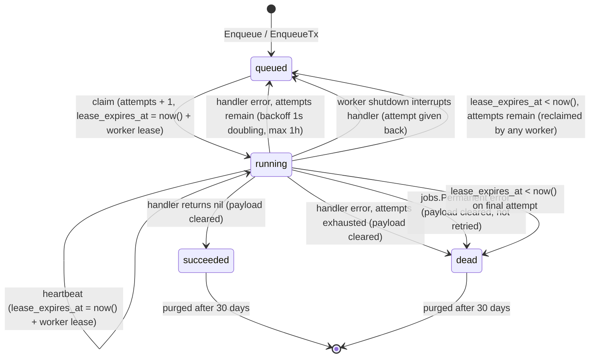
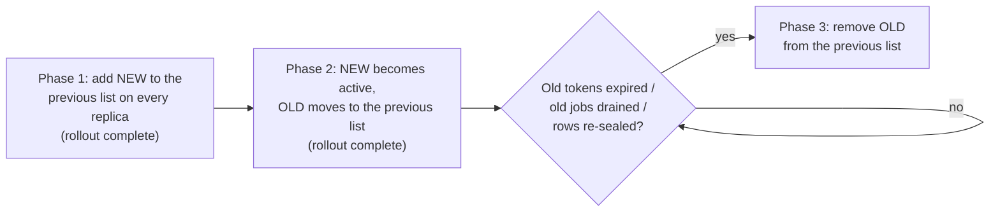
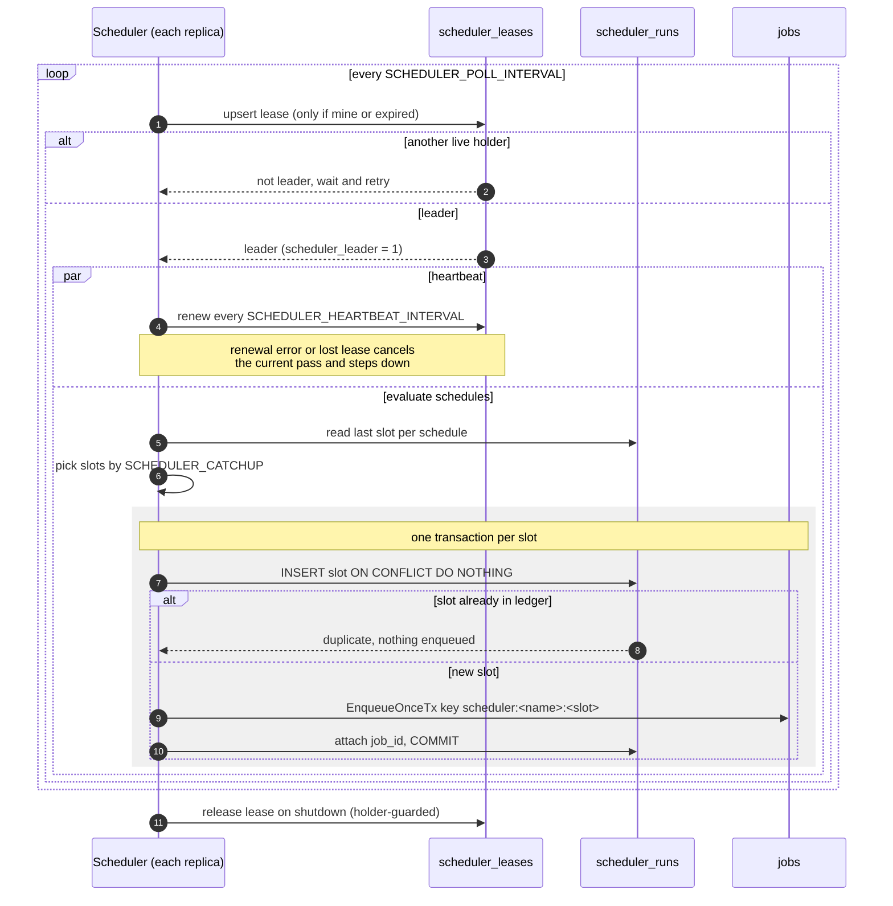
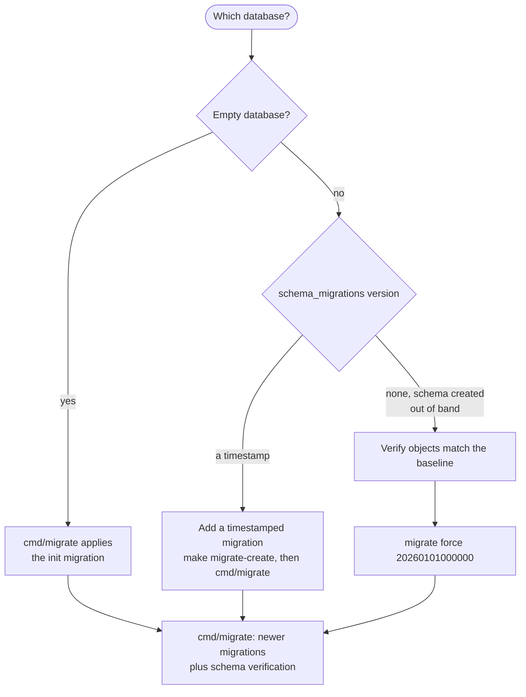
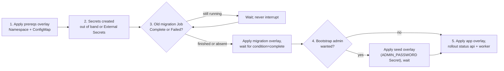

| Shutdown | Spans flush after HTTP, workers, and module background loops stop, bounded by# Operations Runbook

Runbook for the deployed API: health, metrics, logs, jobs, webhooks,
idempotency, migrations, Kubernetes, and incident response. It describes the
behavior in this repository; replace every `<placeholder>` and adapt thresholds
to your service levels. Never put real secrets in this file, a ticket, a log
line, or an error message.

| Related document | Covers |
| --- | --- |
| [Kubernetes deployment](../deploy/k8s/README.md) | Manifests, staging/production overlays, GitHub Actions CD, migration order, rollback. |
| [Architecture](architecture.md) | Modules, dependency rules, data ownership. |
| [Webhooks](webhooks.md) | Outbound signing/retries/SSRF, inbound receiver, secrets, configuration. |
| [Feature Flags](feature-flags.md) | Catalog, precedence, snapshot cache, admin API. |
| [Tracing](tracing.md) | OpenTelemetry configuration, span privacy rules. |
| [Module Template](module-template.md) | Adding a module, routes, permissions, tables, contracts, audit. |

**Contents:** [1. Health](#1-health-and-readiness) ·
[2. Metrics](#2-metrics) · [3. Logs](#3-logs-request-ids-and-audit) ·
[4. Jobs](#4-background-jobs) · [5. Webhooks](#5-webhooks) ·
[6. Idempotency and Redis](#6-idempotency-rate-limits-and-redis) ·
[7. Migrations](#7-migrations) ·
[8. Kubernetes](#8-kubernetes-deployment-notes) ·
[9. Tracing](#9-distributed-tracing) · [10. Incidents](#10-incident-checklist) ·
[11. Configuration](#11-configuration-reference) ·
[12. Security](#12-security-guarantees)

## 1. Health and readiness

| Endpoint | Purpose | Behavior |
| --- | --- | --- |
| `GET /healthz` | Liveness | Always `200` with `{"status":"up"}` while the process runs. Checks no dependency. |
| `GET /readyz` | Readiness | Pings PostgreSQL and cache concurrently (2s each). |
| `GET /health` | Readiness alias | Same handler and response as `/readyz`. |
| `GET /metrics` | Prometheus | Bearer token required when `METRICS_AUTH_TOKEN` is set; production requires a token of at least 16 characters. |
| `GET /openapi.yaml` | OpenAPI 3.1 document | Public (no UI) |


| `database` | `cache` | `status` | HTTP |
| --- | --- | --- | --- |
| `up` | `up` | `up` | `200` |
| `up` | `down` | `degraded` | `200` |
| `busy` | any | `degraded` | `200` |
| `down` | any | `down` | `503` |

- Details contain only `database` and `cache`; pool sizes are not exposed on
  the public probe.
- The probes are unauthenticated, so one result is reused for 1s and
  concurrent probes wait for the single in-flight check: a probe flood costs at
  most about one PostgreSQL and one cache ping per second per pod. A check cut
  short by the caller disconnecting is not cached.
- `busy` means the ping timed out while the pool was saturated
  (`AcquiredConns >= MaxConns`). Those connections are serving requests against
  a reachable database, so the pod stays in rotation; removing every saturated
  pod at once would cascade the load. If the database is really gone, in-flight
  queries fail, release their connections, and the next probe reports `down`.

```bash
curl -fsS http://127.0.0.1:8080/healthz
curl -fsS http://127.0.0.1:8080/readyz
curl -fsS -H "Authorization: Bearer $METRICS_AUTH_TOKEN" \
  http://127.0.0.1:8080/metrics | head

# Kubernetes
kubectl -n <namespace> port-forward svc/<service> 8080:8080
kubectl -n <namespace> get pods -w
kubectl -n <namespace> describe pod <pod>
```

| Probe | Endpoint | Notes |
| --- | --- | --- |
| Startup | `/healthz` | Covers only slow-but-reachable startup. The API exits during startup if PostgreSQL, storage (including the S3 bucket check), or cache initialization fails, so the container restarts instead of masking an outage. |
| Readiness | `/readyz` | A failure removes the pod from the Service; it does not restart it. |
| Liveness | `/healthz` | Never point liveness at `/readyz`, or a Redis blip restarts every pod. |

The container health check is the binary's own `server healthcheck`
subcommand (the distroless image has no shell, curl, or wget). It requests
`http://127.0.0.1:$APP_PORT/readyz` and exits non-zero on anything but `200`;
`server healthcheck --help` documents `--url` and `--timeout`. Compose uses the
same subcommand. Kubernetes uses HTTP probes.

The public Ingress answers `404` for `/healthz`, `/readyz`, `/health`, and
`/metrics` (exact-match `server-snippet` locations in
`deploy/k8s/base/ingress.yaml`). Snippet annotations must be enabled on the
ingress-nginx controller (`controller.allowSnippetAnnotations=true`); without
them the paths are not excluded, so use a proxy rule or a second listener.
Probe and scrape through the pod or Service in the cluster; `/metrics`
additionally requires the bearer token in production.

Readiness does **not** check SMTP, S3 object operations, the job queue, or
whether migrations ran. The bucket check happens at startup and object
reads/writes fail on use; SMTP failures surface through queued jobs;
migrations are a separate Job; queue health is visible in job metrics and the
`jobs` table. A green `/readyz` does not mean email or uploads work.

Trade-off: a Redis outage keeps every replica ready (`degraded`) because rate
limiting and idempotency fail open and sessions fall back to PostgreSQL. The
API keeps serving with weaker abuse protection and possible duplicate
mutations; alert on `status:"degraded"` and `rate_limit_errors_total` instead
of relying on readiness to page.

## 2. Metrics

Set `METRICS_AUTH_TOKEN` in production and configure the scraper to send it:

```yaml
authorization:
  credentials: <metrics-token>
```

Metrics are recorded with the OpenTelemetry SDK and rendered by its
Prometheus exporter. `/metrics` is always available; set
`METRICS_OTLP_ENABLED=true` (or `OTEL_METRICS_EXPORTER=otlp`) to also push the
same instruments over OTLP. The OTLP transport follows
`OTEL_EXPORTER_OTLP_METRICS_PROTOCOL` / `OTEL_EXPORTER_OTLP_PROTOCOL`
(default `http/protobuf`); `OTEL_METRIC_EXPORT_INTERVAL` and
`OTEL_METRIC_EXPORT_TIMEOUT` control the push cadence.

The HTTP request counter is intentionally absent: the
`http_server_request_duration_seconds_count` series replaces it. Route labels
are always Fiber route templates, never raw paths.

| Metric | Labels | Meaning |
| --- | --- | --- |
| `http_server_request_duration_seconds` | `http_request_method`, `http_route`, `http_response_status_code`, `error_type` | OTel HTTP server-duration histogram (seconds), buckets `0.005, 0.01, 0.025, 0.05, 0.075, 0.1, 0.25, 0.5, 0.75, 1, 2.5, 5, 7.5, 10`. `http_request_method` maps unrecognized verbs to `_OTHER`; `http_route` is omitted when no route matched; `error_type` is the status code for 4xx/5xx responses. |
| `rate_limit_errors_total` | `tier` | Rate-limit cache errors (the request was allowed). |
| `jobs_claimed_total` | `kind` | Jobs claimed by workers. |
| `jobs_succeeded_total` | `kind` | Successful outcomes recorded in the database. |
| `jobs_retried_total` | `kind` | Failed jobs requeued for another attempt. |
| `jobs_dead_total` | `kind` | Jobs dead-lettered by a handler failure after exhausting attempts (permanent failures included). Lease-expiry dead letters are counted by `jobs_lease_dead_total` instead. |
| `jobs_lease_lost_total` | `kind` | Running handlers canceled because their worker lost the lease (a fenced heartbeat matched no row, or heartbeats failed for the whole cancel margin). No outcome is recorded for them, so this is a duplicate-execution risk signal. |
| `jobs_lease_dead_total` | `kind` | Jobs dead-lettered by the claim query because their lease expired on the final attempt. |
| `jobs_queue_lag_seconds` | `kind` | Histogram of seconds between a job becoming due (`run_at`) and its claim, computed by the claim query (database clock). Only claimed jobs are observed, so a fully stalled queue shows up as missing observations; alert on `jobs_claimed_total` too. |
| `jobs_claim_errors_total` | — | Failed claim attempts; the worker retries with backoff capped at 30s. |
| `jobs_purged_total` | — | Terminal job rows deleted by retention. |
| `audit_write_failures_total` | — | Best-effort audit events that could not be recorded. |
| `audit_intent_failures_total` | — | Pre-write intent rows that could not be recorded (required guards returned 503). |
| `audit_completion_failures_total` | — | Intent rows that could not be completed; inspect stale `started` rows. |
| `audit_tx_missing_total` | — | Tier 1 audit writes attempted without a transaction (misconfiguration). |
| `audit_domain_missing_total` | — | Guarded successes without the required domain event. |
| `feature_flag_evaluations_total` | `key`, `source`, `enabled` | Feature evaluations by precedence source. |
| `feature_flag_snapshot_loads_total` | `result` | Snapshot loads (`success`/`error`). |
| `feature_flag_cache_hits_total` / `feature_flag_cache_misses_total` | — | In-process snapshot cache behavior. |
| `feature_flag_snapshot_stale_total` | — | Evaluations served from a stale snapshot during a DB outage. |
| `feature_flag_snapshot_fallback_total` | — | Evaluations that used env/compiled defaults because no snapshot was usable. |
| `feature_flag_snapshot_age_seconds` | — | Age of the snapshot currently used. |
| `feature_flag_invalidations_total` | — | Local snapshot invalidations after admin writes. |
| `events_published_total` | `event`, `mode` | Events published locally or durably. A transactional publish (`PublishTx`) counts only after its durable enqueue succeeds; a later rollback of the business transaction can still over-count, because the counter cannot be rolled back. |
| `events_handled_total` | `event`, `outcome` | Event handler calls (`success`, `error`, `panic`). |
| `events_enqueue_errors_total` | `event` | Durable event jobs that could not be enqueued. |
| `scheduler_runs_total` | `schedule`, `outcome` | Scheduler slots processed (`enqueued`, `skipped`, `duplicate`). |
| `scheduler_leader` | — | `1` on the process holding the scheduler lease. |
| `scheduler_enqueue_errors_total` | `schedule` | Scheduled jobs that could not be enqueued. |
| `scheduler_runs_purged_total` | — | Scheduler run-ledger rows deleted by retention. |

The default registry also exposes Go runtime and process metrics (for example
`go_goroutines`, `process_resident_memory_bytes`).

```promql
# 5xx ratio (the histogram's _count replaces the removed request counter)
sum(rate(http_server_request_duration_seconds_count{http_response_status_code=~"5.."}[5m]))
  / sum(rate(http_server_request_duration_seconds_count[5m]))

# p95 latency by route
histogram_quantile(0.95,
  sum by (le, http_route) (rate(http_server_request_duration_seconds_bucket[5m])))

# New dead letters
increase(jobs_dead_total[15m]) > 0

# Lost leases (possible duplicate execution)
increase(jobs_lease_lost_total[15m]) > 0

# Jobs dead-lettered because their worker lease expired on the final attempt
increase(jobs_lease_dead_total[15m]) > 0

# Sustained claim failures
rate(jobs_claim_errors_total[5m]) > 0

# No scheduler leader in the fleet (expected value is 1 overall, not per pod)
sum(scheduler_leader) != 1

# Scheduled slots failing to enqueue
increase(scheduler_enqueue_errors_total[15m]) > 0

# Durable event fan-out failures
increase(events_enqueue_errors_total[15m]) > 0
```

There is no queue-depth gauge. Query PostgreSQL for backlog and age:

```sql
SELECT kind, status, count(*) AS jobs,
       min(run_at) AS oldest_due,
       max(updated_at) AS newest_update
FROM jobs
WHERE status IN ('queued', 'running')
GROUP BY kind, status
ORDER BY jobs DESC;

SELECT count(*) AS dead_last_hour
FROM jobs
WHERE status = 'dead' AND updated_at > now() - interval '1 hour';
```

Alert on symptoms (5xx, latency, dead letters, claim errors, audit failures)
and on queue age, not only on raw queue depth: a large but draining queue is
different from a stuck one.

### Feature flags

Evaluation falls back in this order: last good snapshot (up to
`FEATURE_FLAGS_MAX_STALENESS`, default 5m), then `FEATURE_FLAGS`
environment values, then compiled defaults. `FEATURE_FLAGS_FORCE_OFF` and a
flag's kill switch always win, and a database outage does not prevent
force-off.

- A TTL-expired snapshot within the max staleness is served while a single
  background reload runs, so a slow database raises the snapshot age instead
  of request latency. Only a cold cache or an invalidation makes callers wait
  (up to 5s) for the load.
- Admin writes invalidate only the replica that served the request; others
  converge within `FEATURE_FLAGS_CACHE_TTL` (default 30s). For an
  immediate global stop, set `FEATURE_FLAGS_FORCE_OFF` or the kill switch
  through the admin API.
- When replicas disagree, check
  `feature_flag_snapshot_loads_total{result="error"}`,
  `feature_flag_snapshot_fallback_total`, and
  `feature_flag_snapshot_age_seconds`.

See [Feature Flags](feature-flags.md) for the API and precedence diagram.

## 3. Logs, request IDs, and audit

`APP_ENV=production` and `staging` use JSON `slog` output; other environments
use text. `LOG_LEVEL` is `debug`, `info`, `warn`, or `error` (default `info`).
Logs go to stdout; collect them with the platform's normal pipeline.

The request logger emits one record per request using OpenTelemetry semantic
convention names: `http.request.method`, `url.path`, `http.route`,
`http.response.status_code`, `duration`, `client.address`, `app.request_id`,
`enduser.id` (when authenticated), `http.request.body.size` (when the request
declares one), `user_agent.original`, and `url.query`, plus `trace_id`/`span_id`
when tracing is enabled and the request is sampled.

| Rule | Behavior |
| --- | --- |
| Status | The effective status after the Fiber error handler; a handler returning an error is never logged as `200`. |
| Level | 4xx at `WARN`, 5xx at `ERROR`, everything else at `INFO`. A client disconnect (`context.Canceled`) is logged as `499 client_closed_request` at `INFO` and is not a 5xx. |
| Query redaction | Values for keys named `code`, `state`, `password`, or containing `token` or `secret` are redacted. Do not rely on this for other parameters; never put secrets in URLs. |
| Bodies | Request and response bodies are never logged. Keep it that way. |

An inbound `X-Request-Id` is honored only when the direct peer is a trusted
proxy (`APP_TRUST_PROXY=true` and the peer is in `APP_TRUSTED_PROXIES`) and the
value is 1–128 characters of `[A-Za-z0-9._:-]`; otherwise the API generates a
UUID, so ordinary clients cannot forge or collide correlation IDs. The value is
echoed on the response and returned as `requestId` in RFC 9457 problem
responses.

```bash
# JSON logs
... | jq -c 'select(."app.request_id"=="<id>")'

# Plain logs
grep 'app.request_id=<id>' app.log
```

Search by `app.request_id` first, then use `trace_id` in the tracing backend to
inspect the HTTP span, its sanitized PostgreSQL spans, and any linked job
spans. Tracing never adds emails, tokens, payloads, SQL text, headers, or raw
error messages to logs or spans; see [Tracing](tracing.md).

### Audit trail

Audit events carry the request ID and the resolved tenant ID. Mutations are
audited in two tiers:

| Tier | Mechanism | Failure behavior | Used by |
| --- | --- | --- | --- |
| 1 | The service writes a terminal event with `RecordTx` inside the mutation transaction. A successful write marks the request so the fallback middleware does not write a second row. | Insert failure rolls the mutation back and returns `503 system.audit_unavailable`; a service built without a recorder fails closed the same way. | Identity registration/profile/password/delete, admin role/ban/unban, admin file delete/restore. |
| 2 | `audithttp.Guard` runs after idempotency, inserts an `outcome=started`, `source=http` intent row before the handler, then completes it as `succeeded`, `failed`, or `denied` with the HTTP status/error code. | A required guard returns the same 503 when the intent cannot be stored, so the handler never runs unaudited. Completion failures are counted and leave a stale `started` row; they cannot roll back a committed mutation. | Guarded routes, for example `POST /members/{memberId}/notifications`. |

- Idempotent replays are not audited again, and audit rows are never cached
  with the idempotency response.
- An audit event must name a tenant. The recorder resolves a zero
  `Event.TenantID` from the recording context and fails loudly when neither
  names one; there is no compatibility tenant.
- Client-supplied text (User-Agent, IP, request and resource ids) is sanitized
  before storage: invalid UTF-8 becomes U+FFFD and NUL bytes are stripped, so a
  crafted header cannot fail the insert (which would turn guarded mutations
  into 503s). Metadata strings in the `jsonb` column drop invalid UTF-8 and NUL
  bytes the same way.
- A zero `audithttp.Policy` mode means `ModeRequired`; best-effort guards must
  opt in with `ModeBestEffort`.
- `audit_events` is append-only: only a started HTTP intent can move to a
  terminal outcome, only completion fields may change, and `DELETE`/`TRUNCATE`
  are rejected by triggers (a reviewed retention job must disable
  `trigger_audit_events_no_delete` as the owner).
- Alert on `audit_intent_failures_total`, `audit_completion_failures_total`,
  `audit_tx_missing_total`, and `audit_domain_missing_total`; investigate rows
  where `outcome = 'started' AND created_at < NOW() - INTERVAL '10 minutes'`.
- For explicit domain events see the audit section of
  [Module Template](module-template.md); set `Event.TenantID` there or let the
  recorder resolve it from the context.

## 4. Background jobs

`internal/platform/jobs` is a PostgreSQL-backed durable queue. Every process
whose `APP_ROLE` runs the worker hosts one in-process with concurrency 4.
Claims use `FOR UPDATE SKIP LOCKED`, so multiple replicas are safe. Delivery is
**at-least-once**, never exactly-once: expect duplicate emails and side
effects, and keep handlers idempotent.

| Aspect | Behavior |
| --- | --- |
| Tenant | `Enqueue`/`EnqueueTx` resolve a zero `jobs.tenant_id` from the context; a positive explicit `Job.TenantID` is kept. A job with no tenant in either place is rejected with `ErrInvalidTenant` (the column is `NOT NULL` with no default). The worker restores the row's tenant on the handler context, so email and audit handlers run as the enqueuing tenant; a claimed row without a tenant is dead-lettered permanently. |
| Dedupe | `EnqueueOnce`/`EnqueueOnceTx` use the nullable `jobs.idempotency_key` with a partial unique `(tenant_id, idempotency_key)` index. A duplicate returns the existing id and inserts nothing, so producer and event fan-out retries cannot create a second row. Plain `Enqueue` does not dedupe. Terminal rows keep their key until retention removes them. |
| Global passes | Claim, lease recovery, and purge are global, so the only tenant-leading jobs index is the dedupe key; ad-hoc per-tenant inspection scans `idx_jobs_status_run_at`. Retention and metric labels (`kind` only) are deliberately global to avoid cardinality growth. |
| Tracing | Enqueue stores the active W3C `traceparent` in `jobs.trace_parent` when the caller has a recording span. Each attempt runs as a new-root `<kind> process` span linked to the enqueue span, with `job.id`, `job.kind`, tenant, attempt, and outcome attributes; database spans nest under it. `NULL`/malformed traceparents are ignored. See [Tracing](tracing.md) and [Jobs `trace_parent`](#jobs-trace_parent). |
| Process role | `APP_ROLE=api` serves HTTP only: it enqueues jobs but never claims them. `worker` runs the worker, scheduler, and background loops; its listener serves only `/healthz`, `/readyz` (database and cache), and `/metrics`. `all` does both and remains the single-container local default (`docker compose`); Kubernetes defaults to the split (an `api` Deployment and a `worker` Deployment), and CI rejects a rendered `APP_ROLE=all`. Every role registers the same job handlers. |
| Authorization | Module (`JobProvider`) and durable-event handlers run under `authz.SystemContext`, so `authz.Authorize` allows their subject-less calls; without it they would be denied (fail closed). |
| Identity | Worker and scheduler identities (`locked_by`, lease `holder`) are `<hostname>-<pid>-<random>`, so replicas with the same hostname never share one. |

### Lifecycle and retries



| Rule | Value / behavior |
| --- | --- |
| Attempts | `attempts` increments at claim time; `max_attempts` defaults to 10. |
| Retry backoff | Exponential, 1s doubling, capped at 1h, while `attempts < max_attempts`. |
| Dead letter | Budget exhausted: the job becomes `dead` and its payload is cleared. |
| Permanent failure | A handler error wrapped with `jobs.Permanent(err)` dead-letters on that attempt; `last_error` starts with `permanent failure (not retried): ` and `jobs_dead_total{kind}` counts it. Used for undecodable or invalid payloads (email, password-reset request, webhook dispatch/delivery). Decryption failures are **not** permanent: a replica missing a key another one already seals with retries until the rollout completes. |
| Unknown kind | Follows the same retry path, so a rollout can register the handler before pending work dies; a permanently missing handler eventually dead-letters. |
| Handler timeout | 10m by default. A timeout is a normal failure that consumes the attempt. Cancellation is cooperative: a handler that ignores its context keeps running and heartbeating, and one that still returns success after its deadline is recorded as succeeded with a warning. |
| Lease | Each row stores `lease_expires_at` = `now()` + the owning worker's lease (`WithLeaseDuration`, default 5m), set on claim and on every heartbeat (default every 30s); a `CHECK` requires every `running` row to have one. A job is reclaimed only when `lease_expires_at < now()`, so workers with different lease durations (for example a dedicated slow-kind worker) can share the table without stealing each other's healthy jobs. After a crash, the next claim by any worker requeues the expired job (or dead-letters it if that was the final attempt); a lease-expiry dead letter is logged at error level and counted by `jobs_lease_dead_total{kind}`, never by `jobs_dead_total`. The crashed attempt counts. A live worker that loses the lease (a fenced heartbeat matches no row) cancels its handler at once with `jobs.ErrLeaseLost`, records no success or failure (the reclaimer's fenced write is authoritative), and counts `jobs_lease_lost_total{kind}`. Heartbeats that keep failing transiently cancel the handler near the end rather than at expiry: the worker stops at `leaseDuration - heartbeatInterval - bookkeepingTimeout` (clamped to at least one heartbeat interval) measured from before the last heartbeat RPC was sent, so another worker cannot reclaim the job before the handler has stopped and its outcome write was possible. A handler that ignores cancellation can still overrun, so delivery remains at-least-once. |
| Fencing | Every outcome write is fenced by `attempts`, so a reclaimed worker's late result is discarded. |
| Shutdown release | On SIGINT/SIGTERM the worker stops claiming and cancels running handlers inside the shared shutdown budget (see [Graceful shutdown](#graceful-shutdown)). A handler that fails while the worker is stopping is requeued immediately **without consuming its attempt** (`last_error` starts with `jobs: interrupted by worker shutdown`, span outcome `released`), so a drain on the final attempt never dead-letters. A handler that still succeeds is recorded normally. A non-cooperative handler can exceed the window. |
| Claim errors | Retried in-process with exponential backoff capped at 30s. |

### Dedicated workers for slow kinds

One worker processes every registered kind by default, so a burst of slow jobs
(for example large exports) can occupy every slot and delay fast ones such as
`email.send.encrypted` (head-of-line blocking; watch `jobs_queue_lag_seconds{kind}`).
`jobs.WithKinds(kinds...)` restricts a worker's claim query to the listed
kinds and `jobs.WithExcludeKinds(kinds...)` skips them, in one process or in
separate deployments:

```go
slow := jobs.NewWorker(pool, instanceID+"-slow", jobs.WithKinds("reports.render"), jobs.WithConcurrency(2))
general := jobs.NewWorker(pool, instanceID, jobs.WithExcludeKinds("reports.render"))
```

Both filters only narrow which due jobs are claimed; expired-lease recovery
stays global, so any worker requeues a crashed job of any kind (it never
executes it). A slow-kind worker can use a longer `WithLeaseDuration`: expiry
is the row's `lease_expires_at`, written by the owning worker, so a
short-lease worker never reclaims its healthy jobs. Register a handler for every kind a worker claims, and make sure
every kind is claimed by some worker: an excluded kind with no dedicated worker
waits in the queue.

`cmd/api` applies the same filters from `JOBS_WORKER_KINDS` and
`JOBS_WORKER_EXCLUDE_KINDS` (comma-separated; a kind in both lists fails
startup). A typical bulkhead runs one `APP_ROLE=worker` deployment with
`JOBS_WORKER_KINDS=webhook.delivery` and the general workers with
`JOBS_WORKER_EXCLUDE_KINDS=webhook.delivery`. On Kubernetes, the default
`deploy/k8s/base/worker/` Deployment is the general worker; copy it for a
dedicated slow-kind group.

### Notification email

Notifications use the same queue and the `email.send.encrypted` kind
as identity email. The service resolves the recipient through identity's
`contracts.NotificationRecipientLookup` and never reads `users` directly. The
lookup runs for every notification, including an in-app-only one: only an
active member of the request tenant is a recipient, and anything else is a
`404` before a row is written (a membership FK violation is mapped to the same
not-found). When the `email` channel is enabled, the in-app row and the email
job commit in one transaction, so a queue outage returns `500` and rolls the
row back. Preferences apply before any write: an explicit `enabled=false` row
skips that channel; a missing row means enabled.

```sql
-- Unread backlog per tenant/user
SELECT tenant_id, user_id, count(*) AS unread,
       max(created_at) AS newest
FROM notifications
WHERE read_at IS NULL
GROUP BY tenant_id, user_id
ORDER BY unread DESC;

-- Explicit channel opt-outs
SELECT tenant_id, user_id, type, channel, enabled, updated_at
FROM notification_preferences
WHERE enabled = false
ORDER BY updated_at DESC;
```

Notification emails carry no links or secrets, so a dead-lettered row only
needs a re-send through the admin endpoint or the producing module. The
generic audit trail records successful `POST /notifications/:id/read`,
`POST /notifications/read-all`, and `PUT /notification-preferences`;
`POST /members/{memberId}/notifications` is guarded by a required `notification.sent` intent
row (503 when the audit store is down). Replays are skipped.

### Retention and payload clearing

| Rule | Value |
| --- | --- |
| Eligible rows | `succeeded` and `dead` only; queued and running rows are never purged. |
| Age | Older than 30 days. |
| Schedule | Hourly; the first pass runs when a worker starts. |
| Bounds | 5s per pass, at most 1,000 rows per delete batch, so a backlog cannot hold one transaction open. |
| Index | Partial `idx_jobs_terminal_updated_at ON jobs (updated_at) WHERE status IN ('succeeded','dead')`. |

Succeeded and dead jobs have `payload = '{}'`, so reset and verification links
do not linger in a dump. It also means **a dead job cannot be replayed from its
row**: re-trigger the business flow (for example ask the user to request
another reset email) instead of updating dead rows back to `queued`.

### Expired identity tokens and stale sessions

| Rule | Value |
| --- | --- |
| Job | `identity.tokens.purge_expired`, scheduled hourly by the identity `ScheduleProvider`. |
| Prerequisite | `SCHEDULER_ENABLED=true`. Without the scheduler, expired tokens are still rejected on use but never deleted. |
| Tables | In order: expired `refresh_tokens`, `password_reset_tokens`, `email_verification_tokens`; expired **pending** `invitations` (accepted rows are kept as the membership's provenance); then stale `sessions`, so sessions whose last refresh token expired in the same run are already eligible. |
| Session retention | A session is purged when it was revoked more than 30 days ago (kept that long so `revoked_reason`, for example `refresh_reuse`, is visible for incident review), or when it has been idle (`last_used_at`) for more than 24 hours **and** has no refresh-token rows left. The 24-hour grace keeps a rotation in flight from losing its session row. Used refresh tokens stay until they expire so a replay is still recognized as reuse. |
| Bounds | `DELETE` batches of 1,000 rows chosen with `FOR UPDATE SKIP LOCKED`; at most 1 minute per table per run, the remainder goes to the next run. |
| Index | `idx_refresh_tokens_expires_at`, `idx_invitations_expires_at_pending`, `idx_sessions_last_used_at` (plus `idx_refresh_tokens_tenant_session_id` for the live-token check); the one-row-per-user reset and verification tables are small enough without one. |
| Tenancy | A deliberate cross-tenant maintenance pass (the only identity queries without a `tenant_id` predicate besides the global per-user rows). Reset and verification tokens are per user and have no tenant. |

### Sessions and token requirements

- Every sign-in creates a `sessions` row; the access token's `sid` claim names
  it. Tokens without a positive `sid` (or `tenant_id`) claim are rejected with
  `401` fail-closed, so after deploying this release every user signs in again;
  no migration of old tokens is possible or needed.
- `sessions.expires_at` is the absolute lifetime (`SESSION_MAX_LIFETIME`,
  default `720h`). Each refresh token expires at
  `min(now() + JWT_REFRESH_TTL, sessions.expires_at)`; the validator and
  the refresh endpoint reject an expired session with `401`, so rotation can
  never extend a session indefinitely.
- `sessions.mfa_verified_at` is the AAL2 clock: an `otp`/`rc`/`hwk`/`swk`
  sign-in sets it at session creation, `POST /me/mfa/step-up` refreshes it, and
  a first-factor session leaves it `NULL`. A passkey step-up also adds
  `hwk`/`swk` to the session's `amr`. MFA-gated routes require it to be at
  most `MFA_MAX_AGE` (default `12h`) old and return `403 auth.mfa_required`
  otherwise; the session cache is invalidated on step-up, so the next request
  sees the new value. Platform permissions use the stricter passkey-only
  check. Raising `MFA_MAX_AGE` weakens the NIST SP 800-63B rev4 §2.2.3
  freshness bound for every platform route.
- Revocation reasons in `sessions.revoked_reason`: `logout`, `logout_all`,
  `revoked` (`DELETE /me/sessions/{sessionId}`), `refresh_reuse`,
  `credentials_changed`, `membership_changed` (ban, removal, role change),
  `account_deleted`. A token rotated less than 10 seconds ago in a still-live
  session is a concurrent refresh, not reuse: it returns
  `401 auth.refresh_concurrent`, logs `concurrent refresh inside the rotation
  grace window; session kept`, and revokes nothing. A burst of
  `refresh_reuse` (also logged as `refresh token reuse detected; session
  revoked`) points at stolen refresh tokens or a client that retries refresh
  with an old token too late.
- To force everyone to sign in again without rotating `JWT_SECRET`, revoke
  live sessions (`UPDATE sessions SET revoked_at = now(), revoked_reason =
  'revoked' WHERE revoked_at IS NULL`) and wait out the 5-second session cache,
  or bump users' `token_version`.

### Tenant lifecycle

Tenant status is `trialing | active | suspended | pending_deletion |
deleted`; only `trialing` and `active` serve requests, and a `trialing` tenant
stops serving as soon as `trial_ends_at` passes (resolved as not found before
the hourly job writes `suspended`). Transitions go through
the identity `TenantService` (`internal/modules/identity/service/tenancy/tenants.go`),
which enforces the state machine (`trialing → active | suspended |
pending_deletion`, `active ↔ suspended`, `active | suspended →
pending_deletion`, `pending_deletion → suspended | deleted`) and writes a Tier 1
audit row per change. Entering `pending_deletion` schedules deletion after a
30-day grace; cancelling it clears the schedule and lands on `suspended`, never
directly on `active`: the tenant was not necessarily operational before the
deletion request, so a platform admin activates it explicitly afterwards. The
hourly `identity.tenants.finalize_deletions` job moves a due
`pending_deletion` tenant to `deleted` through the same audited service (system
actor, `tenant.status_changed` with `reason: deletion_due`), so the purge job
can pick it up. The default tenant can never be deleted (also a `CHECK`). Platform admins
use `PATCH /platform/tenants/{tenantId}`; operator tooling must call the
service rather than raw `UPDATE`s, which skip the audit row. A
non-operational tenant returns `404` on tenant resolution after the resolver
cache TTL (30s) and `401` for existing sessions and API keys. A `deleted`
tenant's data is erased by the hourly purge (below); the `tenants` row and its
audit trail remain.

### Data retention overview

Every purge is idempotent (a redelivered job finds fewer rows), bounded, and a
deliberate cross-tenant maintenance pass. Module purges are durable jobs
registered through `JobProvider`/`ScheduleProvider`, so they run under
`authz.SystemContext` and **only when `SCHEDULER_ENABLED=true`**; the platform
loops run in every worker process regardless.

| Data | Rule | Trigger | Bounds | Index |
| --- | --- | --- | --- | --- |
| `jobs` | `succeeded`/`dead` older than 30 days | Worker loop, hourly | 5s per pass, 1,000-row batches | `idx_jobs_terminal_updated_at` |
| `scheduler_runs` | Older than `SCHEDULER_RETENTION` (720h); newest row per schedule kept | Scheduler leader, hourly | See [Scheduler](#scheduler) | — |
| Identity tokens | Expired | `identity.tokens.purge_expired`, hourly (scheduler) | 1,000-row batches, 1 min per table | `idx_refresh_tokens_expires_at` |
| Webhook deliveries/events | Terminal, older than `WEBHOOK_RETENTION` (720h) | Webhooks background loop, hourly | 1,000-row batches, 30s per pass | See [Webhooks](webhooks.md) |
| Trashed files | Soft-deleted more than `FILES_TRASH_RETENTION` (720h) ago: blob, then row; once a blob delete is attempted the row never becomes restorable again and only the delete is retried after a per-row backoff | `files.trash.purge`, hourly (scheduler) | 100-row claimed batches, 1 min per run | Partial `idx_files_deleted_at ON files (deleted_at) WHERE deleted_at IS NOT NULL` |
| Orphan file blobs | Storage keys under `<tenant>/<user>/<name>` older than 1 hour with no `files` row (a failed upload or lost metadata row); export blobs and other layouts are ignored | `files.orphans.sweep`, hourly (scheduler) | Up to 1,000 orphan delete attempts per run (live files never consume the budget); a delete failure is logged and retried next run | — |
| Notifications | **Read** more than `NOTIFICATIONS_RETENTION` (4320h) ago (by `read_at`); unread rows are kept at any age | `notifications.retention.purge`, hourly (scheduler) | 1,000-row batches, 1 min per run | Partial `idx_notifications_read_at ON notifications (read_at) WHERE read_at IS NOT NULL` |
| Data exports | `expires_at` reached, erased (`status = 'expired'`), failed, or queued/running for more than a day (stuck job) | `privacy.exports.purge`, hourly (scheduler) | 100-row batches, 1 min per run; blob, then row | Partial `idx_data_exports_expires_at ON data_exports (expires_at) WHERE expires_at IS NOT NULL` |
| Deleted tenants | `status = 'deleted'` and `purged_at IS NULL`: every membership's per-user data through the privacy erasers (and its membership/invitations then deleted), then every module's tenant-wide rows, then `purged_at` and one `tenant.purged` audit row | `identity.tenants.purge_deleted`, hourly (scheduler) | 25 tenants per run, least recently advanced first, 2 min per tenant and 8 min per run, 100 memberships per page, 500-row batches per tenant table (files/export blobs before their rows); `tenants.purge_cursor` persists progress; every phase is idempotent and retried; the `tenants` row and `audit_events` stay | Partial `idx_tenants_deleted_unpurged ON tenants (purge_progress_at ASC NULLS FIRST, id) WHERE status = 'deleted' AND purged_at IS NULL` |
| Due deletions | A `pending_deletion` tenant whose `deletion_scheduled_at` has passed moves to `deleted` through the audited tenant service | `identity.tenants.finalize_deletions`, hourly (scheduler) | 100 tenants per run, re-checked under the tenant row lock; a concurrent admin transition wins and is a no-op | Partial `idx_tenants_deletion_due ON tenants (deletion_scheduled_at, id) WHERE status = 'pending_deletion'` |
| Expired trials | A `trialing` tenant whose `trial_ends_at` has passed is not operational immediately (404) and is transitioned to `suspended` through the audited tenant service | `identity.tenants.expire_trials`, hourly (scheduler) | 100 tenants per run, re-checked under the row lock; an admin transition wins and is a no-op | — |
| `memberships` ban record | `banned_at` + keyed `banned_email_hash` and its `banned_email_hash_kid` of a banned membership, kept through removal/erasure | Unban while the membership is still suspended (admin action); no automatic purge. Dropping the key that wrote a marker makes it unmatchable (startup warns). | One 64-char marker per banned membership | Partial `idx_memberships_tenant_banned_email_hash ON memberships (tenant_id, banned_email_hash) WHERE banned_email_hash IS NOT NULL` |

Without the scheduler, trashed files keep their blobs and stay restorable
indefinitely, orphan blobs from failed uploads accumulate, notifications are
never deleted, expired export documents stay in storage, expired tokens and
scheduler ledger rows accumulate, expired trials keep their `trialing` status
(though their requests already return 404), tenants past their deletion grace
stay `pending_deletion` (they already stop serving), and deleted tenants keep
their data (the `tenants` row is never removed). The
Kubernetes ConfigMap sets `SCHEDULER_ENABLED=true` on the worker Deployment
(`APP_ROLE=worker`); `cmd/api` logs a production warning when a
worker-capable process starts with it off. The retention indexes
lead with their age column rather than `tenant_id` because the purges scan
every tenant; they are partial, so live files, unread notifications, and active
exports are not indexed. These indexes and the purge claim/retry columns
`files.purge_started_at`, `files.purge_attempts`, and `files.purge_retry_after`
are part of the init migration.

#### Privacy exports and erasure

`POST /me/data-exports` commits a `data_exports` row and a
`privacy.data_export` job in one transaction. The job runs every registered
`privacy.Exporter`, writes one JSON document to
`<tenantID>/<userID>/exports/<uuid>.json`, marks the row `ready` with a 7-day
expiry, and sends an in-app notification. Re-delivery is a no-op once the row
is `ready`; a failed module export marks the row `failed` and the job retries.

| Race | Guard |
| --- | --- |
| Two export requests for one membership | The partial unique index `idx_data_exports_active` makes the second insert fail; the service returns `409 data_export.in_progress` (the request idempotency key additionally collapses retries). The request also holds the active membership `FOR SHARE` so it cannot slip past an erasure. |
| Erasure while an export is building | The erasure request updates the tenant's active/ready exports to `expired`; the export job's `running → ready` update is conditional, so a late writer cannot revive it and deletes its own document. The identity eraser deletes every export document (including already-expired ones), and the finalizer sweeps an export that committed just before the last membership was removed. |
| Retried export/erase jobs | Each job re-reads state and is idempotent: export stops on `ready`/`expired`, a failed/timed-out/panicking export is marked `failed` on a detached context (and stale active rows are purged after a day), erase deletes by `(tenant, user)`, and finalization only anonymizes after every membership is `removed`. |
| Already-deleted account | A finalizer still queued from an earlier self-erasure request upgrades an account deleted before it ran: it still anonymizes the email/name and deletes credentials, identities, sessions, and tokens. A plain `DELETE /users/:id` leaves no finalizer behind, so it does not trigger this upgrade. |
| Last-admin erasure | The request transaction takes the per-tenant owner lock and returns `409 user.last_admin` before it reserves anything; the per-tenant job re-checks under the same lock if a reserved membership was reactivated, and a refusal there is permanent. |
| Two owners erase at once | Each self-erasure request suspends (reserves) the caller's membership under the same per-tenant owner advisory lock, so the transactions serialize and the second one counts the first owner already gone and returns `409 user.last_admin` up front. Sequentially the same is true: the second request sees one active owner. The reservation also revokes the member's sessions in that tenant, so neither an upload nor an invitation acceptance can happen while erasure is pending. |
| Unrequested erase job | A `privacy.erase` job only proceeds for a membership marked by a request (`erasure_requested_at`); a live membership without it is a `jobs.Permanent` refusal, logged at Error with the tenant and user ids, so it dead-letters immediately instead of retrying. |
| Failed module eraser | In a tenant erase job identity's own eraser runs last; it removes the membership only after every other registered eraser succeeded, so a files/storage outage leaves the membership (and the global user) in place and the job retries. |
| Missing identity eraser | The job fails instead of reporting a partial erase: without identity's eraser the membership cannot be removed, so the finalizer keeps retrying. |
| Ban vs self-erasure | A suspended membership keeps `banned_at`, `banned_email_hash`, and `banned_email_hash_kid` when removal/erasure removes it; registration, invitation acceptance/sign-up, Google sign-up, the admin seed, and email changes compute the keyed marker under the active and every previous data-encryption key and match any of them, so the anonymized user's old address cannot rejoin the tenant (GDPR Art.17(3)(e)). An erasure reservation is not a ban: it sets `erasure_requested_at`, never a ban column, and `UnbanMembership` refuses a reserved membership. Unban clears all three ban columns while the membership is still suspended; a removed membership keeps them and needs an audited operator action to release the address. |

Erasure has two paths:

- **Self erasure** (`POST /me/erasure-requests`): the request transaction suspends every
  membership (without a ban marker), revokes its sessions in that tenant, and
  commits one `privacy.erase` job per membership plus `privacy.erase.finalize`.
  Each erase job runs every tenant `Eraser` (files, notifications, apikeys,
  features, stored webhook event history, identity last; identity replaces the
  address on invitations the user accepted or that were addressed to them and
  keeps `accepted_by` as the membership id), then the finalizer checks
  that every membership is `removed` before deleting credentials, identities,
  sessions, and tokens and anonymizing the global user
  (`erased+<id>@invalid`, empty name, `status = deleted`). Until then the
  finalizer fails and retries with backoff. It also sweeps leftover export
  documents and invitation addresses, including invitations in tenants the
  user never joined.
- **Admin erasure** (`POST /members/{memberId}/erasure-requests`): one `privacy.erase` job
  for the request tenant, no finalizer. The request suspends that membership
  (and revokes its sessions) the same way; only that tenant's membership and
  data are removed, the global user and memberships in other tenants stay
  intact, and a cross-tenant id is `404`.

Pending `email.send.encrypted` payloads are sealed at rest and terminal jobs clear
them; a queued email already committed before the request may still be
delivered, and delivered webhooks cannot be recalled from third-party
receivers. Audit rows are append-only and contain only ids/outcomes
(`user.erasure_requested`, `admin.user.erasure_requested`, `user.erased`),
never email, name, or document content; that is the retention basis for the
request history itself. The per-membership `banned_email_hash` is the only
pseudonymous identity marker retained after erasure: a keyed HMAC-SHA256 of the
normalized address (with `banned_email_hash_kid` naming the key), kept with
`banned_at` solely to enforce the tenant's ban (GDPR Art.17(3)(e) legitimate
interest). An unban of a suspended membership clears all three; a removed
membership keeps them for the tenant's records.

The identity section of the export includes the profile, membership, sessions,
linked external identities (`provider`, `subject`, `linkedAt` — never a
token), MFA configuration (`enabled`, `confirmedAt`, `recoveryCodesRemaining`;
never the sealed secret or a recovery-code hash), the current membership role
assignments with their grant times (role history is not stored), invitations
the user sent and received in the tenant, and the user's own `audit_events`
rows (`action`, `createdAt`, `ip`, `userAgent`, `resource`, `resourceId`,
`outcome`). The audit list is capped at 1000 rows, newest first; audit metadata
is never exported.

#### Deleted tenants

`status = 'deleted'` is terminal, but the row itself is never removed: it is
the tenant's identity for audit and incident review. The hourly
`identity.tenants.purge_deleted` job lists deleted tenants with `purged_at IS
NULL`, least recently advanced first, and, per tenant, runs the same registered
privacy erasers as a tenant erase job for every membership from the persisted
`tenants.purge_cursor` (including removed ones; no global finalizer). As soon as
one member's erasers succeed, the job deletes that member's invitations
(releasing the two `RESTRICT` membership FKs) and the membership itself, then
advances `purge_cursor`; a run that stops mid-tenant resumes after the last
finished member. Each tenant has a 2-minute budget and the whole pass 8
minutes, so one large tenant cannot starve the others; the ordering by
`purge_progress_at` (updated with the cursor) gives every tenant a turn across
runs. Afterwards the job asks every module's `tenancy.Purger` to remove its
tenant-wide rows (webhook endpoints/events/deliveries/inbound sources, tenant
roles, `feature_flag_targets`, invitations, API keys, files and blobs,
notifications, data exports) and the platform `jobs` purger, which is
registered after every module. Identity's purger runs last overall: it sweeps
any memberships left (and their sessions, refresh tokens, and role
assignments), the tenant's custom roles, and `tenant_settings`. The jobs purger
deletes the tenant's non-running rows (queued encrypted email payloads
included); a `running` row is left to its lease owner so an in-flight handler is
not stranded, and the retention purge removes it later. Every table is drained
in bounded pages (500 rows for module purgers, 1,000 for jobs; every
files/export page deletes its blobs before its
rows), so a large tenant never loads its whole table or blob list into memory.
Only after every phase succeeds does it write `tenants.purged_at` and a
`tenant.purged` audit row in one transaction. Each phase is idempotent, so a
failure or worker restart retries the same tenant; no phase accepts a tenant
id other than the job's explicit tenant scope, and RLS backs that.

`audit_events` is append-only and is never touched by the purge. A tenant whose
trial has ended is already not operational (its resolution and every session
check return 404/401), and the hourly `identity.tenants.expire_trials` job
moves it to `suspended` through the audited `TenantService` path
(`tenant.status_changed` with `reason: trial_expired`, system actor).

#### Files trash purge

```mermaid
sequenceDiagram
    autonumber
    participant W as files.trash.purge job
    participant DB as PostgreSQL (files)
    participant S as Object storage
    loop until a short batch or the 1 min budget
        W->>DB: UPDATE files SET purge_started_at = now() WHERE id IN<br/>(oldest 100 trashed > N days and retry due, FOR UPDATE SKIP LOCKED); COMMIT
        loop each claimed row
            W->>S: Delete(storage_path)
            alt deleted or already missing
                S-->>W: ok (row queued for hard delete)
            else storage error
                S-->>W: error (row queued for deferred retry, logged)
            end
        end
        W->>DB: UPDATE failed rows SET purge_attempts = purge_attempts + 1,<br/>purge_retry_after = ... (claim kept: never restorable); COMMIT
        W->>DB: DELETE FROM files WHERE id = ANY(ids) AND purge_started_at IS NOT NULL
    end
```

| Rule | Behavior |
| --- | --- |
| Order | Claim, blob, then row. A crash or failed hard delete after the blob delete leaves a claimed row with no blob; the next run deletes it (a missing blob counts as deleted). |
| Restore race | The claim (`purge_started_at`) commits before any blob is deleted, and restore requires `purge_started_at IS NULL`, so a user/admin restore of a claimed row gets `404` while the blob operation runs. A failed blob keeps the claim, so the row is never restorable again; only the blob delete is retried. |
| Failures | A blob that cannot be deleted is logged at error level with `file_id`/`tenant_id`, counted, and deferred on its own row: the claim is kept, `purge_attempts` increments, and `purge_retry_after` moves out with a capped exponential backoff. The rest of the batch is still hard-deleted, the job succeeds, and claiming skips rows whose retry time is in the future, so one permanently failing blob cannot block newer rows. |
| Events | None. The purge publishes no domain event, so no webhook fires; the user-visible deletion already emitted `file.deleted`. No audit row is written (system retention, like the token purge). |

```sql
-- Trash waiting for the purge, by tenant
SELECT tenant_id, count(*), min(deleted_at)
FROM files
WHERE deleted_at IS NOT NULL
GROUP BY tenant_id;

-- Blob failures deferred for a later run
SELECT tenant_id, count(*), max(purge_attempts), max(purge_retry_after)
FROM files
WHERE purge_retry_after IS NOT NULL
GROUP BY tenant_id;

-- Read notifications past retention (should stay near zero)
SELECT count(*) FROM notifications
WHERE read_at < now() - interval '180 days';
```

### Key rotation

Signing and encryption use separate keys, each with a verify/decrypt-only
previous list. Listing the active key as a previous key fails startup.

| Key | Previous list | Protects | Old key can be dropped when |
| --- | --- | --- | --- |
| `JWT_SECRET` | `JWT_PREVIOUS_SECRETS` | Access tokens. Each token's `kid` header (a fingerprint of the signing secret) selects the verification key; an unknown `kid` or a missing `kid` is rejected, and the `typ` header must be `at+jwt` (RFC 9068). | Every token it signed has expired (`JWT_ACCESS_TTL`, default `15m`). |
| `OAUTH_STATE_KEY` | — | HMAC-SHA256 key (after HKDF) for the OAuth anti-CSRF state and PKCE cookie. It is independent of `JWT_SECRET`, so rotating the signing key does not break in-flight Google sign-ins. | No sign-in is in flight (the state/cookie live 5 minutes), so rotating it is effectively immediate. |
| `DATA_ENCRYPTION_KEY` | `DATA_ENCRYPTION_PREVIOUS_KEYS` | Email and password-reset job payloads (the v2 envelope names the sealing `kid`; a v1 envelope is rejected) and the keyed ban marker on `memberships` (HKDF info `fgb/ban-email/v1`, HMAC-SHA256; the row records the marker's key id). | No `queued`/`running` job is still sealed with it **and** no retained ban marker names it. A ban written by a removed key can never match again: after erasure there is no address left to re-hash. |
| `WEBHOOK_SECRET_ENCRYPTION_KEY` | `WEBHOOK_SECRET_ENCRYPTION_PREVIOUS_KEYS` | Stored endpoint/source secrets and delivery snapshots. Rows keep the key that sealed them. | Every endpoint and source secret has been rotated (re-sealed) and no pending delivery snapshot uses it. See [Secrets and key rotation](#secrets-and-key-rotation). |

Rotation is two-phase, so no replica ever sees a key it cannot verify or
decrypt:



Skipping phase 1 lets a replica that has not restarted yet reject tokens (or
fail to open jobs) produced by an updated replica. A job it cannot decrypt
retries rather than dead-lettering, but only until `max_attempts`.

Ban markers and rotation: a ban stores `banned_email_hash` (HMAC-SHA256 of the
normalized address under a key derived from the active data-encryption key) and
`banned_email_hash_kid`. Registration, invitation acceptance/sign-up,
Google sign-up, the admin seed, and email changes compute the marker under the
active key and every previous key and match any of them, so bans written by the
old key keep working after the rotation. Removing a key from the previous list
makes the bans it wrote ineffective — the marker cannot be re-hashed after the
email was erased. `cmd/api` startup counts retained markers per key id and logs
a warning (`ban markers reference a data-encryption key that is not
configured`, with the key id and row count) for every id it does not have
configured. That count is cross-tenant and reads through the bypass role.

JWT notes:

- Refresh tokens are opaque database rows, not JWTs: rotation does not revoke
  them, and a valid refresh token mints an access token with the new key. To
  force a full re-login, revoke sessions or bump users' token version (see
  [Sessions and token requirements](#sessions-and-token-requirements)).
- Google OAuth `state` and its PKCE cookie are HMAC-signed with a key derived
  from the dedicated `OAUTH_STATE_KEY`, so a `JWT_SECRET` swap does not affect
  in-flight sign-ins. Rotating `OAUTH_STATE_KEY` itself still invalidates any
  sign-in already in progress; the window is five minutes.
- A leaked key needs no two-phase care: make the new key active, drop the
  leaked one immediately, and accept that every session signed with it ends.

Job payloads are sealed with `DATA_ENCRYPTION_KEY` (base64-encoded 32 random
bytes, required in every environment and distinct from every other key) and
only a kid-bearing v2 envelope opens. There is no `JWT_SECRET` fallback. A
worker that does not yet know the sealing key retries the job until
`max_attempts`; roll every worker out before relying on a newly promoted key.

### Inspecting jobs

```sql
-- Backlog by tenant, kind, and state
SELECT tenant_id, kind, status, count(*), min(run_at), max(updated_at)
FROM jobs
WHERE status IN ('queued', 'running')
GROUP BY tenant_id, kind, status
ORDER BY count(*) DESC;

-- Recent failures and dead letters
SELECT id, tenant_id, kind, status, attempts, max_attempts,
       idempotency_key, last_error, updated_at
FROM jobs
WHERE status IN ('running', 'dead')
ORDER BY updated_at DESC
LIMIT 50;

-- Lease age for running jobs
SELECT id, kind, locked_by, locked_at, lease_expires_at,
       lease_expires_at - now() AS lease_remaining, attempts, max_attempts
FROM jobs
WHERE status = 'running'
ORDER BY lease_expires_at;
```

A stuck `running` job usually recovers when its lease expires and another
worker polls. Before any manual intervention, confirm no live process owns it.
As a last resort, and accepting duplicate execution, requeue one job only after
its lease is far past expiry. The guard uses the row's own
`lease_expires_at`, so a healthy long-running job that is still heartbeating is
never requeued:

```sql
UPDATE jobs
SET status = 'queued',
    locked_at = NULL,
    locked_by = NULL,
    lease_expires_at = NULL,
    run_at = now(),
    updated_at = now()
WHERE id = <id>
  AND status = 'running'
  AND lease_expires_at < now() - interval '10 minutes';
```

Never bulk-clear locks, and never requeue `dead` jobs (their payload is gone).

### Durable events

`internal/platform/events` publishes metadata-rich events locally and/or as
jobs. `PublishTx` only enqueues the durable jobs on the caller's transaction;
local subscribers are **not** notified inside it, because a `pgx.Tx` has no
after-commit hook. Use `Publish` or `PublishLocal` after the transaction when
local delivery is needed. That keeps a rollback from leaving a ghost local
event and keeps a local handler error from rolling back the business work. A
durable subscription adds one job per event and handler with
`jobs.idempotency_key = event:<eventName>:<eventId>:<handler>:<tenantId>`; the
job payload is the event JSON. Delivery is at-least-once, so handlers must be
idempotent. Local handler panics are recovered and combined with
`errors.Join`. During an incident check `events_handled_total{outcome="panic"}`
and `events_enqueue_errors_total`. Durable handlers must be registered before
the worker runs; the app does this after all `EventProvider` modules register.

### Scheduler

`internal/platform/scheduler` runs in-process in every replica whose
`APP_ROLE` runs the worker (`worker`, or `all` in a single-process local stack)
when enabled. Only the holder of the single `scheduler_leases` row evaluates
schedules; `scheduler_runs` is the unique `(schedule, scheduled_for)` ledger.



Because the ledger row and the job enqueue share a transaction, a leader
restart or overlapping election cannot double-enqueue a slot. Interval
schedules align to epoch boundaries; cron is 5-field UTC.

| Variable | Default | Meaning |
| --- | --- | --- |
| `SCHEDULER_ENABLED` | `false` | Run the scheduler in this process. |
| `SCHEDULER_LEASE_TTL` | `30s` | Lease validity without a heartbeat. |
| `SCHEDULER_HEARTBEAT_INTERVAL` | `10s` | Lease renewal interval; must be below the TTL. |
| `SCHEDULER_POLL_INTERVAL` | `15s` | Evaluation / election interval. |
| `SCHEDULER_CATCHUP` | `latest` | `none` skips slots missed while no leader ran, `latest` runs only the newest, `all` replays in order. Under `none`, a slow poll during continuous leadership still runs the latest slot, so short schedules are not starved. |
| `SCHEDULER_CATCHUP_LIMIT` | `100` | Maximum slots replayed per poll under `all`. |
| `SCHEDULER_RETENTION` | `720h` | Ledger retention. The newest row of every schedule is always kept: it anchors catch-up, and deleting it would make a sparse schedule (for example `@yearly`) look never-run and re-enqueue an executed slot. |

- A schedule's job payload is `{"schedule","scheduledFor","data"}`. Its kind
  must have a worker handler; a missing handler follows the normal
  retry/dead-letter path.
- Logs include `holder`, `schedule`, `slot`, and the underlying error.
  `scheduler_leader` should sum to 1 across replicas. If it is 0, check
  database reachability and lease expiry; if it is greater than 1, check clock
  skew and whether a process runs with an extremely short lease TTL.

```sql
-- Current leader and lease age
SELECT name, holder, expires_at, now() - heartbeat_at AS since_heartbeat
FROM scheduler_leases;

-- Recent slots and whether they enqueued or were skipped
SELECT schedule, scheduled_for, status, job_id, error, created_at
FROM scheduler_runs
ORDER BY scheduled_for DESC
LIMIT 50;

-- Queued backlog by kind (manual check)
SELECT kind, count(*), min(run_at)
FROM jobs
WHERE status = 'queued'
GROUP BY kind
ORDER BY count(*) DESC;
```

## 5. Webhooks

Outbound deliveries reuse the jobs queue. Producers (registration, file
upload/delete/restore, admin file delete/restore) publish a domain event with
`events.PublishTx` in their transaction, which enqueues the webhooks durable
subscription job (`events.<type>.webhooks`); that job commits a
`webhook_events` row (first endpoint), a `webhook_deliveries` row, and its
first `webhook.delivery` job atomically per endpoint; the worker sends one
Standard Webhooks attempt and schedules the next attempt as a new job.
Receivers must deduplicate on `webhook-id`. The signature is
`v1,<base64 HMAC-SHA256>` over `<webhook-id>.<webhook-timestamp>.<body>`. The
dispatch sequence and delivery state machine are diagrammed in
[Webhooks](webhooks.md).

Monitor `events.*.webhooks` jobs as well as `webhook.delivery`: a dead
subscription job means an event was never fanned out (invalid envelope, or the
database failed for all 20 attempts).

### Delivery state and retries

| Response / condition | Result |
| --- | --- |
| `2xx` | `succeeded`. |
| `3xx` | Permanent (`dead`); redirects are never followed. |
| `408`, `425`, `429`, `5xx`, transport error | Retry with backoff. |
| Other `4xx` | Permanent (`dead`). |
| Attempt budget exhausted | `dead`. |
| Endpoint disabled or deleted | Never claimed; its pending deliveries become `dead` on the next job. |
| Shutdown cancels an attempt before any response | The attempt is given back (`attempts` decremented, lease cleared) and the job is released without consuming its attempt; expect a possible duplicate send. |

- `pending` means queued or awaiting the next attempt; `next_attempt_at`
  doubles as the claim lease while an attempt is in flight.
- Backoff is exponential from `WEBHOOK_RETRY_BASE` (default 5s) to
  `WEBHOOK_RETRY_MAX` (default 1h). A valid `Retry-After` (seconds or
  HTTP date) can only lengthen the backoff (`0`/past dates do not retry
  immediately) and is capped at the same maximum.
- Each attempt uses the endpoint's `timeoutMs` (snapshotted on the delivery),
  bounded by `WEBHOOK_REQUEST_TIMEOUT` (default 10s). The attempt and its
  outcome are recorded with a detached 5s context even during shutdown.
- Outcome writes are fenced by the claimed attempt; a `claim lease lost`
  warning means a slow worker's stale result was discarded because a newer
  attempt owned the delivery.
- Every attempt is recorded with status code, duration, and a bounded error.
  Response bodies are not stored.
- URL, payload, event timestamp, attempt budget, and the sealed secret are
  snapshotted at dispatch, so endpoint edits do not change queued deliveries.
  After a secret rotation, every attempt sent while the retired secret's grace
  window is open is co-signed with the current and previous secret; after it
  only the current secret signs. A failed lookup or open of the current secret
  is retryable, so the worker never falls back to a snapshot that may be past
  its grace. Replay creates a new delivery with the endpoint's current URL and
  secret.

### Inspecting deliveries

```sql
-- Backlog by tenant/status
SELECT tenant_id, status, count(*), min(next_attempt_at), max(updated_at)
FROM webhook_deliveries
GROUP BY tenant_id, status
ORDER BY count(*) DESC;

-- Dead deliveries
SELECT id, tenant_id, endpoint_id, event_type, attempts, max_attempts,
       last_status_code, last_error, updated_at
FROM webhook_deliveries
WHERE status = 'dead'
ORDER BY updated_at DESC
LIMIT 50;

-- Attempt timeline
SELECT attempt, status_code, duration_ms, error, created_at
FROM webhook_delivery_attempts
WHERE delivery_id = $1
ORDER BY attempt;

-- Pending work and its jobs
SELECT d.id, d.tenant_id, d.next_attempt_at, j.id AS job_id, j.status, j.run_at
FROM webhook_deliveries d
LEFT JOIN jobs j
  ON j.kind = 'webhook.delivery'
 AND j.payload->>'deliveryId' = d.id::text
WHERE d.status = 'pending'
ORDER BY d.next_attempt_at
LIMIT 50;
```

A pending delivery with a future `next_attempt_at` and no live job can occur
after a crash in the narrow window between the HTTP attempt and bookkeeping.
The original job lease normally retries it; otherwise replay the delivery
instead of bulk-editing state.

### Secrets and key rotation

Outbound endpoint and inbound source secrets are Standard Webhooks
`whsec_<base64>` values; a stored value without that prefix is a structural
error (dead outbound delivery, `401` inbound) and is never decoded. They are
sealed with AES-256-GCM using
`WEBHOOK_SECRET_ENCRYPTION_KEY`; the dedicated key is required in every
environment (base64-encoded 32 random bytes) and there is no `JWT_SECRET`
fallback. Envelopes (v3) record the sealing key's `kid` and bind the
secret's purpose, tenant, and owning endpoint/source as AAD. Only v3 envelopes
are accepted: the unbound v1/v2 formats are rejected, and no database predates
v3, so there is nothing to migrate.

Rotating the encryption key follows the two-phase procedure in
[Key rotation](#key-rotation) with `WEBHOOK_SECRET_ENCRYPTION_PREVIOUS_KEYS`:

1. Add the new key to `WEBHOOK_SECRET_ENCRYPTION_PREVIOUS_KEYS` on every
   replica.
2. Make it `WEBHOOK_SECRET_ENCRYPTION_KEY` and move the old key to the
   previous list. New and rotated secrets are sealed with the new key; stored
   rows keep the key that sealed them and still decrypt.
3. Rotate endpoint and inbound source secrets over time (each rotation
   re-seals with the active key and returns a new plaintext secret to deliver
   to its owner).
4. Remove the old key only when no endpoint, source, or pending delivery
   snapshot is still sealed with it; a row whose key is gone fails decryption.

Workers from before envelope v3 cannot open secrets sealed by an updated
replica, so finish the rollout before creating or rotating webhook secrets.
A pre-v3 ciphertext is invalid rather than opened without tenant/entity
binding; rotate that endpoint/source secret to re-seal it.

Endpoint secret rotation is safe for in-flight work because queued deliveries
keep their snapshot. Inbound rotation is immediate: the old secret stops
verifying on the next request.

### SSRF allowlist

`WEBHOOK_SSRF_ALLOWLIST` lets trusted private receivers through: comma-separated
IPs, CIDRs, or exact hostnames. The default (empty) blocks private, loopback,
link-local, multicast, CGNAT, and reserved targets, pins DNS results to vetted
IPs, disables environment proxies, and never follows redirects. Add the exact
host/IP/CIDR, never a broad range, and keep the list audited.

`WEBHOOK_ALLOWED_PORTS` extends the outbound destination ports (default 443 and
80; comma-separated, 1-65535). Endpoint create/update rejects a disallowed port
with `400 webhook.port_not_allowed`, and the dialer re-checks the port so a
direct caller cannot bypass the URL check.

### Retention

An hourly loop (first pass at startup) deletes only terminal deliveries
(`succeeded`/`dead`) and inbound events older than `WEBHOOK_RETENTION`
(default 720h), in batches of at most 1,000 rows until drained (30s per pass).
Pending deliveries and endpoint/source configuration are never purged.
Attempts cascade with their delivery; endpoints and inbound sources are
soft-deleted and their deliveries/events use `ON DELETE RESTRICT`, so history
only leaves through this purge. The retention indexes are described in
[Webhooks](webhooks.md).

### Receiver troubleshooting

| Response | Cause / check |
| --- | --- |
| `401` `webhook signature is invalid` | Unknown, disabled, or soft-deleted source, or a suspended tenant (deliberately indistinguishable from a bad signature so source or tenant ids cannot be enumerated); missing/stale/invalid timestamp or signature; or a stored source secret that is not a Standard Webhooks `whsec_<base64>` value (logged as `not a Standard Webhooks secret`). Confirm the sender uses Standard Webhooks: `v1,<base64 HMAC-SHA256>` over `<webhook-id>.<webhook-timestamp>.<exact raw body>`, keyed with the base64-decoded active source secret (after `whsec_`), not a rotated one. |
| `200` `duplicate: true` | The event was already stored for `(source, webhook-id)`; this is success. |

Inbound events are stored under the source tenant and audited as
`webhook.received`; `X-Tenant-Slug` is ignored on the public route.

## 6. Idempotency, rate limits, and Redis

### Feature gates and client metadata

A route-level feature gate is `Policy.Feature`, evaluated by the shared chain
after authentication/authorization and before `NoStore`, `Idempotency`, and the
audit Guard. A disabled flag returns `404 feature.disabled` and leaves no
idempotency lock or audit intent row. Do not add a second handler-level check.

The platform middleware records the trusted-proxy-aware client IP (`c.IP()`, so
`APP_TRUST_PROXY`/`APP_TRUSTED_PROXIES` decide whether `X-Forwarded-For` is
honored) and the User-Agent once per request. Login lockout is per
`(normalized email, IP)` with five attempts; the account-wide cap is 100
consecutive failures, so a handful of addresses cannot lock a victim out.
Session rows and audit metadata use the same values.

### Conditional writes

Every `ETag`/`If-Match` resource performs its compare-and-swap in SQL:
`UPDATE ... WHERE id = $1 AND tenant_id = $2 AND updated_at = $3`. The
validator is the column the ETag is derived from. Zero rows is `412
resource.precondition_failed` when the row exists and `404` when it was deleted
concurrently; there is no read-compare-write window.

Idempotent mutations are opt-in with `Idempotency-Key` (1–128 chars of
`[A-Za-z0-9._:-]`).


The lock is still released after a fail-open run, because a claim whose reply
was lost may have landed; compare-and-delete only removes this request's own
token. `cache.Cache.SetNX` provides the atomic claim (Redis `SET NX PX`; the
memory driver implements the same semantics).

The cache re-checks for a stored response before returning `409` or running
the handler, so a retry that races the owner's completion still replays.

| Key | TTL | Purpose |
| --- | --- | --- |
| `idempotency:<method>:<path>:tenant=<id>:<slug>:<identity>:<key>:lock` | 2 minutes | Owner-token lock for the in-flight request. |
| `idempotency:<method>:<path>:tenant=<id>:<slug>:<identity>:<key>:response` | 24 hours | Cached 2xx status, body, and selected headers (`Content-Type`, `Location`, `ETag`). |

- `identity` is the authenticated user ID, or the client IP for public routes.
  Scoping by method, path, tenant ID/slug, and identity means the same client
  key/body/IP in another tenant cannot replay a cross-tenant `201`.
- `<path>` is the matched route template plus its parameter values, so
  `/Users/7/ban/` and `/users/7/ban` (same route under case-insensitive,
  non-strict routing) share one scope. Keys written before tenant/route scoping
  stop matching and expire within 24h.
- Only 2xx responses are cached. Non-multipart bodies up to 1 MiB are
  body-bound with SHA-256; multipart and larger bodies are not bound.
- Cache failures **fail open**: the handler runs and the client gets the normal
  response, so a cache outage can cause duplicate mutations. That is the
  deliberate availability trade-off; clients should still send stable keys.
- The lock is released with compare-and-delete when the cache supports it, so
  a request never deletes a lock another request now owns; otherwise it
  expires.
- Audit skips replayed mutations.
- Cached bodies may contain personal data and live for 24 hours. Size Redis
  accordingly, restrict access, and account for eviction: an evicted entry
  means a later retry executes again.
- Memory cache is per process and unsuitable for multiple replicas or for
  guarantees across restarts. Production rejects `CACHE_DRIVER=memory` unless
  `CACHE_ALLOW_MEMORY_IN_PRODUCTION=true` (a deliberate single-replica
  deployment only). It is bounded by `CACHE_MEMORY_MAX_ENTRIES` (default
  100000): once full, expired entries are dropped first and then the least
  recently used cached values (`Set`), so stored responses cannot grow the heap
  without limit. Locks (`SetNX`) and counters (`Increment`/`IncrementBelow`)
  are never evicted while live, because eviction would silently release an
  idempotency lock, reset a login lockout, or admit a request past its rate
  limit; if every live entry is one of those, the write fails with
  `cache.ErrFull` (lockout fails closed, rate limiting and idempotency fail
  open like any other cache error).

### Rate limits

| Rule | Behavior |
| --- | --- |
| Algorithm | Sliding-window approximation: `floor(previous * (1 - elapsed/window)) + current`, where each window is aligned to an epoch multiple of the tier window. The current counter is advanced atomically only while the result stays within the limit (`INCR` only when below the cap, `PEXPIRE` on first admission), so a rejected retry never consumes a slot or extends the block. The key is `ratelimit:<tier>:<apikey\|user\|ip>:<id>:<windowStart>`, so replicas sharing Redis cannot race. Filling one window no longer doubles the allowance at the next boundary; capacity returns gradually as the previous window ages out. |
| Headers | IETF draft `RateLimit-Policy: "<tier>";q=<limit>;w=<window>` and `RateLimit: "<tier>";r=<remaining>;t=<seconds to window reset>`, plus the legacy `X-RateLimit-Limit`, `X-RateLimit-Remaining`, `X-RateLimit-Reset`, and `Retry-After` on `429` (all set on allowed and rejected responses). `Retry-After` is the first second at which the caller fits again, so it may be one second past the window boundary when the current window is full. |
| `auth` tier | Protected routes pass a per-client-IP sliding window (`RATE_LIMIT_AUTH_MAX`, default 300 per `RATE_LIMIT_AUTH_WINDOW`, default 1m) inside `Deps.Authenticate()`, **before** the token or API key is checked; otherwise a flood of bogus `Authorization: ApiKey ...` headers would cost one database lookup each. Clients behind a shared NAT share it; raise it rather than remove it. It sets only `Retry-After` on `429`. |
| Cache errors | Fail open: the request is allowed, a warning is logged, and `rate_limit_errors_total{tier}` increments. Login lockouts are separate and fail closed. |

### Fail-fast bounds

Fail-open must also be fail-fast, so a blackholed Redis adds well under a
second per request:

| Operation | Bound |
| --- | --- |
| Rate-limit counter operations | 250ms (previous-window read and bounded increment share one budget) |
| Idempotency lookup / lock claim | 250ms |
| Idempotency response write and lock release | 500ms |
| `REDIS_DIAL_TIMEOUT` | 2s |
| `REDIS_READ_TIMEOUT` / `REDIS_WRITE_TIMEOUT` | 500ms / 500ms |
| `REDIS_POOL_TIMEOUT` | 1s |
| `REDIS_MAX_RETRIES` | 1 |
| `CACHE_MEMORY_MAX_ENTRIES` | 100000 (memory driver bound; must be > 0) |

The `REDIS_*` values override timeout/retry parameters in `REDIS_URL`
(instead of go-redis's 5s dial, 3s read, and 3 retries). The client sets
`ContextTimeoutEnabled`, so the per-operation 250ms/500ms context bounds above
cut off socket I/O against a stalled server instead of waiting for the full
read/write timeout.

### Operating Redis

```bash
redis-cli -u "$REDIS_URL" PING
redis-cli -u "$REDIS_URL" INFO keyspace
redis-cli -u "$REDIS_URL" INFO stats | grep -E 'evicted_keys|expired_keys'
redis-cli -u "$REDIS_URL" --scan --pattern 'idempotency:*:response' | head
redis-cli -u "$REDIS_URL" TTL '<one-key-from-the-scan>'
```

Avoid `KEYS *` on production Redis and **do not use `FLUSHALL`/`FLUSHDB`** as a
routine fix: flushing discards idempotency replays, rate-limit counters, and
session cache state. It does not reset JWT validity, but it can cause duplicate
mutations or a burst of database-backed session validation. Eviction is also
destructive to idempotency: configure `maxmemory-policy noeviction` (or a
policy with enough headroom) and alert on `evicted_keys`.

During a Redis outage:

- `/readyz` reports `cache: down` with `status:"degraded"` and still returns
  `200` while PostgreSQL is healthy.
- Session validation falls back to PostgreSQL, but invalidation writes can
  fail: bans, password changes, and role changes made during the outage may
  not reach every replica immediately. Re-check security-sensitive accounts
  after recovery.
- Idempotency and rate limits fail open: expect duplicate mutations and weaker
  abuse protection.
- Do not switch `CACHE_DRIVER` in place; environment changes require a
  restart. Moving to memory is an emergency single-replica degradation that
  loses shared state; revert as soon as Redis is healthy.

## 7. Migrations

Only `cmd/migrate` applies DDL; `cmd/api` and `cmd/seed` assume the schema
exists, so replicas do not race. `cmd/migrate` loads only `DB_*` plus
`APP_ENV`/`LOG_LEVEL`; it needs no JWT, admin, SMTP, storage, or other
application secrets, and it requires `DB_SSLMODE=verify-full` in production
(the API and the migration Job share the rule).

```bash
go run ./cmd/migrate   # apply pending migrations
make migrate-run       # same, through the Makefile
```

Docker Compose runs the one-shot `migrate` service before the app; Kubernetes
uses a separate Job (see [section 8](#8-kubernetes-deployment-notes)).



### Admin seeding

Account creation is a one-shot command, never part of API startup:

```bash
make seed   # migrate-run, then cmd/seed
```

`cmd/seed` loads the database, app-environment, and `ADMIN_*` settings only
(`config.LoadSeed`), so it needs no JWT, SMTP, storage, or metrics secrets. It
also connects with both runtime pools, so `DB_PASSWORD`/`DB_BYPASS_PASSWORD`
still apply. It creates the admin as tenant `owner` plus the `platform_admin`
assignment only when the account is missing; an existing account that is
demoted, banned, removed, or not a member of the tenant is skipped, never
promoted or re-added, so the command is safe to re-run.

Because the API no longer seeds, `ADMIN_PASSWORD` is not part of the API
deployment: Compose runs it in the one-shot `seed` service, and Kubernetes runs
it in `seed/job.yaml` with its own `fiber-boilerplate-seed-secrets` Secret.
`deploy.yml` runs that Job only when its `seed` input is true (default false).

### Database roles and row-level security

Every tenant-owned table has forced row-level security. The API,
worker, and `cmd/seed` connect as two dedicated non-superuser roles:

- the normal role (`DB_USERNAME`/`DB_PASSWORD`) has no `BYPASSRLS`, owns no
  table in the configured schema, and is not a member of a
  superuser/`BYPASSRLS` role or of the owner of a table in that schema (either
  would let it `SET ROLE` and turn `FORCE` off);
- the bypass role (`DB_BYPASS_USERNAME`/`DB_BYPASS_PASSWORD`, e.g.
  `app_bypass`) has `BYPASSRLS`, is not a superuser, owns nothing, is not a
  member of a table owner, and the normal role is not a member of it. It serves
  only deliberate cross-tenant work.

`cmd/api` logs an error when either role is misconfigured and refuses to start
when `APP_ENV=production`. The ownership check uses
`pg_has_role(current_user, c.relowner, 'MEMBER')` for both the normal and the
bypass role, so a grant of the owner role is refused just like direct ownership
(the member could `SET ROLE` to it). Production also requires both bypass
settings and a username different from `DB_USERNAME`. `cmd/migrate` needs the
schema owner instead (`DB_MIGRATE_USERNAME`/`DB_MIGRATE_PASSWORD`, falling back
to `DB_USERNAME`/`DB_PASSWORD`).

Create both runtime roles once, before the first migration:

```bash
psql -v app_user=app -v app_password='...' \
  -v bypass_user=app_bypass -v bypass_password='...' \
  -v owner=postgres -v schema=public \
  -f deploy/postgres/database-roles.sql
```

The script grants both roles the same schema access, table/sequence/function
privileges, and `ALTER DEFAULT PRIVILEGES` for tables later migrations create,
and revokes any membership of the bypass role from the app role. It
deliberately does not grant `TRUNCATE`: truncation ignores RLS, so only the
schema owner may do it. It also revokes `TEMP` on the database: PostgreSQL
grants it to `PUBLIC` by default, so removing it from both runtime roles alone
would not help. A temp table could otherwise shadow an unqualified table name
inside a trigger function for one statement. Docker Compose runs it
automatically on a fresh volume (`deploy/postgres/init-app-role.sh`).

`golang-migrate` creates and owns `schema_migrations`. The role script's
default privileges would give the runtime roles DML on it, which would let a
compromised app role rewrite the recorded version; the script revokes all on
the table when it already exists, and `cmd/migrate` revokes every non-owner
grant after each migration run, which also covers a fresh volume where the
script ran before the table existed.

Trigger functions that read tables (`validate_membership_role`,
`protect_last_owner`, `validate_role_permission`, `validate_platform_role`,
plus the audit guards and `update_updated_at`) pin
`search_path = pg_catalog, <DB_SCHEMA>` at creation time, so neither the
caller's search path nor a temp table can redirect them. `app_tenant_visible`
deliberately stays a plain `LANGUAGE sql` function with no `SET` clause: it
reads no table and must stay inlinable into every policy; `cmd/migrate`
verifies that it has no pinned search path. `validate_role_permission` also
raises when the role row is not visible (another tenant's role), instead of
reading a NULL `tenant_id` and mistaking it for a system role.

Scoping is per transaction and never session-level:
`database.TxManager.WithTx` runs `set_config('app.tenant_id', $1, true)` right
after `BEGIN`; a statement outside a transaction (`database.Scoped`) runs
`BEGIN; set_config(...); <statement>; COMMIT` as one pgx Batch. This keeps
transaction-mode PgBouncer working. A connection with no setting sees no
tenant-owned rows. `app.RLSResolver` is fail-closed in the same way: it uses
only the tenant stored in the context (`tenant.IDFromContext`) and never a
fallback, so an internal path that forgot to install a
tenant sees nothing. The job worker installs each job's `tenant_id`; global
work marks the context with `database.WithRLSBypass` instead.

`app_tenant_visible(tenant_id)` reads only that transaction-local setting, so
no SQL the normal role can run can switch isolation off. Setting the old
application-writable bypass GUC still succeeds (PostgreSQL accepts arbitrary
GUCs) but changes nothing. `database.WithRLSBypass(ctx)`
marks deliberate cross-tenant work (global job claim/lease/purge, retention
purges, the feature-flag snapshot, the public webhook receiver's source
lookup, invitation token acceptance, and identity operations on a global user
across tenants); `TxManager` and `Scoped` choose the bypass pool at `BEGIN` /
per statement from that marker. A transaction cannot switch pools mid-way: a
bypass context created inside a transaction that began on the normal pool
does not change its connection, so those statements stay tenant-scoped and see
no foreign rows. Mark the context before `WithTx`. Never mark an HTTP path that
serves one tenant. The bypass covers as little as possible: invitation
accept/sign-up uses it only for the possession-based tenant lookup, then locks
the invitation and writes the membership and audit row in a tenant-scoped
transaction. Password change/reset, email change, logout-all, MFA
confirmation, and a platform MFA reset bump `users.token_version`, which
invalidates every older session in every tenant through the validator and
refresh checks; the per-tenant `sessions.revoked_at`/reason bookkeeping runs
afterwards as one bypass statement (the follow-up cannot roll the change back,
and a failure leaves only already-invalid rows). MFA confirmation re-issues the
session that confirmed the factor under the new version and returns the new
token pair, so that caller stays signed in. MFA disable does not bump the
version (the factor is gone, so the caller's already-passed second factor
cannot be bypassed): it keeps the caller's session and revokes the user's
other sessions in every tenant with the same after-commit bypass statement (a
cleanup failure there leaves already-MFA-authenticated sessions live until it
is retried, never a second-factor bypass). The only whole-transaction bypass
left on an HTTP path is deleting a global account, which genuinely removes
memberships and sessions in every tenant and gives every tenant-owned
statement an explicit tenant predicate. Outside production an unset
bypass pair falls back to the normal pool with a startup warning; production
validation rejects that configuration. `cmd/migrate` verifies
`relrowsecurity`, `relforcerowsecurity`, the `tenant_isolation` policy, and
that `app_tenant_visible` reads no application-writable bypass setting, on
every table with a `tenant_id` column.

### Connection poolers (PgBouncer)

The API can run behind a transaction-mode pooler; `cmd/migrate` cannot.

| Setting | Rule |
| --- | --- |
| `DB_QUERY_EXEC_MODE` | `cache_statement` (default, pgx named prepared statements per connection) needs PgBouncer 1.21+ with `max_prepared_statements > 0` in transaction mode. `cache_describe` and `describe_exec` use unnamed statements and keep server-side parameter types. `exec` and `simple_protocol` are rejected at startup: without described parameter types, `[]byte` values bound to `json`/`jsonb` columns (audit metadata) are sent as `bytea` and the insert fails. |
| `DB_MIGRATE_HOST` / `DB_MIGRATE_PORT` / `DB_MIGRATE_USERNAME` / `DB_MIGRATE_PASSWORD` | Used by `cmd/migrate` only, replacing `DB_HOST`/`DB_PORT`/`DB_USERNAME`/`DB_PASSWORD`; database, schema, and TLS settings are shared. Use the schema owner here and the non-superuser role for the API. golang-migrate holds a session-level advisory lock (`pg_advisory_lock`) for the whole run, which a transaction-mode pooler does not preserve, so point these at PostgreSQL directly or at a session-mode pool. |
| `DB_MAX_CONNS` / `DB_MIN_CONNS` | Per pool. The API, worker, and seed open both the normal and bypass pools, so budget twice these values per process. |
| `search_path` | Sent as a startup parameter from `DB_SCHEMA`, never as a `SET` after connect (behind a transaction pooler that `SET` would land on one server connection only). Configure PgBouncer to forward it (`track_extra_parameters = search_path`, on versions that support it) or to ignore it (`ignore_startup_parameters = search_path`) and set it on the role with `ALTER ROLE ... SET search_path`. |

### Fresh installs vs deployed databases

- A fresh install applies the single init:
  `migrations/20260101000000_platform_init_schema.up.sql` (see
  [Data Model](data-model.md)).
- Once a database is deployed, never edit a migration it applied. Add one with
  only the new objects: `make migrate-create module=<owner> name=<purpose>`
  writes `<UTC YYYYMMDDHHMMSS>_<owner>_<purpose>.{up,down}.sql`
  (golang-migrate `-format 20060102150405 -tz UTC`). Timestamp versions do not
  collide when branches each add a migration. golang-migrate only applies
  versions above the recorded one, so a branch migration older than main's
  newest must be regenerated before merge. `test/arch/migrations_test.go`
  (part of `make test`/CI) rejects duplicate versions, missing up/down pairs,
  non-timestamp versions, unknown owners, and files or `-- owner:` sections
  that create another owner's table.
- If a fresh schema was created out of band and already matches the baseline,
  verify the objects and `force 20260101000000` instead of applying the files
  over populated tables.

### Multi-tenant foundation upgrade

The baseline creates `tenants` and seeds the default tenant at the pinned
UUIDv7 constant `tenant.DefaultID`
(`0192c9b0-7e4a-7000-8000-000000000001`, slug `default`). Every tenant-owned
table has `tenant_id UUID NOT NULL REFERENCES tenants(id)` with no column
default (every row states its tenant), tenant-leading indexes, row-level
security, and a per-tenant last-owner trigger. Surrogate keys are
`UUID DEFAULT uuidv7()`, foreign keys are `UUID`, and token/secret hashes are
32-byte `BYTEA` SHA-256 digests.

There is no deployed database, so the baseline is edited in place. A database
created before the UUIDv7 conversion still has integer identifiers and this
build cannot serve it: integer → UUID is not an in-place type change. Upgrading
such a database requires a planned data migration:

1. create `tenants` and insert the default tenant at the pinned constant above;
2. add a UUID column beside every integer identifier, backfill it through a
   mapping table (random UUIDv7 values are fine; keep the mapping for external
   references), and rewrite every foreign key through that mapping;
3. swap the primary keys, drop the integer columns, and backfill `tenant_id`
   with the default tenant constant for pre-tenancy rows while removing any
   temporary default;
4. convert token/hash columns to `BYTEA` and either re-hash or expire live
   tokens — the old text digests are not valid 32-byte values;
5. replace the per-tenant indexes and policies with the baseline shapes, and
   rewrite stored file keys if tenant/user ids changed (blobs use
   `<tenantID>/<userID>/<uuid>.<ext>`; copy first, then update
   `files.storage_path` in the same operation).

The default tenant is a real tenant, not a compatibility anchor. New writes must
state their tenant (no column default). Row-level security is enforced on every
tenant-owned table; per-tenant limits are future work (see the README scope
note).

| Setting | Behavior |
| --- | --- |
| `TENANT_DEFAULT_SLUG` (default `default`) | Tenant selected for header-less requests in local/test mode; it is the seeded default tenant, not a fallback for rows that omit `tenant_id`. |
| `TENANT_REQUIRE_HEADER=true` | Rejects requests without `X-Tenant-Slug`. **Production requires it** and the Kubernetes ConfigMap sets it, so no HTTP write silently lands in the default tenant. Roll it out in lower environments only after all clients send the header. |
| Suspended tenant | Startup checks existence separately from request resolution: a suspended configured/default tenant does not fail `cmd/api` or `cmd/seed`, but its requests return 404 until reactivated. |
| `?tenant=<slug>` | Accepted on browser OAuth start and reset/verify links, because navigation cannot send a header; the header wins when both are present. |

After migrating, `cmd/migrate` checks for a dirty state and verifies required
tables, columns, and unique indexes; `tenants.slug`/`status` and slug
uniqueness; `tenant_id` on `jobs`, `audit_events`, and `feature_flag_targets`;
the feature-flag and notification tables/indexes; the default tenant row; and
that every tenant-owned query index leads with `tenant_id`. A legacy partial
schema or a same-named global index fails with an actionable error instead of
silently serving a broken database.

### Jobs `trace_parent`

The baseline includes `jobs.trace_parent TEXT`. This boilerplate has no
deployed database, so no separate migration was added. If a database already
applied version 1, run once before deploying this build:

```sql
ALTER TABLE jobs ADD COLUMN IF NOT EXISTS trace_parent TEXT;
```

`cmd/migrate` verifies the column and fails with an actionable error if it is
missing. Existing rows keep `NULL`, which produces a root `<kind> process` span
without an enqueue link. The column stores only a W3C `traceparent`, never the
job payload or tenant data.

### Failure and backup/restore

```bash
# What version is recorded?
psql "$DSN" -c 'TABLE schema_migrations;'

# Inspect a Kubernetes migration Job
kubectl -n <namespace> describe job/<migration-job>
kubectl -n <namespace> logs job/<migration-job>
```

- A dirty migration means the previous attempt failed mid-transaction. Stop the
  rollout, read the database logs, and repair forward. Do not blindly `force` a
  version or rerun a partially applied DDL script.
- Jobs are immutable. Delete a failed/completed Job before applying a changed
  template, but only after confirming no migration is running.
- Production rollback is forward-only: a previous image may not understand a
  newer schema. Prefer backward-compatible migrations and test the rollback
  before deployment.
- A migration is not a backup. Take a verified snapshot or PITR restore point
  before destructive or long-running changes and test the restore path. To
  restore: stop writes, restore the database, verify `schema_migrations`, then
  start the API and let jobs catch up.
- Keep migrations short. Backfills and large rewrites belong in jobs; use
  expand/contract for incompatible columns so old and new pods can coexist
  during a rolling update.

### PostgreSQL major version (17 -> 18)

The supported server is PostgreSQL 18 (Compose, CI, and testcontainers use
`postgres:18`). A major upgrade cannot reuse a 17 data directory as-is:

- **Managed databases:** use the provider's in-place major upgrade (it runs
  `pg_upgrade`), after a snapshot.
- **Docker Compose (local):** the 18 service mounts a new `postgres18_data`
  volume at `/var/lib/postgresql` (the 18+ image keeps `PGDATA` in
  `/var/lib/postgresql/18/docker`), leaving the old `postgres_data` volume
  untouched. To keep local data, dump it with the 17 image, then restore into
  18:

  ```bash
  docker run --rm -v <project>_postgres_data:/var/lib/postgresql/data postgres:17-alpine \
    sh -c 'pg_ctl -D /var/lib/postgresql/data -w start >/dev/null && pg_dumpall -U postgres' > dump.sql
  docker compose up -d postgres
  docker compose exec -T postgres psql -U postgres < dump.sql
  ```

  Remove `postgres_data` only after the restore is verified.

## 8. Kubernetes deployment notes

Follow [deploy/k8s/README.md](../deploy/k8s/README.md) for the full commands,
topology, and placeholders. The ordering invariant:



1. `kubectl apply -k deploy/k8s/overlays/<env>/prereqs` applies the Namespace
   and environment ConfigMap before the migration Job.
2. Create `fiber-boilerplate-secrets` (runtime),
   `fiber-boilerplate-migrate-secrets` (schema owner, mounted only by the Job),
   and, if seeding, `fiber-boilerplate-seed-secrets` (`ADMIN_PASSWORD` only) in
   that namespace out of band. The optional
   `deploy/k8s/components/external-secrets` component creates all three from a
   ClusterSecretStore. None is part of a kustomization.
3. Delete an existing migration Job only once it is `Complete` or `Failed`.
   Apply `kubectl apply -k deploy/k8s/overlays/<env>/migration`, wait for
   `condition=complete`, and read its logs. The deploy workflow refuses to
   delete an unfinished Job and fails immediately on `Failed=True`.
4. Optionally apply `kubectl apply -k deploy/k8s/overlays/<env>/seed` and wait
   for it. It creates a missing admin only; API startup never does. The deploy
   workflow runs it only when the `seed` input is true (default false).
5. Only then apply `kubectl apply -k deploy/k8s/overlays/<env>` and wait for
   both `deployment/fiber-boilerplate` and
   `deployment/fiber-boilerplate-worker`. `kubectl apply -k` has no
   cross-resource ordering guarantee, so the Jobs are excluded from every app
   overlay.
6. The app and `prereqs` overlays share the environment ConfigMap component.
   The Jobs' images come from their own overlays; keep them and the app overlay
   on the same verified digest. `deploy.yml` resolves the tag once, verifies its
   cosign signature and build provenance, and pins all three.

### Process model

| Workload | Role | Scaling | Surface |
| --- | --- | --- | --- |
| `fiber-boilerplate` | `APP_ROLE=api`: HTTP only, enqueues jobs, never claims them | HPA on CPU, 70% (staging 2–4, production 3–10) | Service + public Ingress |
| `fiber-boilerplate-worker` | `APP_ROLE=worker`: job worker, scheduler, module background loops | 2 replicas, no HPA (or the KEDA component) | no Service/Ingress; health and metrics on 8080 |

`APP_ROLE=all` remains valid for the single-process Compose stack but is not
used by any Kubernetes default. The worker has its own ServiceAccount and PDB;
the API Service, HPA, and PDB use the `api` component label and never select
worker pods. Module bulkheads copy the worker Deployment with
`JOBS_WORKER_KINDS` on the copy and `JOBS_WORKER_EXCLUDE_KINDS` on the general
worker.

The worker exports the `jobs_queue_lag_seconds` histogram, so KEDA can scale it
on mean lag (the optional `keda-worker-scaler` component: 2–10 replicas,
threshold 60s, 300s cooldown). A fully stalled queue exports no observations
rather than a growing lag; alert on a missing increase of `jobs_claimed_total`
and on `jobs_dead_total` as well.

### Pod security, image, and secrets

| Topic | Behavior |
| --- | --- |
| Image | `gcr.io/distroless/static-debian12:nonroot` pinned by digest, `CGO_ENABLED=0`, `-trimpath -tags timetzdata`, version embedded with `-X main.version=<tag>` and logged once at startup as `build info`. No shell and no package manager. |
| User | UID/GID 65532 (distroless nonroot), `runAsNonRoot`, `seccompProfile: RuntimeDefault`, `readOnlyRootFilesystem: true`, capabilities dropped, `automountServiceAccountToken: false`. |
| Health check | Compose uses `server healthcheck`; Kubernetes uses HTTP probes. The distroless image has no wget/curl. |
| Secrets | Mounted as read-only files (`defaultMode 0440`, `fsGroup 65532`) and read through `<NAME>_FILE`; never injected with `envFrom`. Rotating a Secret requires a rollout restart because the process reads it at startup. |
| Workload identity | Dedicated ServiceAccounts per workload (api, worker, migrate, seed) scope cloud identity. Prefer IRSA/GKE/AKS workload identity over static S3 keys. |
| GOMEMLIMIT | Taken from `limits.memory` with a `resourceFieldRef` (`divisor: "1"` = bytes), so overlay memory patches adjust the Go soft limit automatically. |
| Health endpoints | The public Ingress returns 404 for `/healthz`, `/readyz`, `/health`, and `/metrics`; scrape and probe in-cluster. |

### Configuration and capacity

| Topic | Caveat |
| --- | --- |
| HPA owns api replicas | The api Deployment has no `spec.replicas`; adding it makes the HPA and Deployment controller fight. The HPA needs metrics-server (`<unknown>` targets mean metrics are unavailable). |
| Worker replicas | Fixed at 2 in the base so the scheduler lease and claims survive a disruption. The KEDA component removes `spec.replicas` and takes ownership. |
| PDB | `minAvailable: 1` for both Deployments with `unhealthyPodEvictionPolicy: AlwaysAllow`, so an unhealthy pod never blocks a drain. Do not lower a replica minimum below 2 without changing the PDB. |
| NetworkPolicy | Default-deny ingress; only ingress-nginx reaches api pods on 8080. Worker pods accept no pod-to-pod ingress. Kubelet probes may need the commented node CIDR rule on stricter CNIs; a Prometheus scrape needs the commented monitoring-namespace rule. |
| Config reload | None. The ConfigMap is read with `envFrom` at container start; Secret files are refreshed by the kubelet but read at startup. Run `kubectl rollout restart deployment/<name>` after a change. |
| Database connections | `DB_MAX_CONNS` is per pool, and each process opens two pools (normal + bypass), so one pod holds `2 * DB_MAX_CONNS`. Budget the api HPA maximum plus the worker replicas: production is `10 * 2 * 10` (api) + `10 * 2 * 2` (worker) = 240, so keep the database limit above that. Staging is proportionally smaller. The Jobs add one short-lived connection while they run. |
| SMTP | STARTTLS, normally port 587; implicit TLS on 465 is not supported. `SMTP_USERNAME` is a ConfigMap value and `SMTP_PASSWORD` a mounted Secret file. Production requires `SMTP_REQUIRE_TLS=true` and rejects `EMAIL_DRIVER=console`. |
| Redis | `CACHE_DRIVER=redis` and `REDIS_URL` (`rediss://` when available) are required for shared rate limits, session invalidation, and idempotency. A memory cache is single-replica only and rejected in production unless explicitly overridden. |

**S3 / SeaweedFS.** Set `STORAGE_DRIVER=s3` (AWS S3) or `seaweedfs` (the
SeaweedFS S3 gateway, default port 8333), the endpoint (`host:port`, no
scheme), region, bucket, access key id (ConfigMap), and secret key (mounted
Secret file). Prefer workload identity and drop both static keys.

- Production rejects `STORAGE_S3_USE_SSL=false` unless
  `STORAGE_S3_ALLOW_INSECURE=true` explicitly acknowledges plaintext storage.
- `*.amazonaws.com` endpoints use virtual-hosted addressing; every other
  endpoint uses path-style addressing.
- Every replica checks the bucket at startup and may try to create a missing
  one, so pre-create it to avoid races. An unreachable endpoint or bad
  credentials prevents startup; after startup, object operations fail on use
  and are not covered by `/readyz`.
- A missing object is `404`; a missing bucket is a configuration error (`500`).
  Grant `s3:ListBucket` so a missing key is not reported as `403`/`500`.
- Local storage needs a shared ReadWriteMany volume writable by 65532;
  `emptyDir` is node-local and unsuitable for multiple replicas.

### Graceful shutdown

The api Deployment uses the native `lifecycle.preStop.sleep` (5s), then one
shared 20s shutdown budget (`config.ShutdownBudget`), with
`terminationGracePeriodSeconds: 30` leaving a 5s margin before SIGKILL. The
first 15s of the budget (budget minus the 5s `config.ShutdownReserve`) drain
work. A request keeps working for up to 3s after its handler returns (audit
write, idempotency store and lock release: `config.PostHandlerReserve`), so
validation rejects an `APP_REQUEST_TIMEOUT` above 12s.

The worker has no preStop and `terminationGracePeriodSeconds: 300`. It drains a
claimed job inside the same 20s budget; the extra grace covers a handler that
ignores cancellation and keeps heartbeating. 300s matches the default job lease
(5m), so the kubelet kills such a pod at about the time another worker may
reclaim the job. Keep the grace period at or below the lease duration if you
change either.

Worst-case api timeline from pod termination:

```mermaid
gantt
    title API pod termination (seconds, worst case)
    dateFormat X
    axisFormat %S s
    section Kubernetes
    preStop sleep (still serving)       :pre, 0, 5s
    SIGKILL margin                      :crit, margin, 25, 5s
    section Drain window (15s)
    HTTP stop accepting and drain       :http, 5, 15s
    Scheduler then job worker drain     :work, 5, 15s
    Join module background loops        :loops, 5, 15s
    section Reserve (5s)
    Flush spans (min 1s)                :trace, 20, 3s
    Close modules, cache, DB pool       :close, 23, 2s
```



After SIGTERM the process:

1. stops accepting HTTP and drains in-flight requests **in parallel with**
   cancelling the scheduler and then the job worker;
2. joins the module background loops so none is still using the database when
   the pools close;
3. once HTTP has stopped, no new request work starts; email and password-reset
   payloads are already durable jobs committed with their change;
4. flushes spans, bounded by `TRACING_SHUTDOWN_TIMEOUT` (default 10s) and
   the budget left after a 2s close reserve, but always given at least 1s, then
   flushes any pending OTLP metric measurements;
5. closes modules, the cache, and the database pool, bounded by the remaining
   budget. A forced HTTP shutdown sets exit code 1.

All drain phases share one deadline. Raise `terminationGracePeriodSeconds` and
`config.ShutdownBudget` together.

### Continuous deployment and supply chain

`.github/workflows/deploy.yml` is optional and deploys nothing until configured.
It supports manual `workflow_dispatch` for staging or production, automatic
production deploys after a **successful** Release workflow run triggered by a
stable `v<semver>` tag, and a `dry_run` mode that only renders/uploads
manifests. Failed releases and pre-release tags never auto-deploy. Deploys are
serialized per environment with `cancel-in-progress: false`.

| GitHub configuration | Requirement |
| --- | --- |
| Environments `staging`, `production` | Protection rules (required reviewers, wait timers, deployment branches/tags) as appropriate. |
| Variable `DEPLOY_PROVIDER` | `aws`, `gcp`, or `azure`; required for the Release-triggered path and overridable per manual run. |
| Provider variables | AWS: `AWS_ROLE_ARN`, `AWS_REGION`, `AWS_EKS_CLUSTER`. GCP: `GCP_WORKLOAD_IDENTITY_PROVIDER`, `GCP_SERVICE_ACCOUNT`, `GCP_PROJECT_ID`, `GKE_CLUSTER`, `GKE_LOCATION`. Azure: `AZURE_CLIENT_ID`, `AZURE_TENANT_ID`, `AZURE_SUBSCRIPTION_ID`, `AKS_RESOURCE_GROUP`, `AKS_CLUSTER`. |
| Variable `GHCR_IMAGE` (optional) | Bare lowercase GHCR repository equal to the Release image. Defaults to `ghcr.io/${{ github.repository }}`. |
| No `KUBE_CONFIG` | Cluster access is OIDC federation only (`id-token: write`). There is no static kubeconfig in any Secret. |

The federated identity needs the namespace-scoped Role in
`deploy/k8s/rbac/deployer-role.yaml` plus the companion
`namespace-bootstrap-clusterrole.yaml` (get/patch on exactly the two Namespace
names, because prereqs renders the cluster-scoped Namespace object), plus the
provider's own cluster access mapping (EKS access entry, GKE IAM, AKS Entra
ID). Namespaces are pre-created by an administrator; if the workflow creates
them, add `create` on namespaces to that ClusterRole (it cannot be
resource-scoped), the single documented cluster-scoped exception. The Role
covers rollout status (ReplicaSets) and the smoke-check port-forward
(`pods/portforward`), so the post-apply steps do not fail after the image is
live.

Every non-dry-run deployment:

1. resolves the tag to its digest;
2. runs `cosign verify` on `image@digest` against
   `release.yml@refs/tags/v<semver>`;
3. runs `gh attestation verify` on the same digest with
   `--signer-workflow <repo>/.github/workflows/release.yml` and the SLSA
   provenance predicate;
4. renders and rolls out that digest, so a tag rewritten after verification
   cannot change what runs.

A `workflow_run` deploy checks out `github.event.workflow_run.head_sha`, so the
manifests match the image's commit. Production requires a stable full semver or
`sha-<40 hex>`; `latest`, branch names, pre-release tags, and placeholders are
rejected. Staging also accepts pre-release tags.

`release.yml` publishes only a `v<semver>` tag whose commit is an ancestor of
`origin/main` (`git merge-base --is-ancestor`). Protect `v*` tags with a tag
ruleset (restricted creation, no updates or deletions) and keep the
default-branch ruleset so the tagged commit was reviewed. After signing, it
attaches a GitHub build-provenance attestation and one SBOM attestation per
platform, and self-verifies them with the identity `deploy.yml` requires.
The optional `deploy/k8s/components/image-policy` cluster component enforces the
same keyless identity at admission.

Rollback:

```bash
kubectl -n <namespace> rollout history deployment/fiber-boilerplate
kubectl -n <namespace> rollout undo deployment/fiber-boilerplate
kubectl -n <namespace> rollout undo deployment/fiber-boilerplate-worker
kubectl -n <namespace> rollout status deployment/fiber-boilerplate --timeout=10m
```

The migration Job is not rolled back. If a release applied an incompatible
migration, restore from a verified backup/PITR snapshot or ship a forward fix;
do not roll the image back onto a newer schema.

## 9. Distributed tracing

Tracing is off unless `TRACING_ENABLED=true`; when disabled, `app.Deps.Tracing`
is a no-op provider and no collector connection is opened. Configuration,
sampling, privacy rules, and the span/link diagram are in
[Tracing](tracing.md). The SDK reads the standard `OTEL_*` variables itself;
`TRACING_` prefixes the application-owned switches.

When enabled:

- one HTTP server span per request, excluding `/healthz`, `/readyz`, `/health`,
  and `/metrics`, named by the Fiber route template, not the raw path, with
  `url.scheme`, `server.address`, `server.port`, `network.protocol.version`,
  and `client.address`;
- sanitized pgx client spans for queries under a recording parent, with
  SQLSTATE on failure and no SQL text, arguments, or error messages;
- one `<kind> process` consumer span per job attempt, as a new root linked to
  the enqueue trace, with `messaging.*` attributes and `job.outcome`
  (`succeeded`/`retried`/`dead`/`released`/`lease_lost`);
- `trace_id`/`span_id` on request logs.

| Rule | Behavior |
| --- | --- |
| Collector outage | Never part of readiness. Batches fill the bounded SDK queue and are then dropped; the API stays ready. Check the endpoint, DNS, NetworkPolicy egress 4317/4318, and collector health; do not restart the app to "recover" spans. |
| Startup | An unreachable collector is normal and non-fatal; the OTLP client connects lazily. |
| Shutdown | Spans flush after HTTP, workers, and async goroutines stop, bounded by `TRACING_SHUTDOWN_TIMEOUT` and the remaining budget. A flush failure is a warning and never changes the exit code. |
| Incoming `traceparent` | Ignored unless `TRACING_TRUST_INCOMING_TRACE=true` (and, with `APP_TRUST_PROXY=true`, only from `APP_TRUSTED_PROXIES`), so a client cannot force 100% sampling. When trusted, sampling is parent-based; `OTEL_TRACES_SAMPLER_ARG` controls root sampling. |
| Attributes | Never emails, tokens, headers, query strings, payloads, SQL, file names, or raw error text. Use `tracing.MarkError`; it records only a bounded `error.type`. |

## 10. Incident checklist

### First 5 minutes

1. Confirm scope: `/readyz`, pod status, recent rollout/migration, and the
   affected route or job kind.
2. Correlate with `X-Request-Id` (and `trace_id` when tracing is enabled) in
   logs, problem responses, audit rows, and traces.
3. Check the four golden signals plus `jobs_dead_total`,
   `jobs_claim_errors_total`, `scheduler_leader`,
   `scheduler_enqueue_errors_total`, `events_enqueue_errors_total`, and
   `audit_write_failures_total`.
4. Prefer reversible mitigations: roll back the Deployment, restore a
   dependency, or scale capacity. Do not flush Redis, rotate `JWT_SECRET`,
   delete jobs, or force a migration version as a first response.
5. Record the timeline and evidence while it is fresh.

### PostgreSQL is down or saturated

Symptoms: `/readyz` shows `database: down` (503) or `database: busy`
(`degraded`, 200, pool saturated); 5xx responses; session validation failures;
`jobs: claim failed` warnings; rising `jobs_claim_errors_total`.

1. Check DNS, network policy, TLS mode, credentials, and provider status.
2. Check saturation (`database: busy`) against `DB_MAX_CONNS` and the
   database's own limit (`pg_stat_activity`). Do not raise the pool beyond
   capacity.
3. During failover keep pods alive; liveness does not depend on the database
   and readiness recovers automatically.
4. After recovery, confirm `/readyz`, watch the job backlog drain, and check
   for duplicate side effects from retried requests.

### Redis is down or degraded

Symptoms: `/readyz` shows `cache: down` (`degraded`, 200); rising
`rate_limit_errors_total`; rate limits stop rejecting; idempotency
replays/locks fail open; session invalidation warnings; provider
memory/eviction alerts.

1. Restore the managed Redis or fix DNS/TLS/maxclients. Do not flush it.
2. Expect duplicate mutations and weaker rate limiting during the outage.
3. Treat bans, password changes, and role changes made during the outage as
   possibly not propagated; re-check after recovery.
4. Pods stay ready while the database is healthy. Restoring Redis is the fix; a
   memory-cache restart is an emergency single-replica degradation only
   (production also requires `CACHE_ALLOW_MEMORY_IN_PRODUCTION=true`).
5. After recovery, verify login, a rate-limited endpoint, and an idempotent
   mutation.

### SMTP is failing

Symptoms: users miss verification/reset email; `email.send.encrypted`
jobs retry; `jobs_dead_total` rises; relay errors in
logs. Requests that enqueued a job do not fail; delivery waits and retries.

1. Check `SMTP_HOST`, `SMTP_PORT` (normally 587), STARTTLS support,
   credentials, `EMAIL_FROM_ADDRESS`, and relay rate limits.
2. Keep `SMTP_REQUIRE_TLS=true` in production; never disable TLS to work
   around a relay problem.
3. Send a test message through the relay; the API and database can be healthy
   while email is broken.
4. Dead jobs have cleared payloads: re-trigger the user flow, do not requeue
   the row.
5. Expect duplicate emails after retries; delivery is at-least-once.

### Job backlog or stuck queue

Symptoms: old `queued`/`running` rows, rising queue age or
`jobs_queue_lag_seconds`, no claim activity, `jobs_claim_errors_total`
increasing, slow requests.

1. Confirm workers run. They are in-process in every `APP_ROLE=worker` pod (and
   in an `APP_ROLE=all` single-process stack): scaling workers to zero stops
   processing (an `APP_ROLE=api` pod never claims), and a crashed pod stops its
   worker. With
   `JOBS_WORKER_KINDS`/`JOBS_WORKER_EXCLUDE_KINDS`, check that the stuck kind
   is claimed by some running worker.
2. Check PostgreSQL health and `jobs` locks; claim failures back off to 30s.
3. Look for an unregistered kind, a poison payload, or a handler exceeding its
   10m timeout. Unknown kinds retry until `max_attempts` before dying; invalid
   payloads dead-letter at once (`last_error` starts with
   `permanent failure (not retried): `). Repeated `payload decryption failed`
   means a replica lacks a `DATA_ENCRYPTION_*` key (see
   [Key rotation](#key-rotation)).
4. Scale worker-running replicas within the DB connection budget; do not
   exceed `2 * DB_MAX_CONNS * replicas` (normal + bypass pools per process).
5. Let lease expiry reclaim crashed work. Manual lock clearing is a last resort
   and accepts duplicate execution.
6. Do not bulk-requeue `dead` rows: payloads are cleared. Fix the handler and
   re-trigger the business flow.

### Webhook deliveries are failing or delayed

Symptoms: rising `webhook_deliveries` pending/dead counts, `last_error` with
timeouts/5xx, receivers reporting duplicate or missing events.

1. Check the endpoint status, URL, event filters, and attempt budget. Disabled
   or soft-deleted endpoints are not matched for new events.
2. Inspect `webhook_delivery_attempts` for status code and duration. A timeout
   usually means a slow or unreachable receiver; confirm `timeoutMs`.
3. `3xx` is permanent by design and redirects are never followed; fix the URL.
4. `408`, `425`, `429`, and `5xx` retry with backoff/`Retry-After`; a sustained
   `429` means the receiver is throttling and the delivery may eventually die.
5. Check that the worker runs and `jobs` has `webhook.delivery` rows. The
   delivery claim lease recovers a crashed attempt; if no job remains, replay
   the delivery.
6. A dead delivery keeps its payload and secret snapshot, so replay works after
   fixing the receiver. Replay uses the current URL/secret.
7. For inbound failures use [Receiver troubleshooting](#receiver-troubleshooting);
   check clock skew and signature canonicalization before rotating secrets.

### Migration failed or schema is dirty

1. Stop the rollout and read the migration Job and database logs.
2. Inspect `schema_migrations`; a dirty flag means the previous attempt did not
   finish cleanly.
3. Repair forward with a reviewed migration, or restore the verified
   backup/PITR snapshot if data is at risk. Do not reset history or edit a
   shipped migration.
4. Re-run the Job only after the dirty state is understood and repaired.
5. Start the API only after `cmd/migrate` verifies the required schema.

### After the incident

- Record start/end, affected routes/jobs, request IDs, metrics, and the exact
  mitigation.
- Add or tune an alert for the failure mode; prefer symptom-based alerts over
  raw queue depth.
- Update this runbook and the module README if a module caused the incident.
- Add a regression test for any code or migration fix.

## 11. Configuration reference

See [.env.example](../.env.example) for every option and default. Key settings:

| Variable | Purpose |
|----------|---------|
| `APP_ENV` | `local` \| `test` \| `development` \| `staging` \| `production` (log format and production safety checks) |
| `APP_ROLE` | `api` (HTTP only; jobs are enqueued but not processed) \| `worker` (job worker, scheduler, background loops; only `/healthz`, `/readyz`, `/metrics`) \| `all` (both; the single-container local/Compose default only — Kubernetes runs the split) |
| `JOBS_WORKER_KINDS` / `JOBS_WORKER_EXCLUDE_KINDS` | Comma-separated job kinds this process claims / skips (bulkhead workers); every kind must be claimed by some worker, and a kind in both lists fails startup |
| `APP_BODY_LIMIT` | Must exceed `STORAGE_MAX_FILE_SIZE` (multipart overhead) |
| `DB_CONNECT_TIMEOUT` | Database connect timeout (default 10s) |
| `DB_SSLMODE` | Production requires `verify-full`; `require` and `verify-ca` accept any server certificate and are rejected there, as are `disable`, `allow`, and `prefer` |
| `DB_SSLROOTCERT` | Optional CA bundle path for `verify-full` (passed as `sslrootcert`); empty uses the system trust store |
| `DB_QUERY_EXEC_MODE` | pgx execution mode: `cache_statement` (default; behind a transaction-mode PgBouncer needs 1.21+ with `max_prepared_statements > 0`), `cache_describe`, or `describe_exec`; `exec`/`simple_protocol` are rejected (json parameters break) |
| `DB_MIGRATE_HOST` / `DB_MIGRATE_PORT` | `cmd/migrate` only: connect here instead of `DB_HOST`/`DB_PORT`, so migrations (which hold a session advisory lock) bypass a transaction-mode pooler. See [docs/operations.md](#connection-poolers-pgbouncer) |
| `JWT_SECRET` / `JWT_PREVIOUS_SECRETS` | Active signing key (base64-encoded 32 random bytes; tokens carry its derived `kid` and `typ: at+jwt`) and comma-separated verify-only retired keys |
| `JWT_ACCESS_TTL` / `JWT_REFRESH_TTL` | Access- and refresh-token lifetimes as Go durations (defaults `15m` and `720h`); access must be shorter than refresh |
| `AUTH_REFRESH_COOKIE` | `true` keeps the refresh token in the HttpOnly `__Host-refresh` cookie (BFF) instead of the JSON body; requires explicit CORS origins and enables credentialed CORS. Token responses set `Set-Cookie`; refresh/logout read the cookie (optional body) and require the CSRF check (`Sec-Fetch-Site` or trusted `Origin` + `X-CSRF-Token`, else `403 auth.csrf_failed`). |
| `DATA_ENCRYPTION_KEY` / `DATA_ENCRYPTION_PREVIOUS_KEYS` | AES-256-GCM key for email/password-reset job payloads and the HKDF-SHA256 source of the HMAC key for ban markers (base64-encoded 32 random bytes, required in every environment, distinct from every other key; no `JWT_SECRET` fallback) and decrypt-only previous keys |
| `REQUIRE_EMAIL_VERIFICATION` | Require a verified email before login/refresh |
| `PASSWORD_BREACH_CHECK` | `none` (default) or `hibp`: optional breached-password check via the HIBP range API (k-anonymity, 2s timeout, fails open with a warning) |
| `MFA_MAX_AGE` | Freshness bound for a session's second factor on MFA-gated routes as a Go duration (default `12h`); older proofs return `403 auth.mfa_required` and must call `POST /me/mfa/step-up` |
| `WEBAUTHN_RP_ID` | Passkey relying-party id (a lower-case domain without scheme or port). Empty disables passkeys outside production. |
| `WEBAUTHN_RP_NAME` | Relying-party display name; required in production. |
| `WEBAUTHN_RP_ORIGINS` | Comma-separated fully qualified origins allowed to run WebAuthn ceremonies; each must be the RP ID or a subdomain, and production requires `https`. Required with `WEBAUTHN_RP_ID`. |
| `TENANT_DEFAULT_SLUG` | Tenant for header-less requests in local/test mode (default `default`); a real seeded tenant, not a row default |
| `TENANT_REQUIRE_HEADER` | Require `X-Tenant-Slug` on `/api/v1` (default `false`; **must be `true` in production**, recommended in staging) |
| `I18N_DEFAULT_LOCALE` | Fallback locale, `en` or `vi` (default `en`; unsupported values fail startup) |
| `FEATURE_FLAGS` | Comma-separated `key=true\|false` overrides; a bare key means true (unknown keys fail startup) |
| `FEATURE_FLAGS_FORCE_OFF` | Keys that always evaluate false, even during a database outage |
| `FEATURE_FLAGS_CACHE_TTL` / `FEATURE_FLAGS_MAX_STALENESS` | Snapshot freshness and stale-serving bounds (defaults 30s/5m) |
| `SCHEDULER_ENABLED` | Run the optional PostgreSQL-leader scheduler (default `false`) |
| `SCHEDULER_LEASE_TTL` / `SCHEDULER_HEARTBEAT_INTERVAL` / `SCHEDULER_POLL_INTERVAL` | Leader lease, renewal, and evaluation timings (defaults 30s/10s/15s) |
| `SCHEDULER_CATCHUP` / `SCHEDULER_CATCHUP_LIMIT` | `none` \| `latest` \| `all` (default `latest`); limit bounds `all` per pass |
| `SCHEDULER_RETENTION` | `scheduler_runs` retention (default 720h) |
| `FILES_TRASH_RETENTION` / `NOTIFICATIONS_RETENTION` | How long a soft-deleted file stays restorable before its blob and row are purged (default 720h), and how long a read notification is kept after being read (default 4320h; unread are kept). Purged hourly only when `SCHEDULER_ENABLED=true` |
| `FILES_TENANT_QUOTA_BYTES` / `FILES_USER_QUOTA_BYTES` | Total stored-byte quotas for one tenant and one user within it (live plus trash; 0 = unlimited, default 0). Uploads over quota are refused with `413 file.quota_exceeded`; a cheap lock-free pre-check rejects an already-over-quota upload before the blob `Put` and clamd scan, and the per-tenant advisory lock makes the authoritative check serializable |
| `FILES_SCAN_DRIVER` / `FILES_CLAMAV_ADDR` / `FILES_CLAMAV_TIMEOUT` | Upload malware scanner: `none` (default) or `clamav` (clamd INSTREAM over TCP; address required, timeout default 10s). A configured scanner fails closed: infected is `422 file.infected`, scanner errors are `503 file.scan_unavailable`, and the blob is removed either way. Production warns at startup when scanning is off |
| `STORAGE_DRIVER` | `local` \| `s3` \| `seaweedfs` |
| `CACHE_DRIVER` | `memory` \| `redis` (Redis shares rate limits, login lockouts, session invalidation, and idempotency across replicas) |
| `EMAIL_DRIVER` | `console` \| `smtp` (`console` rejected in production) |
| `METRICS_AUTH_TOKEN` | Required in production; sent as `Authorization: Bearer <token>` |
| `TRACING_ENABLED` | Enable tracing (default `false`). The standard SDK `OTEL_*` variables configure the endpoint, protocol, sampler, resource, and batching; `METRICS_OTLP_ENABLED` adds OTLP metric export |
| `ADMIN_EMAIL` / `ADMIN_PASSWORD` | Used only by `cmd/seed` (`make seed`, the Compose `seed` service, or the Kubernetes seed Job); API startup never seeds. Password 12+ chars in production |
| `WEBHOOK_SECRET_ENCRYPTION_KEY` / `WEBHOOK_SECRET_ENCRYPTION_PREVIOUS_KEYS` | AES-256-GCM key for stored webhook secrets (base64-encoded 32 random bytes, required in every environment, no `JWT_SECRET` fallback) and decrypt-only previous keys |
| `OAUTH_STATE_KEY` | Dedicated OAuth state/PKCE HMAC key (base64-encoded 32 random bytes); required when Google sign-in is configured |
| `CORS_ALLOW_CREDENTIALS` | Must be false in JSON mode; cookie mode always sends credentials and requires explicit origins |
| `WEBHOOK_CONNECT_TIMEOUT`, `WEBHOOK_REQUEST_TIMEOUT`, `WEBHOOK_RETRY_BASE`, `WEBHOOK_RETRY_MAX`, `WEBHOOK_MAX_ATTEMPTS`, `WEBHOOK_RETENTION`, `WEBHOOK_TIMESTAMP_TOLERANCE` | Delivery and verification bounds |
| `WEBHOOK_SSRF_ALLOWLIST` | Private IPs/CIDRs/hosts permitted as delivery targets; empty keeps SSRF protection on |
| `WEBHOOK_ALLOWED_PORTS` | Extra outbound destination ports (default `443,80`; always includes both) |
| `WEBHOOK_REQUIRE_HTTPS` | Reject `http://` endpoint URLs at create/update; default true in production, false otherwise |
| `APIKEYS_MAX_LIFETIME` | Maximum API-key lifetime as a Go duration (default `8760h`); omitted `expiresAt` uses it and later values are rejected |
| `<NAME>_FILE` | Read a secret from a file (Docker/Kubernetes secret mounts) for `JWT_SECRET`, `JWT_PREVIOUS_SECRETS`, `DB_PASSWORD`, `DB_BYPASS_PASSWORD`, `DB_MIGRATE_PASSWORD`, `DATA_ENCRYPTION_KEY`, `DATA_ENCRYPTION_PREVIOUS_KEYS`, `WEBHOOK_SECRET_ENCRYPTION_KEY`, `WEBHOOK_SECRET_ENCRYPTION_PREVIOUS_KEYS`, `OAUTH_STATE_KEY`, `SMTP_PASSWORD`, `GOOGLE_CLIENT_SECRET`, `ADMIN_PASSWORD`, `METRICS_AUTH_TOKEN`, `STORAGE_S3_SECRET_KEY`, `REDIS_URL`; a trailing newline is trimmed, and setting both `<NAME>` and `<NAME>_FILE` fails startup |

## 12. Security guarantees

| Area | Guarantee |
|------|-----------|
| Refresh tokens | Hashed, atomic single-use, bound to their session and the user's token version, rotated on every refresh. Reusing a rotated token revokes the whole session (RFC 9700). |
| Access tokens | Carry `sid`, `token_version`, and `amr` (no role; permissions come from the session snapshot); password change/reset, email change, logout-all, session revocation, ban, removal, and role change invalidate them immediately. Validated against the session, membership, user, and tenant through a generation-keyed session cache (use Redis in production so invalidation is shared). |
| Tenant claim | A conflicting explicit `X-Tenant-Slug` returns `403`; a missing/zero/negative claim `401`. Unknown or suspended tenants are rejected with `404` before authentication; a cached suspended snapshot returns `401` until the 5-second TTL expires. |
| Emails | Normalized and unique case-insensitively among live accounts globally. Email changes require the current password, reset verification, revoke sessions, and send a fresh link. An email banned in a tenant cannot re-register or be invited there, even after the banned account deleted itself; otherwise a self-deleted address can re-register. |
| Logout | `POST /auth/logout` revokes one session by possession of its refresh token; `DELETE /me/sessions` revokes every session in every tenant and bumps the token version. |
| Files | Never served from a public directory; downloads require authentication and ownership (or admin). Metadata and blob keys are tenant-scoped; another tenant's id returns `404`. Upload quotas are enforced transactionally per tenant, and an optional clamd scan runs before metadata commits (infected/unknown fails closed and removes the blob). |
| Outbound webhooks | Endpoint create/update resolves the host once (3s) and rejects internal targets; the delivery client checks again at dial time: private, loopback, link-local, multicast, CGNAT, 6to4 anycast `192.88.99.0/24`, discard-only `100::/64`, benchmarking `2001:2::/48`, and reserved ranges blocked unless allowlisted in `WEBHOOK_SSRF_ALLOWLIST`; DNS resolved once and pinned; proxies and redirects disabled. `WEBHOOK_REQUIRE_HTTPS` defaults to true in production. Standard Webhooks HMAC-SHA256 signing (`webhook-signature: v1,<base64>` over `id.timestamp.body`) with a per-endpoint `whsec_` secret; receivers deduplicate on `webhook-id`. |
| Webhook secrets | AES-256-GCM at rest with `WEBHOOK_SECRET_ENCRYPTION_KEY` (required in production); plaintext only on create/rotate. Envelopes name their key (`kid`) and bind the secret's purpose, tenant, and owning endpoint/source as AAD (v3), so a ciphertext copied to another row fails to open; unbound v1/v2 envelopes are rejected. |
| Signing and encryption keys | JWTs carry a `kid`; `JWT_PREVIOUS_SECRETS` keeps retired keys verify-only. Job payloads use a dedicated `DATA_ENCRYPTION_KEY`, so signing and encryption keys rotate independently. Procedure: [key rotation](#key-rotation). |
| Authorization | `authz.Authorize` is the single service-level path and fails closed: a call with neither a subject nor an explicit `authz.SystemContext` (job handlers, admin seed) is `403`. |
| Idempotency | Cache scope includes tenant ID and slug, so a key/body from one IP cannot replay across tenants. |
| Production startup | Rejects the sample JWT secret and default admin password, a missing `DATA_ENCRYPTION_KEY` or one equal to `JWT_SECRET`, console email, wildcard CORS, insecure frontend/OAuth URLs, missing metrics auth, any `DB_SSLMODE` other than `verify-full`, `TENANT_REQUIRE_HEADER=false`, an incomplete or plain-HTTP `WEBAUTHN_*` configuration, and a body limit smaller than the upload size. |
