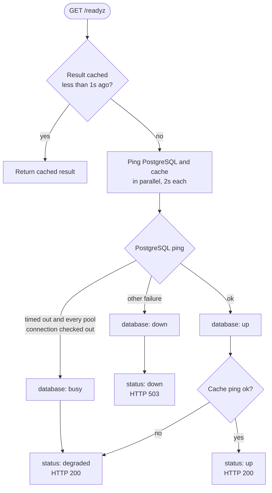
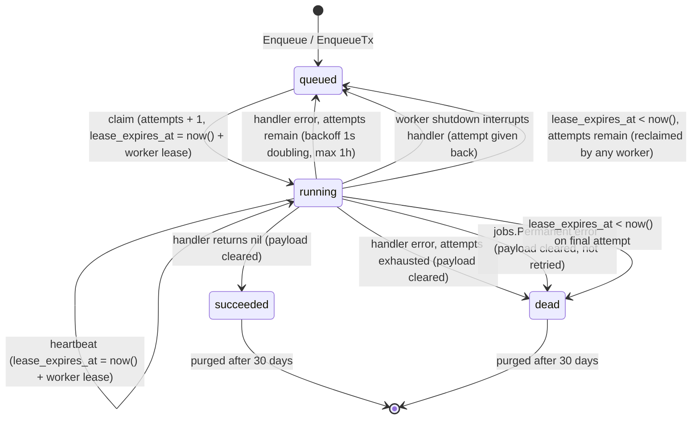
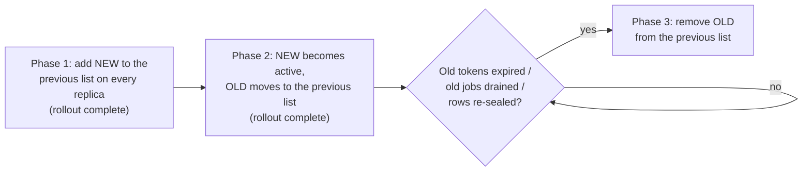
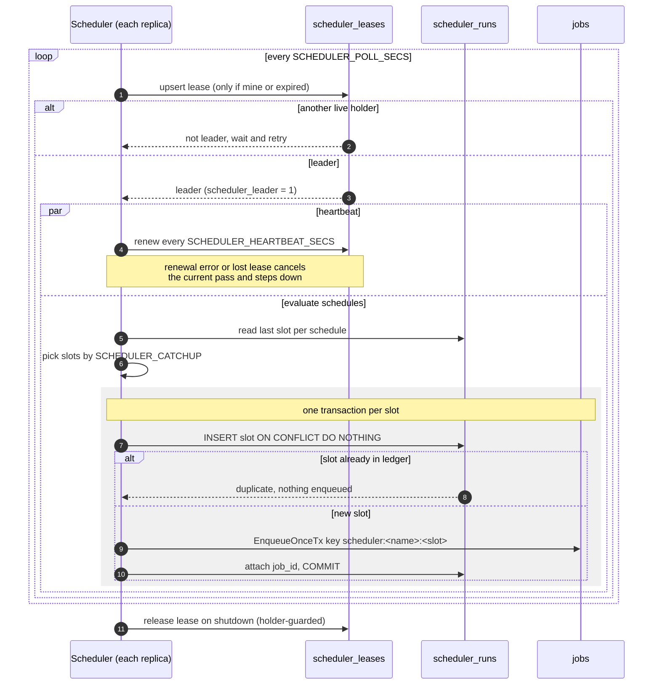
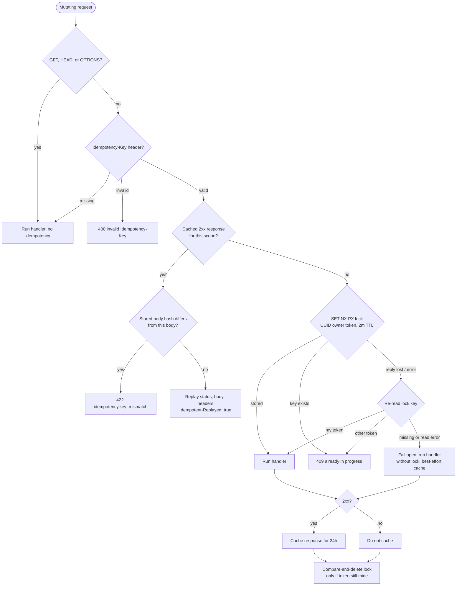
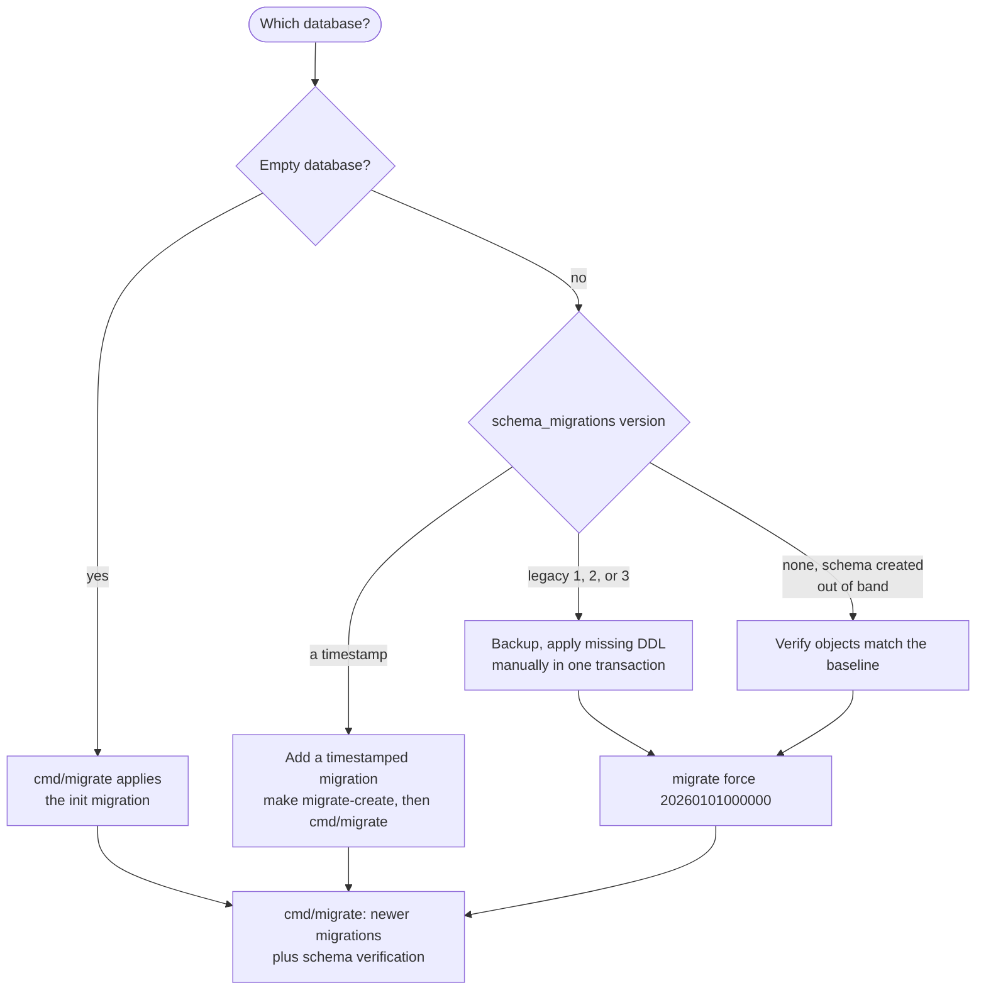
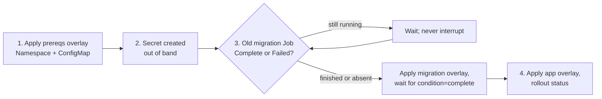

# Operations Runbook

Runbook for the deployed API: health, metrics, logs, jobs, webhooks,
idempotency, migrations, Kubernetes, and incident response. It describes the
behavior in this repository; replace every `<placeholder>` and adapt thresholds
to your service levels. Never put real secrets in this file, a ticket, a log
line, or an error message.

| Related document | Covers |
| --- | --- |
| [Kubernetes deployment](../deploy/k8s/README.md) | Manifests, staging/production overlays, GitHub Actions CD, migration order, rollback. |
| [Architecture](architecture.md) | Modules, dependency rules, data ownership. |
| [Webhooks](webhooks.md) | Outbound signing/retries/SSRF, inbound receiver, secrets, configuration. |
| [Feature Flags](feature-flags.md) | Catalog, precedence, snapshot cache, admin API. |
| [Tracing](tracing.md) | OpenTelemetry configuration, span privacy rules. |
| [Module Template](module-template.md) | Adding a module, routes, permissions, tables, contracts, audit. |

**Contents:** [1. Health](#1-health-and-readiness) ·
[2. Metrics](#2-metrics) · [3. Logs](#3-logs-request-ids-and-audit) ·
[4. Jobs](#4-background-jobs) · [5. Webhooks](#5-webhooks) ·
[6. Idempotency and Redis](#6-idempotency-rate-limits-and-redis) ·
[7. Migrations](#7-migrations-and-legacy-upgrade) ·
[8. Kubernetes](#8-kubernetes-deployment-notes) ·
[9. Tracing](#9-distributed-tracing) · [10. Incidents](#10-incident-checklist)

## 1. Health and readiness

| Endpoint | Purpose | Behavior |
| --- | --- | --- |
| `GET /healthz` | Liveness | Always `200` with `{"status":"up"}` while the process runs. Checks no dependency. |
| `GET /readyz` | Readiness | Pings PostgreSQL and cache concurrently (2s each). |
| `GET /health` | Readiness alias | Same handler and response as `/readyz`. |
| `GET /metrics` | Prometheus | Bearer token required when `METRICS_AUTH_TOKEN` is set; production requires a token of at least 16 characters. |
| `GET /swagger` | API docs | Non-production only. |



| `database` | `cache` | `status` | HTTP |
| --- | --- | --- | --- |
| `up` | `up` | `up` | `200` |
| `up` | `down` | `degraded` | `200` |
| `busy` | any | `degraded` | `200` |
| `down` | any | `down` | `503` |

- Details contain only `database` and `cache`; pool sizes are not exposed on
  the public probe.
- The probes are unauthenticated, so one result is reused for 1s and
  concurrent probes wait for the single in-flight check: a probe flood costs at
  most about one PostgreSQL and one cache ping per second per pod. A check cut
  short by the caller disconnecting is not cached.
- `busy` means the ping timed out while the pool was saturated
  (`AcquiredConns >= MaxConns`). Those connections are serving requests against
  a reachable database, so the pod stays in rotation; removing every saturated
  pod at once would cascade the load. If the database is really gone, in-flight
  queries fail, release their connections, and the next probe reports `down`.

```bash
curl -fsS http://127.0.0.1:8080/healthz
curl -fsS http://127.0.0.1:8080/readyz
curl -fsS -H "Authorization: Bearer $METRICS_AUTH_TOKEN" \
  http://127.0.0.1:8080/metrics | head

# Kubernetes
kubectl -n <namespace> port-forward svc/<service> 8080:8080
kubectl -n <namespace> get pods -w
kubectl -n <namespace> describe pod <pod>
```

| Probe | Endpoint | Notes |
| --- | --- | --- |
| Startup | `/healthz` | Covers only slow-but-reachable startup. The API exits during startup if PostgreSQL, storage (including the S3 bucket check), or cache initialization fails, so the container restarts instead of masking an outage. |
| Readiness | `/readyz` | A failure removes the pod from the Service; it does not restart it. |
| Liveness | `/healthz` | Never point liveness at `/readyz`, or a Redis blip restarts every pod. |

Readiness does **not** check SMTP, S3 object operations, the job queue, or
whether migrations ran. The bucket check happens at startup and object
reads/writes fail on use; SMTP failures surface through queued jobs;
migrations are a separate Job; queue health is visible in job metrics and the
`jobs` table. A green `/readyz` does not mean email or uploads work.

Trade-off: a Redis outage keeps every replica ready (`degraded`) because rate
limiting and idempotency fail open and sessions fall back to PostgreSQL. The
API keeps serving with weaker abuse protection and possible duplicate
mutations; alert on `status:"degraded"` and `rate_limit_errors_total` instead
of relying on readiness to page.

## 2. Metrics

Set `METRICS_AUTH_TOKEN` in production and configure the scraper to send it:

```yaml
authorization:
  credentials: <metrics-token>
```

| Metric | Labels | Meaning |
| --- | --- | --- |
| `http_requests_total` | `method`, `path`, `status` | Completed HTTP requests. `path` is the Fiber route template, not the raw URL. |
| `http_request_duration_seconds` | `method`, `path` | HTTP latency histogram (default Prometheus buckets). |
| `rate_limit_errors_total` | `tier` | Rate-limit cache errors (the request was allowed). |
| `jobs_claimed_total` | `kind` | Jobs claimed by workers. |
| `jobs_succeeded_total` | `kind` | Successful outcomes recorded in the database. |
| `jobs_retried_total` | `kind` | Failed jobs requeued for another attempt. |
| `jobs_dead_total` | `kind` | Handler failures that exhausted attempts. Lease-expiry dead letters are visible in the table but not counted here. |
| `jobs_queue_lag_seconds` | `kind` | Histogram of seconds between a job becoming due (`run_at`) and its claim, computed by the claim query (database clock). Only claimed jobs are observed, so a fully stalled queue shows up as missing observations; alert on `jobs_claimed_total` too. |
| `jobs_claim_errors_total` | — | Failed claim attempts; the worker retries with backoff capped at 30s. |
| `jobs_purged_total` | — | Terminal job rows deleted by retention. |
| `audit_write_failures_total` | — | Best-effort audit events that could not be recorded. |
| `audit_intent_failures_total` | — | Pre-write intent rows that could not be recorded (required guards returned 503). |
| `audit_completion_failures_total` | — | Intent rows that could not be completed; inspect stale `started` rows. |
| `audit_tx_missing_total` | — | Tier 1 audit writes attempted without a transaction (misconfiguration). |
| `audit_domain_missing_total` | — | Guarded successes without the required domain event. |
| `feature_flag_evaluations_total` | `key`, `source`, `enabled` | Feature evaluations by precedence source. |
| `feature_flag_snapshot_loads_total` | `result` | Snapshot loads (`success`/`error`). |
| `feature_flag_cache_hits_total` / `feature_flag_cache_misses_total` | — | In-process snapshot cache behavior. |
| `feature_flag_snapshot_stale_total` | — | Evaluations served from a stale snapshot during a DB outage. |
| `feature_flag_snapshot_fallback_total` | — | Evaluations that used env/compiled defaults because no snapshot was usable. |
| `feature_flag_snapshot_age_seconds` | — | Age of the snapshot currently used. |
| `feature_flag_invalidations_total` | — | Local snapshot invalidations after admin writes. |
| `events_published_total` | `event`, `mode` | Events published locally or durably. |
| `events_handled_total` | `event`, `outcome` | Event handler calls (`success`, `error`, `panic`). |
| `events_enqueue_errors_total` | `event` | Durable event jobs that could not be enqueued. |
| `scheduler_runs_total` | `schedule`, `outcome` | Scheduler slots processed (`enqueued`, `skipped`, `duplicate`). |
| `scheduler_leader` | — | `1` on the process holding the scheduler lease. |
| `scheduler_enqueue_errors_total` | `schedule` | Scheduled jobs that could not be enqueued. |
| `scheduler_runs_purged_total` | — | Scheduler run-ledger rows deleted by retention. |

The default registry also exposes Go runtime and process metrics (for example
`go_goroutines`, `process_resident_memory_bytes`).

```promql
# 5xx ratio
sum(rate(http_requests_total{status=~"5.."}[5m]))
  / sum(rate(http_requests_total[5m]))

# p95 latency by route
histogram_quantile(0.95,
  sum by (le, path) (rate(http_request_duration_seconds_bucket[5m])))

# New dead letters
increase(jobs_dead_total[15m]) > 0

# Sustained claim failures
rate(jobs_claim_errors_total[5m]) > 0

# No scheduler leader in the fleet (expected value is 1 overall, not per pod)
sum(scheduler_leader) != 1

# Scheduled slots failing to enqueue
increase(scheduler_enqueue_errors_total[15m]) > 0

# Durable event fan-out failures
increase(events_enqueue_errors_total[15m]) > 0
```

There is no queue-depth gauge. Query PostgreSQL for backlog and age:

```sql
SELECT kind, status, count(*) AS jobs,
       min(run_at) AS oldest_due,
       max(updated_at) AS newest_update
FROM jobs
WHERE status IN ('queued', 'running')
GROUP BY kind, status
ORDER BY jobs DESC;

SELECT count(*) AS dead_last_hour
FROM jobs
WHERE status = 'dead' AND updated_at > now() - interval '1 hour';
```

Alert on symptoms (5xx, latency, dead letters, claim errors, audit failures)
and on queue age, not only on raw queue depth: a large but draining queue is
different from a stuck one.

### Feature flags

Evaluation falls back in this order: last good snapshot (up to
`FEATURE_FLAGS_MAX_STALENESS_SECONDS`, default 300), then `FEATURE_FLAGS`
environment values, then compiled defaults. `FEATURE_FLAGS_FORCE_OFF` and a
flag's kill switch always win, and a database outage does not prevent
force-off.

- A TTL-expired snapshot within the max staleness is served while a single
  background reload runs, so a slow database raises the snapshot age instead
  of request latency. Only a cold cache or an invalidation makes callers wait
  (up to 5s) for the load.
- Admin writes invalidate only the replica that served the request; others
  converge within `FEATURE_FLAGS_CACHE_TTL_SECONDS` (default 30). For an
  immediate global stop, set `FEATURE_FLAGS_FORCE_OFF` or the kill switch
  through the admin API.
- When replicas disagree, check
  `feature_flag_snapshot_loads_total{result="error"}`,
  `feature_flag_snapshot_fallback_total`, and
  `feature_flag_snapshot_age_seconds`.

See [Feature Flags](feature-flags.md) for the API and precedence diagram.

## 3. Logs, request IDs, and audit

`APP_ENV=production` and `staging` use JSON `slog` output; other environments
use text. `LOG_LEVEL` is `debug`, `info`, `warn`, or `error` (default `info`).
Logs go to stdout; collect them with the platform's normal pipeline.

The request logger emits one record per request with `method`, `path`,
`status`, `latency`, `ip`, `request_id`, `user_id`, `content_length`,
`user_agent`, and `query`, plus `trace_id`/`span_id` when tracing is enabled
and the request is sampled.

| Rule | Behavior |
| --- | --- |
| Status | The effective status after the Fiber error handler; a handler returning an error is never logged as `200`. |
| Level | 4xx at `WARN`, 5xx at `ERROR`, everything else at `INFO`. A client disconnect (`context.Canceled`) is logged as `499 client_closed_request` at `INFO` and is not a 5xx. |
| Query redaction | Values for keys named `code`, `state`, `password`, or containing `token` or `secret` are redacted. Do not rely on this for other parameters; never put secrets in URLs. |
| Bodies | Request and response bodies are never logged. Keep it that way. |

An inbound `X-Request-Id` is honored only when the direct peer is a trusted
proxy (`APP_TRUST_PROXY=true` and the peer is in `APP_TRUSTED_PROXIES`) and the
value is 1–128 characters of `[A-Za-z0-9._:-]`; otherwise the API generates a
UUID, so ordinary clients cannot forge or collide correlation IDs. The value is
echoed on the response and returned as `requestId` in RFC 9457 problem
responses.

```bash
# JSON logs
... | jq -c 'select(.request_id=="<id>")'

# Plain logs
grep 'request_id=<id>' app.log
```

Search by `request_id` first, then use `trace_id` in the tracing backend to
inspect the HTTP span, its sanitized PostgreSQL spans, and any linked job
spans. Tracing never adds emails, tokens, payloads, SQL text, headers, or raw
error messages to logs or spans; see [Tracing](tracing.md).

### Audit trail

Audit events carry the request ID and the resolved tenant ID. Mutations are
audited in two tiers:

| Tier | Mechanism | Failure behavior | Used by |
| --- | --- | --- | --- |
| 1 | The service writes a terminal event with `RecordTx` inside the mutation transaction. A successful write marks the request so the fallback middleware does not write a second row. | Insert failure rolls the mutation back and returns `503 system.audit_unavailable`; a service built without a recorder fails closed the same way. | Identity registration/profile/password/delete, admin role/ban/unban, admin file delete/restore. |
| 2 | `audithttp.Guard` runs after idempotency, inserts an `outcome=started`, `source=http` intent row before the handler, then completes it as `succeeded`, `failed`, or `denied` with the HTTP status/error code. | A required guard returns the same 503 when the intent cannot be stored, so the handler never runs unaudited. Completion failures are counted and leave a stale `started` row; they cannot roll back a committed mutation. | Guarded routes, for example `POST /notifications/send`. |

- Idempotent replays are not audited again, and audit rows are never cached
  with the idempotency response.
- Without tenant middleware (an internal call or a pre-tenant test) the event
  uses the compatibility tenant id 1.
- Client-supplied text (User-Agent, IP, request and resource ids) is sanitized
  before storage: invalid UTF-8 becomes U+FFFD and NUL bytes are stripped, so a
  crafted header cannot fail the insert (which would turn guarded mutations
  into 503s). Metadata strings in the `jsonb` column drop invalid UTF-8 and NUL
  bytes the same way.
- A zero `audithttp.Policy` mode means `ModeRequired`; best-effort guards must
  opt in with `ModeBestEffort`.
- `audit_events` is append-only: only a started HTTP intent can move to a
  terminal outcome, only completion fields may change, and `DELETE`/`TRUNCATE`
  are rejected by triggers (a reviewed retention job must disable
  `trigger_audit_events_no_delete` as the owner).
- Alert on `audit_intent_failures_total`, `audit_completion_failures_total`,
  `audit_tx_missing_total`, and `audit_domain_missing_total`; investigate rows
  where `outcome = 'started' AND created_at < NOW() - INTERVAL '10 minutes'`.
- For explicit domain events see the audit section of
  [Module Template](module-template.md); set `Event.TenantID` there or let the
  recorder resolve it from the context.

## 4. Background jobs

`internal/platform/jobs` is a PostgreSQL-backed durable queue. Every process
whose `APP_ROLE` runs the worker hosts one in-process with concurrency 4.
Claims use `FOR UPDATE SKIP LOCKED`, so multiple replicas are safe. Delivery is
**at-least-once**, never exactly-once: expect duplicate emails and side
effects, and keep handlers idempotent.

| Aspect | Behavior |
| --- | --- |
| Tenant | `Enqueue`/`EnqueueTx` resolve `jobs.tenant_id` from the context (`tenant.EffectiveID`, default 1); an explicit positive `Job.TenantID` is kept. The worker restores that tenant on the handler context, so email and audit handlers run as the enqueuing tenant. A claimed row with no tenant runs as tenant 1. |
| Dedupe | `EnqueueOnce`/`EnqueueOnceTx` use the nullable `jobs.idempotency_key` with a partial unique `(tenant_id, idempotency_key)` index. A duplicate returns the existing id and inserts nothing, so producer and event fan-out retries cannot create a second row. Plain `Enqueue` does not dedupe. Terminal rows keep their key until retention removes them. |
| Global passes | Claim, lease recovery, and purge are global, so the only tenant-leading jobs index is the dedupe key; ad-hoc per-tenant inspection scans `idx_jobs_status_run_at`. Retention and metric labels (`kind` only) are deliberately global to avoid cardinality growth. |
| Tracing | Enqueue stores the active W3C `traceparent` in `jobs.trace_parent` when the caller has a recording span. Each attempt runs as a new-root `job.process` span linked to the enqueue span, with `job.id`, `job.kind`, tenant, attempt, and outcome attributes; database spans nest under it. `NULL`/malformed traceparents are ignored. See [Tracing](tracing.md) and [Jobs `trace_parent`](#jobs-trace_parent). |
| Process role | `APP_ROLE=all` (default) serves the API and runs the worker, the scheduler, and module background loops. `api` serves HTTP only: it enqueues jobs but never claims them, so some `worker`/`all` process must run. `worker` runs the worker, scheduler, and background loops, and its listener serves only `/healthz`, `/readyz` (database and cache), and `/metrics`. Every role registers the same job handlers. |
| Authorization | Module (`JobProvider`) and durable-event handlers run under `authz.SystemContext`, so `authz.Authorize` allows their subject-less calls; without it they would be denied (fail closed). |
| Identity | Worker and scheduler identities (`locked_by`, lease `holder`) are `<hostname>-<pid>-<random>`, so replicas with the same hostname never share one. |

### Lifecycle and retries



| Rule | Value / behavior |
| --- | --- |
| Attempts | `attempts` increments at claim time; `max_attempts` defaults to 10. |
| Retry backoff | Exponential, 1s doubling, capped at 1h, while `attempts < max_attempts`. |
| Dead letter | Budget exhausted: the job becomes `dead` and its payload is cleared. |
| Permanent failure | A handler error wrapped with `jobs.Permanent(err)` dead-letters on that attempt; `last_error` starts with `permanent failure (not retried): ` and `jobs_dead_total{kind}` counts it. Used for undecodable or invalid payloads (email, password-reset request, webhook dispatch/delivery). Decryption failures are **not** permanent: a replica missing a key another one already seals with retries until the rollout completes. |
| Unknown kind | Follows the same retry path, so a rollout can register the handler before pending work dies; a permanently missing handler eventually dead-letters. |
| Handler timeout | 10m by default. A timeout is a normal failure that consumes the attempt. Cancellation is cooperative: a handler that ignores its context keeps running and heartbeating, and one that still returns success after its deadline is recorded as succeeded with a warning. |
| Lease | Each row stores `lease_expires_at` = `now()` + the owning worker's lease (`WithLeaseDuration`, default 5m), set on claim and on every heartbeat (default every 30s); a `CHECK` requires every `running` row to have one. A job is reclaimed only when `lease_expires_at < now()`, so workers with different lease durations (for example a dedicated slow-kind worker) can share the table without stealing each other's healthy jobs. After a crash, the next claim by any worker requeues the expired job (or dead-letters it if that was the final attempt). The crashed attempt counts. The previous owner may still be executing, so concurrent duplicate execution is possible. |
| Fencing | Every outcome write is fenced by `attempts`, so a reclaimed worker's late result is discarded. |
| Shutdown release | On SIGINT/SIGTERM the worker stops claiming and cancels running handlers inside the shared shutdown budget (see [Graceful shutdown](#graceful-shutdown)). A handler that fails while the worker is stopping is requeued immediately **without consuming its attempt** (`last_error` starts with `jobs: interrupted by worker shutdown`, span outcome `released`), so a drain on the final attempt never dead-letters. A handler that still succeeds is recorded normally. A non-cooperative handler can exceed the window. |
| Claim errors | Retried in-process with exponential backoff capped at 30s. |

### Dedicated workers for slow kinds

One worker processes every registered kind by default, so a burst of slow jobs
(for example large exports) can occupy every slot and delay fast ones such as
`email.send` (head-of-line blocking; watch `jobs_queue_lag_seconds{kind}`).
`jobs.WithKinds(kinds...)` restricts a worker's claim query to the listed
kinds and `jobs.WithExcludeKinds(kinds...)` skips them, in one process or in
separate deployments:

```go
slow := jobs.NewWorker(pool, instanceID+"-slow", jobs.WithKinds("reports.render"), jobs.WithConcurrency(2))
general := jobs.NewWorker(pool, instanceID, jobs.WithExcludeKinds("reports.render"))
```

Both filters only narrow which due jobs are claimed; expired-lease recovery
stays global, so any worker requeues a crashed job of any kind (it never
executes it). A slow-kind worker can use a longer `WithLeaseDuration`: expiry
is the row's `lease_expires_at`, written by the owning worker, so a
short-lease worker never reclaims its healthy jobs. Register a handler for every kind a worker claims, and make sure
every kind is claimed by some worker: an excluded kind with no dedicated worker
waits in the queue.

`cmd/api` applies the same filters from `JOBS_WORKER_KINDS` and
`JOBS_WORKER_EXCLUDE_KINDS` (comma-separated; a kind in both lists fails
startup). A typical bulkhead runs one `APP_ROLE=worker` deployment with
`JOBS_WORKER_KINDS=webhook.delivery` and the general workers with
`JOBS_WORKER_EXCLUDE_KINDS=webhook.delivery`. On Kubernetes, start from the
optional `deploy/k8s/base/worker/` component.

### Notification email

Notifications use the same queue and `email.send`/`email.send.encrypted` kinds
as identity email. The service resolves the recipient through identity's
`contracts.NotificationRecipientLookup` and never reads `users` directly. When
the `email` channel is enabled, the in-app row and the email job commit in one
transaction, so a queue outage returns `500` and rolls the row back.
Preferences apply before any write: an explicit `enabled=false` row skips that
channel; a missing row means enabled.

```sql
-- Unread backlog per tenant/user
SELECT tenant_id, user_id, count(*) AS unread,
       max(created_at) AS newest
FROM notifications
WHERE read_at IS NULL
GROUP BY tenant_id, user_id
ORDER BY unread DESC;

-- Explicit channel opt-outs
SELECT tenant_id, user_id, type, channel, enabled, updated_at
FROM notification_preferences
WHERE enabled = false
ORDER BY updated_at DESC;
```

Notification emails carry no links or secrets, so a dead-lettered row only
needs a re-send through the admin endpoint or the producing module. The
generic audit trail records successful `POST /notifications/:id/read`,
`POST /notifications/read-all`, and `PUT /notification-preferences`;
`POST /notifications/send` is guarded by a required `notification.sent` intent
row (503 when the audit store is down). Replays are skipped.

### Retention and payload clearing

| Rule | Value |
| --- | --- |
| Eligible rows | `succeeded` and `dead` only; queued and running rows are never purged. |
| Age | Older than 30 days. |
| Schedule | Hourly; the first pass runs when a worker starts. |
| Bounds | 5s per pass, at most 1,000 rows per delete batch, so a backlog cannot hold one transaction open. |
| Index | Partial `idx_jobs_terminal_updated_at ON jobs (updated_at) WHERE status IN ('succeeded','dead')`. |

Succeeded and dead jobs have `payload = '{}'`, so reset and verification links
do not linger in a dump. It also means **a dead job cannot be replayed from its
row**: re-trigger the business flow (for example ask the user to request
another reset email) instead of updating dead rows back to `queued`.

### Expired identity tokens and stale sessions

| Rule | Value |
| --- | --- |
| Job | `identity.tokens.purge_expired`, scheduled hourly by the identity `ScheduleProvider`. |
| Prerequisite | `SCHEDULER_ENABLED=true`. Without the scheduler, expired tokens are still rejected on use but never deleted. |
| Tables | In order: expired `refresh_tokens`, `password_reset_tokens`, `email_verification_tokens`; expired **pending** `invitations` (accepted rows are kept as the membership's provenance); then stale `sessions`, so sessions whose last refresh token expired in the same run are already eligible. |
| Session retention | A session is purged when it was revoked more than 30 days ago (kept that long so `revoked_reason`, for example `refresh_reuse`, is visible for incident review), or when it has been idle (`last_used_at`) for more than 24 hours **and** has no refresh-token rows left. The 24-hour grace keeps a rotation in flight from losing its session row. Used refresh tokens stay until they expire so a replay is still recognized as reuse. |
| Bounds | `DELETE` batches of 1,000 rows chosen with `FOR UPDATE SKIP LOCKED`; at most 1 minute per table per run, the remainder goes to the next run. |
| Index | `idx_refresh_tokens_expires_at`, `idx_invitations_expires_at_pending`, `idx_sessions_last_used_at` (plus `idx_refresh_tokens_tenant_session_id` for the live-token check); the one-row-per-user reset and verification tables are small enough without one. |
| Tenancy | A deliberate cross-tenant maintenance pass (the only identity queries without a `tenant_id` predicate besides the global per-user rows). Reset and verification tokens are per user and have no tenant. |

### Sessions and legacy tokens

- Every sign-in creates a `sessions` row; the access token's `sid` claim names
  it. Tokens without a positive `sid` (or `tenant_id`) claim are rejected with
  `401` fail-closed, so after deploying this release every user signs in again;
  no migration of old tokens is possible or needed.
- Revocation reasons in `sessions.revoked_reason`: `logout`, `logout_all`,
  `revoked` (`DELETE /auth/sessions/:id`), `refresh_reuse`,
  `credentials_changed`, `membership_changed` (ban, removal, role change),
  `account_deleted`. A burst of `refresh_reuse` (also logged as
  `refresh token reuse detected; session revoked`) points at stolen refresh
  tokens or a client that retries refresh with an old token.
- To force everyone to sign in again without rotating `JWT_SECRET`, revoke
  live sessions (`UPDATE sessions SET revoked_at = now(), revoked_reason =
  'revoked' WHERE revoked_at IS NULL`) and wait out the 5-second session cache,
  or bump users' `token_version`.

### Tenant lifecycle

Tenant status is `trialing | active | suspended | pending_deletion |
deleted`; only `trialing` and `active` serve requests. Transitions go through
the identity `TenantService` (`internal/modules/identity/service/tenants.go`),
which enforces the state machine (`trialing → active | suspended |
pending_deletion`, `active ↔ suspended`, `active | suspended →
pending_deletion`, `pending_deletion → active | deleted`) and writes a Tier 1
audit row per change. Entering `pending_deletion` schedules deletion after a
30-day grace; cancelling it clears the schedule. Tenant 1 can never be
deleted (also a `CHECK`). Platform admins use `PATCH
/platform/tenants/:id/status`; operator tooling must call the service rather
than raw `UPDATE`s, which skip the audit row. A
non-operational tenant returns `404` on tenant resolution after the resolver
cache TTL (30s) and `401` for existing sessions and API keys.

### Data retention overview

Every purge is idempotent (a redelivered job finds fewer rows), bounded, and a
deliberate cross-tenant maintenance pass. Module purges are durable jobs
registered through `JobProvider`/`ScheduleProvider`, so they run under
`authz.SystemContext` and **only when `SCHEDULER_ENABLED=true`**; the platform
loops run in every worker process regardless.

| Data | Rule | Trigger | Bounds | Index |
| --- | --- | --- | --- | --- |
| `jobs` | `succeeded`/`dead` older than 30 days | Worker loop, hourly | 5s per pass, 1,000-row batches | `idx_jobs_terminal_updated_at` |
| `scheduler_runs` | Older than `SCHEDULER_RETENTION_DAYS` (30); newest row per schedule kept | Scheduler leader, hourly | See [Scheduler](#scheduler) | — |
| Identity tokens | Expired | `identity.tokens.purge_expired`, hourly (scheduler) | 1,000-row batches, 1 min per table | `idx_refresh_tokens_expires_at` |
| Webhook deliveries/events | Terminal, older than `WEBHOOK_RETENTION_DAYS` (30) | Webhooks background loop, hourly | 1,000-row batches, 30s per pass | See [Webhooks](webhooks.md) |
| Trashed files | Soft-deleted more than `FILES_TRASH_RETENTION_DAYS` (30) ago: blob, then row | `files.trash.purge`, hourly (scheduler) | 100-row claimed batches, 1 min per run | Partial `idx_files_deleted_at ON files (deleted_at) WHERE deleted_at IS NOT NULL` |
| Notifications | **Read** more than `NOTIFICATIONS_RETENTION_DAYS` (180) ago (by `read_at`); unread rows are kept at any age | `notifications.retention.purge`, hourly (scheduler) | 1,000-row batches, 1 min per run | Partial `idx_notifications_read_at ON notifications (read_at) WHERE read_at IS NOT NULL` |
| Data exports | `expires_at` reached, erased (`status = 'expired'`), failed, or queued/running for more than a day (stuck job) | `privacy.exports.purge`, hourly (scheduler) | 100-row batches, 1 min per run; blob, then row | Partial `idx_data_exports_expires_at ON data_exports (expires_at) WHERE expires_at IS NOT NULL` |

Without the scheduler, trashed files keep their blobs and stay restorable
indefinitely, notifications are never deleted, and expired export documents
stay in storage until the scheduler is enabled. The retention indexes
lead with their age column rather than `tenant_id` because the purges scan
every tenant; they are partial, so live files, unread notifications, and active
exports are not indexed. These indexes and the purge claim column
`files.purge_started_at` are part of the init migration.

#### Privacy exports and erasure (ADR 0013)

`POST /me/data-exports` commits a `data_exports` row and a
`privacy.data_export` job in one transaction. The job runs every registered
`privacy.Exporter`, writes one JSON document to
`<tenantID>/<userID>/exports/<uuid>.json`, marks the row `ready` with a 7-day
expiry, and sends an in-app notification. Re-delivery is a no-op once the row
is `ready`; a failed module export marks the row `failed` and the job retries.

| Race | Guard |
| --- | --- |
| Two export requests for one membership | The partial unique index `idx_data_exports_active` makes the second insert fail; the service returns `409 data_export.in_progress` (the request idempotency key additionally collapses retries). The request also holds the active membership `FOR SHARE` so it cannot slip past an erasure. |
| Erasure while an export is building | The erasure request updates the tenant's active/ready exports to `expired`; the export job's `running → ready` update is conditional, so a late writer cannot revive it and deletes its own document. The identity eraser deletes every export document (including already-expired ones), and the finalizer sweeps an export that committed just before the last membership was removed. |
| Retried export/erase jobs | Each job re-reads state and is idempotent: export stops on `ready`/`expired`, a failed/timed-out/panicking export is marked `failed` on a detached context (and stale active rows are purged after a day), erase deletes by `(tenant, user)`, and finalization only anonymizes after every membership is `removed`. |
| Already-deleted account | The finalizer upgrades an account deleted by the older self-service path: it still anonymizes the email/name and deletes credentials, identities, sessions, and tokens. |
| Last-admin erasure | The service takes the per-tenant admin lock and returns `409 user.last_admin` before any job or audit row is written; the per-tenant job re-checks before running any eraser. |

Erasure has two stages: one `privacy.erase` job per membership runs every
tenant `Eraser` (identity, files, notifications, apikeys, features, and stored
webhook event history), then `privacy.erase.finalize` checks that every
membership is `removed` before deleting credentials, identities, sessions, and
tokens and anonymizing the global user (`erased+<id>@invalid`, empty name,
`status = deleted`). Until then the finalizer fails and retries with backoff.
The finalizer also sweeps leftover export documents. Pending `email.send`
payloads are encrypted at rest and terminal jobs clear them; a queued email
already committed before the request may still be delivered, and delivered
webhooks cannot be recalled from third-party receivers.
Audit rows are append-only and contain only ids/outcomes (`user.erasure_requested`,
`admin.user.erasure_requested`, `user.erased`), never email, name, or document
content; that is the retention basis for the request history itself.

#### Files trash purge

```mermaid
sequenceDiagram
    autonumber
    participant W as files.trash.purge job
    participant DB as PostgreSQL (files)
    participant S as Object storage
    loop until a short batch, a blob failure, or the 1 min budget
        W->>DB: UPDATE files SET purge_started_at = now() WHERE id IN<br/>(oldest 100 trashed > N days, FOR UPDATE SKIP LOCKED); COMMIT
        loop each claimed row
            W->>S: Delete(storage_path)
            alt deleted or already missing
                S-->>W: ok (row queued for hard delete)
            else storage error
                S-->>W: error (row kept, logged)
            end
        end
        W->>DB: DELETE FROM files WHERE id = ANY(ids) AND purge_started_at IS NOT NULL
    end
```

| Rule | Behavior |
| --- | --- |
| Order | Claim, blob, then row. A crash or failed hard delete after the blob delete leaves a claimed row with no blob; the next run deletes it (a missing blob counts as deleted). |
| Restore race | The claim (`purge_started_at`) commits before any blob is deleted, and restore requires `purge_started_at IS NULL`, so a user/admin restore of a claimed row gets `404` even if the purge later fails. A row whose blob delete failed stays claimed: it is past retention and only waits for the next run. |
| Failures | A blob that cannot be deleted keeps its (claimed) row, is logged at error level with `file_id`/`tenant_id`, and fails the job after the rest of the batch commits (normal retry/dead-letter path); the next scheduled run tries again. |
| Events | None. The purge publishes no domain event, so no webhook fires; the user-visible deletion already emitted `file.deleted`. No audit row is written (system retention, like the token purge). |

```sql
-- Trash waiting for the purge, by tenant
SELECT tenant_id, count(*), min(deleted_at)
FROM files
WHERE deleted_at IS NOT NULL
GROUP BY tenant_id;

-- Read notifications past retention (should stay near zero)
SELECT count(*) FROM notifications
WHERE read_at < now() - interval '180 days';
```

### Key rotation

Signing and encryption use separate keys, each with a verify/decrypt-only
previous list. Listing the active key as a previous key fails startup.

| Key | Previous list | Protects | Old key can be dropped when |
| --- | --- | --- | --- |
| `JWT_SECRET` | `JWT_PREVIOUS_SECRETS` | Access tokens. Each token's `kid` header (a fingerprint of the signing secret) selects the verification key; an unknown `kid` is rejected. | Every token it signed has expired (`JWT_EXPIRE_HOUR`). Tokens without a `kid` (issued before kid headers) verify against the active secret only, so they fail as soon as their secret stops being active. |
| `DATA_ENCRYPTION_KEY` | `DATA_ENCRYPTION_PREVIOUS_KEYS` | Email and password-reset job payloads (envelope v2 names the sealing `kid`; v1 envelopes are tried against every key). | No `queued`/`running` job is still sealed with it. |
| `WEBHOOK_SECRET_ENCRYPTION_KEY` | `WEBHOOK_SECRET_ENCRYPTION_PREVIOUS_KEYS` | Stored endpoint/source secrets and delivery snapshots. Rows keep the key that sealed them. | Every endpoint and source secret has been rotated (re-sealed) and no pending delivery snapshot uses it. See [Secrets and key rotation](#secrets-and-key-rotation). |

Rotation is two-phase, so no replica ever sees a key it cannot verify or
decrypt:



Skipping phase 1 lets a replica that has not restarted yet reject tokens (or
fail to open jobs) produced by an updated replica. A job it cannot decrypt
retries rather than dead-lettering, but only until `max_attempts`.

JWT notes:

- Refresh tokens are opaque database rows, not JWTs: rotation does not revoke
  them, and a valid refresh token mints an access token with the new key. To
  force a full re-login, revoke sessions or bump users' token version (see
  [Sessions and legacy tokens](#sessions-and-legacy-tokens)).
- Google OAuth `state` is HMAC-signed with a key derived from the **active**
  `JWT_SECRET` only, so sign-ins started before the swap fail once and must be
  restarted.
- A leaked key needs no two-phase care: make the new key active, drop the
  leaked one immediately, and accept that every session signed with it ends.

Upgrading from a release where job payloads were sealed with a
`JWT_SECRET`-derived key: set a dedicated `DATA_ENCRYPTION_KEY` (32+
characters, different from `JWT_SECRET`) and put the current `JWT_SECRET`
value in `DATA_ENCRYPTION_PREVIOUS_KEYS`; the same HKDF derivation reproduces
the old key, so queued v1 envelopes still open. Remove it once those jobs have
drained. Roll out every worker before relying on it: workers from before
envelope v2 cannot open v2 payloads and retry them until `max_attempts`.

### Inspecting jobs

```sql
-- Backlog by tenant, kind, and state
SELECT tenant_id, kind, status, count(*), min(run_at), max(updated_at)
FROM jobs
WHERE status IN ('queued', 'running')
GROUP BY tenant_id, kind, status
ORDER BY count(*) DESC;

-- Recent failures and dead letters
SELECT id, tenant_id, kind, status, attempts, max_attempts,
       idempotency_key, last_error, updated_at
FROM jobs
WHERE status IN ('running', 'dead')
ORDER BY updated_at DESC
LIMIT 50;

-- Lease age for running jobs
SELECT id, kind, locked_by, locked_at, lease_expires_at,
       lease_expires_at - now() AS lease_remaining, attempts, max_attempts
FROM jobs
WHERE status = 'running'
ORDER BY lease_expires_at;
```

A stuck `running` job usually recovers when its lease expires and another
worker polls. Before any manual intervention, confirm no live process owns it.
As a last resort, and accepting duplicate execution, requeue one job only after
its lease is far past expiry. The guard uses the row's own
`lease_expires_at`, so a healthy long-running job that is still heartbeating is
never requeued:

```sql
UPDATE jobs
SET status = 'queued',
    locked_at = NULL,
    locked_by = NULL,
    lease_expires_at = NULL,
    run_at = now(),
    updated_at = now()
WHERE id = <id>
  AND status = 'running'
  AND lease_expires_at < now() - interval '10 minutes';
```

Never bulk-clear locks, and never requeue `dead` jobs (their payload is gone).

### Durable events

`internal/platform/events` publishes metadata-rich events locally and/or as
jobs. A durable subscription adds one job per event and handler with
`jobs.idempotency_key = event:<eventName>:<eventId>:<handler>:<tenantId>`; the
job payload is the event JSON. Delivery is at-least-once, so handlers must be
idempotent. Local handler panics are recovered and combined with
`errors.Join`. During an incident check `events_handled_total{outcome="panic"}`
and `events_enqueue_errors_total`. Durable handlers must be registered before
the worker runs; the app does this after all `EventProvider` modules register.

### Scheduler

`internal/platform/scheduler` runs in-process in every replica whose
`APP_ROLE` runs the worker (`all` or `worker`) when enabled. Only the holder of the single `scheduler_leases` row evaluates
schedules; `scheduler_runs` is the unique `(schedule, scheduled_for)` ledger.



Because the ledger row and the job enqueue share a transaction, a leader
restart or overlapping election cannot double-enqueue a slot. Interval
schedules align to epoch boundaries; cron is 5-field UTC.

| Variable | Default | Meaning |
| --- | --- | --- |
| `SCHEDULER_ENABLED` | `false` | Run the scheduler in this process. |
| `SCHEDULER_LEASE_TTL_SECS` | `30` | Lease validity without a heartbeat. |
| `SCHEDULER_HEARTBEAT_SECS` | `10` | Lease renewal interval; must be below the TTL. |
| `SCHEDULER_POLL_SECS` | `15` | Evaluation / election interval. |
| `SCHEDULER_CATCHUP` | `latest` | `none` skips slots missed while no leader ran, `latest` runs only the newest, `all` replays in order. Under `none`, a slow poll during continuous leadership still runs the latest slot, so short schedules are not starved. |
| `SCHEDULER_CATCHUP_LIMIT` | `100` | Maximum slots replayed per poll under `all`. |
| `SCHEDULER_RETENTION_DAYS` | `30` | Ledger retention. The newest row of every schedule is always kept: it anchors catch-up, and deleting it would make a sparse schedule (for example `@yearly`) look never-run and re-enqueue an executed slot. |

- A schedule's job payload is `{"schedule","scheduledFor","data"}`. Its kind
  must have a worker handler; a missing handler follows the normal
  retry/dead-letter path.
- Logs include `holder`, `schedule`, `slot`, and the underlying error.
  `scheduler_leader` should sum to 1 across replicas. If it is 0, check
  database reachability and lease expiry; if it is greater than 1, check clock
  skew and whether a process runs with an extremely short lease TTL.

```sql
-- Current leader and lease age
SELECT name, holder, expires_at, now() - heartbeat_at AS since_heartbeat
FROM scheduler_leases;

-- Recent slots and whether they enqueued or were skipped
SELECT schedule, scheduled_for, status, job_id, error, created_at
FROM scheduler_runs
ORDER BY scheduled_for DESC
LIMIT 50;

-- Queued backlog by kind (manual check)
SELECT kind, count(*), min(run_at)
FROM jobs
WHERE status = 'queued'
GROUP BY kind
ORDER BY count(*) DESC;
```

## 5. Webhooks

Outbound deliveries reuse the jobs queue. Producers (registration, file
upload/delete/restore, admin file delete/restore) publish a domain event with
`events.PublishTx` in their transaction, which enqueues the webhooks durable
subscription job (`events.<type>.webhooks`); that job commits a
`webhook_events` row (first endpoint), a `webhook_deliveries` row, and its
first `webhook.delivery` job atomically per endpoint; the worker sends one
Standard Webhooks attempt and schedules the next attempt as a new job.
Receivers must deduplicate on `webhook-id`. The signature is
`v1,<base64 HMAC-SHA256>` over `<webhook-id>.<webhook-timestamp>.<body>`. The
dispatch sequence and delivery state machine are diagrammed in
[Webhooks](webhooks.md).

Monitor `events.*.webhooks` jobs as well as `webhook.delivery`: a dead
subscription job means an event was never fanned out (invalid envelope, or the
database failed for all 20 attempts).

### Delivery state and retries

| Response / condition | Result |
| --- | --- |
| `2xx` | `succeeded`. |
| `3xx` | Permanent (`dead`); redirects are never followed. |
| `408`, `425`, `429`, `5xx`, transport error | Retry with backoff. |
| Other `4xx` | Permanent (`dead`). |
| Attempt budget exhausted | `dead`. |
| Endpoint disabled or deleted | Never claimed; its pending deliveries become `dead` on the next job. |
| Shutdown cancels an attempt before any response | The attempt is given back (`attempts` decremented, lease cleared) and the job is released without consuming its attempt; expect a possible duplicate send. |

- `pending` means queued or awaiting the next attempt; `next_attempt_at`
  doubles as the claim lease while an attempt is in flight.
- Backoff is exponential from `WEBHOOK_RETRY_BASE_SECS` (default 5) to
  `WEBHOOK_RETRY_MAX_SECS` (default 3600). A valid `Retry-After` (seconds or
  HTTP date) can only lengthen the backoff (`0`/past dates do not retry
  immediately) and is capped at the same maximum.
- Each attempt uses the endpoint's `timeoutMs` (snapshotted on the delivery),
  bounded by `WEBHOOK_REQUEST_TIMEOUT_SECS` (default 10). The attempt and its
  outcome are recorded with a detached 5s context even during shutdown.
- Outcome writes are fenced by the claimed attempt; a `claim lease lost`
  warning means a slow worker's stale result was discarded because a newer
  attempt owned the delivery.
- Every attempt is recorded with status code, duration, and a bounded error.
  Response bodies are not stored.
- URL, payload, event timestamp, attempt budget, and the sealed secret are
  snapshotted at dispatch, so endpoint edits do not change queued deliveries.
  After a secret rotation, older deliveries are co-signed with the snapshot and
  current secret for 24 hours, then signed with the current secret only.
  Replay creates a new delivery with the endpoint's current URL and secret.

### Inspecting deliveries

```sql
-- Backlog by tenant/status
SELECT tenant_id, status, count(*), min(next_attempt_at), max(updated_at)
FROM webhook_deliveries
GROUP BY tenant_id, status
ORDER BY count(*) DESC;

-- Dead deliveries
SELECT id, tenant_id, endpoint_id, event_type, attempts, max_attempts,
       last_status_code, last_error, updated_at
FROM webhook_deliveries
WHERE status = 'dead'
ORDER BY updated_at DESC
LIMIT 50;

-- Attempt timeline
SELECT attempt, status_code, duration_ms, error, created_at
FROM webhook_delivery_attempts
WHERE delivery_id = $1
ORDER BY attempt;

-- Pending work and its jobs
SELECT d.id, d.tenant_id, d.next_attempt_at, j.id AS job_id, j.status, j.run_at
FROM webhook_deliveries d
LEFT JOIN jobs j
  ON j.kind = 'webhook.delivery'
 AND j.payload->>'deliveryId' = d.id::text
WHERE d.status = 'pending'
ORDER BY d.next_attempt_at
LIMIT 50;
```

A pending delivery with a future `next_attempt_at` and no live job can occur
after a crash in the narrow window between the HTTP attempt and bookkeeping.
The original job lease normally retries it; otherwise replay the delivery
instead of bulk-editing state.

### Secrets and key rotation

Outbound endpoint and inbound source secrets (Standard Webhooks
`whsec_<base64>`; rotate any secret created before that format) are sealed
with AES-256-GCM using
`WEBHOOK_SECRET_ENCRYPTION_KEY`; outside production an empty key falls back to
`JWT_SECRET`, while production **requires** a dedicated key of at least 32
characters. Envelopes (v2) record the sealing key's `kid`; v1 envelopes are
tried against every configured key.

Rotating the encryption key follows the two-phase procedure in
[Key rotation](#key-rotation) with `WEBHOOK_SECRET_ENCRYPTION_PREVIOUS_KEYS`:

1. Add the new key to `WEBHOOK_SECRET_ENCRYPTION_PREVIOUS_KEYS` on every
   replica.
2. Make it `WEBHOOK_SECRET_ENCRYPTION_KEY` and move the old key to the
   previous list. New and rotated secrets are sealed with the new key; stored
   rows keep the key that sealed them and still decrypt.
3. Rotate endpoint and inbound source secrets over time (each rotation
   re-seals with the active key and returns a new plaintext secret to deliver
   to its owner).
4. Remove the old key only when no endpoint, source, or pending delivery
   snapshot is still sealed with it; a row whose key is gone fails decryption.

Workers from before envelope v2 cannot open secrets sealed by an updated
replica, so finish the rollout before creating or rotating webhook secrets.

Endpoint secret rotation is safe for in-flight work because queued deliveries
keep their snapshot. Inbound rotation is immediate: the old secret stops
verifying on the next request.

### SSRF allowlist

`WEBHOOK_SSRF_ALLOWLIST` lets trusted private receivers through: comma-separated
IPs, CIDRs, or exact hostnames. The default (empty) blocks private, loopback,
link-local, multicast, CGNAT, and reserved targets, pins DNS results to vetted
IPs, disables environment proxies, and never follows redirects. Add the exact
host/IP/CIDR, never a broad range, and keep the list audited.

### Retention

An hourly loop (first pass at startup) deletes only terminal deliveries
(`succeeded`/`dead`) and inbound events older than `WEBHOOK_RETENTION_DAYS`
(default 30), in batches of at most 1,000 rows until drained (30s per pass).
Pending deliveries and endpoint/source configuration are never purged.
Attempts cascade with their delivery; endpoints and inbound sources are
soft-deleted and their deliveries/events use `ON DELETE RESTRICT`, so history
only leaves through this purge. The retention indexes are described in
[Webhooks](webhooks.md).

### Receiver troubleshooting

| Response | Cause / check |
| --- | --- |
| `404` | Source ID unknown, disabled, or soft-deleted, or its tenant is suspended; verify the configured `receiverUrl`. |
| `401` `webhook signature is required` | Missing timestamp or signature header. |
| `401` stale/invalid timestamp | Clock skew beyond `WEBHOOK_TIMESTAMP_TOLERANCE_SECS` (default 300). |
| `401` invalid signature | Confirm the sender uses Standard Webhooks: `v1,<base64 HMAC-SHA256>` over `<webhook-id>.<webhook-timestamp>.<exact raw body>`, keyed with the base64-decoded active source secret (after `whsec_`), not a rotated one. Senders on the pre-Standard `X-Webhook-*` scheme fail here, and so does every request to a source whose secret predates the `whsec_<base64>` format (logged as `predates Standard Webhooks; rotate it`): rotate it. |
| `200` `duplicate: true` | The event was already stored for `(source, webhook-id)`; this is success. |

Inbound events are stored under the source tenant and audited as
`webhook.inbound.received`; `X-Tenant-Slug` is ignored on the public route.

## 6. Idempotency, rate limits, and Redis

Idempotent mutations are opt-in with `Idempotency-Key` (1–128 chars of
`[A-Za-z0-9._:-]`).



The lock is still released after a fail-open run, because a claim whose reply
was lost may have landed; compare-and-delete only removes this request's own
token. `cache.Cache.SetNX` provides the atomic claim (Redis `SET NX PX`; the
memory driver implements the same semantics).

The cache re-checks for a stored response before returning `409` or running
the handler, so a retry that races the owner's completion still replays.

| Key | TTL | Purpose |
| --- | --- | --- |
| `idempotency:<method>:<path>:tenant=<id>:<slug>:<identity>:<key>:lock` | 2 minutes | Owner-token lock for the in-flight request. |
| `idempotency:<method>:<path>:tenant=<id>:<slug>:<identity>:<key>:response` | 24 hours | Cached 2xx status, body, and selected headers (`Content-Type`, `Location`, `ETag`). |

- `identity` is the authenticated user ID, or the client IP for public routes.
  Scoping by method, path, tenant ID/slug, and identity means the same client
  key/body/IP in another tenant cannot replay a cross-tenant `201`.
- `<path>` is the matched route template plus its parameter values, so
  `/Users/7/ban/` and `/users/7/ban` (same route under case-insensitive,
  non-strict routing) share one scope. Keys written before tenant/route scoping
  stop matching and expire within 24h.
- Only 2xx responses are cached. Non-multipart bodies up to 1 MiB are
  body-bound with SHA-256; multipart and larger bodies are not bound.
- Cache failures **fail open**: the handler runs and the client gets the normal
  response, so a cache outage can cause duplicate mutations. That is the
  deliberate availability trade-off; clients should still send stable keys.
- The lock is released with compare-and-delete when the cache supports it, so
  a request never deletes a lock another request now owns; otherwise it
  expires.
- Audit skips replayed mutations.
- Cached bodies may contain personal data and live for 24 hours. Size Redis
  accordingly, restrict access, and account for eviction: an evicted entry
  means a later retry executes again.
- Memory cache is per process and unsuitable for multiple replicas or for
  guarantees across restarts. Production rejects `CACHE_DRIVER=memory` unless
  `CACHE_ALLOW_MEMORY_IN_PRODUCTION=true` (a deliberate single-replica
  deployment only).

### Rate limits

| Rule | Behavior |
| --- | --- |
| Algorithm | Fixed windows aligned to epoch multiples of the tier window. One atomic `INCR` (+`PEXPIRE` on first hit) per request on `ratelimit:<tier>:<apikey\|user\|ip>:<id>:<windowStart>`, so replicas sharing Redis cannot race. A client can send up to twice the limit across a window boundary. |
| Headers | `X-RateLimit-Limit`, `X-RateLimit-Remaining`, `X-RateLimit-Reset`, and `Retry-After` on `429`. |
| `auth` tier | Protected routes pass a per-client-IP tier (`RATE_LIMIT_AUTH_MAX`, default 300 per `RATE_LIMIT_AUTH_WINDOW_SECS`, default 60) inside `Deps.Authenticate()`, **before** the token or API key is checked; otherwise a flood of bogus `Authorization: ApiKey ...` headers would cost one database lookup each. Clients behind a shared NAT share it; raise it rather than remove it. It sets only `Retry-After` on `429`. |
| Cache errors | Fail open: the request is allowed, a warning is logged, and `rate_limit_errors_total{tier}` increments. Login lockouts are separate and fail closed. |

### Fail-fast bounds

Fail-open must also be fail-fast, so a blackholed Redis adds well under a
second per request:

| Operation | Bound |
| --- | --- |
| Rate-limit increment | 250ms |
| Idempotency lookup / lock claim | 250ms |
| Idempotency response write and lock release | 500ms |
| `REDIS_DIAL_TIMEOUT_MS` | 2000 |
| `REDIS_READ_TIMEOUT_MS` / `REDIS_WRITE_TIMEOUT_MS` | 500 / 500 |
| `REDIS_POOL_TIMEOUT_MS` | 1000 |
| `REDIS_MAX_RETRIES` | 1 |

The `REDIS_*` values override timeout/retry parameters in `REDIS_URL`
(instead of go-redis's 5s dial, 3s read, and 3 retries). The client sets
`ContextTimeoutEnabled`, so the per-operation 250ms/500ms context bounds above
cut off socket I/O against a stalled server instead of waiting for the full
read/write timeout.

### Operating Redis

```bash
redis-cli -u "$REDIS_URL" PING
redis-cli -u "$REDIS_URL" INFO keyspace
redis-cli -u "$REDIS_URL" INFO stats | grep -E 'evicted_keys|expired_keys'
redis-cli -u "$REDIS_URL" --scan --pattern 'idempotency:*:response' | head
redis-cli -u "$REDIS_URL" TTL '<one-key-from-the-scan>'
```

Avoid `KEYS *` on production Redis and **do not use `FLUSHALL`/`FLUSHDB`** as a
routine fix: flushing discards idempotency replays, rate-limit counters, and
session cache state. It does not reset JWT validity, but it can cause duplicate
mutations or a burst of database-backed session validation. Eviction is also
destructive to idempotency: configure `maxmemory-policy noeviction` (or a
policy with enough headroom) and alert on `evicted_keys`.

During a Redis outage:

- `/readyz` reports `cache: down` with `status:"degraded"` and still returns
  `200` while PostgreSQL is healthy.
- Session validation falls back to PostgreSQL, but invalidation writes can
  fail: bans, password changes, and role changes made during the outage may
  not reach every replica immediately. Re-check security-sensitive accounts
  after recovery.
- Idempotency and rate limits fail open: expect duplicate mutations and weaker
  abuse protection.
- Do not switch `CACHE_DRIVER` in place; environment changes require a
  restart. Moving to memory is an emergency single-replica degradation that
  loses shared state; revert as soon as Redis is healthy.

## 7. Migrations and legacy upgrade

Only `cmd/migrate` applies DDL; `cmd/api` and `cmd/seed` assume the schema
exists, so replicas do not race. `cmd/migrate` loads only `DB_*` plus
`APP_ENV`/`LOG_LEVEL`; it needs no JWT, admin, SMTP, storage, or other
application secrets, and it rejects plaintext `DB_SSLMODE` values in
production.

```bash
go run ./cmd/migrate   # apply pending migrations
make migrate-run       # same, through the Makefile
```

Docker Compose runs the one-shot `migrate` service before the app; Kubernetes
uses a separate Job (see [section 8](#8-kubernetes-deployment-notes)).



### Database roles and row-level security

Every tenant-owned table has forced row-level security (ADR 0007). The API,
worker, and `cmd/seed` must connect as a dedicated non-superuser role without
`BYPASSRLS`; a superuser or a `BYPASSRLS` role ignores every policy. `cmd/api`
logs an error when it detects one and refuses to start when
`APP_ENV=production`. `cmd/migrate` needs the schema owner instead
(`DB_MIGRATE_USERNAME`/`DB_MIGRATE_PASSWORD`, falling back to
`DB_USERNAME`/`DB_PASSWORD`).

Create the runtime role once, before the first migration:

```bash
psql -v app_user=app -v app_password='...' -v owner=postgres -v schema=public \
  -f deploy/postgres/database-roles.sql
```

The script grants schema access, table/sequence/function privileges, and
`ALTER DEFAULT PRIVILEGES` for tables later migrations create. Docker Compose
runs it automatically on a fresh volume (`deploy/postgres/init-app-role.sh`).

Scoping is per transaction and never session-level:
`database.TxManager.WithTx` runs `set_config('app.tenant_id', $1, true),
set_config('app.rls_bypass', $2, true)` right after `BEGIN`; a statement
outside a transaction (`database.Scoped`) runs
`BEGIN; set_config(...); <statement>; COMMIT` as one pgx Batch. This keeps
transaction-mode PgBouncer working. A connection with no setting sees no
tenant-owned rows.

`database.WithRLSBypass(ctx)` marks deliberate cross-tenant work (global job
claim/lease/purge, retention purges, the feature-flag snapshot, the public
webhook receiver's source lookup, invitation token acceptance, and identity
operations on a global user across tenants). Never mark an HTTP path that
serves one tenant. `cmd/migrate` verifies `relrowsecurity`,
`relforcerowsecurity`, and the `tenant_isolation` policy on every table with a
`tenant_id` column.

### Connection poolers (PgBouncer)

The API can run behind a transaction-mode pooler; `cmd/migrate` cannot.

| Setting | Rule |
| --- | --- |
| `DB_QUERY_EXEC_MODE` | `cache_statement` (default, pgx named prepared statements per connection) needs PgBouncer 1.21+ with `max_prepared_statements > 0` in transaction mode. `cache_describe` and `describe_exec` use unnamed statements and keep server-side parameter types. `exec` and `simple_protocol` are rejected at startup: without described parameter types, `[]byte` values bound to `json`/`jsonb` columns (audit metadata) are sent as `bytea` and the insert fails. |
| `DB_MIGRATE_HOST` / `DB_MIGRATE_PORT` / `DB_MIGRATE_USERNAME` / `DB_MIGRATE_PASSWORD` | Used by `cmd/migrate` only, replacing `DB_HOST`/`DB_PORT`/`DB_USERNAME`/`DB_PASSWORD`; database, schema, and TLS settings are shared. Use the schema owner here and the non-superuser role for the API. golang-migrate holds a session-level advisory lock (`pg_advisory_lock`) for the whole run, which a transaction-mode pooler does not preserve, so point these at PostgreSQL directly or at a session-mode pool. |
| `search_path` | Sent as a startup parameter from `DB_SCHEMA`, never as a `SET` after connect (behind a transaction pooler that `SET` would land on one server connection only). Configure PgBouncer to forward it (`track_extra_parameters = search_path`, on versions that support it) or to ignore it (`ignore_startup_parameters = search_path`) and set it on the role with `ALTER ROLE ... SET search_path`. |

### Fresh installs vs deployed databases

- A fresh install applies the single init (ADR 0012):
  `migrations/20260101000000_platform_init_schema.up.sql` (see
  [Data Model](data-model.md)).
- Once a database is deployed, never edit a migration it applied. Add one with
  only the new objects: `make migrate-create module=<owner> name=<purpose>`
  writes `<UTC YYYYMMDDHHMMSS>_<owner>_<purpose>.{up,down}.sql`
  (golang-migrate `-format 20060102150405 -tz UTC`). Timestamp versions do not
  collide when branches each add a migration. golang-migrate only applies
  versions above the recorded one, so a branch migration older than main's
  newest must be regenerated before merge. `test/arch/migrations_test.go`
  (part of `make test`/CI) rejects duplicate versions, missing up/down pairs,
  non-timestamp versions, unknown owners, and files or `-- owner:` sections
  that create another owner's table.
- A database recorded at a sequential version (the old `000001`–`000003`
  history, or the former consolidated `000001`) keeps it, but those files are
  **not** restored into `migrations/` (the architecture test rejects
  sequential versions). golang-migrate cannot advance a recorded version
  missing from the source (`cmd/migrate` reports "legacy version"), so upgrade
  it once, manually:
  1. take a verified backup/PITR snapshot;
  2. apply the missing DDL (see below and the README upgrade section) with
     `psql` in one transaction so the schema matches the baseline;
  3. record the baseline with
     `migrate -path migrations -database "$DSN" force 20260101000000` only
     after the schema matches; it rewrites the version, not the schema;
  4. run `cmd/migrate`, which applies newer timestamped migrations and verifies
     the schema, failing with the missing objects if step 2 was incomplete.

  Never point an old database at the init without that manual DDL,
  and never reset `schema_migrations` to force it through.
- If a fresh schema was created out of band and already matches the baseline,
  verify the objects and `force 20260101000000` instead of applying the files
  over populated tables.

### Multi-tenant foundation upgrade

The baseline creates `tenants`, seeds tenant id 1 (`default`), adds
`tenant_id BIGINT NOT NULL DEFAULT 1 REFERENCES tenants(id)` to users, files,
notifications, notification preferences, refresh/reset/verification tokens,
jobs, and audit events, adds tenant-leading indexes, and scopes the last-owner
trigger per tenant. A database deployed before this change does **not** get
those objects from the baseline. The upgrade DDL must:

1. create `tenants` and insert `('default','Default')` first so it gets id 1;
2. add/backfill the `tenant_id` columns (default 1) and foreign keys;
3. rebuild user uniqueness as `(tenant_id, lower(email))` and
   `(tenant_id, google_id)` for active rows, and add the tenant-leading
   indexes;
4. replace `protect_last_admin()` with the per-tenant body;
5. add `feature_flags`, `feature_flag_targets`, their partial unique indexes,
   and a unique index on `users(tenant_id, id)` for tenant-safe user targets;
6. create `notifications` and `notification_preferences` with tenant/user
   columns, the feed/unread indexes, and the unique preference index.

The steps above describe the earlier per-tenant `users` foundation. The
current baseline goes further (ADR 0004): `users` are global, tenant access is
a `memberships` row, and every cross-module `(tenant_id, user_id)` FK
references `memberships`. Moving a per-tenant `users` database onto it is a
data migration (merge accounts sharing an email, create memberships, move
passwords/Google IDs to `user_passwords`/`user_identities`, drop old
tokens); see the identity note in the README's
[Upgrading an existing database](../README.md#upgrading-an-existing-database).

Keep tenant id 1 as the compatibility anchor unless you also change the column
defaults and backfill every row. Existing rows default to tenant 1, and their
old `<userID>/<uuid>.<ext>` storage keys stay valid because downloads read
`files.storage_path`. New uploads use `<tenantID>/<userID>/<uuid>.<ext>`; if you
migrate existing blobs, copy first and update `files.storage_path` in the same
operation. Row-level security (ADR 0007) is enforced on every tenant-owned
table; per-tenant limits are future work (see the README scope note).

| Setting | Behavior |
| --- | --- |
| `TENANT_DEFAULT_SLUG` (default `default`) | Tenant for header-less requests in local/test compatibility mode. |
| `TENANT_REQUIRE_HEADER=true` | Rejects requests without `X-Tenant-Slug`. **Production requires it** and the Kubernetes ConfigMap sets it, so no HTTP write silently lands in tenant 1. Roll it out in lower environments only after all clients send the header. |
| Suspended tenant | Startup checks existence separately from request resolution: a suspended configured/default tenant does not fail `cmd/api` or `cmd/seed`, but its requests return 404 until reactivated. |
| `?tenant=<slug>` | Accepted on browser OAuth start and reset/verify links, because navigation cannot send a header; the header wins when both are present. |

After migrating, `cmd/migrate` checks for a dirty state and verifies required
tables, columns, and unique indexes; `tenants.slug`/`status` and slug
uniqueness; `tenant_id` on `jobs`, `audit_events`, and `feature_flag_targets`;
the feature-flag and notification tables/indexes; the default tenant row; and
that every tenant-owned query index leads with `tenant_id`. A legacy partial
schema or a same-named global index fails with an actionable error instead of
silently serving a broken database.

### Jobs `trace_parent`

The baseline includes `jobs.trace_parent TEXT`. This boilerplate has no
deployed database, so no separate migration was added. If a database already
applied version 1, run once before deploying this build:

```sql
ALTER TABLE jobs ADD COLUMN IF NOT EXISTS trace_parent TEXT;
```

`cmd/migrate` verifies the column and fails with an actionable error if it is
missing. Existing rows keep `NULL`, which produces a root `job.process` span
without an enqueue link. The column stores only a W3C `traceparent`, never the
job payload or tenant data.

### Failure and backup/restore

```bash
# What version is recorded?
psql "$DSN" -c 'TABLE schema_migrations;'

# Inspect a Kubernetes migration Job
kubectl -n <namespace> describe job/<migration-job>
kubectl -n <namespace> logs job/<migration-job>
```

- A dirty migration means the previous attempt failed mid-transaction. Stop the
  rollout, read the database logs, and repair forward. Do not blindly `force` a
  version or rerun a partially applied DDL script.
- Jobs are immutable. Delete a failed/completed Job before applying a changed
  template, but only after confirming no migration is running.
- Production rollback is forward-only: a previous image may not understand a
  newer schema. Prefer backward-compatible migrations and test the rollback
  before deployment.
- A migration is not a backup. Take a verified snapshot or PITR restore point
  before destructive or long-running changes and test the restore path. To
  restore: stop writes, restore the database, verify `schema_migrations`, then
  start the API and let jobs catch up.
- Keep migrations short. Backfills and large rewrites belong in jobs; use
  expand/contract for incompatible columns so old and new pods can coexist
  during a rolling update.

### PostgreSQL major version (17 -> 18)

The supported server is PostgreSQL 18 (Compose, CI, and testcontainers use
`postgres:18`). A major upgrade cannot reuse a 17 data directory as-is:

- **Managed databases:** use the provider's in-place major upgrade (it runs
  `pg_upgrade`), after a snapshot.
- **Docker Compose (local):** the 18 service mounts a new `postgres18_data`
  volume at `/var/lib/postgresql` (the 18+ image keeps `PGDATA` in
  `/var/lib/postgresql/18/docker`), leaving the old `postgres_data` volume
  untouched. To keep local data, dump it with the 17 image, then restore into
  18:

  ```bash
  docker run --rm -v <project>_postgres_data:/var/lib/postgresql/data postgres:17-alpine \
    sh -c 'pg_ctl -D /var/lib/postgresql/data -w start >/dev/null && pg_dumpall -U postgres' > dump.sql
  docker compose up -d postgres
  docker compose exec -T postgres psql -U postgres < dump.sql
  ```

  Remove `postgres_data` only after the restore is verified.

## 8. Kubernetes deployment notes

Follow [deploy/k8s/README.md](../deploy/k8s/README.md) for the full commands
and topology diagram. The ordering invariant:



1. `kubectl apply -k deploy/k8s/overlays/<env>/prereqs` applies the Namespace
   and environment ConfigMap before the migration Job.
2. Create `fiber-boilerplate-secrets` in that namespace out of band (or through
   External Secrets / Sealed Secrets / SOPS). It is never part of a
   kustomization.
3. Delete an existing migration Job only once it is `Complete` or `Failed`.
   Apply `kubectl apply -k deploy/k8s/overlays/<env>/migration`, wait for
   `condition=complete`, and read its logs. The deploy workflow refuses to
   delete an unfinished Job and fails immediately on `Failed=True` rather than
   waiting for its 15-minute deadline.
4. Only then apply `kubectl apply -k deploy/k8s/overlays/<env>` and
   `kubectl -n <namespace> rollout status deployment/fiber-boilerplate`.
   `kubectl apply -k` has no cross-resource ordering guarantee, so the
   migration Job is deliberately excluded from every app overlay.
5. The app and `prereqs` overlays share the environment ConfigMap component.
   The migration Job's image is set by
   `overlays/<env>/migration/kustomization.yaml`; keep it and `overlays/<env>`
   on the same image tag.

| Topic | Caveat |
| --- | --- |
| HPA owns replicas | The Deployment has no `spec.replicas`; adding it makes the HPA and Deployment controller fight. The HPA needs metrics-server (`<unknown>` targets mean metrics are unavailable). Staging scales 2–4 replicas, production 3–10. |
| PDB | `minAvailable: 1`. Every environment runs at least two replicas, so a node drain proceeds one pod at a time. Do not lower an HPA minimum below 2 without changing the PDB. |
| NetworkPolicy probes | CNI-dependent: some CNIs allow kubelet probes regardless of policy, others drop them. If probes fail, use the commented node/node-pod CIDR rule, never `0.0.0.0/0`. A Prometheus scrape also needs the commented monitoring-namespace ingress rule. |
| Config reload | None. `envFrom` is read at container start; after editing the ConfigMap component or Secret, run `kubectl rollout restart deployment/<name>`. |
| Database connections | `DB_MAX_CONNS` (default 25) is per pod. Keep `DB_MAX_CONNS * maxReplicas` below the database limit: production uses 10 with HPA max 10 (at most 100 connections); staging uses 5 with max 4. |
| Secrets | Never commit a rendered Secret. Use External Secrets, Sealed Secrets, SOPS, or the platform secret manager. Secret settings also accept `<NAME>_FILE` pointing at a mounted file (setting both forms fails startup); the list is in [`config/secretfile.go`](../config/secretfile.go). |
| Worker split | Every pod runs `APP_ROLE=all` by default. The optional `base/worker` component (not enabled by any overlay) adds a `fiber-boilerplate-worker` Deployment with `APP_ROLE=worker` and sets `APP_ROLE=api` on the API Deployment; worker pods are not selected by the API Service, HPA, or PDB. See [deploy/k8s/README.md](../deploy/k8s/README.md#job-workers). |
| SMTP | STARTTLS, normally port 587; implicit TLS on 465 is not supported. Set `EMAIL_DRIVER=smtp`, `SMTP_HOST`, `SMTP_PORT`, credentials, and `EMAIL_FROM_ADDRESS`. Production requires `SMTP_REQUIRE_TLS=true` and rejects `EMAIL_DRIVER=console`. A relay that does not advertise STARTTLS fails sends. |
| Redis | `CACHE_DRIVER=redis` and `REDIS_URL` (`rediss://` when available) are required for shared rate limits, session invalidation, and idempotency across replicas. Memory cache is single-replica only and rejected in production unless `CACHE_ALLOW_MEMORY_IN_PRODUCTION=true`. |

**S3 / SeaweedFS.** Set `STORAGE_DRIVER=s3` (AWS S3) or `seaweedfs` (the
SeaweedFS S3 gateway, default port 8333), the endpoint (`host:port`, no
scheme), region, bucket, access key, and secret key.

- Production rejects `STORAGE_S3_USE_SSL=false` unless
  `STORAGE_S3_ALLOW_INSECURE=true` explicitly acknowledges plaintext storage
  traffic (only for storage reachable solely over a trusted private network,
  such as a cluster-local SeaweedFS behind a NetworkPolicy).
- The client is aws-sdk-go-v2: `*.amazonaws.com` endpoints use virtual-hosted
  addressing and the SDK's default checksums; every other endpoint uses
  path-style addressing and checksums only when required.
- `minio` is no longer an accepted driver name; a deployment still setting it
  fails startup. SeaweedFS credentials come from `-s3.config` identities or,
  without a config, from its `AWS_ACCESS_KEY_ID`/`AWS_SECRET_ACCESS_KEY` admin
  identity (what `docker-compose.yml` uses).
- Every replica checks the bucket at startup and may try to create a missing
  one, so pre-create it to avoid races; an unreachable endpoint or bad
  credentials prevents startup. After startup, object reads/writes/deletes fail
  on use and are not covered by `/readyz`.
- A missing object (`NoSuchKey` or HTTP 404) maps to `404`; a missing bucket
  (`NoSuchBucket`) is a configuration error and returns `500`. AWS answers
  `403` for a missing key when the credentials lack `s3:ListBucket`, so grant
  it on the bucket or missing blobs surface as `500` instead of `404`.
- Local storage needs a shared ReadWriteMany volume; `emptyDir` is node-local
  and unsuitable for multiple replicas. Blob keys start with
  `<tenantID>/<userID>/`; preserve that prefix in backup/restore tooling and
  never serve the backing directory or bucket publicly.

**Request bodies.**

| Limit | Behavior |
| --- | --- |
| `APP_BODY_LIMIT` (12 MiB) | Fiber's ceiling and the multipart upload limit. Fiber-generated 413s above it are rejected before any middleware, so they use `payload_too_large` but carry no CORS, request-ID, or locale headers. |
| `APP_JSON_BODY_LIMIT` (default 1 MiB, must not exceed `APP_BODY_LIMIT`) | Caps every non-multipart body with `413 payload_too_large` before auth, rate limiting, or decoding. |
| `Content-Encoding` other than `identity` | `415 unsupported_media_type`: Fiber transparently decompresses gzip/br/deflate/zstd, so a small compressed body would otherwise expand past the limit after the check. |

Residual risk: Fiber buffers the whole body before middleware runs, so a
non-multipart request (including a chunked body without `Content-Length`) can
still make a pod read up to `APP_BODY_LIMIT` before rejection, and a client can
label a non-upload body `multipart/form-data` to reach the larger limit on any
route (the check runs before routing, and body binding decodes multipart
fields). Keep an ingress body limit in front of the API.

### Graceful shutdown

`terminationGracePeriodSeconds: 30` covers the 5s `preStop` sleep plus one
shared 20s shutdown budget (`config.ShutdownBudget`), leaving a 5s margin
before SIGKILL. The first 15s of the budget (budget minus the 5s
`config.ShutdownReserve`) drain work. A request keeps working for up to 3s
after its handler returns (audit write, idempotency store and lock release:
`config.PostHandlerReserve`), so validation rejects an `APP_REQUEST_TIMEOUT`
above 12s and every in-flight request fits (the default and the ConfigMap
use 12). Worst-case timeline from pod termination:


After SIGTERM the process:

1. stops accepting HTTP and drains in-flight requests, **in parallel with**
   cancelling the scheduler and then the job worker (they only need the pool
   and cache, which stay open);
2. once HTTP has stopped, so no new ones appear, waits for `pkg/async`
   goroutines (post-commit emails started by handlers);
3. flushes spans, bounded by `OTEL_SHUTDOWN_TIMEOUT_SECS` (default 10) and the
   budget left after a 2s close reserve, but always given at least 1s;
4. closes modules, the cache, and the database pool. Pool close waits for every
   checked-out connection, so it is bounded by the rest of the budget (at least
   1s); if a job or handler that ignored cancellation still holds a connection,
   the process logs `database pool did not close before the shutdown deadline`
   with the acquired count and exits anyway.

All drain phases share one deadline, so a slow phase shortens the later ones
instead of extending the total; the minimums for flush and close stay inside
the 5s SIGKILL margin. A phase that misses the deadline logs a warning; a
forced HTTP shutdown sets exit code 1. Raise `terminationGracePeriodSeconds`
and `config.ShutdownBudget` together.

### Continuous deployment (GitHub Actions)

`.github/workflows/deploy.yml` is optional and deploys nothing until
configured. It supports manual `workflow_dispatch` for staging or production,
automatic production deploys after a **successful** Release workflow run
triggered by a `v*` tag, and a `dry_run` mode that only renders/uploads
manifests. Failed releases never deploy. Deploys are serialized per
environment with `cancel-in-progress: false`.

| GitHub configuration | Requirement |
| --- | --- |
| Environments `staging`, `production` | Protection rules (required reviewers, wait timers, deployment branches/tags) as appropriate. |
| Secret `KUBE_CONFIG` (per environment) | Raw or base64-encoded kubeconfig for that cluster; base64 is recommended. |
| Variable `GHCR_IMAGE` (optional; a secret with the same name also works) | Bare lowercase GHCR repository equal to the Release image `ghcr.io/<owner>/<repo>`. Schemes, tags, digests, ports, and colons are rejected. Defaults to `ghcr.io/${{ github.repository }}`. |

The workflow applies the prereqs, verifies the pre-created Secret exists,
refuses to delete an unfinished migration Job, runs and awaits the migration
Job (failing immediately on `Failed=True`), applies the app overlay, waits for
the rollout, and smoke-checks `/healthz` and `/readyz` through a port-forward.
The optional `image_preflight` input checks GHCR for the exact image first
(`packages: read`). Production requires a full semver tag or `sha-<40 hex>`;
`latest`, branch names, and placeholders are rejected. Staging accepts branch
tags and always pulls. Promotion deploys the same image tag to staging and then
production; the workflow never rebuilds the image.

```bash
kubectl -n <namespace> rollout history deployment/fiber-boilerplate
kubectl -n <namespace> rollout undo deployment/fiber-boilerplate
kubectl -n <namespace> rollout status deployment/fiber-boilerplate --timeout=10m
```

The migration Job is not rolled back. If a release applied an incompatible
migration, restore from a verified backup/PITR snapshot or ship a forward fix;
do not roll the image back onto a newer schema.

## 9. Distributed tracing

Tracing is off unless `OTEL_ENABLED=true`; when disabled, `app.Deps.Tracing`
is a no-op provider and no collector connection is opened. Configuration,
sampling, privacy rules, and the span/link diagram are in
[Tracing](tracing.md).

When enabled:

- one HTTP server span per request, excluding `/healthz`, `/readyz`, `/health`,
  and `/metrics`, named by the Fiber route template, not the raw path;
- sanitized pgx client spans for queries under a recording parent, with
  SQLSTATE on failure and no SQL text, arguments, or error messages;
- one `job.process` consumer span per attempt, as a new root linked to the
  enqueue trace, with `job.outcome` (`succeeded`/`retried`/`dead`/`released`);
- `trace_id`/`span_id` on request logs.

| Rule | Behavior |
| --- | --- |
| Collector outage | Never part of readiness. Batches fill the bounded SDK queue and are then dropped; the API stays ready. Check the endpoint, DNS, NetworkPolicy egress 4317, and collector health; do not restart the app to "recover" spans. |
| Startup | An unreachable collector is normal and non-fatal; the OTLP/gRPC client connects lazily. |
| Shutdown | Spans flush after HTTP, workers, and async goroutines stop, bounded by `OTEL_SHUTDOWN_TIMEOUT_SECS` and the remaining budget. A flush failure is a warning and never changes the exit code. |
| Incoming `traceparent` | Ignored unless `OTEL_TRUST_INCOMING_TRACE=true` (and, with `APP_TRUST_PROXY=true`, only from `APP_TRUSTED_PROXIES`), so a client cannot force 100% sampling. When trusted, sampling is parent-based; `OTEL_TRACES_SAMPLER_ARG` controls root sampling. |
| Attributes | Never emails, tokens, headers, query strings, payloads, SQL, file names, or raw error text. Use `tracing.MarkError`; it records only a bounded `error.type`. |

## 10. Incident checklist

### First 5 minutes

1. Confirm scope: `/readyz`, pod status, recent rollout/migration, and the
   affected route or job kind.
2. Correlate with `X-Request-Id` (and `trace_id` when tracing is enabled) in
   logs, problem responses, audit rows, and traces.
3. Check the four golden signals plus `jobs_dead_total`,
   `jobs_claim_errors_total`, `scheduler_leader`,
   `scheduler_enqueue_errors_total`, `events_enqueue_errors_total`, and
   `audit_write_failures_total`.
4. Prefer reversible mitigations: roll back the Deployment, restore a
   dependency, or scale capacity. Do not flush Redis, rotate `JWT_SECRET`,
   delete jobs, or force a migration version as a first response.
5. Record the timeline and evidence while it is fresh.

### PostgreSQL is down or saturated

Symptoms: `/readyz` shows `database: down` (503) or `database: busy`
(`degraded`, 200, pool saturated); 5xx responses; session validation failures;
`jobs: claim failed` warnings; rising `jobs_claim_errors_total`.

1. Check DNS, network policy, TLS mode, credentials, and provider status.
2. Check saturation (`database: busy`) against `DB_MAX_CONNS` and the
   database's own limit (`pg_stat_activity`). Do not raise the pool beyond
   capacity.
3. During failover keep pods alive; liveness does not depend on the database
   and readiness recovers automatically.
4. After recovery, confirm `/readyz`, watch the job backlog drain, and check
   for duplicate side effects from retried requests.

### Redis is down or degraded

Symptoms: `/readyz` shows `cache: down` (`degraded`, 200); rising
`rate_limit_errors_total`; rate limits stop rejecting; idempotency
replays/locks fail open; session invalidation warnings; provider
memory/eviction alerts.

1. Restore the managed Redis or fix DNS/TLS/maxclients. Do not flush it.
2. Expect duplicate mutations and weaker rate limiting during the outage.
3. Treat bans, password changes, and role changes made during the outage as
   possibly not propagated; re-check after recovery.
4. Pods stay ready while the database is healthy. Restoring Redis is the fix; a
   memory-cache restart is an emergency single-replica degradation only
   (production also requires `CACHE_ALLOW_MEMORY_IN_PRODUCTION=true`).
5. After recovery, verify login, a rate-limited endpoint, and an idempotent
   mutation.

### SMTP is failing

Symptoms: users miss verification/reset email; `email.send` or
`email.send.encrypted` jobs retry; `jobs_dead_total` rises; relay errors in
logs. Requests that enqueued a job do not fail; delivery waits and retries.

1. Check `SMTP_HOST`, `SMTP_PORT` (normally 587), STARTTLS support,
   credentials, `EMAIL_FROM_ADDRESS`, and relay rate limits.
2. Keep `SMTP_REQUIRE_TLS=true` in production; never disable TLS to work
   around a relay problem.
3. Send a test message through the relay; the API and database can be healthy
   while email is broken.
4. Dead jobs have cleared payloads: re-trigger the user flow, do not requeue
   the row.
5. Expect duplicate emails after retries; delivery is at-least-once.

### Job backlog or stuck queue

Symptoms: old `queued`/`running` rows, rising queue age or
`jobs_queue_lag_seconds`, no claim activity, `jobs_claim_errors_total`
increasing, slow requests.

1. Confirm workers run. They are in-process in every `APP_ROLE=all` or
   `worker` pod: scaling those to zero stops processing (an `APP_ROLE=api` pod
   never claims), and a crashed pod stops its worker. With
   `JOBS_WORKER_KINDS`/`JOBS_WORKER_EXCLUDE_KINDS`, check that the stuck kind
   is claimed by some running worker.
2. Check PostgreSQL health and `jobs` locks; claim failures back off to 30s.
3. Look for an unregistered kind, a poison payload, or a handler exceeding its
   10m timeout. Unknown kinds retry until `max_attempts` before dying; invalid
   payloads dead-letter at once (`last_error` starts with
   `permanent failure (not retried): `). Repeated `payload decryption failed`
   means a replica lacks a `DATA_ENCRYPTION_*` key (see
   [Key rotation](#key-rotation)).
4. Scale worker-running replicas within the DB connection budget; do not
   exceed `DB_MAX_CONNS * replicas`.
5. Let lease expiry reclaim crashed work. Manual lock clearing is a last resort
   and accepts duplicate execution.
6. Do not bulk-requeue `dead` rows: payloads are cleared. Fix the handler and
   re-trigger the business flow.

### Webhook deliveries are failing or delayed

Symptoms: rising `webhook_deliveries` pending/dead counts, `last_error` with
timeouts/5xx, receivers reporting duplicate or missing events.

1. Check the endpoint status, URL, event filters, and attempt budget. Disabled
   or soft-deleted endpoints are not matched for new events.
2. Inspect `webhook_delivery_attempts` for status code and duration. A timeout
   usually means a slow or unreachable receiver; confirm `timeoutMs`.
3. `3xx` is permanent by design and redirects are never followed; fix the URL.
4. `408`, `425`, `429`, and `5xx` retry with backoff/`Retry-After`; a sustained
   `429` means the receiver is throttling and the delivery may eventually die.
5. Check that the worker runs and `jobs` has `webhook.delivery` rows. The
   delivery claim lease recovers a crashed attempt; if no job remains, replay
   the delivery.
6. A dead delivery keeps its payload and secret snapshot, so replay works after
   fixing the receiver. Replay uses the current URL/secret.
7. For inbound failures use [Receiver troubleshooting](#receiver-troubleshooting);
   check clock skew and signature canonicalization before rotating secrets.

### Migration failed or schema is dirty

1. Stop the rollout and read the migration Job and database logs.
2. Inspect `schema_migrations`; a dirty flag means the previous attempt did not
   finish cleanly.
3. Repair forward with a reviewed migration, or restore the verified
   backup/PITR snapshot if data is at risk. Do not reset history or edit a
   shipped migration.
4. Re-run the Job only after the dirty state is understood and repaired.
5. Start the API only after `cmd/migrate` verifies the required schema.

### After the incident

- Record start/end, affected routes/jobs, request IDs, metrics, and the exact
  mitigation.
- Add or tune an alert for the failure mode; prefer symptom-based alerts over
  raw queue depth.
- Update this runbook and the module README if a module caused the incident.
- Add a regression test for any code or migration fix.
