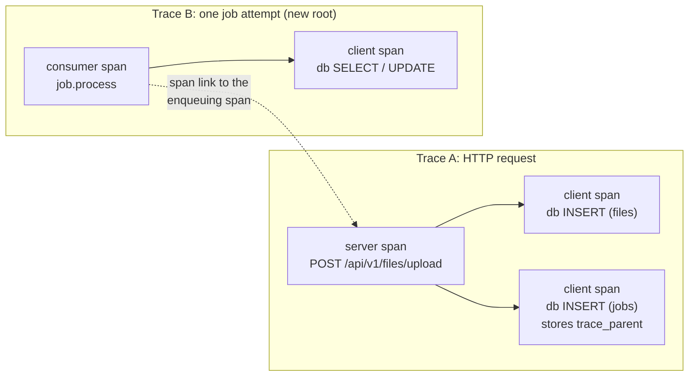
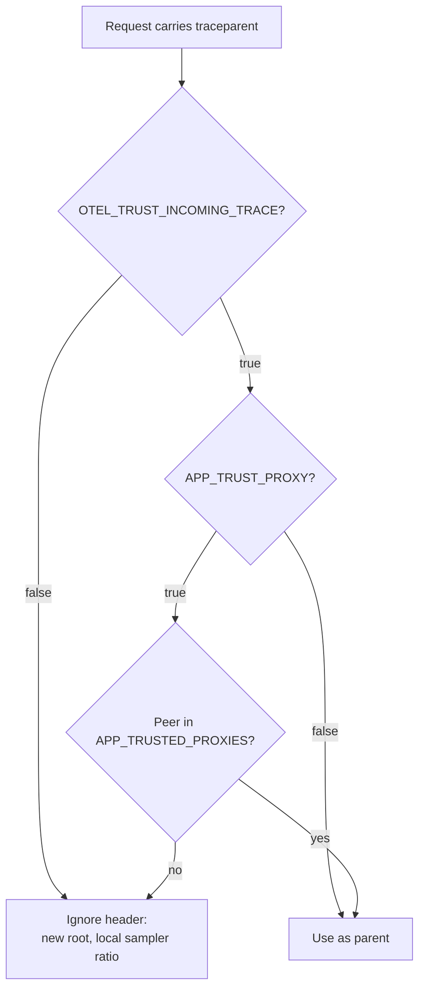

# OpenTelemetry tracing

The API can emit W3C Trace Context spans for HTTP requests, PostgreSQL
queries, and durable jobs. Tracing is **disabled by default**. When disabled,
the process uses a no-op provider: no span is recorded and no collector
connection is opened.

## Quick start

1. Start the local collector profile:

   ```bash
   docker compose --profile otel up --build
   ```

   The collector receives OTLP/gRPC on `127.0.0.1:4317` and OTLP/HTTP on
   `127.0.0.1:4318` and prints batches to its log. It is an optional Compose
   profile: a normal `docker compose up` never starts it and the app has no
   `depends_on` on it.

2. Enable tracing for the app:

   ```bash
   OTEL_ENABLED=true \
   OTEL_EXPORTER_OTLP_ENDPOINT=localhost:4317 \
   go run ./cmd/api
   ```

   `OTEL_TRACES_EXPORTER=none` is also accepted: spans are sampled and
   propagated (so logs still carry `trace_id`/`span_id`) but not exported,
   which is useful when debugging sampling without a collector.

3. Send a request and look for a `trace_id` in the request log:

   ```bash
   curl -fsS http://127.0.0.1:8080/healthz   # excluded, no span
   curl -fsS http://127.0.0.1:8080/api/v1/auth/me
   ```

## Configuration

All settings are optional and read at startup.

| Variable | Default | Meaning |
| --- | --- | --- |
| `OTEL_ENABLED` | `false` | Master switch. Invalid tracing values are ignored while false. |
| `OTEL_TRACES_EXPORTER` | `otlp` | `otlp` exports over OTLP/gRPC; `none` samples without exporting. |
| `OTEL_EXPORTER_OTLP_ENDPOINT` | `localhost:4317` | Collector `host:port` (no scheme). |
| `OTEL_EXPORTER_OTLP_PROTOCOL` | `grpc` | Only `grpc` is supported. |
| `OTEL_EXPORTER_OTLP_INSECURE` | `true` | Disable TLS to the collector. Set `false` for a TLS collector. |
| `OTEL_SERVICE_NAME` | `fiber-golang-boilerplate` | Resource `service.name`. |
| `OTEL_SERVICE_NAMESPACE` | empty | Resource `service.namespace`. |
| `OTEL_SERVICE_VERSION` | `dev` | Resource `service.version`; set the release version in CD. |
| `OTEL_DEPLOYMENT_ENVIRONMENT` | `local` | Resource `deployment.environment.name`. |
| `OTEL_SERVICE_INSTANCE_ID` | hostname | Resource `service.instance.id`. |
| `OTEL_TRACES_SAMPLER` | `parentbased_traceidratio` | `parentbased_traceidratio`, `parentbased_always_on`, `parentbased_always_off`, `traceidratio`, `always_on`, or `always_off`. |
| `OTEL_TRACES_SAMPLER_ARG` | `1.0` | Ratio in `[0,1]` for the ratio samplers. |
| `OTEL_TRACING_EXCLUDE_PATHS` | `/healthz,/readyz,/health,/metrics` | Exact request paths that never create spans. |
| `OTEL_INSTRUMENT_DB` | `true` | Emit sanitized pgx client spans under a recording parent. |
| `OTEL_TRUST_INCOMING_TRACE` | `false` | Honor an inbound W3C `traceparent` (see [incoming traceparent](#http-server-span)). Off by default so a client cannot force sampling. |
| `OTEL_BATCH_TIMEOUT_SECS` | `5` | Maximum delay before a batch is exported. |
| `OTEL_EXPORT_TIMEOUT_SECS` | `30` | Per-export timeout. |
| `OTEL_SHUTDOWN_TIMEOUT_SECS` | `10` | Bounded flush on shutdown. The flush runs after HTTP/jobs drain and is also capped by what remains of the 20s shutdown budget minus a 2s close reserve, but always gets at least 1s (see [Graceful shutdown](operations.md#graceful-shutdown)). |
| `OTEL_BATCH_MAX_QUEUE_SIZE` | `2048` | Spans buffered in memory; new spans are dropped when full. |
| `OTEL_BATCH_MAX_EXPORT_BATCH_SIZE` | `512` | Spans per export request; must not exceed the queue size. |

Validation runs only when `OTEL_ENABLED=true`. A malformed endpoint, sampler,
or batch setting fails startup with an actionable configuration error. An
**unreachable collector never fails startup**: the OTLP/gRPC client connects
lazily and export failures only drop spans.

## What is recorded



Solid arrows are parent/child; the dotted arrow is a span link, not a parent.
The persisted `traceparent` is the span active when the job was enqueued (the
HTTP server span here, or a `job.process` span when one job enqueues another).

### HTTP server span

Created for every request except the excluded probe paths, after `RequestID`
and before `Metrics`/`Logger`/`Recovery`.

| Aspect | Value |
| --- | --- |
| Name | `METHOD /route/template` (unmatched routes: just `METHOD`) |
| Kind | server |
| Attributes | `http.request.method`, `http.route` (route template, never the raw path or query), `http.response.status_code`, `app.request_id`, `enduser.id`, `tenant.id` |
| App errors | `app.error_code` for `apperror.AppError` values (for example `internal_error`, `not_found`) |
| Status | 5xx: `Error` plus a bounded `error.type`; 4xx stays `Unset` |

Incoming `traceparent` handling:



Untrusted headers are ignored because, with a parent-based sampler, a client's
sampled flag would otherwise force 100% sampling and export cost.

### PostgreSQL client span

Each `Query`/`QueryRow`/`Exec` that runs while a **recording** span is active
gets a client span.

| Aspect | Value |
| --- | --- |
| Name | `db SELECT` / `db INSERT` / ... |
| Kind | client |
| Attributes | `db.system.name=postgresql`, `db.operation.name` |
| Failures | `db.response.status_code` (PostgreSQL SQLSTATE) and a bounded `error.type` |
| No recording parent | No span, so background work without a trace creates no orphan spans |
| `pgx.ErrNoRows` | A normal miss, not an error |

### Job consumer span

Every enqueue variant (`Enqueue`, `EnqueueTx`, `EnqueueOnce`, `EnqueueOnceTx`)
persists the active W3C `traceparent` in `jobs.trace_parent`. The worker starts
each attempt as a **new root** `job.process` consumer span linked to the
enqueue span, then installs the tenant context before running the handler.

| Aspect | Value |
| --- | --- |
| Kind | consumer |
| Attributes | `job.id`, `job.kind`, `job.tenant_id`, `job.attempt`, `job.max_attempts` |
| Outcome | `job.outcome` (`succeeded`, `retried`, `dead`, `released` on shutdown), `job.dead_letter`, `job.retry_at` when retried |
| Failures | Status `Error` and a bounded `error.type` |

The handler's `context.Context` carries the span, so sanitized DB spans nest
under `job.process`. Each retry is a fresh root, which keeps every attempt
independently inspectable. A `NULL` or unparsable `trace_parent` yields a root
span without a link.

## Privacy rules

Spans are designed to be safe to export to a third-party backend:

| Never recorded | Instead |
| --- | --- |
| Request/response bodies, headers, query strings | Method, route template, status |
| Emails, tokens, uploaded file names | IDs only (`enduser.id`, `tenant.id`, `job.id`) |
| SQL text, bind parameters | `db.operation.name` |
| Raw error messages (`err.Error()`), `error.description`, span events/exceptions | Bounded `error.type` (Go type name or `http_<status>`) |
| Raw path of unmatched requests | No route attribute |

Trace IDs are safe correlation identifiers and may appear in logs.

## Kubernetes

`deploy/k8s/prereqs/configmap.yaml` contains a disabled tracing block, and the
NetworkPolicy already allows egress to a collector on TCP 4317 (narrow the
CIDR to your collector namespace/service range). Enable it per environment:

```yaml
OTEL_ENABLED: "true"
OTEL_EXPORTER_OTLP_ENDPOINT: "otel-collector.observability.svc.cluster.local:4317"
OTEL_SERVICE_VERSION: "<release-tag>"
OTEL_DEPLOYMENT_ENVIRONMENT: "production"
OTEL_TRACES_SAMPLER_ARG: "0.1"
```

If the collector uses TLS, set `OTEL_EXPORTER_OTLP_INSECURE: "false"` and make
sure the pod trusts the collector CA. No readiness or liveness probe depends on
the collector.

## Schema upgrade note

`jobs.trace_parent` is part of the init migration (`migrations/20260101000000_platform_init_schema.up.sql`) for
fresh installs. The project has no deployed database yet, so no new migration
file was added. If a database applied the former consolidated `000001`
baseline (version 1) before this column existed, add the column
once before deploying this build:

```sql
ALTER TABLE jobs ADD COLUMN IF NOT EXISTS trace_parent TEXT;
```

`cmd/migrate` verifies the column exists and fails with an actionable message
otherwise. Existing rows have `NULL`, which means the worker creates a root
span without a link.

## Operations

| Symptom | What to check |
| --- | --- |
| Collector down | Spans queue up to `OTEL_BATCH_MAX_QUEUE_SIZE`, then drop; the API stays ready. Check the collector endpoint and NetworkPolicy; restarting the API does not recover spans. |
| Missing traces | `OTEL_ENABLED=true`, the endpoint, the sampler ratio, and that the route is not excluded. With `OTEL_TRUST_INCOMING_TRACE=true`, sampling follows the trusted parent; a `traceparent` with the sampled flag off keeps the trace unsampled. Upstream traces not joining is expected while the flag is off. |
| Shutdown | The provider flushes last, after HTTP and the job worker stop. A failed flush logs a warning but never changes the exit code. |
| Correlating logs | Request records include `trace_id` and `span_id` when a recording span exists. Search logs by `request_id`, then pivot to the trace by `trace_id`. |
