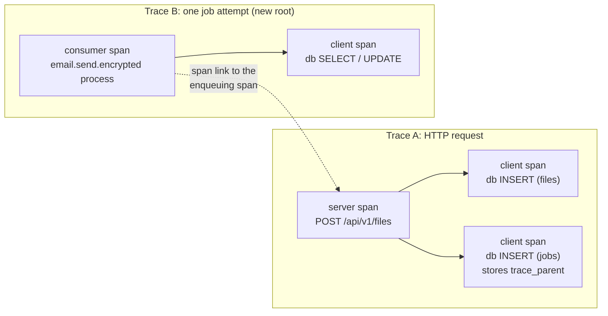
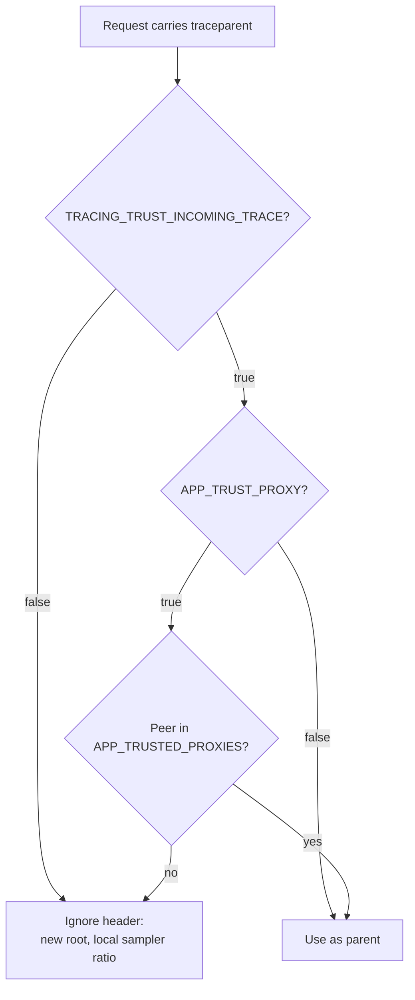

# OpenTelemetry tracing

The API can emit W3C Trace Context spans for HTTP requests, PostgreSQL
queries, and durable jobs. Tracing is **disabled by default**. When disabled,
the process uses a no-op provider: no span is recorded and no collector
connection is opened.

## Quick start

1. Start the local collector profile:

   ```bash
   docker compose --profile otel up --build
   ```

   The collector receives OTLP/gRPC on `127.0.0.1:4317` and OTLP/HTTP on
   `127.0.0.1:4318` and prints batches to its log. It is an optional Compose
   profile: a normal `docker compose up` never starts it and the app has no
   `depends_on` on it.

2. Enable tracing for the app:

   ```bash
   TRACING_ENABLED=true \
   OTEL_EXPORTER_OTLP_ENDPOINT=http://localhost:4318 \
   go run ./cmd/api
   ```

   The default transport is OTLP/HTTP with protobuf, so the endpoint is a URL.
   `OTEL_EXPORTER_OTLP_PROTOCOL=grpc` switches to gRPC and uses a
   `host:port` endpoint (default `localhost:4317`).

   `OTEL_TRACES_EXPORTER=none` is also accepted: spans are sampled and
   propagated (so logs still carry `trace_id`/`span_id`) but not exported,
   which is useful when debugging sampling without a collector.

3. Send a request and look for a `trace_id` in the request log:

   ```bash
   curl -fsS http://127.0.0.1:8080/healthz   # excluded, no span
   curl -fsS http://127.0.0.1:8080/api/v1/auth/me
   ```

## Configuration

The tracer provider is configured from the standard OpenTelemetry SDK
environment, exactly as the specification defines it. The SDK reads endpoint
URLs, protocol, TLS, headers, resource attributes, the sampler, and the batch
span processor settings itself; this application does not copy those names into
its own config struct.

### Application switches (`TRACING_` prefix)

| Variable | Default | Meaning |
| --- | --- | --- |
| `TRACING_ENABLED` | `false` | Master switch. The standard SDK variables are inert while false. |
| `TRACING_EXCLUDE_PATHS` | `/healthz,/readyz,/health,/metrics` | Exact request paths that never create spans. |
| `TRACING_INSTRUMENT_DB` | `true` | Emit sanitized pgx client spans under a recording parent. |
| `TRACING_TRUST_INCOMING_TRACE` | `false` | Honor an inbound W3C `traceparent` (see [incoming traceparent](#http-server-span)). Off by default so a client cannot force sampling. |
| `TRACING_SHUTDOWN_TIMEOUT` | `10s` | Bounded flush on shutdown. The flush runs after HTTP/jobs drain and is also capped by what remains of the 20s shutdown budget minus a 2s close reserve, but always gets at least 1s (see [Graceful shutdown](operations.md#graceful-shutdown)). |

### Standard SDK variables

| Variable | Default | Meaning |
| --- | --- | --- |
| `OTEL_TRACES_EXPORTER` | `otlp` | `otlp` exports spans; `none` samples without exporting. |
| `OTEL_EXPORTER_OTLP_TRACES_PROTOCOL` / `OTEL_EXPORTER_OTLP_PROTOCOL` | `http/protobuf` | `http/protobuf` or `grpc`; the traces-specific value wins. Unsupported values fail startup. |
| `OTEL_EXPORTER_OTLP_TRACES_ENDPOINT` / `OTEL_EXPORTER_OTLP_ENDPOINT` | `http://localhost:4318` (HTTP) or `localhost:4317` (gRPC) | Collector endpoint. |
| `OTEL_EXPORTER_OTLP_INSECURE` | `false` | Disable TLS to the collector. |
| `OTEL_EXPORTER_OTLP_HEADERS`, `_TIMEOUT`, `_CERTIFICATE`, `_CLIENT_CERTIFICATE`, `_CLIENT_KEY` | — | Standard exporter TLS/auth settings, read by the SDK. |
| `OTEL_SERVICE_NAME` | `unknown_service:<binary>` | Resource `service.name`. Set it explicitly in every deployment. |
| `OTEL_RESOURCE_ATTRIBUTES` | — | Extra resource attributes, for example `service.namespace=fiber-boilerplate,deployment.environment.name=production`. |
| `OTEL_TRACES_SAMPLER` | `parentbased_always_on` | `parentbased_traceidratio`, `parentbased_always_on`, `parentbased_always_off`, `traceidratio`, `always_on`, or `always_off`. |
| `OTEL_TRACES_SAMPLER_ARG` | `1.0` | Ratio in `[0,1]` for the ratio samplers. |
| `OTEL_BSP_SCHEDULE_DELAY`, `OTEL_BSP_EXPORT_TIMEOUT`, `OTEL_BSP_MAX_QUEUE_SIZE`, `OTEL_BSP_MAX_EXPORT_BATCH_SIZE` | SDK defaults | Batch span processor bounds. |

`service.version` is not an environment variable: the build embeds the release
tag or commit SHA (`-ldflags "-X main.version=..."`, set by the image build) and
the provider reports it as `service.version`. It overrides a `service.version`
in `OTEL_RESOURCE_ATTRIBUTES`.

Validation runs only when `TRACING_ENABLED=true`. An unsupported exporter,
transport protocol, or malformed endpoint fails startup with an actionable
error. An **unreachable collector never fails startup**: the OTLP client
connects lazily and export failures only drop spans.

## What is recorded



Solid arrows are parent/child; the dotted arrow is a span link, not a parent.
The persisted `traceparent` is the span active when the job was enqueued (the
HTTP server span here, or a `<kind> process` span when one job enqueues another).

### HTTP server span

Created for every request except the excluded probe paths, after `RequestID`
and before `Metrics`/`Logger`/`Recovery`.

| Aspect | Value |
| --- | --- |
| Name | `METHOD /route/template` (unmatched routes: just `METHOD`; unrecognized methods: `_OTHER`) |
| Kind | server |
| Connection attributes | `url.scheme`, `server.address`, `server.port`, `network.protocol.version`, `client.address` |
| Request attributes | `http.request.method` (unknown values become `_OTHER`), `http.route` (route template, never the raw path or query), `http.response.status_code`, `app.request_id`, `enduser.id`, `tenant.id` |
| App errors | `app.error_code` for `apperror.AppError` values (for example `internal_error`, `not_found`) |
| Status | 5xx: `Error` plus a bounded `error.type`; 4xx stays `Unset` |

Incoming `traceparent` handling:



Untrusted headers are ignored because, with a parent-based sampler, a client's
sampled flag would otherwise force 100% sampling and export cost.

### PostgreSQL client span

Each `Query`/`QueryRow`/`Exec` that runs while a **recording** span is active
gets a client span.

| Aspect | Value |
| --- | --- |
| Name | `db SELECT` / `db INSERT` / ... |
| Kind | client |
| Attributes | `db.system.name=postgresql`, `db.operation.name` |
| Failures | `db.response.status_code` (PostgreSQL SQLSTATE) and a bounded `error.type` |
| No recording parent | No span, so background work without a trace creates no orphan spans |
| `pgx.ErrNoRows` | A normal miss, not an error |

### Job consumer span

Every enqueue variant (`Enqueue`, `EnqueueTx`, `EnqueueOnce`, `EnqueueOnceTx`)
persists the active W3C `traceparent` in `jobs.trace_parent`. The worker starts
each attempt as a **new root** consumer span linked to the enqueue span, then
installs the tenant context before running the handler.

| Aspect | Value |
| --- | --- |
| Name | `<kind> process` (for example `email.send.encrypted process`) |
| Kind | consumer |
| Messaging attributes | `messaging.system=job_queue` (custom value for the in-database queue), `messaging.operation.type=process`, `messaging.message.id`, `messaging.destination.name=<kind>` |
| App attributes | `job.id`, `job.kind`, `job.tenant_id`, `job.attempt`, `job.max_attempts` |
| Outcome | `job.outcome` (`succeeded`, `retried`, `dead`, `released` on shutdown), `job.dead_letter`, `job.retry_at` when retried |
| Failures | Status `Error` and a bounded `error.type` |

The handler's `context.Context` carries the span, so sanitized DB spans nest
under the job span. Each retry is a fresh root, which keeps every attempt
independently inspectable. A `NULL` or unparsable `trace_parent` yields a root
span without a link.

## Privacy rules

Spans are designed to be safe to export to a third-party backend:

| Never recorded | Instead |
| --- | --- |
| Request/response bodies, headers, query strings | Method, route template, status, scheme, peer address |
| Emails, tokens, uploaded file names | IDs only (`enduser.id`, `tenant.id`, `job.id`) |
| SQL text, bind parameters | `db.operation.name` |
| Raw error messages (`err.Error()`), `error.description`, span events/exceptions | Bounded `error.type` (Go type name or `http_<status>`) |
| Raw path of unmatched requests | No route attribute |

Trace IDs are safe correlation identifiers and may appear in logs.

## Metrics

Metrics use the same OpenTelemetry SDK and resource. `/metrics` is always a
Prometheus exposition rendered by the OTel Prometheus exporter; adding
`METRICS_OTLP_ENABLED=true` (or `OTEL_METRICS_EXPORTER=otlp`) also pushes the
same instruments over OTLP. The transport follows
`OTEL_EXPORTER_OTLP_METRICS_PROTOCOL` / `OTEL_EXPORTER_OTLP_PROTOCOL`
(default `http/protobuf`), and `OTEL_METRIC_EXPORT_INTERVAL` /
`OTEL_METRIC_EXPORT_TIMEOUT` control the push cadence. The metric catalogue is
in [Operations](operations.md#2-metrics).

## Kubernetes

`deploy/k8s/prereqs/configmap.yaml` contains a disabled tracing block, and the
NetworkPolicy already allows egress to a collector on TCP 4317/4318 (narrow the
CIDR to your collector namespace/service range). Enable it per environment:

```yaml
TRACING_ENABLED: "true"
OTEL_EXPORTER_OTLP_PROTOCOL: "http/protobuf"
OTEL_EXPORTER_OTLP_ENDPOINT: "http://otel-collector.observability.svc.cluster.local:4318"
OTEL_SERVICE_NAME: "fiber-boilerplate"
OTEL_RESOURCE_ATTRIBUTES: "service.namespace=fiber-boilerplate,deployment.environment.name=production"
OTEL_TRACES_SAMPLER: "parentbased_traceidratio"
OTEL_TRACES_SAMPLER_ARG: "0.1"
```

The release workflow injects the build version, so do not set
`OTEL_SERVICE_VERSION` or `OTEL_DEPLOYMENT_ENVIRONMENT`; they are not read.
If the collector uses TLS, keep `OTEL_EXPORTER_OTLP_INSECURE` unset/false and
make sure the pod trusts the collector CA. No readiness or liveness probe
depends on the collector.

## Schema upgrade note

`jobs.trace_parent` is part of the init migration (`migrations/20260101000000_platform_init_schema.up.sql`) for
fresh installs. The project has no deployed database yet, so no new migration
file was added. If a database applied the former consolidated `000001`
baseline (version 1) before this column existed, add the column
once before deploying this build:

```sql
ALTER TABLE jobs ADD COLUMN IF NOT EXISTS trace_parent TEXT;
```

`cmd/migrate` verifies the column exists and fails with an actionable message
otherwise. Existing rows have `NULL`, which means the worker creates a root
span without a link.

## Operations

| Symptom | What to check |
| --- | --- |
| Collector down | Spans queue up to `OTEL_BSP_MAX_QUEUE_SIZE`, then drop; the API stays ready. Check the collector endpoint and NetworkPolicy; restarting the API does not recover spans. |
| Missing traces | `TRACING_ENABLED=true`, the endpoint/protocol, the sampler ratio, and that the route is not excluded. With `TRACING_TRUST_INCOMING_TRACE=true`, sampling follows the trusted parent; a `traceparent` with the sampled flag off keeps the trace unsampled. Upstream traces not joining is expected while the flag is off. |
| Shutdown | The provider flushes last, after HTTP and the job worker stop. A failed flush logs a warning but never changes the exit code. |
| Correlating logs | Request records include `trace_id` and `span_id` when a recording span exists. Search logs by `app.request_id`, then pivot to the trace by `trace_id`. |
