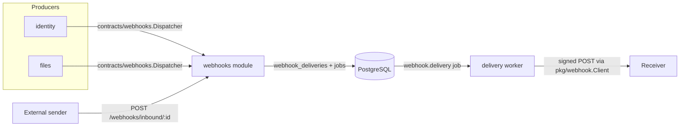
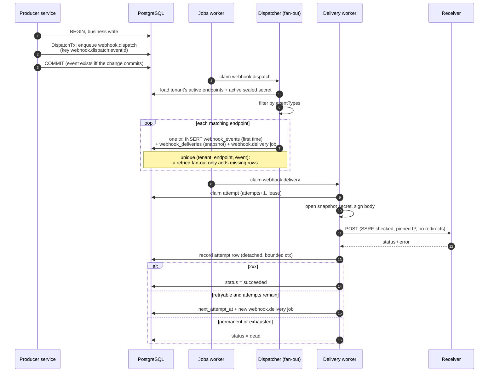
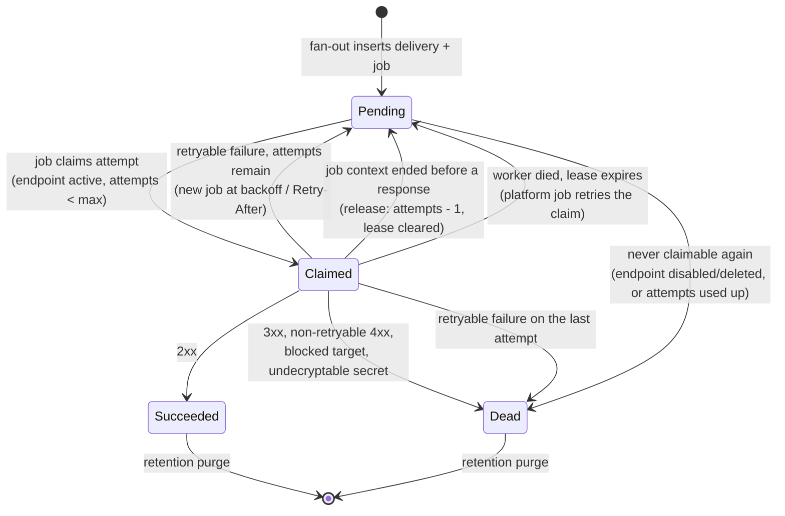
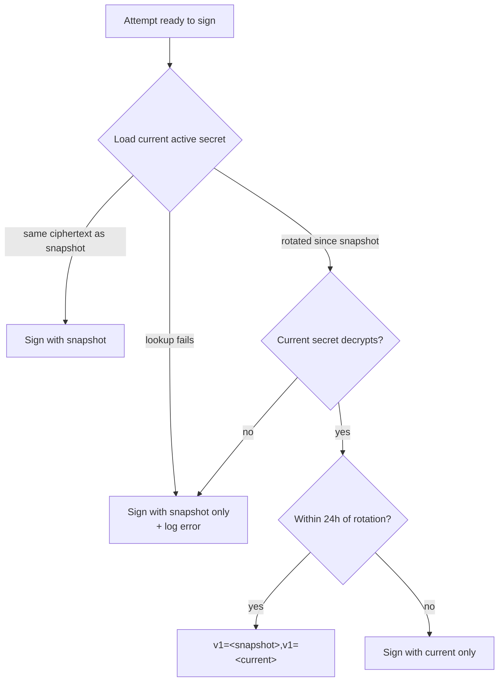
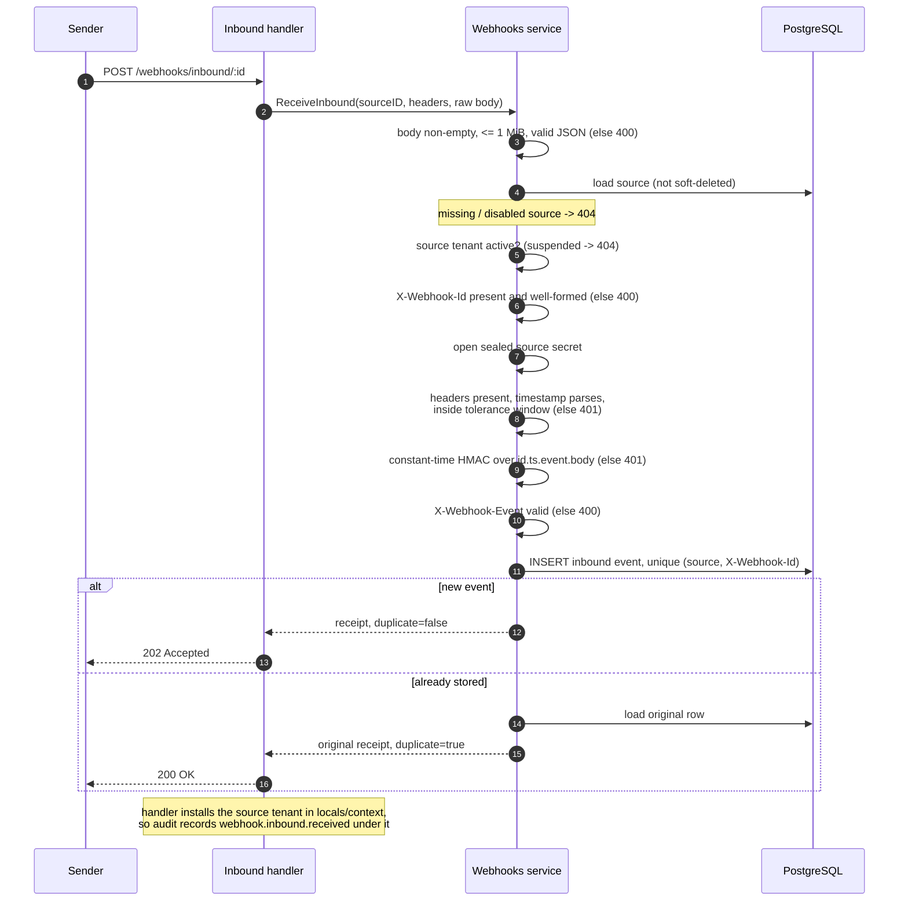

# Webhooks

Tenant-scoped outbound webhooks with durable delivery, plus a public
HMAC-authenticated inbound receiver.

| Concern | Lives in |
|---|---|
| Endpoints, deliveries, inbound sources, worker | `internal/modules/webhooks` |
| Stdlib-only event/dispatcher contract | `internal/contracts/webhooks` |
| Signing, verification, SSRF-safe HTTP client | `pkg/webhook` |



## Outbound

### Event contract

Business modules emit `webhooks.Event` through `webhooks.Dispatcher` without
importing the webhooks module:

```go
type Event struct {
    ID         string
    Type       string
    TenantID   int64
    OccurredAt time.Time
    Data       json.RawMessage
}

type Dispatcher interface {
    Dispatch(ctx context.Context, events ...Event) (int, error)
}
```

| Field | Rule |
|---|---|
| `Type` | Concrete lowercase dotted name (`file.uploaded`, `user.registered`). Patterns (`file.*`, `*`) are endpoint filters, not event types. |
| `ID` | Supply a stable ID when the producer may retry. Empty gets an `evt_...` ID, but a retry with a new ID is a new logical event and cannot be deduplicated. |
| `TenantID` | Zero resolves from the context (`tenant.EffectiveID`). |
| `Data` | Defaults to `{}`; must be valid JSON. |

Application bootstrap attaches the webhooks dispatcher to identity and files
and installs it in `app.Deps.Webhooks`. A nil dispatcher is a no-op, so tests
and minimal deployments do not need the module. Modules can also inject the
contract directly.

| Event | Producer |
|---|---|
| `user.registered` | Identity registration. |
| `file.uploaded` | File upload. |
| `file.deleted` | User soft delete and admin takedown (`DELETE /admin/files/:id`). |
| `file.restored` | User restore and admin restore. |

`file.deleted`/`file.restored` carry `{id, tenantId, userId, originalName}`.

### Transactional dispatch (outbox)

Plain `Dispatch` runs after the producer's commit, so a crash between the two
could lose (or, on a retry, duplicate) the event. Producers that own a
transaction call the dispatcher's `DispatchTx(ctx, tx pgx.Tx, events...)`
instead. It is not on the stdlib-only contract (it takes a `pgx.Tx`):
producers declare a narrow `WebhookTxDispatcher` interface and type-assert the
injected dispatcher, mirroring `jobs.EnqueueTx`/`events.PublishTx`. Files
keeps that interface in its `repository/` package and asserts it once in
`build.go`; its services only see the `service.Outbox` port.

`DispatchTx` fixes the event ID and enqueues one `webhook.dispatch` job per
event in the caller's transaction, deduplicated by the idempotency key
`webhook.dispatch:<eventId>`. The event and the business change commit or roll
back together; an enqueue failure fails the producer's mutation (fail-closed,
like the email outbox). Endpoints are matched when the job runs, not at commit
time.

| Producer path | Dispatch mode |
|---|---|
| Identity registration (with `TxManager`) | `DispatchTx` |
| User file upload/delete/restore (with the files tx manager, as wired by default) | `DispatchTx` |
| Admin file delete/restore | `DispatchTx` inside the audit transaction |
| Any of the above without a transaction manager | Best-effort post-commit `Dispatch` |

### Dispatch and delivery flow



Step by step, the fan-out:

1. Resolves/validates the tenant, event ID, type, timestamp, and JSON body.
2. Loads the tenant's active endpoints with their active sealed secret and
   filters by `eventTypes`.
3. Inserts the `webhook_events` row (first endpoint only), a
   `webhook_deliveries` row, and a `webhook.delivery` job in **one
   transaction**. The event row holds the payload, type, and event timestamp
   once; the delivery snapshots the endpoint URL, secret ciphertext, max
   attempts, and timeout.
4. Returns the number of newly created deliveries; re-dispatching the same
   event is a no-op.

The worker sends **one attempt per job**. Retries are new jobs scheduled at the
delivery's next attempt time; the platform job's own backoff is not used for
webhook-level retries. The `webhook.delivery` job has its own budget of 20
platform attempts for infrastructure failures.

### Delivery state machine

The database status is `pending`, `succeeded`, or `dead`. A claimed attempt is
still `pending`, with `next_attempt_at` pushed forward as a lease (3 minutes by
default).



| Rule | Behavior |
|---|---|
| Claim | Only while the endpoint is `active` and not deleted, the delivery is `pending`, attempts remain, and `next_attempt_at` has passed. |
| Unclaimable pending | The next job marks it `dead` with `last_error` `endpoint is disabled or deleted` or `delivery attempts exhausted`. A live claim lease is never touched; a busy claim makes the job retry after the lease. |
| Attempt recording | Once the request is sent, the attempt row and outcome are written with a detached, bounded (5s) context, so worker shutdown cannot lose a sent attempt. |
| Fencing | Outcome writes (succeeded, dead, reschedule) match `attempts = <claimed attempt>`. A stale worker whose lease expired matches no row; its result is logged (`claim lease lost`) and dropped. |
| Interrupted attempt | If the job context ends (worker shutdown **or** platform job timeout) before a response arrives, the delivery attempt is given back (`attempts - 1`, lease cleared) instead of recorded as a failure, so a drain on the last attempt cannot dead-letter a delivery that may never have been sent. The request may still have reached the receiver, which is within the at-least-once contract. |
| Platform job after interruption | On worker **shutdown** the jobs worker releases the job without consuming a platform attempt. A platform **job timeout** is a real failure: it consumes a platform job attempt and retries with job backoff (the delivery attempt itself was still given back). |
| Per-endpoint timeout | A normal retryable failure that consumes the delivery attempt. |
| Residual fencing gap (ABA) | The fence is the attempt number, and a release decrements it. If worker A stalls for more than ~55s beyond its request inside the 3-minute claim lease (120s max request + bookkeeping), worker B reclaims attempt N+1, and B is then released back to N, A's late write matches again. The worst case is one redundant `webhook.delivery` job, which receivers already absorb by deduplicating on `X-Webhook-Delivery`. |
| Lease sizing | Keep the delivery claim lease (`WorkerOptions.Lease`, default 3m) and the jobs worker lease well above the maximum request timeout (`WEBHOOK_REQUEST_TIMEOUT_SECS`, max 120s) plus bookkeeping (5s), so a live attempt is never reclaimed. |

### Signed request

| Header | Value |
|---|---|
| `X-Webhook-Id` | Event ID (stable across delivery retries). |
| `X-Webhook-Delivery` | Delivery ID. **Deduplicate on this value**; delivery is at-least-once. |
| `X-Webhook-Event` | Event type. |
| `X-Webhook-Timestamp` | Unix seconds used in the signature. |
| `X-Webhook-Signature` | `v1=<lowercase hex HMAC-SHA256>`; two comma-separated values during a rotation grace period. |
| `X-Webhook-Attempt` | 1-based attempt number. |
| `User-Agent` | `fiber-golang-boilerplate-webhooks/1.0`. |

Body:

```json
{
  "id": "evt_...",
  "type": "file.uploaded",
  "createdAt": "2026-10-24T12:00:00Z",
  "data": {"fileId": 42}
}
```

The signature input is these exact bytes:

```text
<X-Webhook-Id>.<X-Webhook-Timestamp>.<X-Webhook-Event>.<raw-request-body>
```

> **Breaking change for receivers.** Earlier builds signed only
> `<timestamp>.<raw-body>`. The prefix stays `v1=` (still HMAC-SHA256), but a
> receiver verifying the old input rejects every request. Update receivers
> before deploying this build, or accept both inputs during the rollout.
> Binding the event ID and type closes a replay gap: a captured request can no
> longer be resent within the timestamp window under a fresh `X-Webhook-Id`
> (bypassing ID deduplication) or a different `X-Webhook-Event`.

Receiver checklist:

- Use the raw header values exactly as received (an absent `X-Webhook-Event`
  signs as the empty string).
- Verify with `webhook.Sign`/`webhook.VerifyRequest`, compare in constant time,
  and use a small timestamp tolerance (default 5 minutes).
- Accept the request when **any** comma-separated `v1=` value matches; the
  sender co-signs during endpoint secret rotation.
- `X-Webhook-Timestamp` must be positive Unix **seconds** (milliseconds are
  rejected) and within the tolerance in both directions.

### Signing during secret rotation



Only the snapshot and the current secret co-sign: after two rotations inside
the window, a receiver still on the intermediate secret rejects the request.

### Retry classification

| Response | Outcome |
|---|---|
| `2xx` | Succeeded. |
| `3xx` | Dead. Redirects are never followed. |
| `4xx` except `408`/`425`/`429` | Dead. |
| `408` / `425` / `429` | Retry while attempts remain. |
| `5xx` | Retry while attempts remain. |
| Transport/DNS/timeout | Retry while attempts remain. |
| Blocked/invalid target | Dead immediately. |
| Undecodable `webhook.delivery`/`webhook.dispatch` job payload (or missing delivery id / event id / tenant) | The job is dead-lettered at once via `jobs.Permanent` (`last_error` starts with `permanent failure (not retried): `). |

- Backoff is `base * 2^(attempt-1)` capped at `WEBHOOK_RETRY_MAX_SECS`.
- A valid `Retry-After` (seconds or HTTP date) can only **lengthen** the
  backoff, never shorten it (`Retry-After: 0` or a past date cannot force an
  immediate retry), and is capped at the same maximum.
- Every attempt is recorded in `webhook_delivery_attempts` with status code,
  duration, and a truncated error (never the response body).
- Replay (`POST /webhooks/deliveries/:id/replay`) creates a **new** delivery
  from the retained payload with the endpoint's current URL and active secret.
  The original row is untouched.

### Endpoint model

| Field | Meaning |
|---|---|
| `url` | Absolute `http(s)` URL, snapshotted per delivery. |
| `eventTypes` | Patterns: exact (`file.uploaded`), prefix (`file.*`), or `*`. Empty means `*`. Stored as a set and returned sorted. |
| `status` | `active` or `disabled`. Disabled endpoints are not matched, and their pending deliveries are not retried. |
| `maxAttempts` | 1-50 delivery attempts (default `WEBHOOK_MAX_ATTEMPTS`). |
| `timeoutMs` | Per-attempt HTTP timeout, 100-120000 ms, snapshotted per delivery; can only shorten `WEBHOOK_REQUEST_TIMEOUT_SECS`. |
| `description` | Free-form label. |

Delete is soft: the row keeps its delivery history but is excluded from
matching and returns `404` for reads.

### SSRF safety

`pkg/webhook.Client`:

| Control | Behavior |
|---|---|
| URL shape | Absolute `http(s)` only, no userinfo. |
| Address checks | Resolves the hostname itself; rejects private, loopback, link-local, multicast, unspecified, CGNAT, and reserved/documentation ranges. |
| IPv6 transition | NAT64 `64:ff9b::/96`, 6to4 `2002::/16`, IPv4-compatible `::/96`, and IPv4-translated `::ffff:0:0:0/96` are re-checked against the embedded IPv4; local-use NAT64 `64:ff9b:1::/48`, Teredo `2001::/32`, and site-local `fec0::/10` are blocked outright. |
| DNS rebinding | Dials the vetted IP while keeping the hostname for `Host`/TLS SNI. |
| Proxy | `Proxy: nil`, so `HTTP_PROXY` cannot bypass validation. |
| Redirects | Never followed; a 3xx is a dead delivery. |
| Limits | Connect, response-header, and overall timeouts; bounded response-body read. |

`WEBHOOK_SSRF_ALLOWLIST` permits specific trusted private receivers
(comma-separated IPs, CIDRs, or exact hostnames). Leave it empty unless a
receiver is intentionally internal. Never use `0.0.0.0/0` or `::/0`.

## Inbound

`POST /api/v1/webhooks/inbound/{sourceID}` is public: no JWT and no
`X-Tenant-Slug`. The source ID selects the owning tenant; the source secret
authenticates the request.

| Header | Rule |
|---|---|
| `X-Webhook-Id` | Required external event ID, 1-255 printable characters; used for deduplication. |
| `X-Webhook-Timestamp` | Required Unix seconds. |
| `X-Webhook-Signature` | Required `v1=<hex>`. |
| `X-Webhook-Event` | Optional event type (default `inbound`). |

The signature covers `<X-Webhook-Id>.<timestamp>.<X-Webhook-Event>.<raw-body>`
(the same breaking change as outbound) and must be within
`WEBHOOK_TIMESTAMP_TOLERANCE_SECS`. Because the ID is signed, a captured
request cannot be replayed under a new ID to bypass deduplication.

Checks run in this order (the first failure wins):



| Outcome | Response |
|---|---|
| New event | `202 Accepted` with `{id, tenantId, sourceId, eventId, eventType, receivedAt, duplicate: false}`. |
| Repeated `(source, X-Webhook-Id)` | `200 OK`, `duplicate: true`, and the original row. The body is stored once. |
| Unknown, disabled, soft-deleted source, or suspended tenant | `404`. |
| Missing/invalid signature or stale timestamp | `401`. |
| Malformed body, ID, or event type | `400`. |

The stored row keeps the signature and payload but does not echo them back.

## Secrets and configuration

| Secret | Format | Storage |
|---|---|---|
| Endpoint signing secret | 32 random bytes, `whsec_...` | `webhook_endpoint_secrets` (versioned, one active) |
| Inbound source secret | `whin_...` | `webhook_inbound_sources` |

Both are sealed with AES-256-GCM using HKDF-SHA256 domain separation from
`WEBHOOK_SECRET_ENCRYPTION_KEY`. Outside production an empty dedicated key
falls back to `JWT_SECRET`; **production requires the dedicated key** (at
least 32 characters). Only ciphertext is stored; plaintext is returned exactly
once on create or rotate. The stored envelope (v2) records the sealing key's
`kid`; v1 envelopes without one are tried against every configured key.

| Rotation | Behavior |
|---|---|
| Endpoint | Locks the endpoint row, deactivates the old secret, inserts the next version (concurrent rotations serialize). Queued deliveries keep their ciphertext snapshot and are co-signed for 24 hours (see [Signing during secret rotation](#signing-during-secret-rotation)). If the current secret cannot be loaded or decrypted, the attempt is signed with the snapshot only and the failure is logged. Replays use the current active secret. |
| Inbound source | Replaces the verification secret immediately; old signatures fail on the next request. |
| `WEBHOOK_SECRET_ENCRYPTION_KEY` | Two-phase: add the new key to `WEBHOOK_SECRET_ENCRYPTION_PREVIOUS_KEYS` everywhere, then promote it and keep the old key listed. Rows keep the key that sealed them until their secret is rotated, so drop the old key only after every endpoint/source secret is rotated and no pending delivery snapshot uses it ([Key rotation](operations.md#key-rotation)). |

| Variable | Default | Purpose |
|---|---|---|
| `WEBHOOK_SECRET_ENCRYPTION_KEY` | empty (JWT fallback) | AES-256-GCM secret-encryption key; required in production. |
| `WEBHOOK_SECRET_ENCRYPTION_PREVIOUS_KEYS` | empty | Comma-separated decrypt-only keys kept during a rotation; must not contain the active key. |
| `WEBHOOK_CONNECT_TIMEOUT_SECS` | `5` | Bounds both the TCP dial and the TLS handshake. |
| `WEBHOOK_REQUEST_TIMEOUT_SECS` | `10` | Per-attempt timeout, max 120. |
| `WEBHOOK_RETRY_BASE_SECS` | `5` | First retry backoff. |
| `WEBHOOK_RETRY_MAX_SECS` | `3600` | Backoff/Retry-After cap, max 7 days. |
| `WEBHOOK_MAX_ATTEMPTS` | `8` | Default delivery attempt budget (1-50). |
| `WEBHOOK_RETENTION_DAYS` | `30` | Terminal delivery/inbound-event retention. |
| `WEBHOOK_TIMESTAMP_TOLERANCE_SECS` | `300` | Inbound signature clock skew. |
| `WEBHOOK_SSRF_ALLOWLIST` | empty | Trusted private IPs/CIDRs/hosts. |

## Permissions and audit

`webhooks:read` and `webhooks:write` are granted to the built-in `admin` role.
Administration routes accept a JWT or an API key scoped to these permissions
(`app.Deps.Authenticate()`) and use `authzhttp.Require`; regular users receive
`403`. The public receiver is the only unauthenticated route.

| Route kind | Audit |
|---|---|
| Endpoint/source create, update, delete, rotate-secret; delivery replay | Tier 2: a required `audithttp.Guard` writes a `started` intent row before the handler and completes it with the outcome. An unavailable audit store returns `503 system.audit_unavailable` and the mutation does not run. The service then records the domain event as a child (`parent_id`) of the intent; a domain-event write failure is logged and does not fail the mutation. |
| Public receiver | `webhook.inbound.received`, best-effort, under the source tenant. |

Domain events: `webhook.endpoint.created|updated|deleted|secret_rotated`,
`webhook.delivery.replayed`,
`webhook.inbound_source.created|updated|deleted|secret_rotated`. Metadata holds
IDs, URL/filter/status, event type, and the duplicate flag; never secrets or
payloads.

## HTTP API

| Method | Path | Permission |
|---|---|---|
| GET | `/api/v1/webhooks/endpoints` | `webhooks:read` |
| POST | `/api/v1/webhooks/endpoints` | `webhooks:write` |
| GET | `/api/v1/webhooks/endpoints/:id` | `webhooks:read` |
| PUT | `/api/v1/webhooks/endpoints/:id` | `webhooks:write` |
| DELETE | `/api/v1/webhooks/endpoints/:id` | `webhooks:write` |
| POST | `/api/v1/webhooks/endpoints/:id/rotate-secret` | `webhooks:write` |
| GET | `/api/v1/webhooks/deliveries` | `webhooks:read` |
| GET | `/api/v1/webhooks/deliveries/:id` | `webhooks:read` |
| GET | `/api/v1/webhooks/deliveries/:id/attempts` | `webhooks:read` |
| POST | `/api/v1/webhooks/deliveries/:id/replay` | `webhooks:write` |
| GET | `/api/v1/webhooks/inbound-sources` | `webhooks:read` |
| POST | `/api/v1/webhooks/inbound-sources` | `webhooks:write` |
| GET | `/api/v1/webhooks/inbound-sources/:id` | `webhooks:read` |
| PUT | `/api/v1/webhooks/inbound-sources/:id` | `webhooks:write` |
| DELETE | `/api/v1/webhooks/inbound-sources/:id` | `webhooks:write` |
| POST | `/api/v1/webhooks/inbound-sources/:id/rotate-secret` | `webhooks:write` |
| GET | `/api/v1/webhooks/inbound-sources/:id/events` | `webhooks:read` |
| POST | `/api/v1/webhooks/inbound/{id}` | Public, HMAC |

Idempotency:

| Routes | `Idempotency-Key` |
|---|---|
| Endpoint/source create, both `rotate-secret` routes | Deliberately not cached, so a plaintext secret never sits in the shared response cache. A retried rotation rotates again and returns the newest (only active) secret. |
| Update, delete, replay | Accepted. |
| Public receiver | Not used; relies on `(source, X-Webhook-Id)` deduplication. |

## Tables and retention

| Table | Role |
|---|---|
| `webhook_endpoints` + `webhook_endpoint_secrets` | Endpoints and versioned secrets (one active). |
| `webhook_endpoint_subscriptions` | One row per `eventTypes` pattern of an endpoint. |
| `webhook_events` | Each dispatched event once: id, type, occurrence time, payload (the signed envelope). |
| `webhook_deliveries` | Outbox + endpoint snapshot (URL, secret ciphertext, timeout, max attempts) + state. |
| `webhook_delivery_attempts` | One row per attempt. |
| `webhook_inbound_sources` | Inbound receivers and sealed secrets. |
| `webhook_inbound_events` | Received events, unique per source and external event ID. |

- All tables carry `tenant_id` with tenant-leading indexes; there are no
  cross-module foreign keys.
- Module-internal FKs are tenant-composite (`(tenant_id, endpoint_id)`,
  `(tenant_id, event_id)`, `(tenant_id, delivery_id)`, `(tenant_id,
  source_id)`). Subscriptions and secrets cascade with their endpoint and
  attempts with their delivery; deliveries and inbound events are history and
  `RESTRICT` deletion of their endpoint/event/source.
- A retention loop runs hourly (first pass at startup) and deletes
  `succeeded`/`dead` deliveries older than `WEBHOOK_RETENTION_DAYS`, then
  outbound events older than the window that no delivery references any more,
  then inbound events older than the window. Pending deliveries (and their
  events) are never purged.
- Each purge deletes in batches of at most 1,000 rows (`FOR UPDATE SKIP
  LOCKED`) until a batch is short, bounded by a 30s pass.
- Retention is cross-tenant, so its supporting indexes
  (`idx_webhook_deliveries_terminal_updated_at`,
  `idx_webhook_inbound_events_received_at`) are deliberately not
  tenant-leading. `idx_webhook_deliveries_replayed_from_id` keeps the
  `ON DELETE SET NULL` on replays from scanning the table per deleted row.

## Inspecting and operating

```sql
-- Backlog by tenant/status
SELECT tenant_id, status, count(*), min(next_attempt_at), max(updated_at)
FROM webhook_deliveries
GROUP BY tenant_id, status
ORDER BY count(*) DESC;

-- Dead deliveries and last failures
SELECT id, tenant_id, endpoint_id, event_type, attempts, max_attempts,
       last_status_code, last_error, updated_at
FROM webhook_deliveries
WHERE status = 'dead'
ORDER BY updated_at DESC
LIMIT 50;

-- Recent attempts for one delivery
SELECT attempt, status_code, duration_ms, error, created_at
FROM webhook_delivery_attempts
WHERE delivery_id = $1
ORDER BY attempt;

-- Outstanding fan-out and delivery jobs
SELECT id, tenant_id, kind, status, attempts, run_at, last_error
FROM jobs
WHERE kind IN ('webhook.dispatch', 'webhook.delivery') AND status IN ('queued', 'running')
ORDER BY run_at
LIMIT 50;
```

A stuck pending delivery with a future `next_attempt_at` usually means a worker
died after claiming it. The platform job lease retries the same job after
expiry; if no job remains, replay the delivery. Do not set terminal rows back
to pending in bulk: payloads and secrets are retained, but ordering, attempt
budgets, and receiver dedupe expectations still apply.
