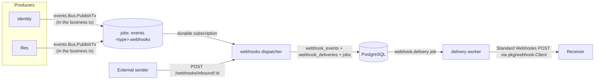
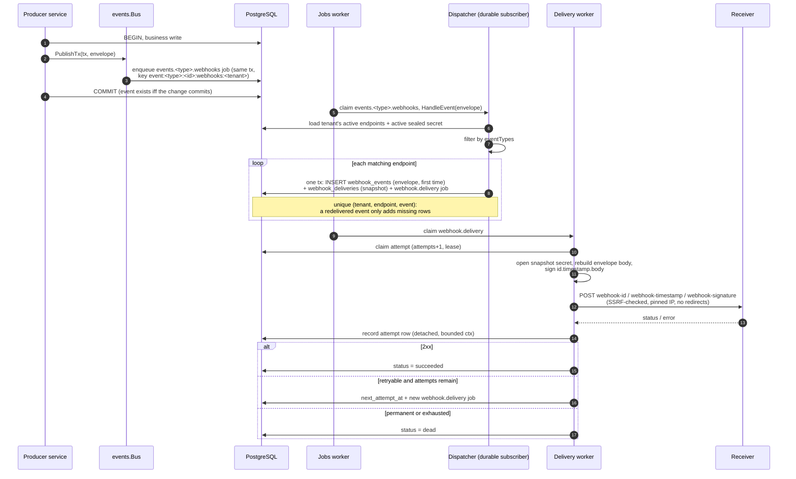
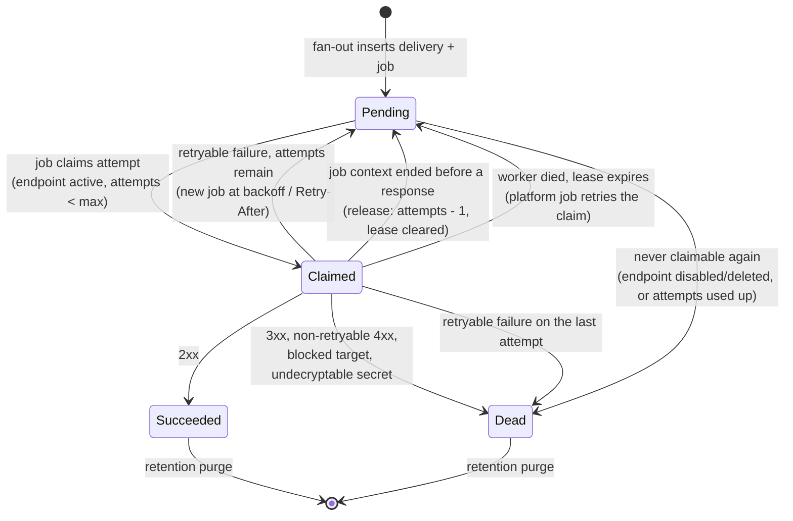
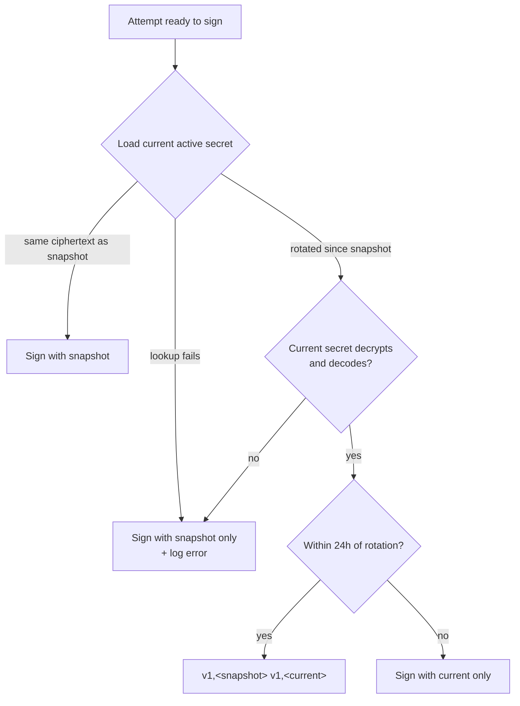
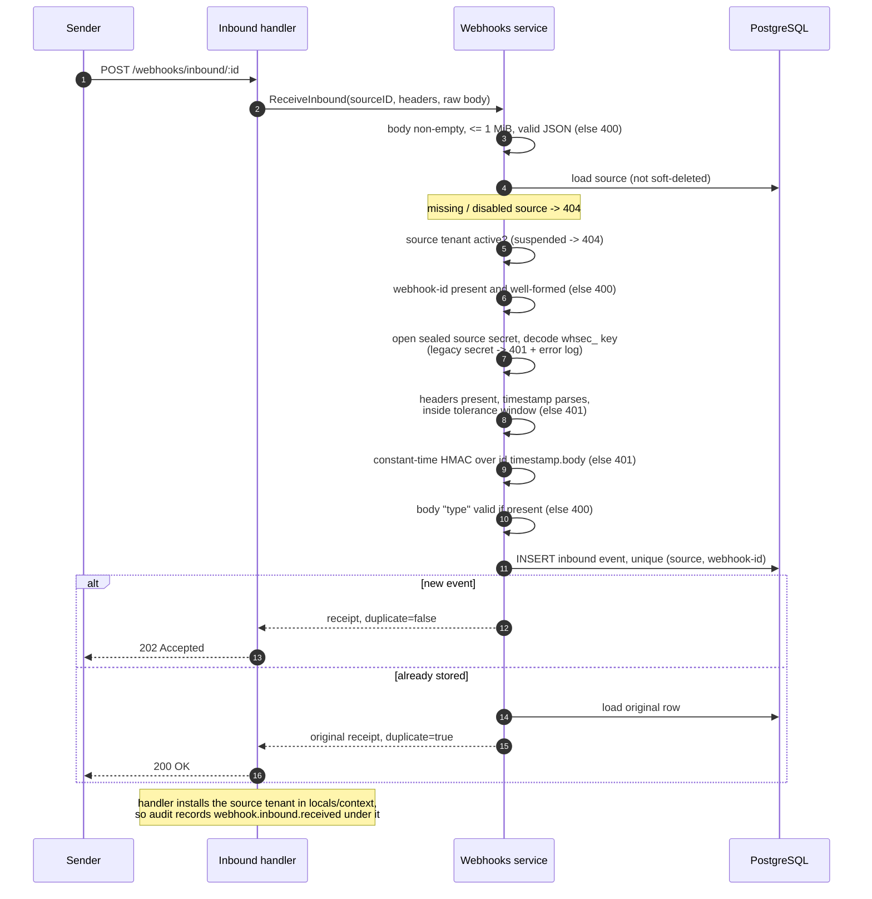

# Webhooks

Tenant-scoped outbound webhooks with durable delivery, plus a public inbound
receiver. Both follow the [Standard Webhooks](https://github.com/standard-webhooks/standard-webhooks/blob/main/spec/standard-webhooks.md)
specification, and outbound payloads are the versioned domain event
envelope.

| Concern | Lives in |
|---|---|
| Event envelope, bus, durable subscriptions | `internal/platform/events` |
| Event payload structs and versions | `internal/contracts/<producer>` (`identity`, `files`) |
| Endpoints, deliveries, inbound sources, worker | `internal/modules/webhooks` |
| Subscribed event types | `internal/modules/webhooks/catalog` (`SubscribedEvents`) |
| Signing, verification, secrets, SSRF-safe HTTP client | `pkg/webhook` |



Producers never import or call the webhooks module: they publish domain
events, and webhooks is one durable subscriber (notifications or a future
broker relay can subscribe to the same events).

## Outbound

### Event envelope

Every event, and therefore every outbound webhook body, is one envelope
(`events.Event`):

```json
{
  "id": "01920f6e-5b7c-7a3e-9c1d-2f4b8e6a1c3d",
  "type": "file.uploaded",
  "dataVersion": 1,
  "occurredAt": "2026-10-25T08:00:00.123456Z",
  "tenantId": 1,
  "actor": {"type": "user", "id": "42"},
  "data": {"fileId": 7, "ownerId": 42, "originalName": "report.pdf",
           "mimeType": "application/pdf", "size": 1024,
           "createdAt": "2026-10-25T08:00:00.12Z"}
}
```

| Field | Rule | CloudEvents 1.0 |
|---|---|---|
| `id` | UUIDv7 (`uuid.NewV7`), assigned by the bus; also the `webhook-id` header and the receiver's deduplication key. | `id` |
| `type` | Concrete lowercase dotted name (`[a-z0-9._-]`). Patterns (`file.*`, `*`) are endpoint filters, not types. | `type` |
| `dataVersion` | Integer >= 1, the version of `data`'s schema for this type. | extension `dataversion` |
| `occurredAt` | UTC time the event happened. | `time` |
| `tenantId` | Owning tenant. | `source` = `/tenants/<tenantId>` + extension `tenantid` |
| `actor` | `{type, id}`: `user` (id = user id), `service` (id names it), or `system` (no id). Defaults to the request user, else `system`. | extensions `actortype`, `actorid` |
| `data` | The type's payload struct, JSON. | `data` (`datacontenttype: application/json`) |

`specversion` is always `1.0`, so a relay can emit CloudEvents without touching
producers. The bus also carries an internal `requestId` for log/trace
correlation; it is never stored in `webhook_events` or sent to receivers.

**Evolution rule.** Adding an optional field to `data` keeps `dataVersion`.
Removing, renaming, or retyping a field, or changing its meaning, is breaking:
publish a new `dataVersion` (or a new type) and keep the old one until
receivers have moved. Payload structs live in `internal/contracts/<producer>`
and are deliberately not REST DTOs, so an API response change can never
silently change a webhook contract.

### Event catalog

| Type | `dataVersion` | Producer | `data` (struct) |
|---|---|---|---|
| `user.registered` | 1 | Identity registration (actor: the new user) | `{userId, email, name, emailVerified, createdAt}` (`identity.UserRegistered`) |
| `file.uploaded` | 1 | File upload | `{fileId, ownerId, originalName, mimeType, size, createdAt}` (`files.FileUploaded`) |
| `file.deleted` | 1 | User soft delete and admin takedown (`DELETE /admin/files/:id`) | `{fileId, ownerId, originalName, deletedAt}` (`files.FileDeleted`) |
| `file.restored` | 1 | User restore and admin restore | `{fileId, ownerId, originalName}` (`files.FileRestored`) |

To make a new type deliverable, add its payload struct and version constant to
the producer's contracts package, publish it with `PublishTx`, and add the type
to `webhooks/catalog.SubscribedEvents`.

### Publishing in the producer transaction

Producers call `events.Bus.PublishTx(ctx, tx, event)` inside the transaction
that makes the change. For every durable subscriber the bus enqueues one job
(`events.<type>.<handler>`, idempotency key
`event:<type>:<id>:<handler>:<tenantId>`) through the same `pgx.Tx`, so the
event exists if and only if the change commits; a publish failure rolls the
change back (fail-closed). Files publishes through the tx-bound
`service.EventPublisher` port (`repository.Transactor`), so its services never
see `pgx.Tx`; identity registration publishes in its registration
transaction. A nil bus (unit tests) publishes nothing.

The webhooks module implements `app.EventProvider`: `RegisterEvents`
subscribes `Dispatcher.HandleEvent` durably to each `SubscribedEvents` type
(handler `webhooks`, 20 job attempts). The subscription is at-least-once, so
fan-out is idempotent; an invalid envelope dead-letters at once
(`jobs.Permanent`).

### Dispatch and delivery flow



Step by step, the fan-out:

1. Validates the envelope (tenant, id, type, `dataVersion`, actor, JSON data).
2. Loads the envelope tenant's active endpoints with their active sealed
   secret and filters by `eventTypes`.
3. Inserts the `webhook_events` row (first endpoint only), a
   `webhook_deliveries` row, and a `webhook.delivery` job in **one
   transaction**. The event row stores the envelope once (id, type,
   `data_version`, actor, `occurred_at`, data); the delivery snapshots the
   endpoint URL, secret ciphertext, max attempts, and timeout.
4. Returns the number of newly created deliveries; handling the same event
   again is a no-op.

The worker sends **one attempt per job**. Retries are new jobs scheduled at the
delivery's next attempt time; the platform job's own backoff is not used for
webhook-level retries. The `webhook.delivery` job has its own budget of 20
platform attempts for infrastructure failures.

### Delivery state machine

The database status is `pending`, `succeeded`, or `dead`. A claimed attempt is
still `pending`, with `next_attempt_at` pushed forward as a lease (3 minutes by
default).



| Rule | Behavior |
|---|---|
| Claim | Only while the endpoint is `active` and not deleted, the delivery is `pending`, attempts remain, and `next_attempt_at` has passed. |
| Unclaimable pending | The next job marks it `dead` with `last_error` `endpoint is disabled or deleted` or `delivery attempts exhausted`. A live claim lease is never touched; a busy claim makes the job retry after the lease. |
| Attempt recording | Once the request is sent, the attempt row and outcome are written with a detached, bounded (5s) context, so worker shutdown cannot lose a sent attempt. |
| Fencing | Outcome writes (succeeded, dead, reschedule) match `attempts = <claimed attempt>`. A stale worker whose lease expired matches no row; its result is logged (`claim lease lost`) and dropped. |
| Interrupted attempt | If the job context ends (worker shutdown **or** platform job timeout) before a response arrives, the delivery attempt is given back (`attempts - 1`, lease cleared) instead of recorded as a failure, so a drain on the last attempt cannot dead-letter a delivery that may never have been sent. The request may still have reached the receiver, which is within the at-least-once contract. |
| Platform job after interruption | On worker **shutdown** the jobs worker releases the job without consuming a platform attempt. A platform **job timeout** is a real failure: it consumes a platform job attempt and retries with job backoff (the delivery attempt itself was still given back). |
| Per-endpoint timeout | A normal retryable failure that consumes the delivery attempt. |
| Residual fencing gap (ABA) | The fence is the attempt number, and a release decrements it. If worker A stalls for more than ~55s beyond its request inside the 3-minute claim lease (120s max request + bookkeeping), worker B reclaims attempt N+1, and B is then released back to N, A's late write matches again. The worst case is one redundant `webhook.delivery` job, which receivers already absorb by deduplicating on `webhook-id`. |
| Lease sizing | Keep the delivery claim lease (`WorkerOptions.Lease`, default 3m) and the jobs worker lease well above the maximum request timeout (`WEBHOOK_REQUEST_TIMEOUT_SECS`, max 120s) plus bookkeeping (5s), so a live attempt is never reclaimed. |


### Signed request (Standard Webhooks)

| Header | Value |
|---|---|
| `webhook-id` | The event id (UUIDv7), stable across delivery retries. **Deduplicate on this value**; delivery is at-least-once. |
| `webhook-timestamp` | Unix seconds used in the signature. |
| `webhook-signature` | `v1,<base64 HMAC-SHA256>`; two space-separated signatures during a rotation grace period. |
| `Content-Type` | `application/json`. |
| `User-Agent` | `fiber-golang-boilerplate-webhooks/2.0`. |

The body is the [event envelope](#event-envelope). The event type and
`dataVersion` are in the signed body, not in a header or the signed string.
The signature input is these exact bytes:

```text
<webhook-id>.<webhook-timestamp>.<raw-request-body>
```

The HMAC key is the base64-decoded part of the endpoint secret after
`whsec_` (not the secret string itself).

Receiver checklist:

- Verify with an official Standard Webhooks library (below) or
  `webhook.DecodeSecret` + `webhook.VerifyRequest`; compare in constant time
  and keep a small timestamp tolerance (default 5 minutes, both directions).
- Accept the request when **any** space-separated `v1,` signature matches; the
  sender co-signs during endpoint secret rotation. Ignore unknown versions.
- Deduplicate on `webhook-id`, then switch on `type` and `dataVersion` in the
  body; ignore unknown types and unknown fields.
- `webhook-timestamp` must be positive Unix **seconds** (milliseconds are
  rejected).

### Verifying a delivery

The Go library accepts the secret exactly as returned on create/rotate
(`whsec_...`); the Python and TypeScript examples pass the base64 key after the
prefix, as their READMEs document. Always verify the raw body bytes, before
parsing them.

Go, with the official library
([`libraries/go`](https://github.com/standard-webhooks/standard-webhooks/tree/main/libraries/go)):

```go
import standardwebhooks "github.com/standard-webhooks/standard-webhooks/libraries/go"

wh, err := standardwebhooks.NewWebhook(secret) // "whsec_..."
if err != nil {
    return err
}
body, _ := io.ReadAll(r.Body)
if err := wh.Verify(body, r.Header); err != nil {
    http.Error(w, "invalid signature", http.StatusUnauthorized)
    return
}
```

Go, with this repository's helper (`pkg/webhook`, same algorithm):

```go
key, err := webhook.DecodeSecret(secret)
if err != nil {
    return err
}
err = webhook.VerifyRequest(key, r.Header, body, webhook.DefaultTolerance, time.Now())
```

Python ([`standardwebhooks`](https://github.com/standard-webhooks/standard-webhooks/tree/main/libraries/python)):

```python
from standardwebhooks.webhooks import Webhook

wh = Webhook(secret.removeprefix("whsec_"))  # base64 key
event = wh.verify(raw_body, headers)  # raises on a bad signature or timestamp
```

TypeScript ([`standardwebhooks`](https://github.com/standard-webhooks/standard-webhooks/tree/main/libraries/javascript)):

```ts
import { Webhook } from "standardwebhooks";

const wh = new Webhook(secret.replace(/^whsec_/, "")); // base64 key
const event = wh.verify(rawBody, headers); // throws on failure
```

Other languages: see the [library list](https://github.com/standard-webhooks/standard-webhooks/tree/main/libraries).
The repository's integration suite checks every delivery against an
independent verifier written from the specification
(`test/integration/webhooks_wire_test.go`), and `pkg/webhook` is pinned to the
specification's published test vector.

### Signing during secret rotation



Only the snapshot and the current secret co-sign: after two rotations inside
the window, a receiver still on the intermediate secret rejects the request.

### Retry classification

| Response | Outcome |
|---|---|
| `2xx` | Succeeded. |
| `3xx` | Dead. Redirects are never followed. |
| `4xx` except `408`/`425`/`429` | Dead. |
| `408` / `425` / `429` | Retry while attempts remain. |
| `5xx` | Retry while attempts remain. |
| Transport/DNS/timeout | Retry while attempts remain. |
| Blocked/invalid target | Dead immediately. |
| Snapshot secret that predates Standard Webhooks (not `whsec_<base64>`) | Dead immediately, `endpoint secret predates Standard Webhooks; rotate it`. |
| Undecodable `webhook.delivery` job or invalid `events.*.webhooks` envelope (missing id/tenant/actor, bad type or version) | The job is dead-lettered at once via `jobs.Permanent` (`last_error` starts with `permanent failure (not retried): `). |

- Backoff is `base * 2^(attempt-1)` capped at `WEBHOOK_RETRY_MAX_SECS`.
- A valid `Retry-After` (seconds or HTTP date) can only **lengthen** the
  backoff, never shorten it (`Retry-After: 0` or a past date cannot force an
  immediate retry), and is capped at the same maximum.
- Every attempt is recorded in `webhook_delivery_attempts` with status code,
  duration, and a truncated error (never the response body).
- Replay (`POST /webhooks/deliveries/:id/replay`) creates a **new** event (new
  UUIDv7 `id`, so receivers do not drop it as a duplicate, and a new
  `occurredAt`) with the original type, `dataVersion`, actor, and data,
  delivered to the endpoint's current URL with its active secret. The original
  rows are untouched.

### Endpoint model

| Field | Meaning |
|---|---|
| `url` | Absolute `http(s)` URL, snapshotted per delivery. |
| `eventTypes` | Patterns: exact (`file.uploaded`), prefix (`file.*`), or `*`. Empty means `*`. Stored as a set and returned sorted. |
| `status` | `active` or `disabled`. Disabled endpoints are not matched, and their pending deliveries are not retried. |
| `maxAttempts` | 1-50 delivery attempts (default `WEBHOOK_MAX_ATTEMPTS`). |
| `timeoutMs` | Per-attempt HTTP timeout, 100-120000 ms, snapshotted per delivery; can only shorten `WEBHOOK_REQUEST_TIMEOUT_SECS`. |
| `description` | Free-form label. |

Delete is soft: the row keeps its delivery history but is excluded from
matching and returns `404` for reads.

### SSRF safety

`pkg/webhook.Client`:

| Control | Behavior |
|---|---|
| URL shape | Absolute `http(s)` only, no userinfo. |
| Address checks | Resolves the hostname itself; rejects private, loopback, link-local, multicast, unspecified, CGNAT, and reserved/documentation ranges. |
| IPv6 transition | NAT64 `64:ff9b::/96`, 6to4 `2002::/16`, IPv4-compatible `::/96`, and IPv4-translated `::ffff:0:0:0/96` are re-checked against the embedded IPv4; local-use NAT64 `64:ff9b:1::/48`, Teredo `2001::/32`, and site-local `fec0::/10` are blocked outright. |
| DNS rebinding | Dials the vetted IP while keeping the hostname for `Host`/TLS SNI. |
| Proxy | `Proxy: nil`, so `HTTP_PROXY` cannot bypass validation. |
| Redirects | Never followed; a 3xx is a dead delivery. |
| Limits | Connect, response-header, and overall timeouts; bounded response-body read. |

`WEBHOOK_SSRF_ALLOWLIST` permits specific trusted private receivers
(comma-separated IPs, CIDRs, or exact hostnames). Leave it empty unless a
receiver is intentionally internal. Never use `0.0.0.0/0` or `::/0`.

## Inbound

`POST /api/v1/webhooks/inbound/{sourceID}` is public: no JWT and no
`X-Tenant-Slug`. The source ID selects the owning tenant; the source secret
authenticates the request. Senders sign with any Standard Webhooks library
using the source secret.

| Header | Rule |
|---|---|
| `webhook-id` | Required message ID, 1-255 printable characters; used for deduplication. |
| `webhook-timestamp` | Required Unix seconds. |
| `webhook-signature` | Required, space-separated `v1,<base64>` signatures (one must match). |

The signature covers `<webhook-id>.<webhook-timestamp>.<raw-body>` and the
timestamp must be within `WEBHOOK_TIMESTAMP_TOLERANCE_SECS`. Because the id is
signed, a captured request cannot be replayed under a new id to bypass
deduplication, and because the body is signed, its `type` cannot be relabeled.
The stored event type is the body's top-level `"type"` string (`inbound` when
the body is not an object or has no `type`); a `type` that is present but not
a concrete event name is rejected with `400`.

Checks run in this order (the first failure wins):



| Outcome | Response |
|---|---|
| New event | `202 Accepted` with `{id, tenantId, sourceId, eventId, eventType, receivedAt, duplicate: false}`. |
| Repeated `(source, webhook-id)` | `200 OK`, `duplicate: true`, and the original row. The body is stored once. |
| Unknown, disabled, soft-deleted source, or suspended tenant | `404`. |
| Missing/invalid signature, stale timestamp, or a source secret that predates Standard Webhooks | `401`. |
| Malformed body, id, or body `type` | `400`. |

The stored row keeps the signature and payload but does not echo them back.

## Secrets and configuration

| Secret | Format | Storage |
|---|---|---|
| Endpoint signing secret | `whsec_` + standard base64 of 32 random bytes | `webhook_endpoint_secrets` (versioned, one active) |
| Inbound source secret | `whsec_` + standard base64 of 32 random bytes | `webhook_inbound_sources` |

Both use the Standard Webhooks secret format, so official libraries accept
them unchanged; the HMAC key is the decoded 32 bytes (`webhook.DecodeSecret`
requires the prefix and at least 24 decoded bytes).

**Compatibility.** Secrets created before this format (`whsec_`/`whin_` +
URL-safe base64, used as raw HMAC keys) cannot be decoded. They are not
converted silently: a delivery whose snapshot secret predates the format is
dead-lettered with `endpoint secret predates Standard Webhooks; rotate it`,
and an inbound source with such a secret rejects every request with `401`
(logged as an error). Rotate every endpoint and inbound source secret
(`POST .../rotate-secret`) when upgrading, then replay dead deliveries.

Both are sealed with AES-256-GCM using HKDF-SHA256 domain separation from
`WEBHOOK_SECRET_ENCRYPTION_KEY`. Outside production an empty dedicated key
falls back to `JWT_SECRET`; **production requires the dedicated key** (at
least 32 characters). Only ciphertext is stored; plaintext is returned exactly
once on create or rotate. The stored envelope (v2) records the sealing key's
`kid`; v1 envelopes without one are tried against every configured key.

| Rotation | Behavior |
|---|---|
| Endpoint | Locks the endpoint row, deactivates the old secret, inserts the next version (concurrent rotations serialize). Queued deliveries keep their ciphertext snapshot and are co-signed for 24 hours (see [Signing during secret rotation](#signing-during-secret-rotation)). If the current secret cannot be loaded, decrypted, or decoded, the attempt is signed with the snapshot only and the failure is logged. Replays use the current active secret. |
| Inbound source | Replaces the verification secret immediately; old signatures fail on the next request. |
| `WEBHOOK_SECRET_ENCRYPTION_KEY` | Two-phase: add the new key to `WEBHOOK_SECRET_ENCRYPTION_PREVIOUS_KEYS` everywhere, then promote it and keep the old key listed. Rows keep the key that sealed them until their secret is rotated, so drop the old key only after every endpoint/source secret is rotated and no pending delivery snapshot uses it ([Key rotation](operations.md#key-rotation)). |

| Variable | Default | Purpose |
|---|---|---|
| `WEBHOOK_SECRET_ENCRYPTION_KEY` | empty (JWT fallback) | AES-256-GCM secret-encryption key; required in production. |
| `WEBHOOK_SECRET_ENCRYPTION_PREVIOUS_KEYS` | empty | Comma-separated decrypt-only keys kept during a rotation; must not contain the active key. |
| `WEBHOOK_CONNECT_TIMEOUT_SECS` | `5` | Bounds both the TCP dial and the TLS handshake. |
| `WEBHOOK_REQUEST_TIMEOUT_SECS` | `10` | Per-attempt timeout, max 120. |
| `WEBHOOK_RETRY_BASE_SECS` | `5` | First retry backoff. |
| `WEBHOOK_RETRY_MAX_SECS` | `3600` | Backoff/Retry-After cap, max 7 days. |
| `WEBHOOK_MAX_ATTEMPTS` | `8` | Default delivery attempt budget (1-50). |
| `WEBHOOK_RETENTION_DAYS` | `30` | Terminal delivery/inbound-event retention. |
| `WEBHOOK_TIMESTAMP_TOLERANCE_SECS` | `300` | Inbound signature clock skew. |
| `WEBHOOK_SSRF_ALLOWLIST` | empty | Trusted private IPs/CIDRs/hosts. |

## Permissions and audit

`webhooks:read` and `webhooks:write` are granted to the built-in `admin` role.
Administration routes accept a JWT or an API key scoped to these permissions
(`app.Deps.Authenticate()`) and use `authzhttp.Require`; regular users receive
`403`. The public receiver is the only unauthenticated route.

| Route kind | Audit |
|---|---|
| Endpoint/source create, update, delete, rotate-secret; delivery replay | Tier 2: a required `audithttp.Guard` writes a `started` intent row before the handler and completes it with the outcome. An unavailable audit store returns `503 system.audit_unavailable` and the mutation does not run. The service then records the domain event as a child (`parent_id`) of the intent; a domain-event write failure is logged and does not fail the mutation. |
| Public receiver | `webhook.inbound.received`, best-effort, under the source tenant. |

Domain events: `webhook.endpoint.created|updated|deleted|secret_rotated`,
`webhook.delivery.replayed`,
`webhook.inbound_source.created|updated|deleted|secret_rotated`. Metadata holds
IDs, URL/filter/status, event type, and the duplicate flag; never secrets or
payloads.

## HTTP API

| Method | Path | Permission |
|---|---|---|
| GET | `/api/v1/webhooks/endpoints` | `webhooks:read` |
| POST | `/api/v1/webhooks/endpoints` | `webhooks:write` |
| GET | `/api/v1/webhooks/endpoints/:id` | `webhooks:read` |
| PUT | `/api/v1/webhooks/endpoints/:id` | `webhooks:write` |
| DELETE | `/api/v1/webhooks/endpoints/:id` | `webhooks:write` |
| POST | `/api/v1/webhooks/endpoints/:id/rotate-secret` | `webhooks:write` |
| GET | `/api/v1/webhooks/deliveries` | `webhooks:read` |
| GET | `/api/v1/webhooks/deliveries/:id` | `webhooks:read` |
| GET | `/api/v1/webhooks/deliveries/:id/attempts` | `webhooks:read` |
| POST | `/api/v1/webhooks/deliveries/:id/replay` | `webhooks:write` |
| GET | `/api/v1/webhooks/inbound-sources` | `webhooks:read` |
| POST | `/api/v1/webhooks/inbound-sources` | `webhooks:write` |
| GET | `/api/v1/webhooks/inbound-sources/:id` | `webhooks:read` |
| PUT | `/api/v1/webhooks/inbound-sources/:id` | `webhooks:write` |
| DELETE | `/api/v1/webhooks/inbound-sources/:id` | `webhooks:write` |
| POST | `/api/v1/webhooks/inbound-sources/:id/rotate-secret` | `webhooks:write` |
| GET | `/api/v1/webhooks/inbound-sources/:id/events` | `webhooks:read` |
| POST | `/api/v1/webhooks/inbound/{id}` | Public, HMAC |

Idempotency:

| Routes | `Idempotency-Key` |
|---|---|
| Endpoint/source create, both `rotate-secret` routes | Deliberately not cached, so a plaintext secret never sits in the shared response cache. A retried rotation rotates again and returns the newest (only active) secret. |
| Update, delete, replay | Accepted. |
| Public receiver | Not used; relies on `(source, webhook-id)` deduplication. |

## Tables and retention

| Table | Role |
|---|---|
| `webhook_endpoints` + `webhook_endpoint_secrets` | Endpoints and versioned secrets (one active). |
| `webhook_endpoint_subscriptions` | One row per `eventTypes` pattern of an endpoint. |
| `webhook_events` | Each dispatched event envelope once: id, type, `data_version`, `actor_type`/`actor_id`, `occurred_at`, and `payload` (the envelope data). The worker rebuilds the signed body from it. |
| `webhook_deliveries` | Outbox + endpoint snapshot (URL, secret ciphertext, timeout, max attempts) + state. |
| `webhook_delivery_attempts` | One row per attempt. |
| `webhook_inbound_sources` | Inbound receivers and sealed secrets. |
| `webhook_inbound_events` | Received events, unique per source and external event ID. |

- All tables carry `tenant_id` with tenant-leading indexes; there are no
  cross-module foreign keys.
- Module-internal FKs are tenant-composite (`(tenant_id, endpoint_id)`,
  `(tenant_id, event_id)`, `(tenant_id, delivery_id)`, `(tenant_id,
  source_id)`). Subscriptions and secrets cascade with their endpoint and
  attempts with their delivery; deliveries and inbound events are history and
  `RESTRICT` deletion of their endpoint/event/source.
- A retention loop runs hourly (first pass at startup) and deletes
  `succeeded`/`dead` deliveries older than `WEBHOOK_RETENTION_DAYS`, then
  outbound events older than the window that no delivery references any more,
  then inbound events older than the window. Pending deliveries (and their
  events) are never purged.
- Each purge deletes in batches of at most 1,000 rows (`FOR UPDATE SKIP
  LOCKED`) until a batch is short, bounded by a 30s pass.
- Retention is cross-tenant, so its supporting indexes
  (`idx_webhook_deliveries_terminal_updated_at`,
  `idx_webhook_inbound_events_received_at`) are deliberately not
  tenant-leading. `idx_webhook_deliveries_replayed_from_id` keeps the
  `ON DELETE SET NULL` on replays from scanning the table per deleted row.

## Inspecting and operating

```sql
-- Backlog by tenant/status
SELECT tenant_id, status, count(*), min(next_attempt_at), max(updated_at)
FROM webhook_deliveries
GROUP BY tenant_id, status
ORDER BY count(*) DESC;

-- Dead deliveries and last failures
SELECT d.id, d.tenant_id, d.endpoint_id, ev.event_type, ev.data_version, d.attempts,
       d.max_attempts, d.last_status_code, d.last_error, d.updated_at
FROM webhook_deliveries d
JOIN webhook_events ev ON ev.tenant_id = d.tenant_id AND ev.event_id = d.event_id
WHERE d.status = 'dead'
ORDER BY d.updated_at DESC
LIMIT 50;

-- Recent attempts for one delivery
SELECT attempt, status_code, duration_ms, error, created_at
FROM webhook_delivery_attempts
WHERE delivery_id = $1
ORDER BY attempt;

-- Outstanding fan-out and delivery jobs
SELECT id, tenant_id, kind, status, attempts, run_at, last_error
FROM jobs
WHERE (kind = 'webhook.delivery' OR kind LIKE 'events.%.webhooks') AND status IN ('queued', 'running')
ORDER BY run_at
LIMIT 50;
```

A stuck pending delivery with a future `next_attempt_at` usually means a worker
died after claiming it. The platform job lease retries the same job after
expiry; if no job remains, replay the delivery. Do not set terminal rows back
to pending in bulk: payloads and secrets are retained, but ordering, attempt
budgets, and receiver dedupe expectations still apply.
