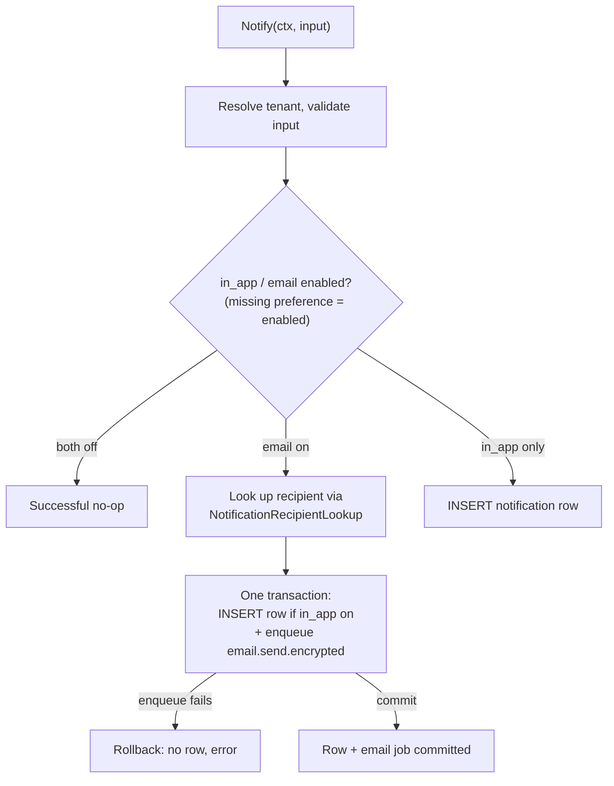

# Notifications module

Owns the per-member in-app notification feed, per-type channel preferences, and
the durable email channel.

## Routes

| Method | Path | Permission | Description |
| --- | --- | --- | --- |
| GET | `/api/v1/me/notifications` | `notifications:read` | Cursor list (`limit`, `startingAfter`, `unreadOnly`) |
| GET | `/api/v1/me/notifications/unread-count` | `notifications:read` | Unread badge count |
| GET | `/api/v1/me/notifications/{notificationId}` | `notifications:read` | One owned notification |
| PATCH | `/api/v1/me/notifications/{notificationId}` | `notifications:write` | Merge patch `{read}`; `true` marks read, `false` marks unread |
| PATCH | `/api/v1/me/notifications` | `notifications:write` | Bulk merge patch `{read:true}` |
| GET | `/api/v1/me/notification-preferences` | `notifications:read` | Explicit preferences |
| PUT | `/api/v1/me/notification-preferences/{type}/{channel}` | `notifications:write` | Replace `{enabled}` at the item URI |
| POST | `/api/v1/members/{memberId}/notifications` | `notifications:send` | Send to another member of the tenant |

All routes require authentication and are scoped to both the request tenant and
the authenticated member. Cross-tenant and other-member ids return `404`.
PATCH bodies use `application/merge-patch+json` (RFC 7396). Mutations use
`Idempotency-Key`. The member send is Guarded fail-closed; the caller's own
read/preference writes use a best-effort Guard because they only change the
caller's notification state.

## Data

`notifications` stores the in-app delivery (`type`, `title`, `body`, JSON
`data`, `read_at`). `notification_preferences` stores explicit
`(tenant_id, user_id, type, channel)` opt-outs; a missing row means the channel
is enabled. The preference `PUT` requires an explicit boolean `enabled` (an
omitted field is a `422`, never an implicit disable). Title, body, and `data`
must be valid UTF-8 without NUL characters (including a `\u0000` JSON escape),
otherwise `400`. Both tables are tenant-owned and cascade with the user. The
feed list uses separate all/unread queries so the unread filter can use the
partial `idx_notifications_tenant_user_unread`.

## Cross-module API

Other modules import `internal/contracts/notifications`:

- `notifications.Notifier.Notify(ctx, CreateNotificationInput)` creates a
  notification.
- `identity.NotificationRecipientLookup` (`internal/contracts/identity`) is implemented by the identity
  adapter; notifications never read the `users` table.

When email is enabled (and a transaction manager plus transactional sender are
wired, as in the default build), the in-app row and the `email.send.encrypted` job commit in one transaction; an enqueue failure rolls
the row back. The job inherits the notification's tenant. Delivery is
at-least-once.

## Tests

Unit tests cover service, HTTP operations, tenant/user isolation, preferences,
email payload, suppression, and queue rollback. The HTTP tests build the huma
API exactly as `internal/app` does. Integration tests (`-tags=integration`,
`TEST_DATABASE_URL` or Testcontainers) cover repository scoping,
cursor/unread/read, preferences, job payload, and queue failure.
